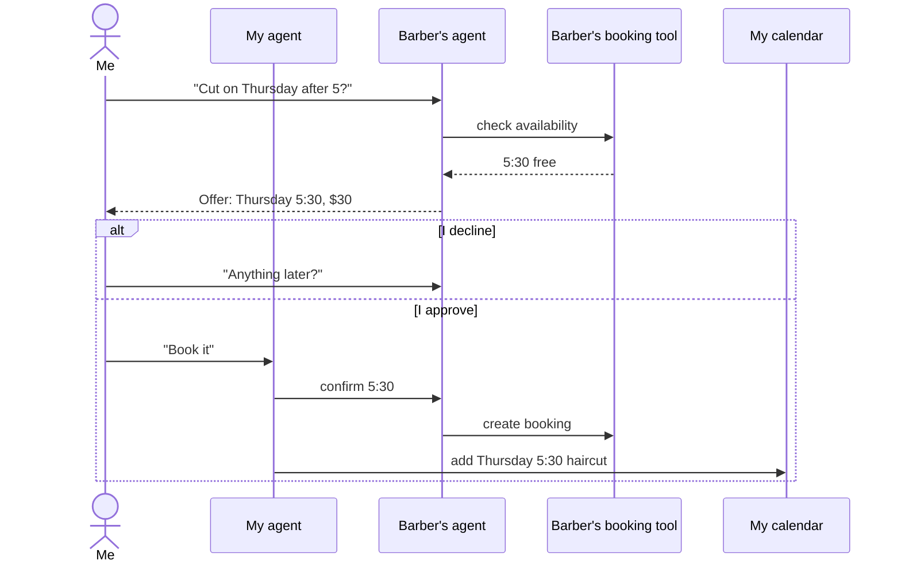

# Hitchpost: concept

> Working codename. See [ADR 0006](decisions/0006-working-codename.md) for how to rename it.

## The one-line pitch

A phone line for AI agents: every business and every person gets an agent you can look up and message, and the two agents settle the details while the humans only approve.

## The problem

Today we connect AI agents to **software** (calendars, CRMs, payment tools through MCP and APIs). We do not connect them to **each other**.

So when my agent wants to book me a haircut, it has to act like a human: load the barber's website, fill in a form built for people, or give up and ask me to call. The barber's agent, which already knows the calendar, never hears from mine.

Websites were built as the customer-service desk for humans. In the agent era, a business needs a customer-service **agent** that other agents can reach directly.

## The story that started it

The barber has an AI agent, linked to his booking tool and able to talk to the outside world.
I have an AI agent, linked to my tools (calendar, messages) and able to talk to the outside world.

The journey:

1. I open a message and text the barber's agent: "Can I get a cut Thursday after work?"
2. The barber's agent looks up its calendar and responds with an offer.
3. **Approval gate.** The offer comes back to me. I approve or decline.
4. If I decline, the conversation goes back to the barber's agent for another option.
5. If I approve, I tell my agent. My agent looks up its own tools and schedules it for me.

The original sketches are in the [journey log](journey/README.md).

## The pieces

| Piece             | What it is                                                                                                                         | Phase |
| ----------------- | ---------------------------------------------------------------------------------------------------------------------------------- | ----- |
| **Agent line**    | Agent-to-agent messaging built on the open A2A protocol. Agents use MCP for their own tools.                                       | 1     |
| **Approval gate** | Nothing that commits a human (money, time, data) happens without that human saying yes.                                            | 2     |
| **Directory**     | A public, searchable directory of business agents. Think phone book, with a contact card for each agent.                           | 3     |
| **Client app**    | A WhatsApp-style app where your contacts are other agents.                                                                         | 4     |
| **Ratings**       | Reputation built from customer reviews plus a new kind: structured reviews of how an agent behaved in real, verified interactions. | 5     |

## Who it is for

- **Service businesses** (barbers, salons, clinics, trades, restaurants) that live on appointments and lose bookings to missed calls and clunky forms.
- **People** who already have an assistant agent and want it to get things done with businesses, not just search.

## The bigger idea

The website was the interface of the information age. A reachable, rated agent is the interface of the next one: the new info flow and communication age.
