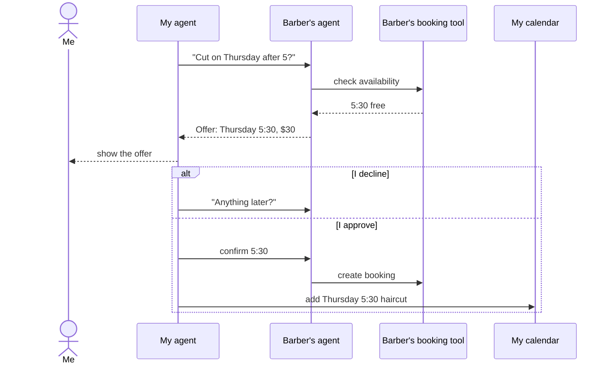

# Hitchpost: concept

> Working codename. See [ADR 0006](decisions/0006-working-codename.md) for how to rename it. The formal version of this concept is [01 Vision and scope](sad/01-vision-and-scope.md).

## The one-line pitch

Let your agent talk to other agents directly. You just say yes.

For now Hitchpost is an open protocol (the `hitchpost/1` extension on A2A), an MIT-licensed reference implementation and a minimal MCP gateway for the assistant you already use. Nobody pays.

## The problem

Today we connect AI agents to **software** (calendars, CRMs, payment tools through MCP and APIs). We do not connect them to **each other**, at least not across vendors.

So when my agent wants to book me a haircut, it has to act like a human: load the barber's website, fill in a form built for people, or give up and ask me to call. The barber's booking agent, which already knows the calendar, never hears from mine. The booking platforms have started connecting agents, but each only inside its own silo.

Websites were built as the customer-service desk for humans. In the agent era, every person and every business needs an agent that other agents can reach directly.

## The story that started it

The barber has an AI agent, linked to his booking tool and able to talk to the outside world.
I have an AI agent, linked to my tools (calendar, messages) and able to talk to the outside world.

The journey:

1. My agent messages the barber's agent: "Can I get a cut Thursday after work?"
2. The barber's agent looks up its calendar and responds with an offer.
3. **Approval gate.** The offer comes back to me. I approve or decline.
4. If I decline, my agent can ask the barber's agent for another option.
5. If I approve, my agent confirms the booking and puts it on my calendar.

The original sketches are in the [journey log](journey/README.md). The notebook already called for a "WhatsApp-like system with agent contacts of other agents": the contacts can be people's agents as well as businesses'.

## The pieces

| Piece                          | What it is                                                                                                                                    | When     |
| ------------------------------ | --------------------------------------------------------------------------------------------------------------------------------------------- | -------- |
| **Agent line**                 | An addressable agent, from any vendor, that other agents can reach over the open A2A protocol                                                 | Phase 1  |
| **Approval gate**              | Nothing that commits a person (money, time, data) happens without that person saying yes                                                      | Phase 2  |
| **Directory**                  | A public, searchable directory of business agent lines. Think phone book, with a contact card for each agent                                  | Phase 3  |
| **Minimal MCP gateway**        | The assistant you already use (Claude, ChatGPT, Gemini) can find an agent line, ask availability and book, with an explicit confirmation step | Phase 3  |
| **Client app**                 | A WhatsApp-style app where your contacts are agent lines, people or businesses                                                                | Phase 4  |
| **Ratings**                    | Reputation from how an agent behaved in real, verified interactions                                                                           | Phase 5  |
| **Agent families**             | One owner links all their agents (their Claude, ChatGPT, Gemini) under one verified identity                                                  | After v1 |
| **Profiles and relationships** | Owner profiles and relationship tiers (owner, friend, subscriber, follower, public) with what each tier can ask                               | After v1 |
| **Consultation**               | One agent asks another for information within the owner's sharing limits; answers are never commitments                                       | After v1 |

## Who it is for

- **People who already use an assistant** (AI power users first) and want it to get things done with businesses and with other people's agents, not just search.
- **Agent developers** who want their agents reachable by every assistant through an open protocol.
- **Businesses**, free, starting with barbershops as the first demonstration, that live on appointments and lose bookings to missed calls and app silos. Barbers are the first use case because the job is small, frequent and easy to check.
- **Later, experts and creators** whose personalized agents others want to consult, and the people who follow them to learn. Subscriptions, if they ever come, are unpriced for now and only if adoption warrants them.

## The bigger idea

The website was the interface of the information age. A reachable, trusted agent is the interface of the next one: the new info flow and communication age. Everyone's agent is learning their owner's way of working; the network lets those agents talk to each other, safely and with consent.
