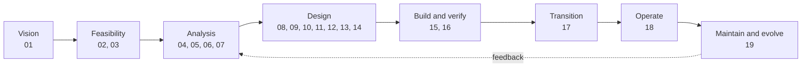
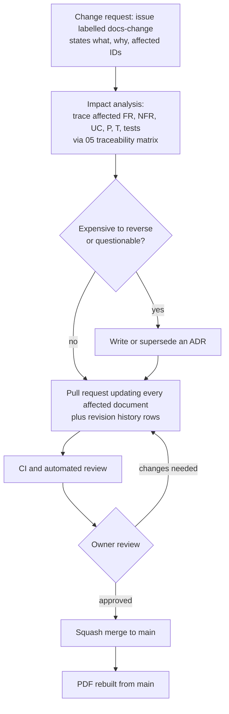

# HP-SAD-00 · Document control and standards conformance

| Field       | Value                                                                                                           |
| ----------- | --------------------------------------------------------------------------------------------------------------- |
| Document ID | HP-SAD-00                                                                                                       |
| Version     | 1.2                                                                                                             |
| Status      | Baselined for Phase 2                                                                                           |
| Date        | 2026-11-09                                                                                                      |
| Owner       | Sanaullah Jannisar, product and engineering lead                                                                |
| Conforms to | ISO/IEC/IEEE 15289 (information items), ISO/IEC/IEEE 12207 (configuration and information management processes) |

## 1. Purpose and scope

This is the control document for the Hitchpost system analysis and design package (HP-SAD). It says what is in the package, how to read it, which standards each part follows and how far, how the package is baselined and changed, who has reviewed it, and the normative values and phases every other document must use.

The package covers the whole life of the system: vision, feasibility, analysis, design, verification, delivery, transition, operation and maintenance. It describes what is built today (end of Phase 1 plus the audit fixes) and designs forward to production (Phase 6) and beyond.

## 2. How to read this package

| Audience                   | Start with                           | Then                                                                                           | Time   |
| -------------------------- | ------------------------------------ | ---------------------------------------------------------------------------------------------- | ------ |
| Executive or investor      | 01 Vision and scope                  | 02 Feasibility, 03 Business case, 16 Project plan                                              | 30 min |
| Product manager or analyst | 01, 04 Stakeholders and personas     | 05 Requirements, 06 Use cases, 07 Process models, 14 UI design                                 | 2 h    |
| Engineer                   | 10 Architecture                      | 13 Interfaces, 08 Data design, 09 Data dictionary, 11 Quality attributes, 12 Security          | 2 h    |
| Operations and support     | 18 Deployment and operations         | 17 Transition plan, 19 Maintenance, 12 Security                                                | 1 h    |
| Assessor or auditor        | This document (sections 5, 8 and 10) | 05 traceability matrix, 15 Test strategy, the [Phase 1 audit](../audits/2026-11-08-phase-1.md) | 1 h    |

Every item carries a status: **Built** (in the code now, with a path or test cited), **Phase N** (planned for that phase) or **Later** (after v1). Nothing planned is written as if it exists. Where a value or a phase appears in more than one document, section 10 of this document is the single source and the other documents cite its ID.

## 3. Document register

The current version of each document is in its own header table and revision history; this register lists identity and standard only, so it can't drift.

| ID        | Title                                      | File                                                                     | Status    | Primary standard                           |
| --------- | ------------------------------------------ | ------------------------------------------------------------------------ | --------- | ------------------------------------------ |
| HP-SAD-00 | Document control and standards conformance | [00-document-control.md](00-document-control.md)                         | Baselined | ISO/IEC/IEEE 15289                         |
| HP-SAD-01 | Vision and scope                           | [01-vision-and-scope.md](01-vision-and-scope.md)                         | Baselined | ISO/IEC/IEEE 29148 (BRS)                   |
| HP-SAD-02 | Feasibility study                          | [02-feasibility-study.md](02-feasibility-study.md)                       | Baselined | ISO/IEC/IEEE 15288 (business analysis)     |
| HP-SAD-03 | Business case                              | [03-business-case.md](03-business-case.md)                               | Baselined | ISO/IEC/IEEE 29148 (BRS)                   |
| HP-SAD-04 | Stakeholders and personas                  | [04-stakeholders-and-personas.md](04-stakeholders-and-personas.md)       | Baselined | ISO/IEC/IEEE 29148 (StRS), 42010           |
| HP-SAD-05 | Requirements specification                 | [05-requirements.md](05-requirements.md)                                 | Baselined | ISO/IEC/IEEE 29148 (SyRS/SRS)              |
| HP-SAD-06 | Use cases                                  | [06-use-cases.md](06-use-cases.md)                                       | Baselined | ISO/IEC/IEEE 29148 (operational scenarios) |
| HP-SAD-07 | Process and behaviour models               | [07-process-and-behaviour-models.md](07-process-and-behaviour-models.md) | Baselined | IEEE 1016 (interaction, state dynamics)    |
| HP-SAD-08 | Data design                                | [08-data-design.md](08-data-design.md)                                   | Baselined | IEEE 1016 (information viewpoint)          |
| HP-SAD-09 | Data dictionary                            | [09-data-dictionary.md](09-data-dictionary.md)                           | Baselined | IEEE 1016 (information viewpoint)          |
| HP-SAD-10 | System architecture                        | [10-architecture.md](10-architecture.md)                                 | Baselined | ISO/IEC/IEEE 42010                         |
| HP-SAD-11 | Quality attributes                         | [11-quality-attributes.md](11-quality-attributes.md)                     | Baselined | ISO/IEC 25010, ATAM                        |
| HP-SAD-12 | Security and privacy                       | [12-security-and-privacy.md](12-security-and-privacy.md)                 | Baselined | ISO/IEC 27001 Annex A (informative), GDPR  |
| HP-SAD-13 | Interface design                           | [13-interfaces.md](13-interfaces.md)                                     | Baselined | IEEE 1016 (interface viewpoint)            |
| HP-SAD-14 | User interface design                      | [14-user-interface-design.md](14-user-interface-design.md)               | Baselined | IEEE 1016, WCAG 2.2 AA                     |
| HP-SAD-15 | Test strategy and plan                     | [15-test-strategy.md](15-test-strategy.md)                               | Baselined | ISO/IEC/IEEE 29119-3                       |
| HP-SAD-16 | Project plan                               | [16-project-plan.md](16-project-plan.md)                                 | Baselined | ISO/IEC/IEEE 16326                         |
| HP-SAD-17 | Transition plan                            | [17-transition-plan.md](17-transition-plan.md)                           | Baselined | ISO/IEC/IEEE 12207 (transition process)    |
| HP-SAD-18 | Deployment and operations                  | [18-deployment-and-operations.md](18-deployment-and-operations.md)       | Baselined | ISO/IEC/IEEE 12207 (operation process)     |
| HP-SAD-19 | Maintenance and evolution                  | [19-maintenance-and-evolution.md](19-maintenance-and-evolution.md)       | Baselined | ISO/IEC/IEEE 14764                         |
| HP-SAD-20 | Glossary                                   | [20-glossary.md](20-glossary.md)                                         | Baselined | ISO/IEC/IEEE 24765                         |

Supporting records outside the package, not baselined but referenced: [decision records](../decisions/README.md), [build journey](../journey/README.md), [bug log](../bugs.md), [audits](../audits/).

## 4. Lifecycle coverage

## 5. Standards conformance matrix

I claim alignment, not certification. Each row maps a standard's information item to where this package provides it. The rules I applied:

- **Full** only when the cited section delivers the item now and was checked in the 2026-11-09 review. The row names that section.
- **Partial** when the item exists but is incomplete, unreviewed, or planned for a later phase. The row says what is missing and when it lands.
- **N/A** with a reason.

These standards are paywalled; the mapping follows their published outlines and clause titles, not the full texts.

### 5.1 ISO/IEC/IEEE 29148:2018, requirements engineering

| Information item                                                                      | Where                                                | Conformance                                                                                                                                                                          |
| ------------------------------------------------------------------------------------- | ---------------------------------------------------- | ------------------------------------------------------------------------------------------------------------------------------------------------------------------------------------ |
| BRS: business purpose, scope, business environment                                    | 01 sections 1 to 4; 03 section 1                     | Full                                                                                                                                                                                 |
| BRS: business model, goals, stakeholders                                              | 01 goals; 03 section 2; 04 stakeholder map           | Partial: the pricing hypothesis is untested (A-04 in 03)                                                                                                                             |
| StRS: stakeholder needs, operational concept, user characteristics                    | 04 personas and journeys                             | Partial: personas are assumptions until the A-01 and A-02 discovery work (16) produces real interview data                                                                           |
| StRS: operational scenarios                                                           | 06 use cases                                         | Full                                                                                                                                                                                 |
| SyRS/SRS: functional requirements, uniquely identified                                | 05 functional requirements (FR-*)                    | Full                                                                                                                                                                                 |
| SyRS/SRS: performance, usability, security, reliability, maintainability requirements | 05 non-functional requirements (NFR-*); 11 scenarios | Partial: performance targets are unmeasured until Phase 6 load tests                                                                                                                 |
| SyRS/SRS: interfaces (external, user, software, communications)                       | 13 interfaces; 14 UI design                          | Partial: the Phase 2 protocol rules (extension header, duplicate handling, capability tokens) are checked against SDK 1.3 source but not yet proven by tests (TC-36, TC-48 to TC-50) |
| SyRS/SRS: design constraints, assumptions, dependencies                               | 05 constraints; 03 assumptions                       | Full                                                                                                                                                                                 |
| Verification method per requirement                                                   | 05 traceability matrix; 15 requirement coverage      | Partial: Phase 2+ test cases are identified, not yet written                                                                                                                         |
| Requirement attributes (priority, source, status)                                     | 05 tables (phase, status, source)                    | Partial: priority is expressed as phase, not a separate MoSCoW field                                                                                                                 |
| Requirements quality review (necessary, unambiguous, verifiable)                      | Section 8 of this document                           | Partial: reviews so far were run as AI agents under my direction; no independent human review yet (planned before Phase 6)                                                           |

### 5.2 ISO/IEC/IEEE 42010:2022, architecture description

| Element                                                     | Where                                                                                        | Conformance                                                                                           |
| ----------------------------------------------------------- | -------------------------------------------------------------------------------------------- | ----------------------------------------------------------------------------------------------------- |
| Identification and overview of the architecture description | 10 opening and section 1                                                                     | Full                                                                                                  |
| Stakeholders and their concerns                             | 04 stakeholder map; 10 section 1 drivers                                                     | Full                                                                                                  |
| Viewpoints (named, with concerns and model kinds)           | 10 viewpoint catalogue                                                                       | Partial: catalogue added in the 1.1 remediation; not yet reviewed against the standard's full content |
| Views and models                                            | 10 C4 diagrams; 07 behaviour models; 08 data model                                           | Full                                                                                                  |
| Correspondences between views                               | 10 correspondence rules; 05 traceability matrix                                              | Partial: rules stated; not mechanically checked                                                       |
| Architecture rationale and decisions                        | 10 decisions section; ADRs 0001 to 0012 and 0018 accepted, 0013 to 0017 written as proposals | Partial: five of the seven Phase 2+ decisions are still proposals, each with a decide-by milestone    |
| Known issues and open questions                             | 19 tech-debt register; 10 open proposals                                                     | Full                                                                                                  |

### 5.3 IEEE 1016-2009, software design descriptions

| Design viewpoint | Where                                                                   | Conformance                                                                 |
| ---------------- | ----------------------------------------------------------------------- | --------------------------------------------------------------------------- |
| Context          | 10 context view                                                         | Full                                                                        |
| Composition      | 10 container and component views                                        | Full                                                                        |
| Logical          | 08 domain model                                                         | Full                                                                        |
| Dependency       | 10 component view; package graph in `pnpm-workspace.yaml`               | Full                                                                        |
| Information      | 08 data design; 09 data dictionary                                      | Full                                                                        |
| Patterns use     | 10 cross-cutting concerns                                               | Partial: patterns named, not catalogued                                     |
| Interface        | 13 interfaces; 14 UI design                                             | Full                                                                        |
| Structure        | 10 component view                                                       | Full                                                                        |
| Interaction      | 10 sequences; 06 use cases                                              | Partial: Phase 2 sequences are checked against SDK source, not yet executed |
| State dynamics   | 07 state machines                                                       | Full                                                                        |
| Algorithm        | 07 decision tables; slot finding in `packages/barber-agent/src/book.ts` | Full                                                                        |
| Resource         | 18 capacity and cost notes; 11 performance scenarios                    | Partial: no load measurements until Phase 6                                 |

### 5.4 ISO/IEC/IEEE 29119-3:2021, test documentation

| Document                                | Where                                                                   | Conformance                                                                                 |
| --------------------------------------- | ----------------------------------------------------------------------- | ------------------------------------------------------------------------------------------- |
| Test policy and organisational strategy | 15 the rule; [ADR 0005](../decisions/0005-ci-and-review-policy.md)      | Full                                                                                        |
| Test plan (project level)               | 15 levels, entry and exit criteria, release checklist; 16 test work     | Partial: risk basis and schedule for Phase 2+ testing are in 15 and 16 but not yet executed |
| Test design and case specifications     | 15 test case list (TC-*); test files under `packages/*/src/*.test.ts`   | Partial: Built tests are specified in code; Phase 2+ cases are listed, not yet written      |
| Test procedure, data and environment    | 15 test data and time; 18 environments                                  | Partial: staging does not exist until Phase 6                                               |
| Test completion and incident reports    | [Phase 1 audit](../audits/2026-11-08-phase-1.md); [bug log](../bugs.md) | Partial: per-phase completion reports start at the Phase 2 gate                             |

### 5.5 ISO/IEC 25010:2023, product quality model

| Characteristic                                    | Where                                                                                       | Conformance                              |
| ------------------------------------------------- | ------------------------------------------------------------------------------------------- | ---------------------------------------- |
| Functional suitability                            | 05 FR-*; 15 coverage                                                                        | Full                                     |
| Performance efficiency                            | NFR-PERF-01, NFR-PERF-02; 11 scenarios                                                      | Partial: unmeasured until Phase 6        |
| Compatibility (interoperability)                  | NFR-INT-01; 13 versioning                                                                   | Partial: no third-party agent tested yet |
| Interaction capability (usability, accessibility) | NFR-A11Y-01; 14 UI design                                                                   | Partial: no usability test run yet       |
| Reliability                                       | NFR-REL-01, NFR-REL-02; 18 SLOs, recovery                                                   | Partial: designed, not exercised         |
| Security                                          | NFR-SEC-*; 12 security and privacy                                                          | Partial: agent authentication is Phase 6 |
| Maintainability                                   | NFR-MAINT-*; 19 maintenance                                                                 | Full                                     |
| Flexibility (portability, adaptability)           | 10 deployment view; ADR 0016 (proposed)                                                     | Partial                                  |
| Safety                                            | Not applicable: no physical harm path; harm is financial or privacy, covered under security | N/A                                      |

### 5.6 ISO/IEC/IEEE 12207:2017 and 15288:2023, lifecycle processes

| Process                                       | Where                                                                                  | Conformance                                                                    |
| --------------------------------------------- | -------------------------------------------------------------------------------------- | ------------------------------------------------------------------------------ |
| Business or mission analysis                  | 01, 02, 03                                                                             | Full                                                                           |
| Stakeholder needs and requirements definition | 04, 06                                                                                 | Partial: no stakeholder interviews yet                                         |
| System and software requirements definition   | 05                                                                                     | Full                                                                           |
| Architecture definition                       | 10, 11                                                                                 | Full                                                                           |
| Design definition                             | 07, 08, 09, 13, 14                                                                     | Full                                                                           |
| Implementation                                | Code under `packages/`; [CONTRIBUTING.md](../../CONTRIBUTING.md)                       | Full for Phase 1                                                               |
| Verification and validation                   | 15; Phase 1 audit                                                                      | Partial: validation with real users not yet run                                |
| Transition                                    | 17                                                                                     | Partial: planned, not executed                                                 |
| Operation                                     | 18                                                                                     | Partial: planned, not executed                                                 |
| Maintenance                                   | 19                                                                                     | Partial: planned, not executed                                                 |
| Project planning, assessment and control      | 16                                                                                     | Partial: resource-loaded and re-baselined; no progress measured against it yet |
| Risk management                               | 03 risks; 12 threat model                                                              | Full                                                                           |
| Configuration management                      | Section 7 of this document; git; [ADR 0005](../decisions/0005-ci-and-review-policy.md) | Partial: branch protection not on until the repository is pushed               |
| Information management                        | This document                                                                          | Full                                                                           |
| Quality assurance                             | 15; CI gates; section 8 reviews                                                        | Partial: CI has not yet run on GitHub                                          |
| Disposal                                      | 19 sunset and end of life                                                              | Partial: planned                                                               |

## 6. Baseline and change control

### 6.1 Versioning

| Change                                                                         | Version bump                                      | Example       |
| ------------------------------------------------------------------------------ | ------------------------------------------------- | ------------- |
| Wording, typo, link fix; no meaning changes                                    | Patch note in revision history, version unchanged | 1.0 stays 1.0 |
| A requirement, design element, parameter or plan changes within the same phase | Minor                                             | 1.0 to 1.1    |
| Re-baseline at a phase gate, or a change to scope or architecture              | Major                                             | 1.x to 2.0    |

The whole package is re-baselined at each phase gate (HP-SAD-16), so every document's major version tracks the phase it was baselined for.

### 6.2 Change request flow (`docs-change`)

There is one change process for this package, named `docs-change` everywhere (issue label, project plan, pull request template).

Rules:

1. A change to a requirement updates the traceability matrix in the same pull request, or it doesn't merge.
2. A change to a value or phase listed in section 10 is made in section 10 first; other documents cite the P-ID and are updated in the same pull request.
3. Decisions are never edited away. A new ADR supersedes the old one, and the old one keeps a status note.
4. Every changed document gets a revision history row naming the change and the affected IDs.

### 6.3 Review and approval

Until Hitchpost has more maintainers, I am the approver, and I approve my own baselines. That is a known weakness. To limit it:

- Any change touching the approval gate, security, or the message contract also gets an independent review recorded in section 8. So far those reviews have been separate Claude Code agents that I ran under my direction, each given the files and not my conclusions.
- Before Phase 6 (production), I will get at least one external human review of 05, 10, 12 and 13 and record it in section 8.

## 7. Configuration management of the documents

- **Source of truth:** the Markdown files in `docs/sad/` on `main`. Diagrams are Mermaid in the same files, so they version with the text.
- **Derived output:** the bound PDF is built from `main` by `pnpm docs:pdf`; it is never edited by hand. Its cover carries the package version and the git commit it was built from.
- **Identification:** each document carries its ID, version, status and date in its header table and a revision history at the end.
- **Storage and access:** public git repository; history is the audit trail. Tags mark baselines (`sad-v1.0`, then `sad-v1.1` for this remediation).
- **Consistency check, and its limits:** before a baseline I run a script that checks that every referenced item ID (FR, NFR, UC, A, R, T, D, G, BR, QAS, WP, M, DQ, E, ALT) is defined somewhere, every relative link and anchor resolves, and every document has its header and revision history. It does **not** check that a value or phase stated in one document matches another. The 2026-11-09 review found exactly that kind of contradiction (time zones placed in three different phases, different patch windows, different retention wording). Section 10 now holds those values once, and documents cite them by P-ID instead of restating them.

## 8. Review and sign-off record

All reviews below were run by me. The expert reviews were separate Claude Code agents I set up and directed, each with a defined role, read-only access and no sight of my own conclusions. I checked their key findings against the code or SDK myself before acting on them. No independent human has reviewed the package yet.

| Date       | Review                           | Scope                                     | Reviewers                                                                                                                                              | Outcome                                                                                                                                                                                                                                     |
| ---------- | -------------------------------- | ----------------------------------------- | ------------------------------------------------------------------------------------------------------------------------------------------------------ | ------------------------------------------------------------------------------------------------------------------------------------------------------------------------------------------------------------------------------------------- |
| 2026-11-08 | Phase 1 expert audit             | Code, CI, docs, product                   | Five Claude Code agents run in parallel under my direction: QA engineering, application security, software architecture, DevOps, product and portfolio | 9 pre-Phase-2 findings, all fixed test-first; docs corrected ([report](../audits/2026-11-08-phase-1.md))                                                                                                                                    |
| 2026-11-08 | Cross-document consistency check | HP-SAD first draft (12 documents)         | Owner, scripted check                                                                                                                                  | No undefined IDs and no broken links in that draft. The script did not check values or phases (see section 7)                                                                                                                               |
| 2026-11-09 | Baseline 1.0 sign-off            | HP-SAD-00 to 20                           | Sanaullah Jannisar, owner (self-approval)                                                                                                              | Baselined for Phase 2                                                                                                                                                                                                                       |
| 2026-11-09 | Independent standards assessment | HP-SAD-00 to 20, version 1.0              | One Claude Code agent acting as a standards assessor, run under my direction                                                                           | Overall grade C+: breadth strong, internal contradictions in values, phases, schedule and money, an incomplete traceability matrix, and conformance claims stronger than the evidence. 11 ranked findings                                   |
| 2026-11-09 | Independent engineering review   | Design documents against code and A2A SDK | One Claude Code agent acting as a staff engineer, run under my direction                                                                               | 15 findings, including two design defects confirmed in the SDK: manual approval cannot use the input-required state, and the agent card has no metadata field for the contract version                                                      |
| 2026-11-09 | Remediation and re-baseline 1.1  | HP-SAD-00 to 20                           | Sanaullah Jannisar, owner (self-approval)                                                                                                              | I decided every contested value and phase once (section 10), corrected the booking protocol, rebuilt the traceability matrix, re-baselined the schedule and budget, and downgraded conformance claims to Partial where the evidence is thin |

## 9. Conventions

| Convention    | Rule                                                                                                                        |
| ------------- | --------------------------------------------------------------------------------------------------------------------------- |
| Document IDs  | HP-SAD-NN, two digits, matching the file prefix                                                                             |
| Item IDs      | Prefix legend in [20 Glossary](20-glossary.md#4-id-prefix-legend); IDs are never reused, retired IDs stay listed as retired |
| Status labels | Built (with code path or test), Phase N, Later                                                                              |
| Phases        | 0 Foundation, 1 Agent line, 2 Approval gate, 3 Directory, 4 Client app, 5 Ratings, 6 Production, Later Evolution            |
| Values        | Any number or phase used in more than one document is a P-ID in section 10; documents cite the ID                           |
| Voice         | First person for my decisions, plain English, no unsourced market claims (date them or mark "to verify")                    |
| Diagrams      | Mermaid, inline                                                                                                             |
| Personas      | Dana (customer), Marcus (barber), Priya (agent developer), Sam (operator)                                                   |

## 10. Normative parameters and phase map

This section is the single source for values and phases. Other documents cite these IDs. A change here follows rule 2 in section 6.2.

### 10.1 Parameter register

| ID   | Parameter                                                                 | Value                                                                                                                                                                                                                                           |
| ---- | ------------------------------------------------------------------------- | ----------------------------------------------------------------------------------------------------------------------------------------------------------------------------------------------------------------------------------------------- |
| P-01 | Offer hold                                                                | 10 min from `issuedAt`                                                                                                                                                                                                                          |
| P-02 | Reserved hold (after `booking_request` accepted, shop on manual approval) | Until the shop decides, max 30 min (P-03)                                                                                                                                                                                                       |
| P-03 | Manual approval wait                                                      | 30 min, then `booking_rejected` with reason `shop_timeout`                                                                                                                                                                                      |
| P-04 | Personal agent booking deadline                                           | 35 min (P-03 + 5 min); polls `GetTask` every 10 s, backing off to 60 s                                                                                                                                                                          |
| P-05 | Availability request deadline                                             | 10 s for the whole exchange (Built)                                                                                                                                                                                                             |
| P-06 | Max search window                                                         | 31 days (Built)                                                                                                                                                                                                                                 |
| P-07 | Open holds cap                                                            | 3 per sender; sender is the client IP until agent authentication (Phase 6), then the agent identity. No per-`contextId` cap: clients choose `contextId`                                                                                         |
| P-08 | Rate limit                                                                | 60 requests per minute per sender; basic per-IP limit in Phase 2, per-identity in Phase 6                                                                                                                                                       |
| P-09 | Clock margin                                                              | The personal agent treats an offer as expired 30 s before its local deadline: receivedAt + (expiresAt - issuedAt)                                                                                                                               |
| P-10 | Cancellation cutoff                                                       | None by default; per shop (`cancellationCutoffMinutes`)                                                                                                                                                                                         |
| P-11 | Retention: expired or declined offers                                     | 7 days                                                                                                                                                                                                                                          |
| P-12 | Retention: bookings, audit events, interaction records                    | 2 years, then deleted (not anonymised); aggregates are kept without personal fields                                                                                                                                                             |
| P-13 | Retention after account deletion                                          | Personal data erased from live systems within 30 days; backup copies expire within P-15 (30 days), so fully gone within 60 days                                                                                                                 |
| P-14 | Retention: resolved reports                                               | 1 year                                                                                                                                                                                                                                          |
| P-15 | Backups                                                                   | Daily full plus continuous WAL; RPO 5 min for infrastructure loss; backups expire after 30 days; no separate cold-storage export                                                                                                                |
| P-16 | Security patching                                                         | Critical CVE within 48 hours; high within 7 days; others in the next release                                                                                                                                                                    |
| P-17 | Support response targets                                                  | SEV1 1 h, SEV2 4 business hours, SEV3 next release; community issues triaged within 5 days. Severity definitions: the single SEV table in [19](19-maintenance-and-evolution.md). No SEV1 cover is promised while pilot listings are paused (17) |
| P-18 | Contract version support                                                  | Each major version is supported for 6 months after its successor ships                                                                                                                                                                          |
| P-19 | Text field limit                                                          | 1 to 200 characters, no control characters (Built)                                                                                                                                                                                              |
| P-20 | Price cap and duration cap                                                | 0 to 10,000,000 cents; 1 to 1,440 minutes (Built)                                                                                                                                                                                               |

**Zero loss and RPO.** No confirmed booking is ever lost: the booking write is committed synchronously before `booking_confirmed` is sent, so a crash either leaves no booking and no confirmation, or both. The 5-minute RPO in P-15 applies to everything else (offers, audit tail, directory edits) and to loss of a whole region.

### 10.2 Phase map

One row per capability that more than one document places in time. If a document disagrees with this table, this table wins and the document is a defect.

| Capability                                                                                                                                                 | Phase             |
| ---------------------------------------------------------------------------------------------------------------------------------------------------------- | ----------------- |
| Typed availability request and offer over A2A; strict validation; whole-exchange deadline                                                                  | 1 (Built)         |
| Offer hold and expiry, `offer_declined`, booking as an A2A Task, approval gate, cancel, reschedule                                                         | 2                 |
| Manual shop approval (Task stays WORKING; client polls `GetTask`)                                                                                          | 2                 |
| Business-side persistence: SQLite (SDK `DatabaseTaskStore` plus offers, bookings, audit tables); personal-side JSONL audit                                 | 2                 |
| Basic per-IP rate limit (P-08) and open-holds cap (P-07)                                                                                                   | 2                 |
| Correlation fields (`contextId`, `taskId`, `offerId`, `messageId`) on every audit event                                                                    | 2                 |
| Shop configuration (`Book`) validated at load                                                                                                              | 2                 |
| Contract version as an `AgentCapabilities.extensions` entry, declared by clients in the `A2A-Extensions` header                                            | 2                 |
| Server-minted capabilities: `offerId` authorises booking, `bookingToken` authorises cancel and reschedule; `contextId` is for correlation only             | 2                 |
| Directory, listing verification, search                                                                                                                    | 3                 |
| Client app, built-in personal agent, calendar write                                                                                                        | 4                 |
| Barber dashboard, including manual approval queue and outcome marking (FR-RATE-04)                                                                         | 4                 |
| Ratings from verified interactions; customer "Did it go as booked?" prompt (FR-RATE-05); interaction records attested by matching JCS hashes on both sides | 5                 |
| Time zones (IANA zone per shop, local slot grid, DST rules; ADR 0018)                                                                                      | 6                 |
| Agent authentication, signed agent cards, signed interaction records, per-identity rate limits (ADR 0017)                                                  | 6                 |
| Staging environment (WP-6.1) and staging smoke tests                                                                                                       | 6                 |
| One subdomain per hosted business agent                                                                                                                    | 6                 |
| Postgres with `slot_claims` exclusion constraint; multi-instance hosting                                                                                   | 6                 |
| Real booking system over MCP with conditional writes                                                                                                       | 6                 |
| Trace ids, SLO dashboards, alerting                                                                                                                        | 6                 |
| First real booking (pilot)                                                                                                                                 | 6                 |
| Shop-side cancellation pushed to the customer                                                                                                              | Later             |
| Payments                                                                                                                                                   | Later (not in v1) |

## Revision history

| Version | Date       | Change                                                                                                                                                                                                                                                                                                                                                                                                        | Author      |
| ------- | ---------- | ------------------------------------------------------------------------------------------------------------------------------------------------------------------------------------------------------------------------------------------------------------------------------------------------------------------------------------------------------------------------------------------------------------- | ----------- |
| 1.0     | 2026-11-09 | First baseline                                                                                                                                                                                                                                                                                                                                                                                                | S. Jannisar |
| 1.1     | 2026-11-09 | Remediation after independent review: added section 10 (parameter register P-01 to P-20, phase map); conformance downgraded to Partial where evidence is thin; reviews disclosed as Claude Code agents run under my direction; self-approval and planned external review stated; consistency check described with its limits; one change process name (`docs-change`); register no longer duplicates versions | S. Jannisar |
| 1.2     | 2026-11-09 | Second remediation after regrade: P-07 per sender only; P-13 and P-15 reconciled (30-day backups, fully erased within 60 days); phase map adds staging (Phase 6), capability tokens, the extension header, the FR-RATE-04/05 split and signed interaction records (Phase 6); interfaces, interaction and project-planning conformance set to Partial                                                          | S. Jannisar |
