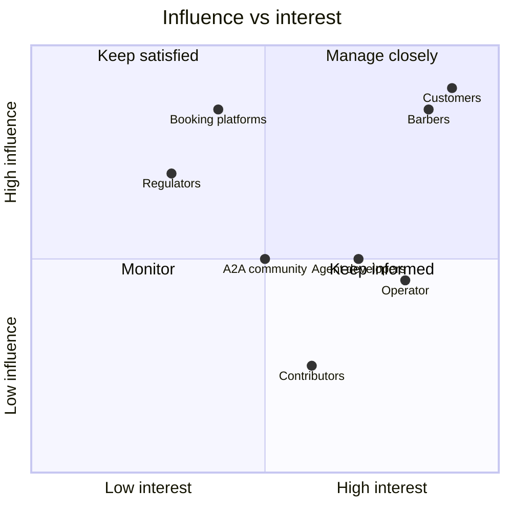
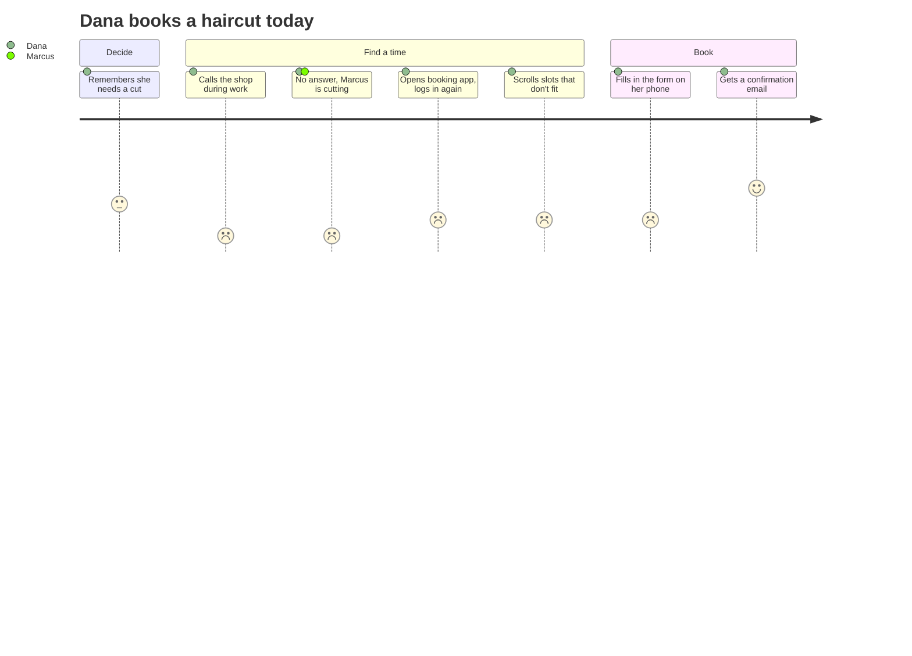
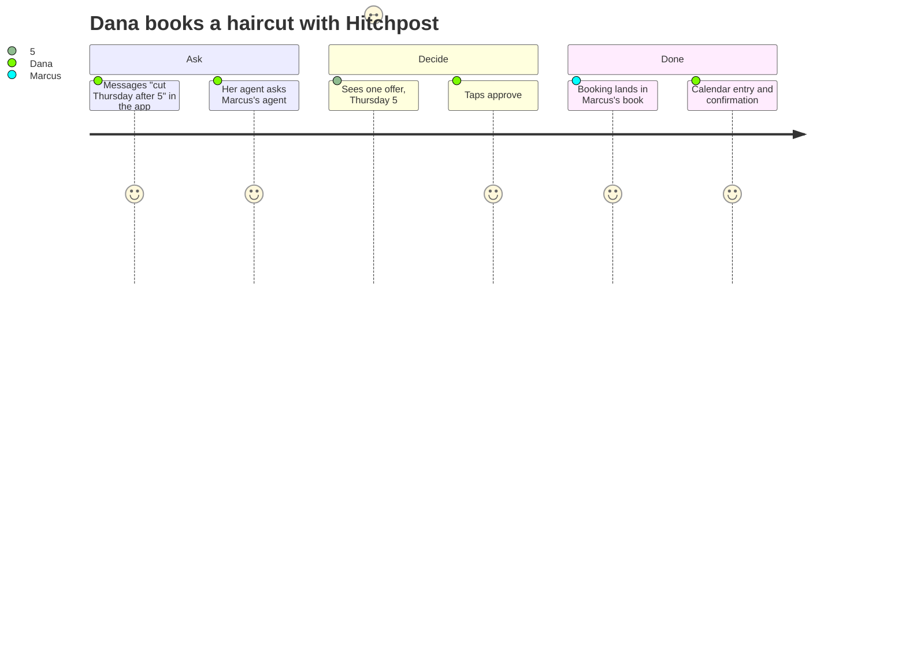
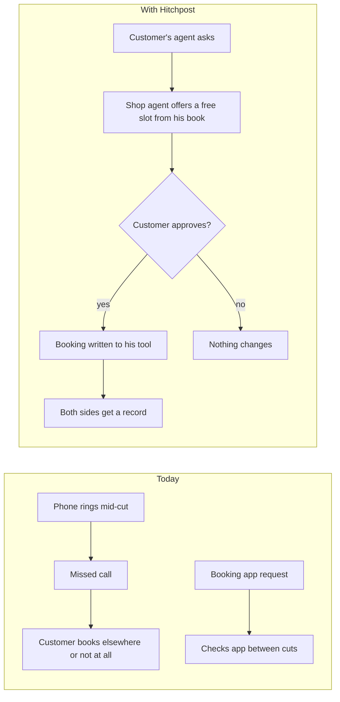
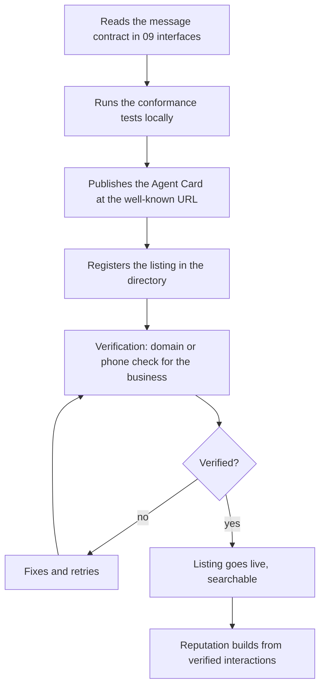

# 03. Stakeholders and personas

- **Status:** Draft, 2026-11-08
- **Owner:** Sanaullah Jannisar
- **Stage:** Analysis

## Stakeholder map

| Stakeholder                                           | Interest                                                         | Influence                          | How I engage                                                      |
| ----------------------------------------------------- | ---------------------------------------------------------------- | ---------------------------------- | ----------------------------------------------------------------- |
| Customers (Dana)                                      | Book fast, no surprises, privacy                                 | High: adoption decides everything  | Wizard-of-Oz test (A-01), app feedback, ratings                   |
| Barbers and shop owners (Marcus)                      | More bookings, fewer missed calls, no double-booking, low effort | High: supply side                  | Interviews (A-02), in-person setup, weekly check-ins              |
| Agent developers (Priya)                              | Get their agent listed, trusted and used                         | Medium: interop and growth         | Open docs, open source, Agent Card spec, contract tests           |
| Directory operator and moderator (Sam)                | Keep listings real and abuse low                                 | Medium                             | Admin tools (Phase 6), runbooks                                   |
| Booking platforms (Booksy, Square, Fresha and others) | Keep customers in their ecosystem; API terms                     | High: they control calendar access | Read API terms (A-03), approach as partners, never scrape         |
| A2A and MCP communities                               | Protocol adoption and correct use                                | Medium: protocol direction         | Follow the spec, report issues, contribute fixes                  |
| Regulators (privacy, consumer protection)             | Lawful data handling; fair practices                             | High if payments come              | Privacy by design, no payments in v1, legal review before Phase 6 |
| Contributors                                          | Interesting, well-run open-source project                        | Low to medium                      | CONTRIBUTING, good first issues, fast reviews                     |
| Hiring managers and peers                             | Evidence of how I lead a build                                   | Low on product, high for me        | Journey, ADRs, audits, honest bug log                             |

## Responsibilities (RACI-lite)

R = does the work, A = owns the decision, C = consulted, I = informed. "Me" is the maintainer, who is also Sam until there's a separate operator.

| Activity                    | Me   | Barbers                                  | Customers            | Contributors | Platforms |
| --------------------------- | ---- | ---------------------------------------- | -------------------- | ------------ | --------- |
| Product direction and scope | A, R | C                                        | C                    | I            | I         |
| Architecture and ADRs       | A, R |                                          |                      | C            |           |
| Code changes and review     | A    |                                          |                      | R            |           |
| Listing and verification    | A, R | R (provide details)                      |                      |              | C (API)   |
| Approving bookings          |      | A for the shop's time (Phase 2 decision) | A for their own time |              |           |
| Moderation and reports      | A, R | C                                        | R (report)           |              |           |
| Security response           | A, R | I                                        | I                    | C            | I         |
| Releases and operations     | A, R | I                                        | I                    | C            |           |

One open decision for Phase 2: does Marcus approve each booking, or do opening hours count as his standing approval? My working answer is standing approval by default, with a per-shop switch for manual approval. It gets confirmed in the A-02 interviews.

## Personas

### Dana, customer

- **Context:** 34, works hybrid, books a haircut every 3 to 4 weeks, usually remembers late. Has an assistant app on her phone.
- **Goals:** get a slot that fits after work without calling; know it's really booked.
- **Pains:** phone calls during work hours; every shop uses a different app; booking forms on a phone; finding out the slot was gone.
- **What she needs from Hitchpost:** one message, one clear offer, one tap to approve, confirmation she can trust.
- **What would make her leave:** a wrong booking, or approvals that feel like more work than calling.

### Marcus, barber and shop owner

- **Context:** 41, owns a 2-chair shop, cuts all day, uses a booking app his customers mostly ignore. Phone rings while he's cutting.
- **Goals:** a full book, fewer no-shows, no double-bookings, no extra admin.
- **Pains:** missed calls equal missed bookings; booking-app fees; customers who don't show.
- **What he needs:** listing in minutes, bookings landing in the tool he already uses, nothing to watch during the day.
- **What would make him leave:** one double-booking, or having to manage yet another inbox.

### Priya, agent developer

- **Context:** 29, builds agents for small businesses as a freelancer. Knows A2A.
- **Goals:** list her clients' agents, have them found and trusted, prove they behave.
- **Pains:** no directory where local-business agents get discovered; no way to show her agent is reliable.
- **What she needs:** a clear message contract, a test harness, a simple registration and verification flow, and visible reputation.

### Sam, operator and moderator

- **Context:** the maintainer at launch; later a part-time role.
- **Goals:** real listings only, fast response to reports, quiet on-call.
- **Pains:** fake listings, spam agents, unclear evidence when handling disputes.
- **What Sam needs:** an admin view of listings and reports, audit logs from both sides of a dispute, rate-limit and block controls.

## Journeys

### Dana: today

### Dana: with Hitchpost (Phase 4)

### Marcus: today vs with Hitchpost

### Priya: onboarding a client's agent (Phase 3)

## Supersedes and related

Supersedes "Who it is for" in [concept.md](../concept.md). Related: [01 vision and scope](01-vision-and-scope.md), [02 business case](02-business-case.md), [05 use cases](05-use-cases.md).
