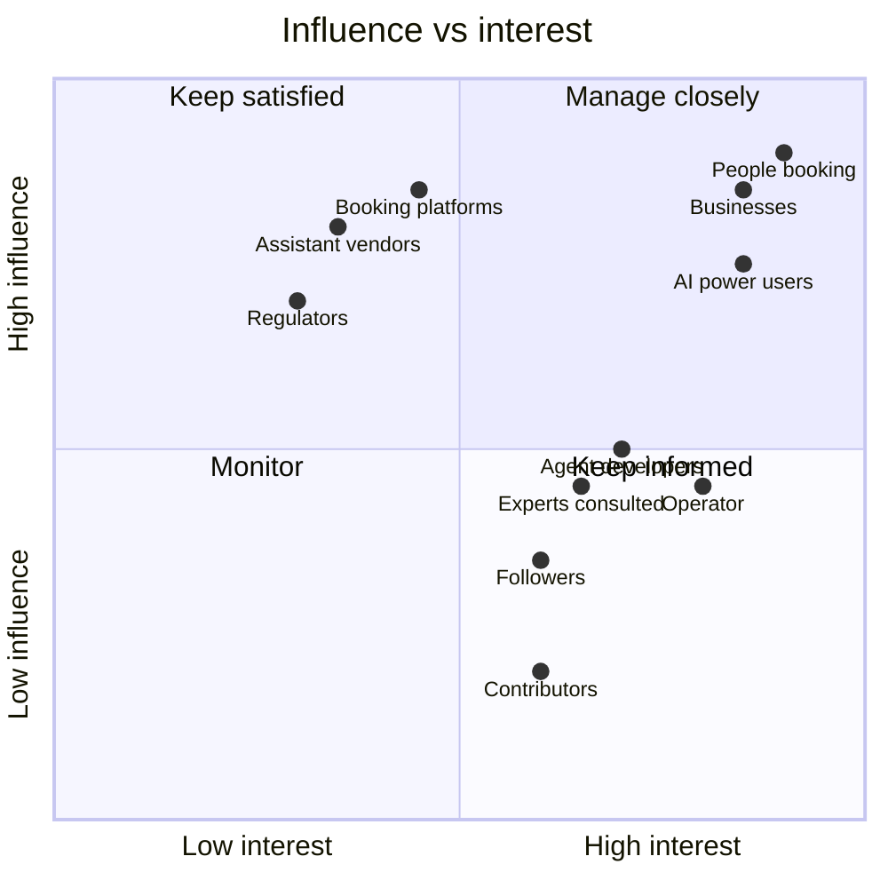
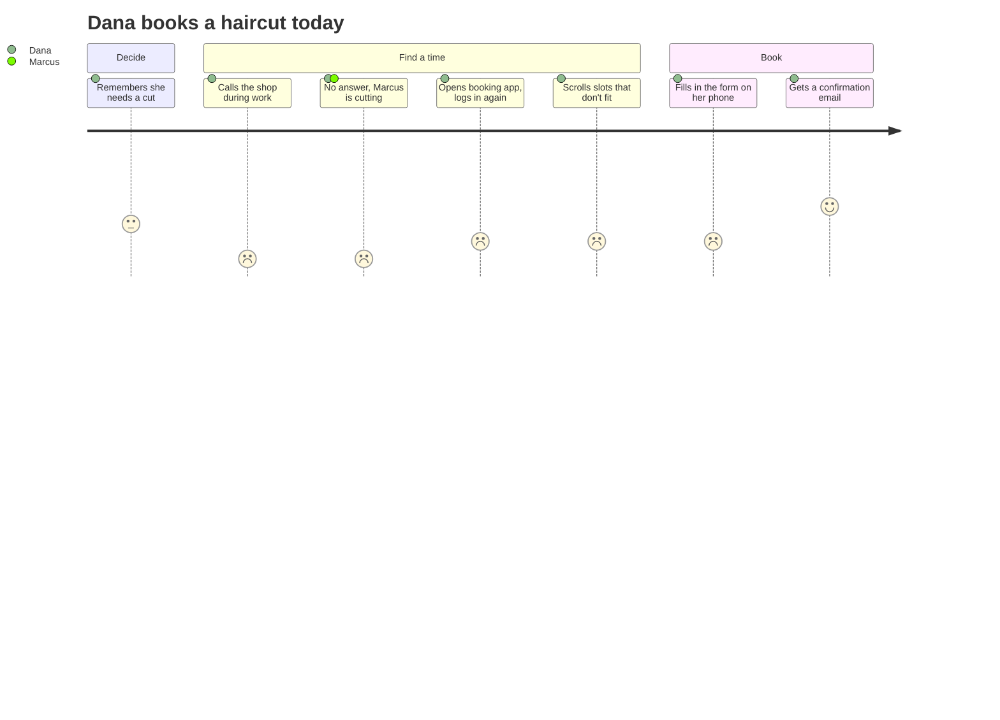
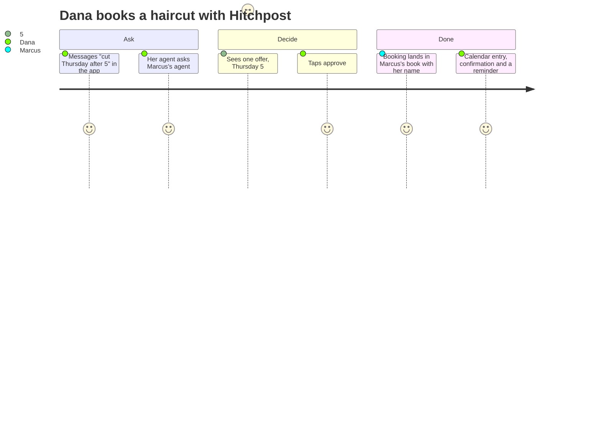
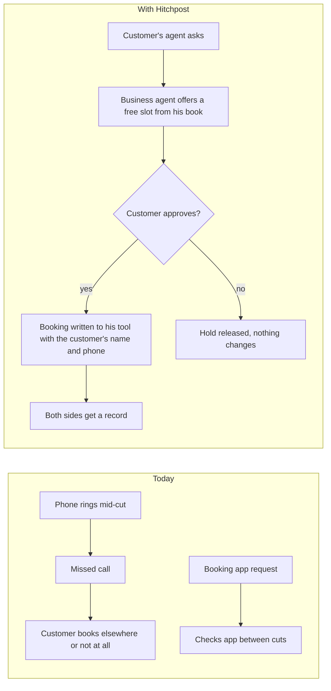
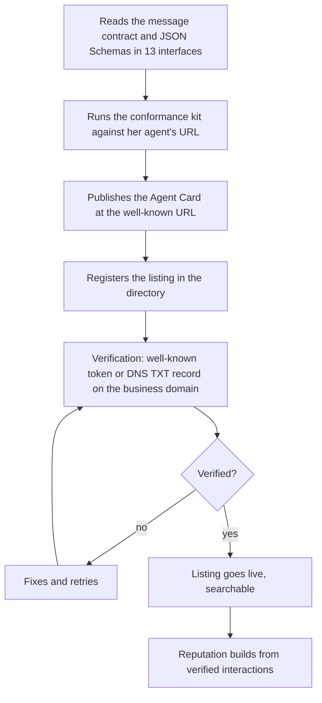
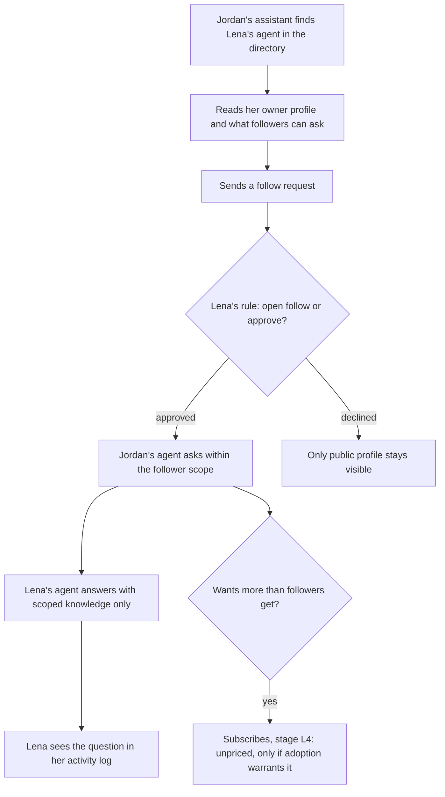

# HP-SAD-04 · Stakeholders and personas

| Field       | Value                                                                                                                                              |
| ----------- | -------------------------------------------------------------------------------------------------------------------------------------------------- |
| Document ID | HP-SAD-04                                                                                                                                          |
| Version     | 1.4                                                                                                                                                |
| Status      | Frozen for Phase 2 spike                                                                                                                           |
| Date        | 2026-11-09                                                                                                                                         |
| Owner       | Sanaullah Jannisar, product and engineering lead                                                                                                   |
| Conforms to | ISO/IEC/IEEE 29148:2018 (stakeholder requirements: stakeholders, user profiles, operational concept); ISO/IEC/IEEE 42010 stakeholders and concerns |

## 1. Stakeholder map

Hitchpost is, for now, a free and open protocol that lets anyone's agent talk to other agents directly ([01 Vision and scope](01-vision-and-scope.md)). Nobody pays. The first users are AI power users and agent developers; businesses join because it's free, with barbers as the first business demonstration. The booking stakeholders matter first, because booking proves the protocol. The social-network stakeholders (experts whose agents get consulted, followers and subscribers, assistant vendors) matter from stage L1.

| Stakeholder                                             | Interest                                                                    | Influence                          | How I engage                                                                                                            |
| ------------------------------------------------------- | --------------------------------------------------------------------------- | ---------------------------------- | ----------------------------------------------------------------------------------------------------------------------- |
| AI power users (Alex), the first users                  | Their own assistant books and arranges things with other agents, no new app | High: they adopt first, self-serve | Minimal MCP gateway (Phase 3), open source, developer channels                                                          |
| People booking (Dana)                                   | Book fast, no surprises, privacy                                            | High: adoption decides everything  | 10-week disclosed Wizard-of-Oz (A-01), app feedback, ratings                                                            |
| Businesses (Marcus, barbers first)                      | More bookings, fewer missed calls, no double-booking, low effort            | High: supply side                  | Past-behaviour interviews (A-02), in-person setup, monthly check-ins until the pilot                                    |
| Agent developers (Priya)                                | Get their agent listed, trusted and used                                    | Medium: interop and growth         | Open message contract, JSON Schemas, conformance kit, open source                                                       |
| Directory operator and moderator (Sam), backup operator | Keep listings real and abuse low; quiet on-call                             | Medium                             | Admin tools, runbooks, a named backup before the pilot                                                                  |
| Booking platforms (Square, Booksy, Fresha, Vagaro)      | Keep customers in their ecosystem; API terms                                | High: they control calendar access | Open extension they can implement natively; free directory listing for their endpoints; Square first                    |
| Assistant vendors (Anthropic, OpenAI, Google)           | Their assistants reaching more services safely                              | High from Phase 3                  | Minimal MCP gateway (Phase 3), full gateway (L3) and A2A, no lock-in to one vendor                                      |
| Experts and creators whose agents others consult (Lena) | Share how they work without leaking what they shouldn't                     | Medium from stage L2               | Sharing scopes per relationship tier, activity log; subscriptions at L4 are unpriced and only if adoption warrants them |
| Followers and subscribers (Jordan)                      | Learn from other people's agents; know what they get at each tier           | Medium from stage L2               | Clear scopes per tier; cancel-anytime if subscriptions ever exist                                                       |
| A2A and MCP communities                                 | Protocol adoption and correct use                                           | Medium: protocol direction         | Follow the specs, publish the extension, report issues, contribute fixes                                                |
| US regulators (FTC, Texas Attorney General)             | Fair practices, honest AI claims, lawful data handling, real reviews        | High once real people use it       | Legal pack before S1 ([35](35-legal-compliance-and-governance.md)); nobody pays                                         |
| Payments provider (only if L4 is ever priced)           | Compliant payees, low fraud                                                 | None until then                    | KYC, 1099-K, refunds, click-to-cancel                                                                                   |
| Contributors                                            | Interesting, well-run open-source project                                   | Low to medium                      | CONTRIBUTING, scoped good first issues, fast reviews                                                                    |
| Portfolio audience (hiring managers, peers)             | Evidence of how I lead a build                                              | Low on the product                 | Journey, ADRs, audits, honest bug log, kept apart from product-facing pages                                             |

## 2. Responsibilities (RACI-lite)

R = does the work, A = owns the decision, C = consulted, I = informed. "Me" is the maintainer, who is also Sam until there's a separate operator. The full RACI for moderation, incidents and data requests is in [35](35-legal-compliance-and-governance.md).

| Activity                        | Me   | Businesses                             | People                     | Backup operator | Contributors | Platforms |
| ------------------------------- | ---- | -------------------------------------- | -------------------------- | --------------- | ------------ | --------- |
| Product direction and scope     | A, R | C                                      | C                          |                 | I            | I         |
| Architecture and ADRs           | A, R |                                        |                            |                 | C            |           |
| Code changes and review         | A    |                                        |                            |                 | R            |           |
| Listing and verification        | A, R | R (provide details)                    |                            |                 |              | C (API)   |
| Approving bookings              |      | A (standing approval by opening hours) | A for their own time       |                 |              |           |
| Marking outcomes                |      | R (Completed or NoShow)                | R ("Did it go as booked?") | A (disputes)    |              |           |
| Moderation and reports          | A, R | C                                      | R (report)                 | R               |              |           |
| Security response and incidents | A, R | I                                      | I                          | R               | C            | I         |
| Releases and operations         | A, R | I                                      | I                          | C               | C            |           |
| Sharing scopes on an agent (L2) |      | A for their agent                      | A for their agent          |                 |              |           |

In the pilot, opening hours are the business's standing approval. Manual approval of each booking is designed but comes later ([01](01-vision-and-scope.md) section 7).

## 3. Personas

### Alex, AI power user (the first user, Phase 3)

- **Context:** 31, product engineer. Runs Claude and ChatGPT every day, has added MCP servers before, and would rather ask an assistant than open another app.
- **Goals:** tell his own assistant "book me a haircut Thursday after work" and have it reach the business's agent directly; later, link his agents and let friends' agents ask his.
- **Pains:** every business wants him in its own app; his assistant can search the web but can't actually talk to a business's agent; he doesn't trust an assistant that books without asking.
- **What he needs from Hitchpost:** a minimal MCP server he can add in minutes, that finds an agent line, reads its card and profile, asks availability, and books only after an explicit confirmation step.
- **What would make him leave:** a booking made without his confirmation, or a gateway that's slower than the business's own app.

### Dana, person booking

- **Context:** 34, works hybrid, books a haircut every 3 to 4 weeks, usually remembers late. Has an assistant app on her phone and her barber's booking app. Because she books only every 3 to 4 weeks, the A-01 test in [03](03-business-case.md) runs 10 weeks: long enough to see at least two of her bookings.
- **Goals:** get a slot that fits after work without calling; know it's really booked; find a time with a friend without a long text thread (UC-11).
- **Pains:** phone calls during work hours; every business uses a different app; finding out the slot was gone.
- **What she needs from Hitchpost:** from her own assistant through the minimal MCP gateway, or in the app: one message, one clear offer showing the business, price, cancellation terms and an absolute "held until" time, one tap to approve, a confirmation she can trust, and a reminder before the appointment.
- **What would make her leave:** a wrong booking, or approvals that feel like more work than the app she already has.

### Marcus, barber and business owner

- **Context:** 41, owns a 2-chair shop, cuts all day, uses a booking app his customers mostly ignore. Phone rings while he's cutting.
- **Goals:** a full book, fewer no-shows, no double-bookings, no extra admin.
- **Pains:** missed calls equal missed bookings; booking-app fees; customers who don't show; strangers he knows nothing about.
- **What he needs:** an agent line live in minutes, bookings landing in the tool he already uses, the customer's name and phone with each booking, nothing to watch during the day, and nothing to pay.
- **What would make him leave:** one double-booking, having to copy bookings by hand, or having to manage yet another inbox.

### Priya, agent developer

- **Context:** 29, builds agents for small businesses as a freelancer. Knows A2A.
- **Goals:** list her clients' agents, have them found and trusted, prove they behave.
- **Pains:** no directory where local-business agents get discovered; no way to show her agent is reliable; contracts that only make sense to one SDK.
- **What she needs:** a language-neutral message contract with JSON Schemas, a conformance kit she can point at her agent's URL, a simple registration and verification flow, and visible reputation.

### Sam, operator and moderator

- **Context:** the maintainer at launch, with a named backup operator for the pilot; later a part-time role.
- **Goals:** real listings only, fast response to reports, quiet on-call within published hours.
- **Pains:** fake listings, spam agents, unclear evidence when handling disputes.
- **What Sam needs:** an admin view of listings and reports, audit logs from both sides of a dispute, rate-limit and block controls, a one-command pause.

### Lena, expert whose agent others consult (stages L1 to L4)

- **Context:** 38, structural engineer who also does research. Uses Claude for analysis and ChatGPT for drafting, each tuned to her own way of working.
- **Goals:** let people learn how she approaches problems without her spending hours answering the same questions; see who asked what. Subscriptions are Later and unpriced, and only if the network warrants them.
- **Pains:** client details are confidential; her methods could be scraped; someone could pose as her or her agent.
- **What she needs:** her agents linked as one agent family under her verified identity; an owner profile saying what each agent is for; sharing scopes per relationship tier (owner, friend, subscriber, follower, public; `blocked` is an edge state, not a tier); an activity log; block and revoke.
- **What would make her leave:** one leak of something she didn't share, or an impersonator.

### Jordan, follower and later subscriber (stages L2 to L4)

- **Context:** 26, junior engineer. Follows Lena's agent to learn how she works; asks his own assistant to consult it.
- **Goals:** get useful answers from people he can't reach directly; know exactly what he gets at each tier.
- **Pains:** experts he can't reach; answers with no way to tell whether they're really the expert's view.
- **What he needs:** a clear view of what Lena's agent shares with followers vs friends or subscribers, and confidence the agent really is hers.

## 4. Journeys

### Dana: today

### Dana: with Hitchpost (Phase 4)

### Marcus: today vs with Hitchpost

### Priya: onboarding a client's agent (Phase 3)

### Jordan consults Lena's agent (stage L2 to L4, described, not yet designed)

## 5. Supersedes and related

Supersedes "Who it is for" in [concept.md](../concept.md). Related: [01 vision and scope](01-vision-and-scope.md), [03 business case](03-business-case.md), [06 use cases](06-use-cases.md).

## Revision history

| Version | Date       | Change                                                                                                                                                                                                                                                                                                                                                                                                                         | Author      |
| ------- | ---------- | ------------------------------------------------------------------------------------------------------------------------------------------------------------------------------------------------------------------------------------------------------------------------------------------------------------------------------------------------------------------------------------------------------------------------------ | ----------- |
| 0.1     | 2026-11-08 | First draft                                                                                                                                                                                                                                                                                                                                                                                                                    | S. Jannisar |
| 1.0     | 2026-11-09 | Baselined: renumbered into lifecycle order, formal document control, standards conformance                                                                                                                                                                                                                                                                                                                                     | S. Jannisar |
| 1.1     | 2026-11-09 | Remediation after independent review: A-01 test length (8 weeks) tied to Dana's booking frequency; Priya's verification step matches FR-DIR-01                                                                                                                                                                                                                                                                                 | S. Jannisar |
| 1.3     | 2026-11-09 | Round 3: expert panel audit, user-to-user reframing, US jurisdiction: stakeholders for a network of agent lines (assistant vendors, US regulators, platforms as partners, backup operator); new personas Lena (expert whose agent is consulted) and Jordan (follower, later subscriber); standing approval decided for the pilot; outcome marking in the RACI; A-01 at 10 weeks; Priya gets JSON Schemas and a conformance kit | S. Jannisar |
| 1.4     | 2026-11-09 | Round 5: protocol first (no pricing), minimal MCP gateway in v1, final QA fixes, frozen for the Phase 2 spike: new first-user persona Alex (AI power user) and stakeholder row; assistant vendors matter from Phase 3; nobody pays (Marcus, Lena, Jordan, regulators, payments provider restated); Dana can book from her own assistant; one relationship tier list                                                            | S. Jannisar |
