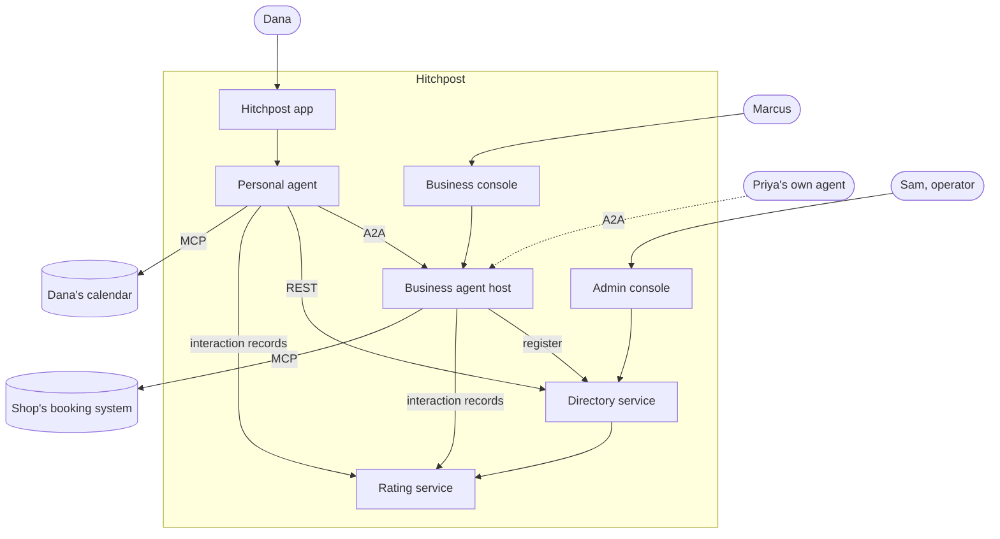
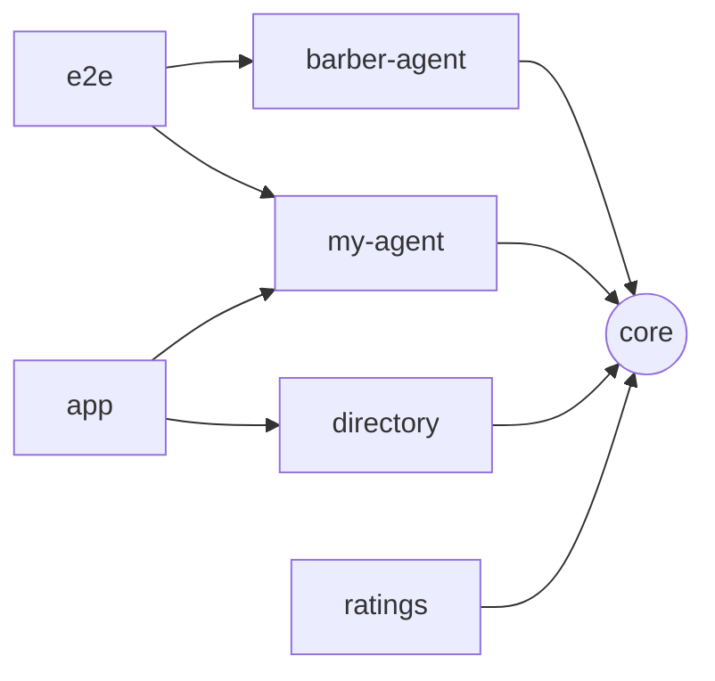
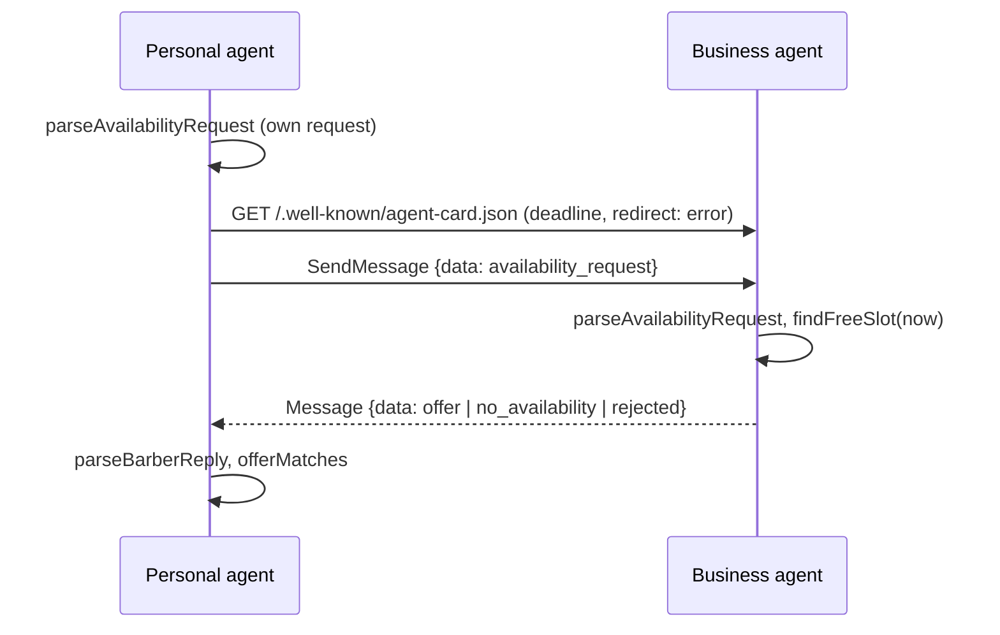
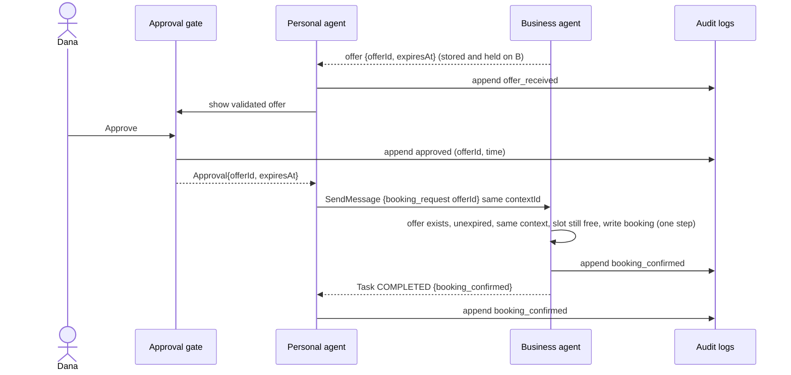
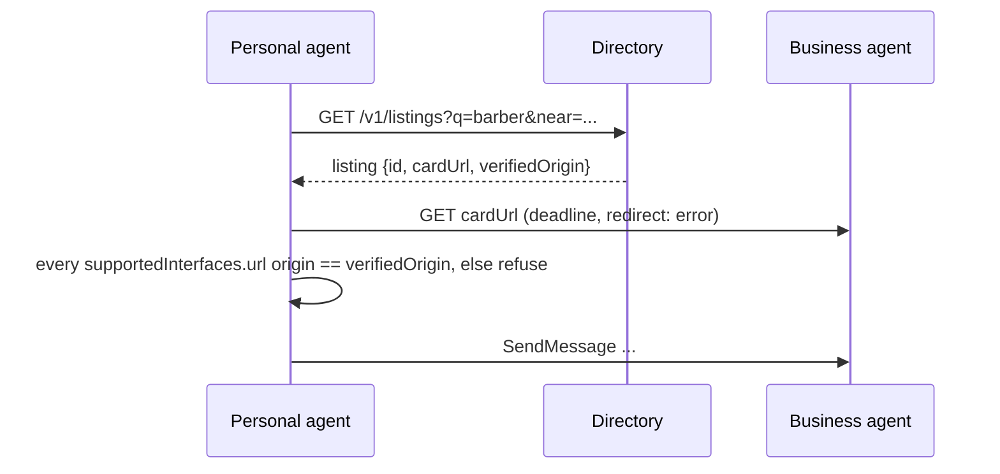
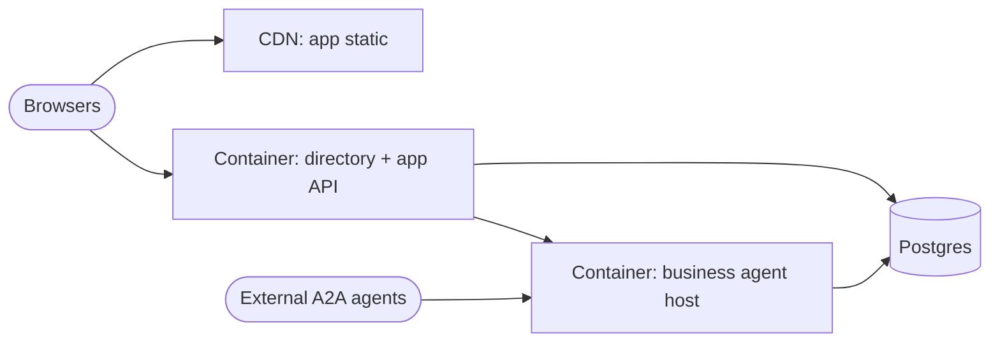

# 06. System architecture

How Hitchpost is put together today, and how it grows to v1 (Phase 6) and beyond. Status labels follow the [index](README.md): **Built**, **Phase N**, **Later**.

## 1. Drivers and constraints

| Driver                                  | Source                                                                   | Architectural consequence                                                                                           |
| --------------------------------------- | ------------------------------------------------------------------------ | ------------------------------------------------------------------------------------------------------------------- |
| Interoperate with any A2A agent         | NFR-INT-01, [ADR 0003](../decisions/0003-build-on-a2a-and-mcp.md)        | A2A v1.0 on the wire, official `@a2a-js/sdk`. No private protocol between our own parts.                            |
| Never commit a person without their yes | FR-GATE-01..03, [ADR 0007](../decisions/0007-human-approval-gate.md)     | The gate is a component of the _personal_ agent, and the only producer of an `Approval` value.                      |
| Other agents are untrusted              | NFR-SEC-01, [ADR 0010](../decisions/0010-typed-data-parts-before-llm.md) | Every boundary parses and rebuilds input (`packages/core/src/booking.ts`). Free text never drives an action.        |
| No double booking                       | FR-BOOK-01..02                                                           | The business agent owns the book and makes one atomic check-and-write per booking.                                  |
| Small team, one language                | [ADR 0002](../decisions/0002-typescript-monorepo.md)                     | TypeScript monorepo, Node 24, shared types in `@hitchpost/core`.                                                    |
| Responsive conversations                | NFR-PERF-01 (p95 under 2 s per agent exchange)                           | Synchronous request/reply for availability; Tasks only where state must persist.                                    |
| Directory uptime                        | NFR-REL-01 (99.5%)                                                       | Directory is a separate stateless service with its own database, so agents keep working peer to peer if it is down. |
| Data minimisation                       | NFR-PRIV-01                                                              | Agents share a free slot, never a calendar. Personal data stays on the person's side.                               |

Constraints: open source under MIT ([ADR 0004](../decisions/0004-mit-open-source.md)); Node type stripping, so only erasable TypeScript syntax (see [bug log](../bugs.md)); no paid infrastructure before Phase 6.

## 2. Context

### Today (Phase 1, Built)

Both agents run on one machine, bound to `127.0.0.1` (`packages/barber-agent/src/server.ts`).

### v1 (Phase 6)

## 3. Containers

| Container                              | Responsibility                                                                                           | Status                    | Code                                                       |
| -------------------------------------- | -------------------------------------------------------------------------------------------------------- | ------------------------- | ---------------------------------------------------------- |
| **core**                               | Message types, validators, A2A part helpers. No I/O.                                                     | Built                     | `packages/core/src/booking.ts`, `packages/core/src/a2a.ts` |
| **barber-agent** (business agent host) | A2A server per business: agent card, availability, booking, cancel. Owns the book.                       | Built (availability only) | `packages/barber-agent/src/`                               |
| **my-agent** (personal agent)          | Asks business agents, validates replies, runs the approval gate, writes to the person's calendar.        | Built (ask only)          | `packages/my-agent/src/`                                   |
| **e2e**                                | End-to-end tests that start several agents together. Replaces my-agent's dev dependency on barber-agent. | Phase 2                   | `packages/e2e/`                                            |
| **directory**                          | Register, verify and search business agents. REST API.                                                   | Phase 3                   | `packages/directory/`                                      |
| **app**                                | Web client: contacts are agents, chat, approval screen. Hosts the personal agent's UI.                   | Phase 4                   | `packages/app/`                                            |
| **ratings**                            | Collects interaction records, computes behaviour metrics, accepts verified reviews.                      | Phase 5                   | `packages/ratings/`                                        |
| **admin**                              | Moderation queue and takedowns. Part of the directory service UI.                                        | Phase 6                   | inside `packages/directory/`                               |

Rule: `core` depends only on SDK _types_. Nothing depends on `e2e`. Services talk over A2A or REST, never by importing each other's internals.

## 4. Components

### Business agent (barber-agent)

| Component                                            | Role                                                                                 | Status  |
| ---------------------------------------------------- | ------------------------------------------------------------------------------------ | ------- |
| `server.ts` `startBarberAgent(name, executor, port)` | Express app: agent card, JSON-RPC handler, JSON error handler, `x-powered-by` off    | Built   |
| `executor.ts` `BarberExecutor`                       | Parses the request, finds a slot, replies with one Message                           | Built   |
| `book.ts` `findFreeSlot`                             | Slot search over time ranges, never in the past                                      | Built   |
| Offer store                                          | `offerId → {contextId, service, start, price, expiresAt}`; held slots count as taken | Phase 2 |
| Booking handler                                      | `booking_request` → Task; atomic check-and-write                                     | Phase 2 |
| Audit log                                            | `append(event)`; memory for tests, JSONL file for CLI, table later                   | Phase 2 |
| Booking tool adapter                                 | Replaces the in-memory book with an MCP client to the shop's system                  | Phase 6 |

### Personal agent (my-agent)

| Component             | Role                                                                                               | Status  |
| --------------------- | -------------------------------------------------------------------------------------------------- | ------- |
| `ask.ts` `askForSlot` | Card discovery and message under one deadline, no redirects, reply validated and matched           | Built   |
| `main.ts`             | CLI; prints only validated fields and its own errors                                               | Built   |
| Approval gate         | Shows the validated offer, records the person's decision, returns an `Approval` (only constructor) | Phase 2 |
| `bookOffer(approval)` | The only function that sends `booking_request`; requires an `Approval`                             | Phase 2 |
| Audit log             | Same interface as the business side                                                                | Phase 2 |
| Directory client      | Resolves a listing, checks the card's interface URL origin against the listing                     | Phase 3 |
| Calendar adapter      | Writes the confirmed booking over MCP                                                              | Phase 4 |
| Language front end    | Turns "Thursday after work" into an `availability_request`. Never decides what is booked.          | Later   |

### Directory, app, ratings

| Component           | Role                                                                | Status  |
| ------------------- | ------------------------------------------------------------------- | ------- |
| Directory API       | `POST /listings`, verification, search, card fetch with SSRF guards | Phase 3 |
| Verification worker | Domain proof (`/.well-known` token or DNS TXT) and phone check      | Phase 3 |
| App shell           | Contacts list, chat thread, approval sheet, bookings                | Phase 4 |
| Rating ingest       | Accepts signed interaction records from both sides                  | Phase 5 |
| Review service      | Only for interactions with records from both sides                  | Phase 5 |
| Moderation          | Report queue, takedown, appeal                                      | Phase 6 |

## 5. Key sequences

### Availability (Built, UC-01)

### Approve and book (Phase 2, UC-02)

Failure paths: expired or unknown offer, or slot taken, returns Task `REJECTED` with `booking_rejected {reason}`. Decline sends nothing to B; the hold simply expires (UC-03).

### Directory lookup with origin check (Phase 3, UC-06)

## 6. Deployment view (proposal, needs an ADR)

| Option                                                               | Fit                | Cost           | Notes                                                                                           |
| -------------------------------------------------------------------- | ------------------ | -------------- | ----------------------------------------------------------------------------------------------- |
| A. One container host (Fly.io, Render or Railway) + managed Postgres | Good               | Low            | Business agents multi-tenant in one process, routed by path `/a/<listingId>/`. Simplest to run. |
| B. Serverless functions + serverless Postgres                        | Medium             | Lowest at idle | Cold starts threaten p95 under 2 s; long Task lifecycles awkward.                               |
| C. Kubernetes                                                        | Poor at this stage | High           | Operational load out of proportion to one area of barbers.                                      |

**Recommendation: A.** One region near the pilot area, Postgres for directory, offers, bookings and audit, a CDN in front of the app. Revisit at multi-region. Proposed as ADR 0014.

## 7. Cross-cutting concerns

| Concern                 | Today                                                                                      | Design                                                                                                                         |
| ----------------------- | ------------------------------------------------------------------------------------------ | ------------------------------------------------------------------------------------------------------------------------------ |
| **Time zones**          | UTC only; inputs must carry a zone and are normalised to UTC (`toInstant` in `booking.ts`) | Phase 2: opening hours in the shop's IANA zone; slot search converts per day; DST tests. Wire format stays UTC.                |
| **Idempotency**         | Not needed (availability is read-only)                                                     | `booking_request` carries `offerId`; a repeat returns the same Task result, never a second booking.                            |
| **Concurrency**         | None                                                                                       | One synchronous check-and-write per booking in-process (Phase 2); a Postgres exclusion constraint on booking ranges (Phase 6). |
| **Errors**              | Server returns `{"error":"bad request"}`; CLI shows only its own messages (`AskError`)     | Error model in [09](09-interfaces.md#5-error-model); never echo remote text to a person.                                       |
| **Configuration**       | `PORT` env var in `barber-agent/src/main.ts`                                               | Env vars only (`PUBLIC_URL`, `DATABASE_URL`, limits). Public card URL from config, not the bind address.                       |
| **Observability**       | Console logs                                                                               | NFR-OBS-01: structured JSON logs with `contextId`, OpenTelemetry traces across agents (Phase 6).                               |
| **Auth between agents** | None, localhost only                                                                       | NFR-SEC-02: signed agent cards plus bearer tokens per contact (Phase 6).                                                       |
| **Rate limits**         | None                                                                                       | NFR-SEC-03: per sender at the edge and per listing in the host (Phase 6).                                                      |

## 8. Architecture decisions

Existing: [0002](../decisions/0002-typescript-monorepo.md) monorepo, [0003](../decisions/0003-build-on-a2a-and-mcp.md) A2A and MCP, [0005](../decisions/0005-ci-and-review-policy.md) CI and review, [0007](../decisions/0007-human-approval-gate.md) approval gate, [0010](../decisions/0010-typed-data-parts-before-llm.md) typed data, [0011](../decisions/0011-in-memory-appointment-book.md) in-memory book.

Proposed (not yet written):

| ADR  | Title                                                                        | Needed by                   |
| ---- | ---------------------------------------------------------------------------- | --------------------------- |
| 0012 | Booking uses A2A Tasks; questions use Messages                               | Phase 2                     |
| 0013 | Approval is a type only the gate can create                                  | Phase 2                     |
| 0014 | Hosting: one container platform plus managed Postgres                        | Phase 6 (decide in Phase 3) |
| 0015 | Directory verifies origin; clients enforce card URL origin                   | Phase 3                     |
| 0016 | Compile packages for deployment instead of running `.ts` from `node_modules` | Phase 6                     |
| 0017 | Agent-to-agent authentication: signed cards and per-contact tokens           | Phase 6                     |
| 0018 | Shop time zones: IANA zone per business, UTC on the wire                     | Phase 2                     |
