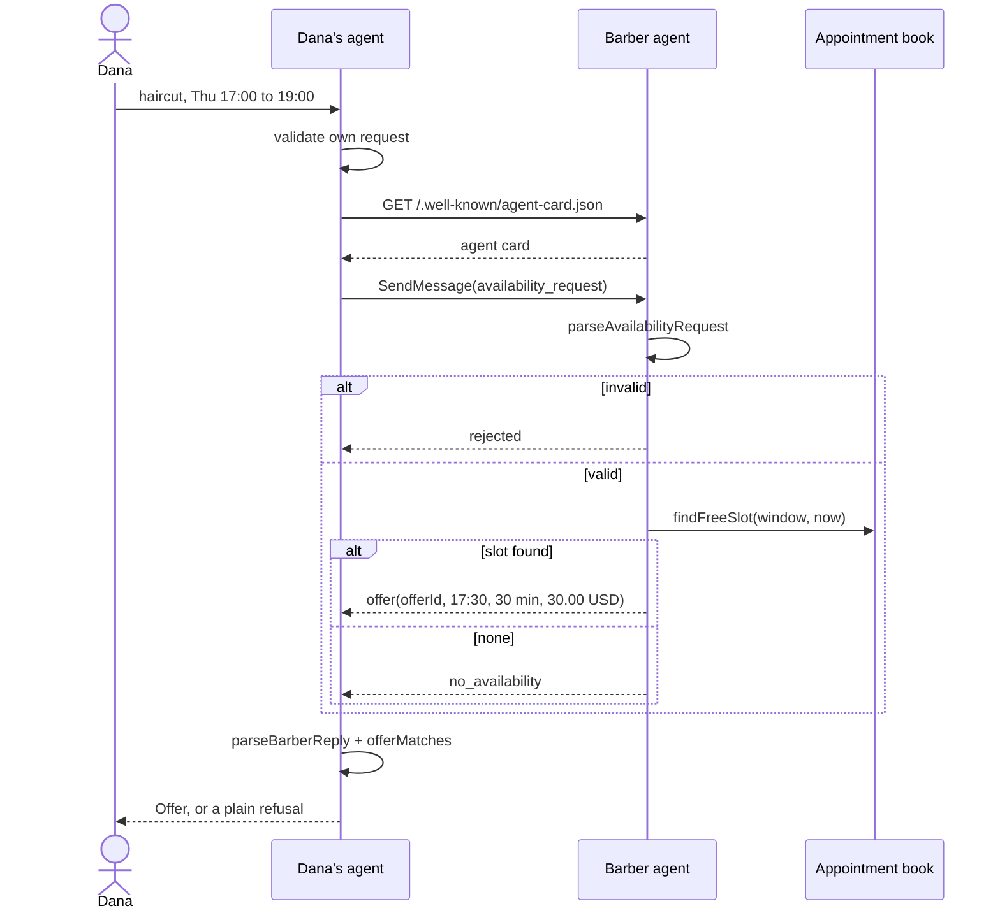
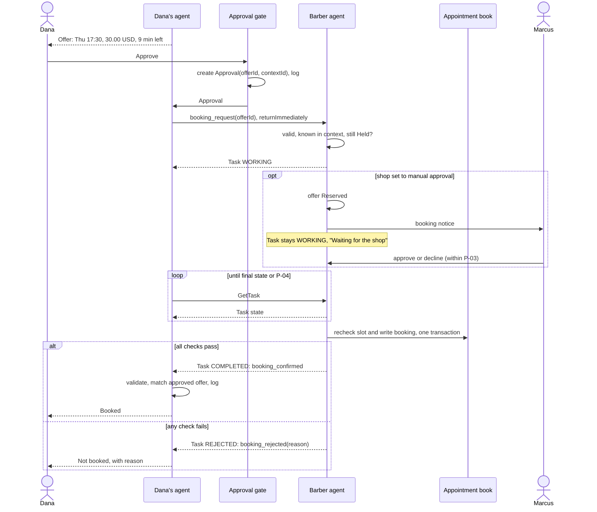
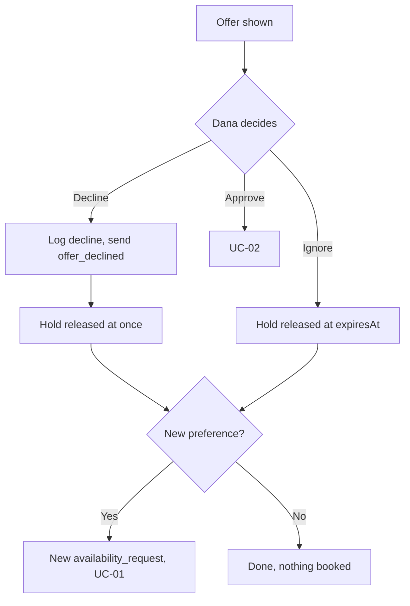
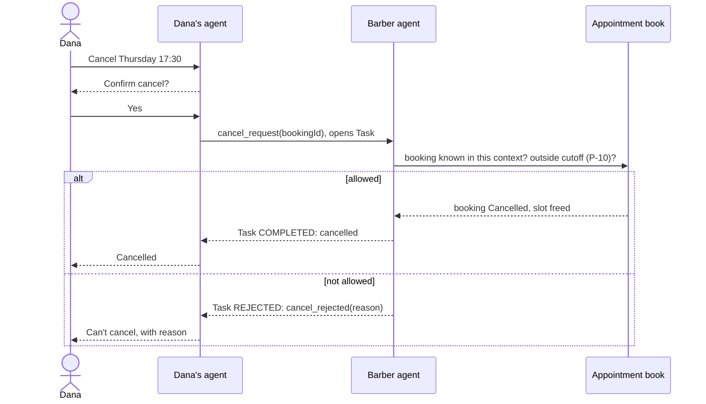

# HP-SAD-06 · Use cases

| Field       | Value                                                                                   |
| ----------- | --------------------------------------------------------------------------------------- |
| Document ID | HP-SAD-06                                                                               |
| Version     | 1.1                                                                                     |
| Status      | Baselined for Phase 2                                                                   |
| Date        | 2026-11-09                                                                              |
| Owner       | Sanaullah Jannisar, product and engineering lead                                        |
| Conforms to | ISO/IEC/IEEE 29148:2018 (operational scenarios); UML 2.5 use case and sequence notation |

Step-by-step flows for use cases UC-01 to UC-10. UC-01 describes the system as built; the rest describe the design for their phase. Requirement IDs refer to [05. Requirements](05-requirements.md). The booking protocol behind UC-02 to UC-04 is [ADR 0012](../decisions/0012-booking-protocol.md); business rules (BR-) and states are in [07](07-process-and-behaviour-models.md); timing values are the normative parameters P-01 to P-20 in [00](00-document-control.md).

Actors: **Dana** (customer), **Dana's agent**, **Marcus** (barber), **Marcus's agent** (barber agent), **Priya** (agent developer), **Sam** (operator), **Directory**.

---

## UC-01. Ask a business agent for availability

**Phase 1, Built.** Code: `askForSlot` in `packages/my-agent/src/ask.ts`, `BarberExecutor` in `packages/barber-agent/src/executor.ts`.

- **Actors:** Dana, Dana's agent, Marcus's agent.
- **Preconditions:** Dana's agent knows the barber agent's URL. The barber agent is running with an appointment book.
- **Trigger:** Dana asks for a service in a time window (today through the CLI: service, earliest, latest).
- **Postconditions:** Dana sees a validated offer, "no slots" or a rejection. Nothing is booked.
- **Related:** FR-MSG-01 to FR-MSG-08, FR-BOOK-04, NFR-SEC-01, NFR-SEC-05.

**Main flow**

1. Dana's agent validates its own request (service, strict ISO times, window up to 31 days).
2. It fetches the barber agent's card from `/.well-known/agent-card.json` (no redirects, one deadline for the whole exchange).
3. It sends the `availability_request` as an A2A data part over JSON-RPC.
4. The barber agent validates and rebuilds the request.
5. It finds the first free slot in the window that fits opening hours, overlaps no booking and is not in the past.
6. It replies with an `offer` message.
7. Dana's agent validates the reply and checks the offer matches the request (same service, start inside the window).
8. Dana sees the offer and the note that nothing is booked until she approves.

**Alternate and exception flows**

- **1a.** Dana's request is invalid: her agent refuses to send it and says the service or dates aren't valid.
- **2a.** The card can't be fetched, redirects, or the agent doesn't answer before the deadline (10 s): Dana sees "Couldn't get an answer from that agent."
- **4a.** The request is invalid or not a data part (for example free text): the barber agent replies `rejected`.
- **5a.** No slot fits: the barber agent replies `no_availability`.
- **7a.** The reply is malformed, contains control characters, or the offer doesn't match the request: Dana's agent refuses it with a plain message of its own. Remote text is never shown.
- **7b.** The barber agent answers with a Task instead of a Message: Dana's agent reports the task state.

---

## UC-02. Approve an offer and book it

**Phase 2.**

- **Actors:** Dana, Dana's agent, Marcus's agent.
- **Preconditions:** UC-01 produced a validated, matching offer with `issuedAt` and `expiresAt`. The barber agent stored it as Held and blocks the slot until it expires (offer hold, P-01).
- **Trigger:** Dana approves the offer.
- **Postconditions:** the slot is booked in Marcus's book; both audit logs record offer, approval, request and result with the correlation fields (`contextId`, `taskId`, `offerId`, `messageId`); Dana's calendar has the appointment (from Phase 4).
- **Related:** FR-GATE-01 to FR-GATE-05, FR-BOOK-01, FR-BOOK-02, FR-APP-02, NFR-REL-02; BR-06 to BR-09, BR-18, BR-19.

**Main flow**

1. Dana's agent shows the offer using only validated fields, with the time left. Its local deadline is when it received the offer plus (`expiresAt` − `issuedAt`), less the clock margin (P-09), so clock skew can't let an approval arrive late.
2. Dana approves. The approval gate creates an `Approval` bound to this `offerId` and `contextId` (only the gate can create one) and logs it.
3. Her agent sends a `booking_request` with the `offerId` in the offer's original `contextId`, listing the contract extension, with `returnImmediately: true`. The booking function only accepts an `Approval`.
4. The barber agent opens an A2A Task. It checks the request is valid, the offer is known in this `contextId`, and it is still Held. By default the shop's opening hours count as Marcus's standing approval.
5. In one transaction it rechecks the slot is free, writes the booking, marks the offer Booked, logs it, and completes the Task with `booking_confirmed`.
6. Dana's agent polls `GetTask` until a final state, validates the confirmation, checks it matches the approved offer field for field, logs it, and adds the appointment to Dana's calendar.
7. Dana sees "Booked."

**Alternate and exception flows**

- **2a.** The local deadline passed before Dana approved: her agent says the offer expired and offers to ask again (back to UC-01).
- **4a.** The offer is unknown in this context or no longer Held: the Task ends `REJECTED` with `booking_rejected` `unknown_offer` or `expired`; nothing is written.
- **4b.** Marcus has switched his shop to manual approval (FR-GATE-05): the offer becomes Reserved and the Task stays `WORKING` with the status "Waiting for the shop" (not input-required, which in A2A asks the client for input; see ADR 0012). Marcus is notified. If he approves within the manual approval wait (P-03), the flow continues at step 5. If he declines, the Task ends `booking_rejected` `shop_declined`; if he doesn't answer in time, `shop_timeout`. Either way the offer is Released.
- **5a.** The recheck finds the slot taken (only possible if the shop's own system booked it outside Hitchpost): `booking_rejected` `slot_taken`; nothing is written.
- **6a.** The confirmation doesn't match the approved offer: Dana's agent treats it as a failure, logs it and tells Dana to contact the shop.
- **6b.** No final state before the booking deadline (P-04): Dana's agent tells her it couldn't confirm the booking and keeps polling in the background; it never shows "Booked" without a `booking_confirmed`.
- **3a.** Network failure after sending: Dana's agent retries with the same `offerId` and the same `messageId`; the barber agent returns the existing Task in whatever state it is (BR-18), never a second booking.

---

## UC-03. Decline an offer or ask for another

**Phase 2.**

- **Actors:** Dana, Dana's agent, Marcus's agent.
- **Preconditions:** Dana has a validated offer (UC-01).
- **Trigger:** Dana declines, or asks for something different.
- **Postconditions:** nothing is booked; both sides log the decline; the hold is released at once (or at `expiresAt` if Dana just ignores the offer).
- **Related:** FR-GATE-01, FR-GATE-03, FR-BOOK-01; BR-17, BR-19.

Declining sends `offer_declined`, so Marcus's chair is freed immediately instead of sitting blocked for the rest of the offer hold (P-01). Releasing holds early also keeps a person under the open holds cap (P-07) when they ask for alternatives.

**Main flow**

1. Dana declines the offer.
2. Her agent logs the decline and sends `offer_declined` with the `offerId` in the offer's `contextId`.
3. The barber agent marks the offer Declined, releases the hold and logs it.
4. If Dana gave a new preference ("anything later?"), her agent sends a new `availability_request` with the adjusted window (back to UC-01).

**Alternate flows**

- **1a.** Dana ignores the offer: nothing is sent; at `expiresAt` the barber agent marks it Expired and releases the hold.
- **2a.** `offer_declined` doesn't arrive (network failure): the hold is released at `expiresAt` anyway; nothing depends on the decline message.
- **4a.** No other slot fits: Dana sees "no slots" and can widen the window.
- **4b.** Dana already has open holds up to the cap (P-07): the barber agent answers `rejected` until one is declined or expires.

---

## UC-04. Reschedule or cancel a booking

**Phase 2.**

- **Actors:** Dana, Dana's agent, Marcus's agent. (Marcus cancelling from the shop side is Later; in v1 he contacts Dana outside Hitchpost.)
- **Preconditions:** a Confirmed booking exists in both audit logs.
- **Trigger:** Dana cancels or asks to move the booking.
- **Postconditions:** cancel: booking Cancelled, slot freed, both logs updated. Reschedule: the new booking is confirmed and the old one cancelled in the same transaction.
- **Related:** FR-BOOK-03, FR-MSG-10, FR-GATE-01, FR-GATE-03; BR-10, BR-11, BR-19.

**Main flow (cancel)**

1. Dana chooses the booking and cancels. Her agent confirms with her first (cancelling is a commitment change).
2. Her agent sends `cancel_request` with the `bookingId` in the booking's original `contextId`, which opens an A2A Task. Until agent authentication (Phase 6) that `contextId` is what proves the request comes from the customer who booked, so it is never shown or put in a URL.
3. The barber agent checks the booking is known in this context and outside the cancellation cutoff (P-10), marks it Cancelled, frees the slot, logs it and completes the Task with `cancelled`.
4. Dana's agent removes the calendar entry and logs it.

**Main flow (reschedule)**

1. Dana asks to move the booking. Her agent sends `reschedule_request` with the `bookingId` and the new window, in the booking's `contextId`.
2. The barber agent answers with an `offer` carrying `replacesBookingId` (as in UC-01).
3. Dana approves it and the normal UC-02 flow books the new slot.
4. In the same transaction that writes the new booking, the barber agent marks the old one Rescheduled and frees its slot; both sides log it.

**Alternate and exception flows**

- **3a.** Cancel refused: the Task ends `REJECTED` with `cancel_rejected`, reason `cutoff` (inside the shop's cutoff) or `unknown_booking` (not known in this context); nothing changes.
- **Reschedule 2a.** No slot in the new window: `no_availability`; the old booking stays.
- **Reschedule 3a.** The new offer expires, is declined, or its booking is rejected: the old booking stays (the swap is atomic).
- **Later.** Marcus cancels from the shop side and Dana's agent is notified. This needs a business-to-person message the `hitchpost/1` contract doesn't have.

---

## UC-05. Register a business agent in the directory

**Phase 3.**

- **Actors:** Marcus (or Priya on his behalf), Directory.
- **Preconditions:** the business has an A2A agent with a reachable agent card.
- **Trigger:** Marcus submits his agent card URL and business details.
- **Postconditions:** a verified listing is live and searchable.
- **Related:** FR-DIR-01, FR-DIR-03, FR-DIR-04.

**Main flow**

1. Marcus enters the shop name, area, services, IANA time zone and agent card URL (`POST /v1/listings`, status `pending`).
2. The directory fetches the card, validates it, and checks the card's interface URL has the same origin as the submitted URL.
3. The directory asks Marcus to prove control of that origin (`POST /v1/listings/{id}/verify`: a well-known token file or a DNS TXT record).
4. Marcus completes the check.
5. The listing goes live marked verified.

**Alternate flows**

- **2a.** The card is missing, invalid or points at another origin: registration is refused with the reason.
- **4a.** Verification fails or times out: the listing stays unpublished.
- **Later.** Marcus updates (`PATCH /v1/listings/{id}`) or closes (`DELETE`) the listing; changing `cardUrl` resets verification and repeats steps 2 to 4.

---

## UC-06. Find a business agent

**Phase 3.**

- **Actors:** Dana or Dana's agent, Directory.
- **Preconditions:** verified listings exist.
- **Trigger:** a search by name, service or area.
- **Postconditions:** Dana's agent has a verified card URL to use in UC-01.
- **Related:** FR-DIR-02, FR-DIR-03, FR-DIR-05.

**Main flow**

1. Dana (or her agent) searches "fade near Downtown" (`GET /v1/listings?q=fade&near=…`).
2. The directory returns matching verified listings, nearest first, with verification status and, from Phase 5, rating summaries.
3. Dana picks one. Her agent fetches the card and checks its interface origin matches the listing before sending anything.

**Alternate flows**

- **2a.** No results: suggest widening the area or service.
- **3a.** Origin mismatch: her agent refuses, and the listing is reported automatically (UC-09).

---

## UC-07. Add an agent as a contact and chat in the app

**Phase 4.**

- **Actors:** Dana, the client app with its built-in personal agent (the consumer agent at launch, A-08), a business agent.
- **Preconditions:** Dana has the app installed and signed in.
- **Trigger:** Dana adds a business from the directory, or pastes any A2A agent URL.
- **Postconditions:** the agent is in her contacts; conversations with it run UC-01 to UC-04 in the app.
- **Related:** FR-APP-01 to FR-APP-05, NFR-A11Y-01.

**Main flow**

1. Dana finds a business (UC-06) and taps "Add contact".
2. The app stores the contact with its verified card URL.
3. Dana opens the chat and types "cut Thursday after work". The app turns this into a structured request she confirms (service, window).
4. The conversation follows UC-01; offers appear as approval cards (UC-02).

**Alternate flows**

- **1a.** Dana pastes an unlisted agent URL: the app warns that it isn't verified before adding it.
- **Any step.** Dana blocks a contact: no further messages from it are shown or answered.

---

## UC-08. Rate an interaction

**Phase 5.**

- **Actors:** Dana and Marcus (each rates the other side), Directory.
- **Preconditions:** a verified interaction exists: both sides logged the offer and a matching decision, and the booking reached Completed or NoShow (BR-14).
- **Trigger:** the outcome is reported, by the shop marking it on the dashboard or by Dana answering "Did it go as booked?" (E-15).
- **Postconditions:** the structured metrics update; an optional short review is attached.
- **Related:** FR-RATE-01 to FR-RATE-03.

**Main flow**

1. The directory computes behaviour metrics from the interaction (response time, offer honoured, stayed within its card's skills).
2. Dana is asked for an optional rating and short review.
3. The review is stored against that interaction, once per side.

**Alternate flows**

- **1a.** No verified interaction: rating is refused.
- **3a.** A second rating for the same interaction and side: refused.

---

## UC-09. Report an abusive or fake agent

**Phase 5.**

- **Actors:** anyone (Dana, Marcus, Priya, an agent automatically), Directory, Sam.
- **Preconditions:** the agent is listed or has interacted with the reporter.
- **Trigger:** a report with a reason (impersonation, spam, misleading offers, abuse).
- **Postconditions:** the report is queued for moderation (UC-10); severe automatic signals can suspend a listing pending review.
- **Related:** FR-ADMIN-01.

**Main flow**

1. The reporter picks a reason and adds details.
2. The directory records the report with links to the related interactions.
3. Sam is notified.

**Alternate flows**

- **2a.** Many reports in a short time, or an origin mismatch: the listing is suspended automatically until Sam reviews it.

---

## UC-10. Moderate the directory and handle reports

**Phase 6.**

- **Actors:** Sam, Directory, the reported business.
- **Preconditions:** reports exist (UC-09).
- **Trigger:** Sam opens the moderation queue.
- **Postconditions:** each report is resolved (dismissed, warning, suspension, removal), the business is notified with the reason, and the action is in the moderation audit trail.
- **Related:** FR-ADMIN-01, FR-ADMIN-02.

**Main flow**

1. Sam reviews the report and the linked audit records.
2. Sam chooses an action and a reason.
3. The directory applies it and notifies the business.
4. The action is recorded in the moderation trail.

**Alternate flows**

- **3a.** The business appeals: Sam re-reviews; the outcome is recorded too.

## Revision history

| Version | Date       | Change                                                                                                                                                                                                                                                                                   | Author      |
| ------- | ---------- | ---------------------------------------------------------------------------------------------------------------------------------------------------------------------------------------------------------------------------------------------------------------------------------------- | ----------- |
| 0.1     | 2026-11-08 | First draft                                                                                                                                                                                                                                                                              | S. Jannisar |
| 1.0     | 2026-11-09 | Baselined: renumbered into lifecycle order, formal document control, standards conformance                                                                                                                                                                                               | S. Jannisar |
| 1.1     | 2026-11-09 | Remediation after independent review: UC-02 Reserved and WORKING with polling, recheck, idempotent retry, clock margin; UC-03 `offer_declined`; UC-04 `cancel_rejected`, `replacesBookingId` atomic swap, context binding, shop-side cancel Later; UC-08 verified interaction definition | S. Jannisar |
