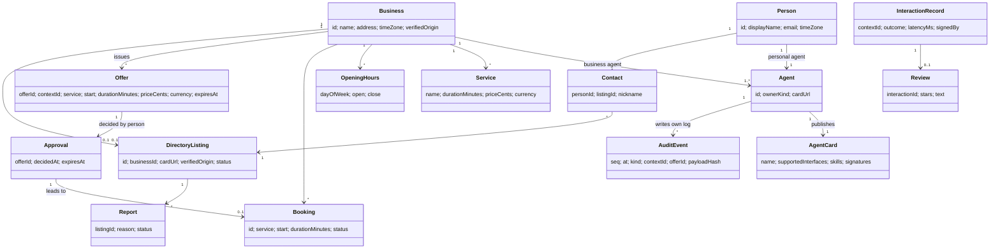

# 07. Data design

The entities Hitchpost handles, who owns each, where it is stored in each phase, how long it is kept and how sensitive it is.

## 1. Domain model

## 2. Entities

| Entity                | Owner (stores it)                                  | Privacy class                | Status                                | Notes                                                                                    |
| --------------------- | -------------------------------------------------- | ---------------------------- | ------------------------------------- | ---------------------------------------------------------------------------------------- |
| Person                | Personal side (app)                                | Personal                     | Phase 4                               | Name, email, time zone. Never sent to business agents except what a booking needs.       |
| Business              | Directory                                          | Public                       | Phase 3                               | Public listing data.                                                                     |
| Agent / AgentCard     | Each agent publishes its own                       | Public                       | Built                                 | Card in `barber-agent/src/server.ts` `barberCard()`.                                     |
| Service, OpeningHours | Business agent                                     | Public                       | Built                                 | `Book.services`, `Book.hours` in `barber-agent/src/book.ts`.                             |
| Booking               | Business agent                                     | Personal                     | Built (as `Book.booked`, time ranges) | Phase 2 adds `id`, `status`, customer reference.                                         |
| Offer                 | Business agent stores; personal agent keeps a copy | Personal                     | Phase 2                               | Built only as a message type (`Offer` in `core/src/booking.ts`), not stored. FR-BOOK-01. |
| Approval              | Personal agent only                                | Personal                     | Phase 2                               | Never leaves the personal side; the business sees only `booking_request`. FR-GATE-02.    |
| AuditEvent            | Each side, own log                                 | Personal                     | Phase 2                               | Append-only. FR-GATE-03.                                                                 |
| DirectoryListing      | Directory                                          | Public                       | Phase 3                               | FR-DIR-01..03.                                                                           |
| Contact               | Personal side (app)                                | Personal                     | Phase 4                               | FR-APP-01.                                                                               |
| InteractionRecord     | Ratings service, signed by both sides              | Personal (pseudonymous)      | Phase 5                               | FR-RATE-02.                                                                              |
| Review                | Ratings service                                    | Public text, personal author | Phase 5                               | Only with a matching InteractionRecord. FR-RATE-01.                                      |
| Report                | Directory                                          | Personal (reporter)          | Phase 5 to 6                          | FR-ADMIN-01.                                                                             |

No entity holds payment data before a payments ADR. Calendars are never copied: the personal agent writes one event over MCP and keeps only the booking reference (NFR-PRIV-01).

## 3. Integrity rules

| Rule                                                           | Enforced where                                                                     | Status                             |
| -------------------------------------------------------------- | ---------------------------------------------------------------------------------- | ---------------------------------- |
| No two bookings overlap in a business's book                   | `findFreeSlot` overlap check; Phase 6 Postgres exclusion constraint on `tstzrange` | Built (search), Phase 6 (database) |
| Held offers count as taken until they expire                   | Offer store consulted by slot search                                               | Phase 2                            |
| A booking needs an unexpired offer from the same `contextId`   | Booking handler, single check-and-write                                            | Phase 2                            |
| One booking per offer                                          | Unique `offerId` on Booking                                                        | Phase 2                            |
| An Approval names exactly one offer and expires with it        | `Approval` type, only created by the gate                                          | Phase 2                            |
| Audit events are never updated or deleted                      | Append-only interface; `seq` monotonic; each event hashes the previous             | Phase 2 (hash chain Phase 6)       |
| A review needs an interaction record from both sides           | Ratings ingest                                                                     | Phase 5                            |
| A listing's card URL origin equals its verified origin         | Directory on register and on every card refresh                                    | Phase 3                            |
| All instants stored in UTC; shop hours in the shop's IANA zone | `toInstant` in core; ADR 0018 (proposed)                                           | Built (UTC), Phase 2 (zones)       |

## 4. Storage by phase

| Phase     | Storage                                                                                                            | Why                                                                                   |
| --------- | ------------------------------------------------------------------------------------------------------------------ | ------------------------------------------------------------------------------------- |
| 1 (Built) | In memory (`Book` object passed to `BarberExecutor`)                                                               | Nothing to persist yet ([ADR 0011](../decisions/0011-in-memory-appointment-book.md)). |
| 2         | In memory behind small interfaces (`OfferStore`, `AuditLog.append`); JSONL file for the CLI                        | Prove the lifecycle before choosing a database.                                       |
| 3         | Postgres for the directory                                                                                         | Search, uniqueness, verification state.                                               |
| 4         | Postgres for app accounts and contacts; browser holds nothing sensitive beyond the session                         | One database to operate.                                                              |
| 5         | Postgres tables for interaction records and reviews                                                                | Same.                                                                                 |
| 6         | Postgres for business-agent data when we host the agent; the shop's own booking system over MCP when they have one | Hosted agents need durable offers and bookings.                                       |

The A2A SDK's `InMemoryTaskStore` (used in `server.ts`) is replaced by its `DatabaseTaskStore` in Phase 6 so Tasks survive restarts.

## 5. Retention

| Data                | Kept for                                            | Then                                    |
| ------------------- | --------------------------------------------------- | --------------------------------------- |
| Expired offers      | 7 days                                              | Deleted                                 |
| Bookings            | 2 years after the appointment                       | Anonymised (customer reference removed) |
| Audit events        | 2 years                                             | Deleted; aggregate counts kept          |
| Interaction records | 2 years                                             | Aggregated into metrics                 |
| Reviews             | Until the author deletes them or the listing closes | Deleted                                 |
| Person and contacts | Until account deletion                              | Deleted within 30 days                  |
| Reports             | 1 year after resolution                             | Deleted                                 |

Numbers are starting points to confirm in [08 Security and privacy](08-security-and-privacy.md) before Phase 6.

## 6. Migrations

- SQL migrations in each service (`packages/<service>/migrations/NNNN_name.sql`), applied by CI on deploy, forward only.
- Expand then contract: add new columns or tables, deploy code that writes both, backfill, then remove the old shape in a later release.
- Message shapes on the wire follow the versioning rules in [09](09-interfaces.md#2-versioning-and-compatibility); stored data never depends on a field a peer may stop sending.
- The A2A SDK ships the `a2a-db` CLI for its task tables; run it as one migration step.
