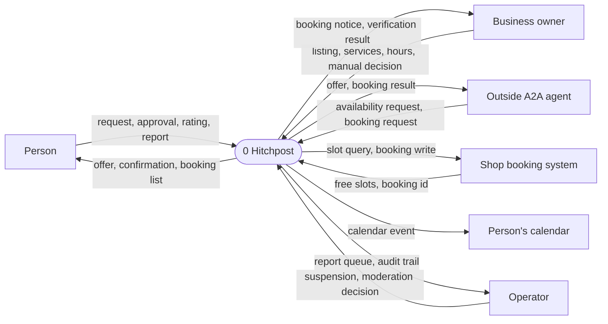
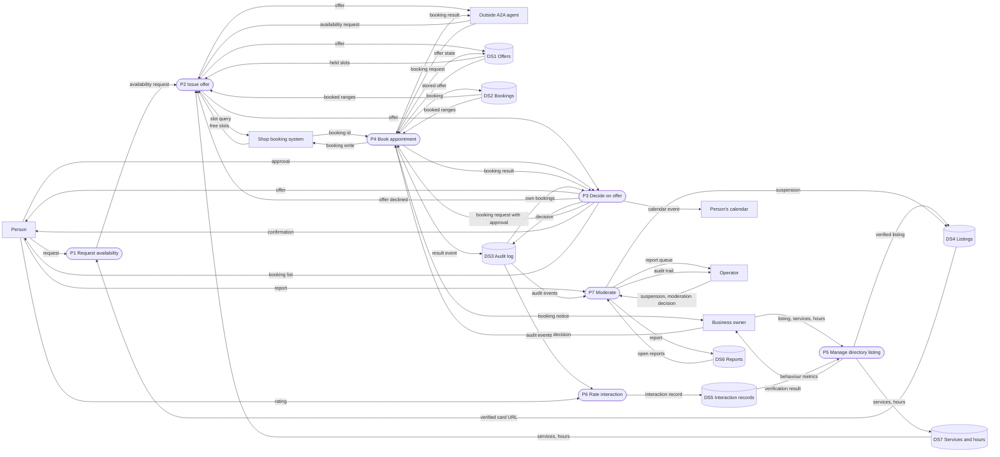
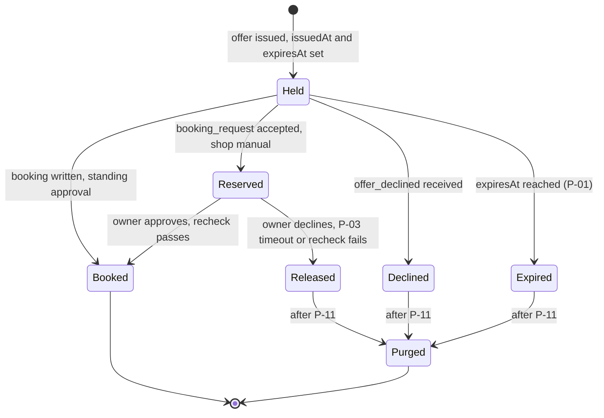
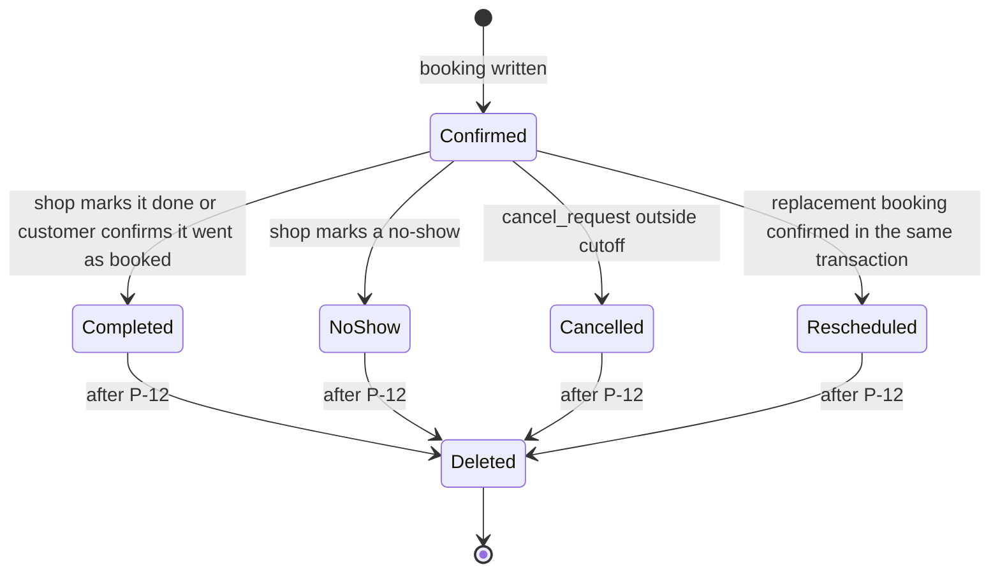
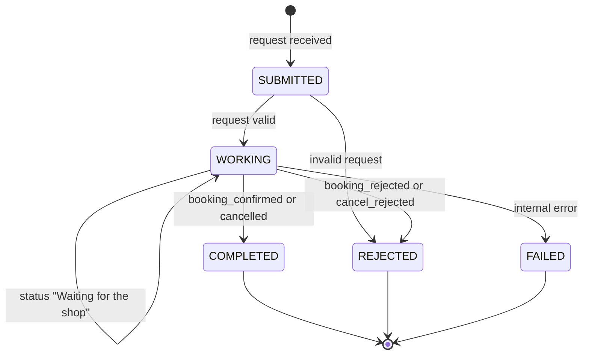
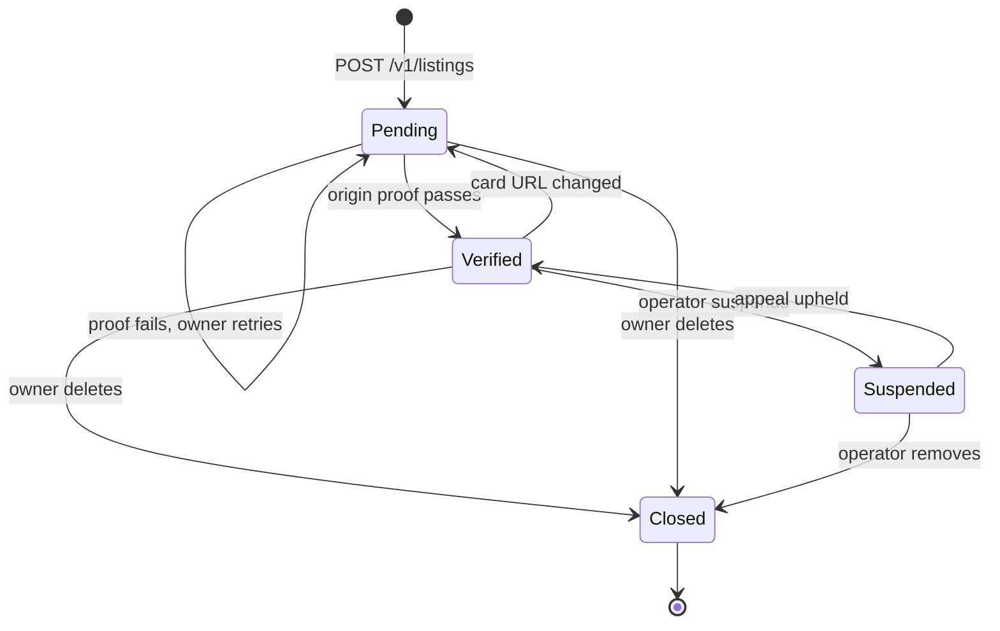
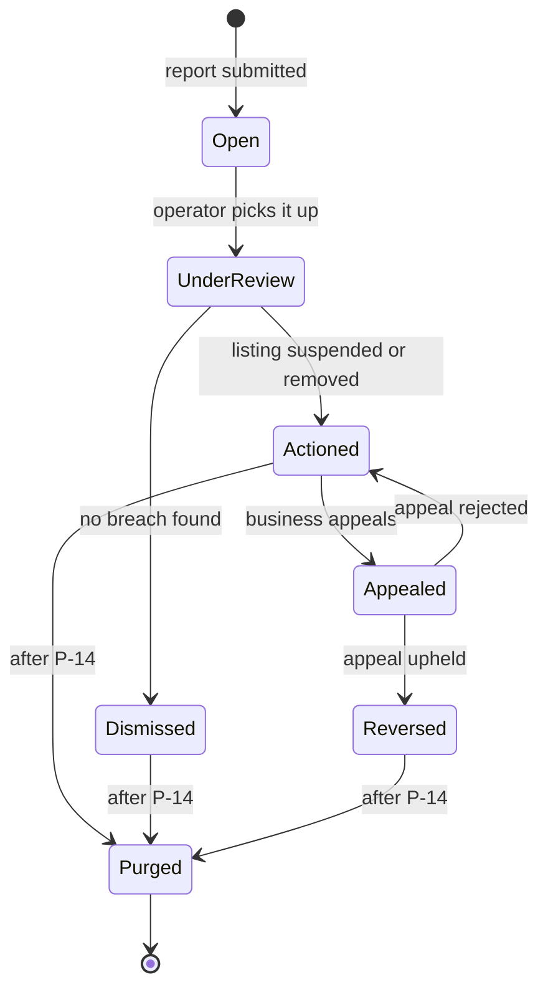
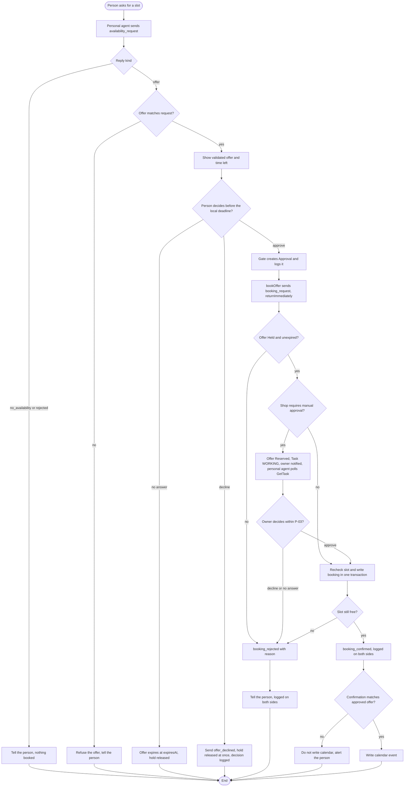

# HP-SAD-07 · Process and behaviour models

| Field       | Value                                                                                                                 |
| ----------- | --------------------------------------------------------------------------------------------------------------------- |
| Document ID | HP-SAD-07                                                                                                             |
| Version     | 1.1                                                                                                                   |
| Status      | Baselined for Phase 2                                                                                                 |
| Date        | 2026-11-09                                                                                                            |
| Owner       | Sanaullah Jannisar, product and engineering lead                                                                      |
| Conforms to | ISO/IEC/IEEE 29148 (requirements analysis models), structured analysis (Yourdon/DeMarco DFDs), UML 2.5 state machines |

## 1. Purpose and scope

This document models how data moves through Hitchpost and how its key objects change state. It covers v1 (Phases 1 to 6): agent messaging, the approval gate, booking, directory, ratings and moderation. It turns the requirements in [05](05-requirements.md) and the flows in [06](06-use-cases.md) into process models, business rules, decision tables and state machines that the design in [10](10-architecture.md) and the tests in [15](15-test-strategy.md) are checked against. The booking protocol these models follow is recorded in [ADR 0012](../decisions/0012-booking-protocol.md).

Status marks follow the package convention: **Built** (in code now), **Phase N** (planned), **Later**. Timing and limit values are referenced by their normative parameter IDs (P-01 to P-20, register in [00 Document control](00-document-control.md)), not repeated.

## 2. Notation

Mermaid has no native DFD shapes, so I use a fixed mapping. Every diagram in this document follows it.

| DFD element     | Mermaid shape                | Naming rule                        |
| --------------- | ---------------------------- | ---------------------------------- |
| External entity | Rectangle `[Name]`           | A noun: a person or outside system |
| Process         | Rounded `([P1 Verb object])` | Numbered, verb plus object         |
| Data store      | Cylinder `[(DS1 Name)]`      | Numbered, plural noun              |
| Data flow       | Labelled arrow               | The data that moves, not an action |

Rules I hold every diagram to: no flow goes directly between two external entities or two data stores; every process has at least one input and one output; every data store is both written and read somewhere in the set; and each level balances with its parent (every external entity and every boundary flow of the parent appears in the child, with the same name, and the child adds no new external entities).

## 3. Context diagram (level 0)

Hitchpost as one process, with everything it exchanges data with.

The outside A2A agent is a personal agent Hitchpost didn't build (FR-MSG-01). It talks to the business side directly, so its flows enter P2 and P4 at level 1, bypassing our own personal agent's P1 and P3.

## 4. Level 1 DFD

The v1 system broken into its major processes. Every level-0 entity and flow appears here.

| Process | What it does                                                                                                                               | Implemented by                                   | Status                                     |
| ------- | ------------------------------------------------------------------------------------------------------------------------------------------ | ------------------------------------------------ | ------------------------------------------ |
| P1      | Validates the person's request, resolves the agent card, sends the request                                                                 | Personal agent, `askForSlot`                     | Built (resolves by URL; directory Phase 3) |
| P2      | Validates the request, applies hold caps, finds the first free slot, stores and replies with an offer; releases a hold on `offer_declined` | Business agent, `BarberExecutor`, `findFreeSlot` | Built (offer storage, caps Phase 2)        |
| P3      | Shows only validated fields, records approve or decline, creates an `Approval`, verifies the confirmation, writes the calendar             | Personal agent, approval gate                    | Phase 2 (calendar write Phase 4)           |
| P4      | Checks and reserves the offer, waits for the shop if needed, rechecks and writes the booking                                               | Business agent, booking handler                  | Phase 2                                    |
| P5      | Registers, verifies and updates listings                                                                                                   | Directory service                                | Phase 3                                    |
| P6      | Builds interaction records from both sides' logs, accepts reviews                                                                          | Ratings service                                  | Phase 5                                    |
| P7      | Takes reports, gives the operator the queue and audit trail, suspends or restores listings                                                 | Directory admin                                  | Phase 5 to 6                               |

Processes are logical. Which container runs each one is in [10](10-architecture.md); one container can run several processes.

| Store | Holds                                                | Owner                         | Status                                          |
| ----- | ---------------------------------------------------- | ----------------------------- | ----------------------------------------------- |
| DS1   | Issued offers with `issuedAt`, `expiresAt` and state | Business agent                | Phase 2                                         |
| DS2   | Bookings as time ranges                              | Business agent or shop system | Built in memory (`Book.booked`)                 |
| DS3   | Append-only audit events, with correlation fields    | Each side keeps its own       | Phase 2                                         |
| DS4   | Directory listings                                   | Directory                     | Phase 3                                         |
| DS5   | Interaction records signed by both sides             | Ratings service               | Phase 5                                         |
| DS6   | Reports and moderation actions                       | Directory                     | Phase 5 to 6                                    |
| DS7   | Services and opening hours                           | Business agent                | Built in memory (`Book.services`, `Book.hours`) |

## 5. Level 2 DFD: P4 Book appointment

Booking is the first process that commits a person's time, so it gets one more level of detail. This diagram decomposes P4 only: every flow crossing its boundary is one of P4's level-1 flows, shown with its level-1 source or destination, and no new external entity appears.

```mermaid
flowchart LR
  p3([P3 Decide on offer])
  peer[Outside A2A agent]
  owner[Business owner]
  booksys[Shop booking system]
  d1[(DS1 Offers)]
  d2[(DS2 Bookings)]
  d3[(DS3 Audit log)]

  p41([P4.1 Validate booking request])
  p42([P4.2 Check and reserve offer])
  p43([P4.3 Await shop decision])
  p44([P4.4 Recheck slot and write booking])
  p45([P4.5 Reply and log])

  p3 -- "booking request with approval" --> p41
  peer -- "booking request" --> p41
  p41 -- "valid request" --> p42
  p41 -- "rejection reason" --> p45
  d1 -- "stored offer" --> p42
  p42 -- "offer state" --> d1
  p42 -- "offer reserved, shop manual" --> p43
  p42 -- "offer held, standing approval" --> p44
  p42 -- "rejection reason" --> p45
  p43 -- "booking notice" --> owner
  owner -- "manual decision" --> p43
  p43 -- "shop approved" --> p44
  p43 -- "declined or timed out" --> p45
  p43 -- "offer state" --> d1
  d2 -- "booked ranges" --> p44
  p44 -- "booking write" --> booksys
  booksys -- "booking id" --> p44
  p44 -- "booking" --> d2
  p44 -- "offer state" --> d1
  p44 -- "result" --> p45
  p45 -- "booking result" --> p3
  p45 -- "booking result" --> peer
  p45 -- "result event" --> d3
```

P4.4 rechecks the slot and writes the booking in one transaction, so two requests for the same slot cannot both pass, even after a shop's manual wait (NFR-REL-02). P4.2 is idempotent: a repeated request for the same offer returns the existing Task rather than starting a new one (BR-18). See the decision table in §7.2.

## 6. Business rules catalogue

| ID    | Rule                                                                                                                                                                                                                                                                                   | Requirement            | Where enforced                                                                  | Status                            |
| ----- | -------------------------------------------------------------------------------------------------------------------------------------------------------------------------------------------------------------------------------------------------------------------------------------- | ---------------------- | ------------------------------------------------------------------------------- | --------------------------------- |
| BR-01 | A slot may be offered only if it starts inside the requested window, not before now, on a 30-minute boundary, and the whole service fits inside opening hours.                                                                                                                         | FR-BOOK-04             | `findFreeSlot` in `packages/barber-agent/src/book.ts`                           | Built (UTC; shop-local Phase 6)   |
| BR-02 | A slot may not be offered if its time range overlaps any booked range or any Held or Reserved offer.                                                                                                                                                                                   | FR-BOOK-04, FR-BOOK-01 | `findFreeSlot` overlap check; holds Phase 2                                     | Built (bookings), Phase 2 (holds) |
| BR-03 | An availability window must be strictly positive and no longer than the maximum search window (P-06).                                                                                                                                                                                  | FR-MSG-07, NFR-PERF-02 | `parseAvailabilityRequest`, `MAX_WINDOW_DAYS` in `packages/core/src/booking.ts` | Built                             |
| BR-04 | All instants must be strict ISO 8601 with an explicit zone and a real calendar day; they are stored as canonical UTC.                                                                                                                                                                  | FR-MSG-06              | `toInstant` in `packages/core/src/booking.ts`                                   | Built                             |
| BR-05 | A requesting agent accepts an offer only if its service equals the requested service and its start lies within `[earliest, latest]` inclusive.                                                                                                                                         | FR-MSG-04              | `offerMatches` in `packages/core/src/booking.ts`, `askForSlot`                  | Built                             |
| BR-06 | An offer is Held from `issuedAt` until `expiresAt` (offer hold, P-01) and can be used for at most one booking. The business clock decides expiry; the personal agent treats it as expired the clock margin (P-09) before its own local deadline.                                       | FR-BOOK-01, FR-BOOK-02 | Offer store, booking handler, approval gate                                     | Phase 2                           |
| BR-07 | An approval names exactly one `offerId` and `contextId`, is created only by the approval gate, and expires with its offer.                                                                                                                                                             | FR-GATE-02, FR-GATE-04 | `Approval` type and `bookOffer(approval)`                                       | Phase 2                           |
| BR-08 | Nothing commits a person (time, money, personal data) without that person's explicit approval.                                                                                                                                                                                         | FR-GATE-01             | Approval gate; the only booking path takes an `Approval`                        | Phase 2 (nothing books today)     |
| BR-09 | Opening hours count as the owner's standing approval unless the shop turns on manual approval. On manual approval the offer is Reserved and the booking Task stays `WORKING` until the owner decides, at most the manual approval wait (P-03), then `booking_rejected` `shop_timeout`. | FR-GATE-05             | Booking handler                                                                 | Phase 2                           |
| BR-10 | A booking may be cancelled until the shop's cancellation cutoff (P-10); a cancel inside the cutoff ends in `cancel_rejected` with reason `cutoff`.                                                                                                                                     | FR-BOOK-03             | Booking handler                                                                 | Phase 2                           |
| BR-11 | A reschedule is a `reschedule_request` answered with an offer carrying `replacesBookingId`; the old booking is cancelled in the same transaction that confirms the new one, so a failed reschedule leaves the old booking intact.                                                      | FR-BOOK-03             | Booking handler                                                                 | Phase 2                           |
| BR-12 | A listing is published only after its owner proves control of the agent card's origin, and the card's interface URL must share that origin. Hosted agents each have their own subdomain, so origins are never shared (Phase 6).                                                        | FR-DIR-01, FR-DIR-03   | Directory verification worker                                                   | Phase 3                           |
| BR-13 | Changing a listing's card URL resets it to unverified.                                                                                                                                                                                                                                 | FR-DIR-01, FR-DIR-04   | Directory API `PATCH`                                                           | Phase 3                           |
| BR-14 | An interaction can be rated only if it is a verified interaction (both sides logged the offer and a matching decision, and the booking reached Completed or NoShow); each side rates it at most once.                                                                                  | FR-RATE-01             | Rating ingest                                                                   | Phase 5                           |
| BR-15 | Text shown to a person must respect the text limit (P-19).                                                                                                                                                                                                                             | NFR-SEC-05             | `SAFE_TEXT` in `packages/core/src/booking.ts`                                   | Built                             |
| BR-16 | A suspended listing disappears from search immediately; the business is told the reason and can appeal.                                                                                                                                                                                | FR-ADMIN-01            | Directory admin                                                                 | Phase 6                           |
| BR-17 | No sender and no `contextId` may hold more than the open holds cap (P-07); beyond it the business answers `rejected` and issues no hold. A declined offer (`offer_declined`) releases its hold at once.                                                                                | FR-BOOK-01, NFR-SEC-03 | Offer store                                                                     | Phase 2                           |
| BR-18 | A repeated `booking_request` for the same offer returns the existing Task, in any state, and never creates a second booking.                                                                                                                                                           | NFR-REL-02             | Booking handler (`offerId → taskId`)                                            | Phase 2                           |
| BR-19 | `booking_request`, `offer_declined`, `cancel_request` and `reschedule_request` are accepted only in the `contextId` of the original offer. Until agent authentication (Phase 6) the `contextId` is a bearer capability: logged, never shown or put in a URL.                           | FR-GATE-02, NFR-SEC-01 | Booking handler                                                                 | Phase 2                           |

## 7. Decision tables

Each table is complete: every combination of conditions maps to exactly one action. A dash means "any value". Rules are evaluated left to right; the first column that matches wins.

### 7.1 Can this slot be offered? (BR-01, BR-02, BR-17)

| Rule                                          | 1                       | 2          | 3             | 4             | 5             | 6             | 7                   |
| --------------------------------------------- | ----------------------- | ---------- | ------------- | ------------- | ------------- | ------------- | ------------------- |
| Service exists in the book                    | N                       | Y          | Y             | Y             | Y             | Y             | Y                   |
| Sender and context under the hold cap (P-07)  | -                       | N          | Y             | Y             | Y             | Y             | Y                   |
| Start is in the window and not before now     | -                       | -          | N             | Y             | Y             | Y             | Y                   |
| Shop open that day, service fits before close | -                       | -          | -             | N             | Y             | Y             | Y                   |
| Overlaps a booking                            | -                       | -          | -             | -             | Y             | N             | N                   |
| Overlaps a Held or Reserved offer (Phase 2)   | -                       | -          | -             | -             | -             | Y             | N                   |
| **Action**                                    | Reply `no_availability` | `rejected` | Try next slot | Try next slot | Try next slot | Try next slot | **Offer this slot** |

If the search reaches `latest` without an action of "offer", the reply is `no_availability`. Rule 1 matches today's code, which answers `no_availability` for an unknown service. Rule 2 is Phase 2.

### 7.2 Accept a `booking_request`? (BR-06, BR-07, BR-09, BR-18, BR-19; Phase 2)

| Rule                                      | 1          | 2                    | 3               | 4         | 5           | 6            | 7           | 8            | 9               | 10             |
| ----------------------------------------- | ---------- | -------------------- | --------------- | --------- | ----------- | ------------ | ----------- | ------------ | --------------- | -------------- |
| Request valid (shape, contract extension) | N          | Y                    | Y               | Y         | Y           | Y            | Y           | Y            | Y               | Y              |
| Already a Task for this `offerId`         | -          | Y                    | N               | N         | N           | N            | N           | N            | N               | N              |
| `offerId` known in this `contextId`       | -          | -                    | N               | Y         | Y           | Y            | Y           | Y            | Y               | Y              |
| Offer Held and unexpired                  | -          | -                    | -               | N         | Y           | Y            | Y           | Y            | Y               | Y              |
| Shop requires manual approval             | -          | -                    | -               | -         | N           | N            | Y           | Y            | Y               | Y              |
| Owner decision within P-03                | -          | -                    | -               | -         | -           | -            | Approve     | Approve      | Decline         | None           |
| Slot free at write (recheck)              | -          | -                    | -               | -         | Y           | N            | Y           | N            | -               | -              |
| **Action**                                | `rejected` | Return existing Task | `unknown_offer` | `expired` | **Confirm** | `slot_taken` | **Confirm** | `slot_taken` | `shop_declined` | `shop_timeout` |

Actions other than "Confirm" and "Return existing Task" end the Task `REJECTED` with a `booking_rejected` of that reason. In rules 7 to 10 the offer is Reserved while the owner decides, so a recheck can only fail if the shop's own booking system took the slot outside Hitchpost (a walk-in, for example).

### 7.3 Can this interaction be rated? (BR-14; Phase 5)

| Rule                                          | 1      | 2      | 3                  | 4                            | 5                 |
| --------------------------------------------- | ------ | ------ | ------------------ | ---------------------------- | ----------------- |
| Rater was a party to the interaction          | N      | Y      | Y                  | Y                            | Y                 |
| Interaction record has both sides' signatures | -      | N      | Y                  | Y                            | Y                 |
| Booking reached Completed or NoShow           | -      | -      | N                  | Y                            | Y                 |
| Rater already rated it                        | -      | -      | -                  | Y                            | N                 |
| **Action**                                    | Refuse | Refuse | Refuse until final | Refuse (one rating per side) | **Accept rating** |

## 8. State machines

The state names below are the enumeration values `OfferState`, `BookingStatus` and `ListingStatus` used in [09 Data dictionary](09-data-dictionary.md).

### 8.1 Offer (business side; Phase 2)

Held and Reserved offers block slots (BR-02). Booked offers are kept as part of their booking's record. Today an offer exists only as a message; nothing is stored (Built as message, Phase 2 as state).

### 8.2 Booking (Phase 2)

A booking exists only once it has been written; the wait for a shop's decision belongs to the offer (Reserved), not the booking.

Completed is what the north star counts as "honored" ([01](01-vision-and-scope.md)). A shop-side cancellation of a Confirmed booking is Later: `hitchpost/1` has no business-to-person push.

### 8.3 A2A booking Task (Phase 2, ADR 0012)

The SDK's task states, as Hitchpost uses them for `booking_request`, `cancel_request` and `reschedule_request`.

`INPUT_REQUIRED` is deliberately not used for the shop's decision: in A2A it asks the _client_ for input, and SDK 1.3 stops draining executor events at that state (`server/index.js:2181`). The personal agent sends with `returnImmediately: true` and polls `GetTask` until a final state or its booking deadline (P-04). It treats `FAILED` and a missed deadline as "not booked" and tells the person so; it never assumes success (FR-GATE-01).

### 8.4 Directory listing (Phase 3)

Only `Verified` listings appear in search (BR-12, BR-16).

### 8.5 Report (Phase 5 to 6)

## 9. Activity diagram: approve and book (UC-02, UC-03)

## 10. Event list

| ID   | Event                                   | Type     | Trigger                            | Process | Response                                                             | Status  |
| ---- | --------------------------------------- | -------- | ---------------------------------- | ------- | -------------------------------------------------------------------- | ------- |
| E-01 | Person asks for availability            | External | Person                             | P1, P2  | Offer, `no_availability` or `rejected`                               | Built   |
| E-02 | Outside agent sends a message           | External | Any A2A agent                      | P2, P4  | Validated reply or `rejected`                                        | Built   |
| E-03 | Person approves an offer                | External | Person                             | P3, P4  | Booking confirmed or rejected                                        | Phase 2 |
| E-04 | Person declines an offer                | External | Person                             | P3, P2  | `offer_declined` sent; hold released at once; decision logged        | Phase 2 |
| E-05 | Owner decides a manual booking          | External | Business owner                     | P4      | Task completes or is rejected `shop_declined`                        | Phase 2 |
| E-06 | Person cancels or reschedules           | External | Person                             | P4      | `cancelled`, `cancel_rejected`, or an offer with `replacesBookingId` | Phase 2 |
| E-07 | Offer reaches `expiresAt`               | Temporal | Clock, offer hold (P-01)           | P2      | Hold released, offer Expired                                         | Phase 2 |
| E-08 | Manual approval wait ends               | Temporal | Clock, manual approval wait (P-03) | P4      | Offer Released; `booking_rejected` `shop_timeout`                    | Phase 2 |
| E-09 | Appointment time passes                 | Temporal | Clock                              | P4      | Shop and customer asked how it went                                  | Phase 4 |
| E-10 | Business registers or edits a listing   | External | Business owner                     | P5      | Listing pending, verification started                                | Phase 3 |
| E-11 | Agent card refresh finds origin changed | Temporal | Daily card refresh                 | P5      | Listing back to pending                                              | Phase 3 |
| E-12 | Person submits a rating or review       | External | Person                             | P6      | Accepted or refused per §7.3                                         | Phase 5 |
| E-13 | Someone reports a listing               | External | Person or agent                    | P7      | Report opened                                                        | Phase 5 |
| E-14 | Retention period ends                   | Temporal | Daily job                          | All     | Delete per P-11 to P-14 ([08 §5](08-data-design.md#5-retention))     | Phase 6 |
| E-15 | Outcome reported                        | External | Shop (dashboard) or customer       | P4, P6  | Booking Completed or NoShow; interaction becomes ratable             | Phase 4 |

## Revision history

| Version | Date       | Change                                                                                                                                                                                                                                                  | Author      |
| ------- | ---------- | ------------------------------------------------------------------------------------------------------------------------------------------------------------------------------------------------------------------------------------------------------- | ----------- |
| 1.0     | 2026-11-09 | First baseline                                                                                                                                                                                                                                          | S. Jannisar |
| 1.1     | 2026-11-09 | Remediation after independent review: balanced level 1 and level 2 DFDs, Reserved offer state, WORKING instead of input-required, recheck at write, idempotency, hold caps, context binding (BR-17 to BR-19), Booking NoShow and Completed, E-15, P-IDs | S. Jannisar |
