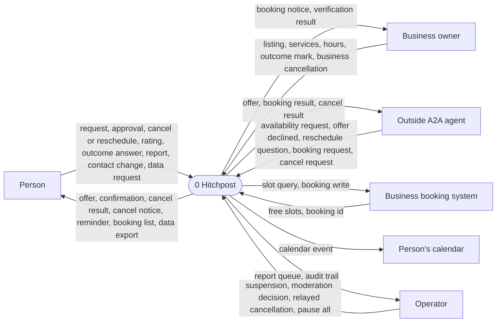
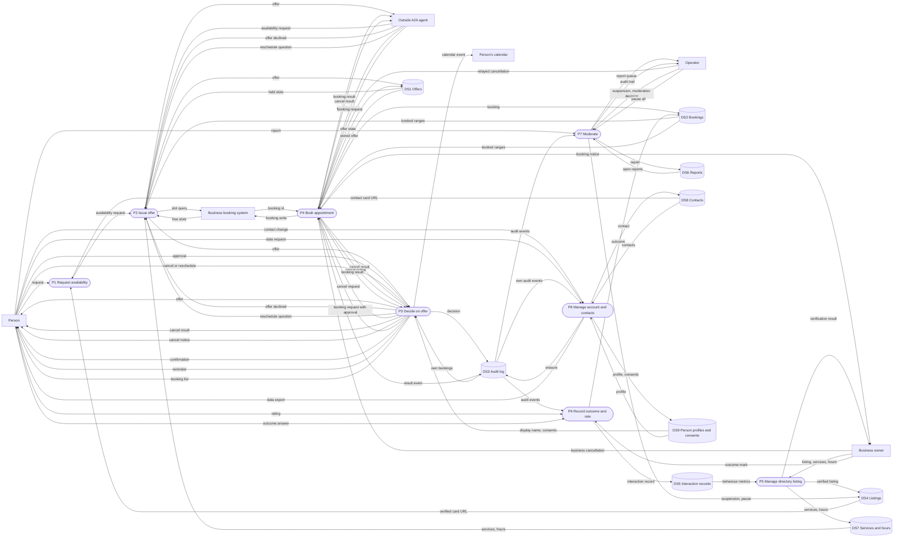
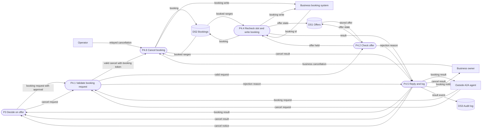
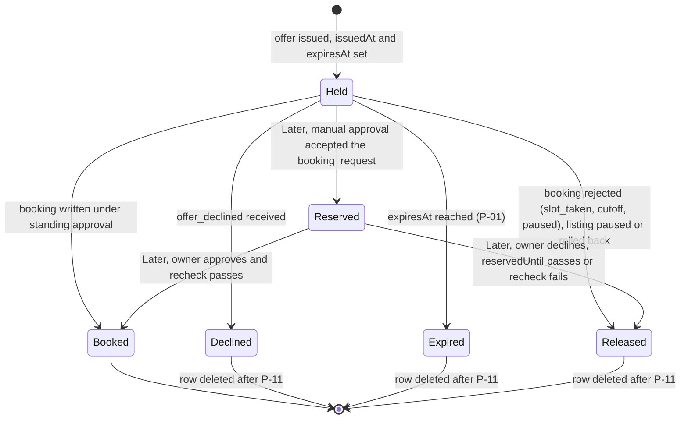
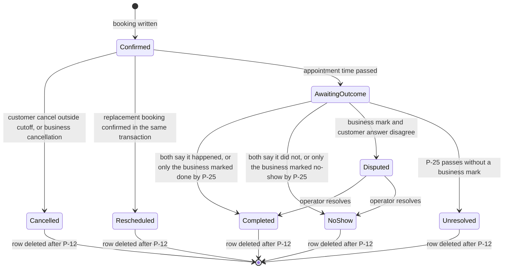
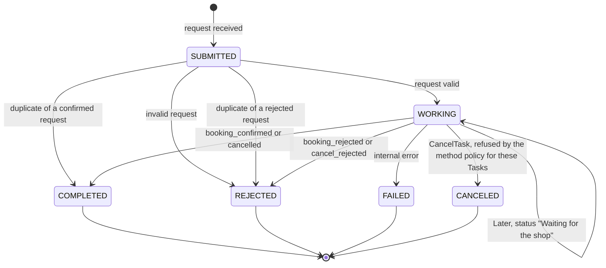
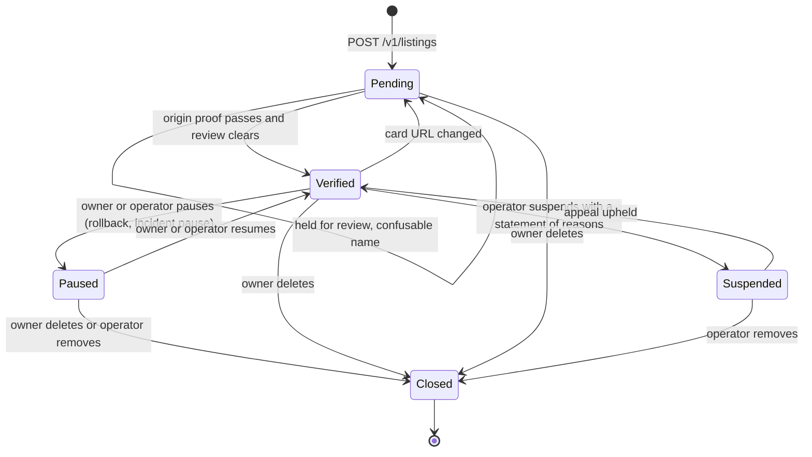
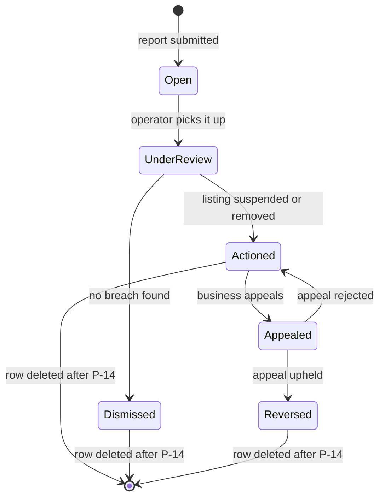
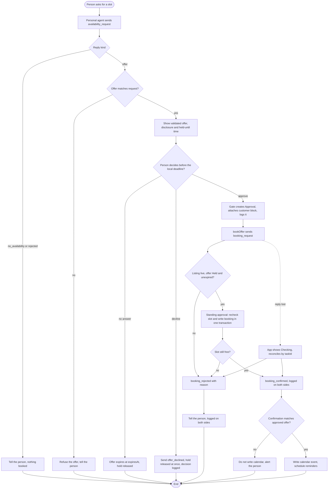

# HP-SAD-07 · Process and behaviour models

| Field       | Value                                                                                                                 |
| ----------- | --------------------------------------------------------------------------------------------------------------------- |
| Document ID | HP-SAD-07                                                                                                             |
| Version     | 1.5                                                                                                                   |
| Status      | Frozen for Phase 2 spike                                                                                              |
| Date        | 2026-11-09                                                                                                            |
| Owner       | Sanaullah Jannisar, product and engineering lead                                                                      |
| Conforms to | ISO/IEC/IEEE 29148 (requirements analysis models), structured analysis (Yourdon/DeMarco DFDs), UML 2.5 state machines |

## 1. Purpose and scope

This document models how data moves through Hitchpost and how its key objects change state. It covers v1 (Phases 1 to 6) of a network of agent lines between users, person to business and person to person: agent messaging, the approval gate, booking, person-to-person time agreement, the directory, outcomes and ratings, accounts and contacts, and moderation. It turns the requirements in [05](05-requirements.md) and the flows in [06](06-use-cases.md) into process models, business rules, decision tables and state machines that the design in [10](10-architecture.md) and the tests in [15](15-test-strategy.md) are checked against. The booking protocol these models follow is recorded in [ADR 0012](../decisions/0012-booking-protocol.md).

Status marks follow the package convention: **Built** (in code now), **Phase N** (planned), **Later**. In the pilot businesses use standing approval only; manual approval of each booking is Later and appears here only where marked so. Timing and limit values are referenced by their normative parameter IDs (register in [00 Document control](00-document-control.md)), not repeated.

## 2. Notation

Mermaid has no native DFD shapes, so I use a fixed mapping. Every diagram in this document follows it.

| DFD element     | Mermaid shape                | Naming rule                        |
| --------------- | ---------------------------- | ---------------------------------- |
| External entity | Rectangle `[Name]`           | A noun: a person or outside system |
| Process         | Rounded `([P1 Verb object])` | Numbered, verb plus object         |
| Data store      | Cylinder `[(DS1 Name)]`      | Numbered, plural noun              |
| Data flow       | Labelled arrow               | The data that moves, not an action |

Rules I hold every diagram to: no flow goes directly between two external entities or two data stores; every process has at least one input and one output; every data store is both written and read somewhere in the set; and each level balances with its parent (every external entity and every boundary flow of the parent appears in the child, with the same name, and the child adds no new external entities).

## 3. Context diagram (level 0)

Hitchpost as one process, with everything it exchanges data with.

The outside A2A agent is any agent Hitchpost didn't build: a business's own agent, a third-party personal agent, or another person's agent line (FR-MSG-01, UC-11). It talks to the responding side directly, so its flows enter P2 and P4 at level 1, bypassing our own personal agent's P1 and P3. In a person-to-person exchange (UC-11) our personal agent can also be the responder: P2 issues the offer from the owner's free and busy times and P4 books it after the owner's own approval in P3.

## 4. Level 1 DFD

The v1 system broken into its major processes. Every level-0 entity and flow appears here with the same name.

| Process | What it does                                                                                                                                                                                                                                                | Implemented by                                                                | Status                                                       |
| ------- | ----------------------------------------------------------------------------------------------------------------------------------------------------------------------------------------------------------------------------------------------------------- | ----------------------------------------------------------------------------- | ------------------------------------------------------------ |
| P1      | Validates the person's request, resolves the agent card from a contact or a listing, refuses a card on another origin, sends the request                                                                                                                    | Personal agent, `askForSlot`                                                  | Built (resolves by URL; contacts Phase 4; directory Phase 3) |
| P2      | Validates the request, de-duplicates it, applies hold caps, finds the earliest free slot (from the book, or from the owner's free and busy times in UC-11), stores and replies with an offer with its disclosure block; releases a hold on `offer_declined` | Business agent or responding personal agent, `BarberExecutor`, `findFreeSlot` | Built (offer storage, caps, de-duplication Phase 2)          |
| P3      | Shows only validated fields, records approve or decline, creates an `Approval`, attaches the customer block, verifies the confirmation, writes the calendar, sends reminders and cancel notices                                                             | Personal agent, approval gate                                                 | Phase 2 (calendar write, reminders and notices Phase 4)      |
| P4      | Checks the offer, rechecks and writes the booking under standing approval, cancels bookings for the customer or the business                                                                                                                                | Business agent, booking handler                                               | Phase 2                                                      |
| P5      | Registers, verifies and updates listings; holds confusable names for review                                                                                                                                                                                 | Directory service                                                             | Phase 3                                                      |
| P6      | Records outcomes from the business mark and the customer answer, resolves them by rule, builds interaction records from both sides' logs, accepts reviews                                                                                                   | Business dashboard, ratings service                                           | Phase 4 (outcome marks), Phase 5 (customer answers, ratings) |
| P7      | Takes reports, gives the operator the queue and audit trail, suspends, pauses or restores listings                                                                                                                                                          | Directory admin                                                               | Phase 5 (pause all from Phase 2 as an operator command)      |
| P8      | Keeps the person's contacts, profile and consents (SMS reminders); answers export and deletion requests                                                                                                                                                     | Personal agent, client app                                                    | Phase 4 (export and deletion Phase 6, NFR-PRIV-02)           |

Processes are logical. Which container runs each one is in [10](10-architecture.md) and [26](26-service-architecture.md); one container can run several processes.

| Store | Holds                                                                                                                | Owner                                         | Status                                          |
| ----- | -------------------------------------------------------------------------------------------------------------------- | --------------------------------------------- | ----------------------------------------------- |
| DS1   | Issued offers with `issuedAt`, `expiresAt`, sender and state                                                         | Business agent (or responding personal agent) | Phase 2                                         |
| DS2   | Bookings as time ranges, with service, price and duration copied at confirmation, the customer block and the outcome | Business agent or business system             | Built in memory (`Book.booked`)                 |
| DS3   | Append-only audit events, with correlation fields                                                                    | Each side keeps its own                       | Phase 2                                         |
| DS4   | Directory listings                                                                                                   | Directory                                     | Phase 3                                         |
| DS5   | Interaction records attested by both sides' matching audit hashes (signatures Phase 6)                               | Ratings service                               | Phase 5                                         |
| DS6   | Reports and moderation actions                                                                                       | Directory                                     | Phase 5                                         |
| DS7   | Services (with stable `serviceId`) and opening hours                                                                 | Business agent                                | Built in memory (`Book.services`, `Book.hours`) |
| DS8   | A person's agent-line contacts: businesses, people, any A2A URL                                                      | Personal agent                                | Phase 4                                         |
| DS9   | A person's profile (display name, verified phone) and consents (SMS reminders)                                       | Personal agent                                | Phase 4                                         |

## 5. Level 2 DFD: P4 Book appointment

Booking is the first process that commits a person's time, so it gets one more level of detail. This diagram decomposes P4 only: every flow crossing its boundary is one of P4's level-1 flows, shown with its level-1 source or destination, and no new external entity appears.

P4.4 rechecks the slot and writes the booking in one transaction, so two requests for the same slot cannot both pass (NFR-REL-02). P4.2 is idempotent: a resent or concurrent request for an offer that already has a Task gets a new Task that completes at once with the original result and `duplicateOf` (BR-18). P4.6 checks the `bookingToken` and the cancellation cutoff (P-10) before a customer cancellation; a business cancellation (owner from Phase 4, operator relay in the pilot) needs no token and produces a cancel notice to the person (FR-BOOK-15). A reschedule is not part of P4: it is a question answered by P2 with an offer carrying `replacesBookingId`, and the swap happens in P4.4 when that offer is booked. P4.3, the wait for a business owner's manual decision, is Later and is left out of the v1 model (number kept free); see the decision table in §7.2.

## 6. Business rules catalogue

| ID    | Rule                                                                                                                                                                                                                                                                                                                                                                                                                                                                                                           | Requirement                        | Where enforced                                                                  | Status                                                   |
| ----- | -------------------------------------------------------------------------------------------------------------------------------------------------------------------------------------------------------------------------------------------------------------------------------------------------------------------------------------------------------------------------------------------------------------------------------------------------------------------------------------------------------------- | ---------------------------------- | ------------------------------------------------------------------------------- | -------------------------------------------------------- |
| BR-01 | A slot may be offered only if it starts inside the requested window, not before now, on a 30-minute boundary, and the whole service fits inside opening hours.                                                                                                                                                                                                                                                                                                                                                 | FR-BOOK-04                         | `findFreeSlot` in `packages/barber-agent/src/book.ts`                           | Built (UTC; business-local in Phase 6)                   |
| BR-02 | A slot may not be offered if its time range overlaps any booked range or any Held offer (or, Later, a Reserved offer).                                                                                                                                                                                                                                                                                                                                                                                         | FR-BOOK-04, FR-BOOK-01             | `findFreeSlot` overlap check; holds Phase 2                                     | Built (bookings), Phase 2 (holds)                        |
| BR-03 | An availability window must be strictly positive and no longer than the maximum search window (P-06).                                                                                                                                                                                                                                                                                                                                                                                                          | FR-MSG-07, NFR-PERF-02             | `parseAvailabilityRequest`, `MAX_WINDOW_DAYS` in `packages/core/src/booking.ts` | Built                                                    |
| BR-04 | All instants must be strict ISO 8601 with an explicit zone and a real calendar day; they are stored as canonical UTC.                                                                                                                                                                                                                                                                                                                                                                                          | FR-MSG-06                          | `toInstant` in `packages/core/src/booking.ts`                                   | Built                                                    |
| BR-05 | A requesting agent accepts an offer only if its service equals the requested service and its start lies within `[earliest, latest]` inclusive.                                                                                                                                                                                                                                                                                                                                                                 | FR-MSG-04                          | `offerMatches` in `packages/core/src/booking.ts`, `askForSlot`                  | Built                                                    |
| BR-06 | An offer is Held from `issuedAt` until `expiresAt` (offer hold, P-01) and can be used for at most one booking. The business clock decides expiry; the personal agent treats it as expired the clock margin (P-09) before its own local deadline.                                                                                                                                                                                                                                                               | FR-BOOK-01, FR-BOOK-02             | Offer store, booking handler, approval gate                                     | Phase 2                                                  |
| BR-07 | An approval names exactly one `offerId` (the `contextId` is recorded with it for correlation only), is created only by the approval gate, and expires with its offer.                                                                                                                                                                                                                                                                                                                                          | FR-GATE-02, FR-GATE-04             | `Approval` type and `bookOffer(approval)`                                       | Phase 2                                                  |
| BR-08 | Nothing commits a person (time, money, personal data) without that person's explicit approval. A person never has standing approval; in UC-11 both people approve.                                                                                                                                                                                                                                                                                                                                             | FR-GATE-01, FR-APP-07              | Approval gate; the only booking path takes an `Approval`                        | Phase 2 (nothing books today)                            |
| BR-09 | A business's opening hours are its standing approval: a valid booking inside them is decided at once. This is the only business mode in the pilot. Manual approval (offer Reserved, Task `WORKING` until the owner decides or the manual approval wait P-03 ends, then `shop_timeout`) is Later.                                                                                                                                                                                                               | FR-GATE-05                         | Booking handler                                                                 | Phase 2 (standing); Later (manual)                       |
| BR-10 | A customer may cancel a booking only with a request presenting its `bookingToken`, and only until the cancellation cutoff (P-10); a cancel inside the cutoff ends in `cancel_rejected` with reason `cutoff`, and a wrong or missing token in `cancel_rejected` with reason `unknown_booking`. A business cancellation needs no token and always notifies the person.                                                                                                                                           | FR-BOOK-03, FR-BOOK-10, FR-BOOK-15 | Booking handler                                                                 | Phase 2                                                  |
| BR-11 | A reschedule is a `reschedule_request` Message presenting the `bookingToken`, answered with an offer carrying `replacesBookingId`, `no_availability`, or `rejected` with reason `cutoff`. The cutoff (P-10) is checked at the question and again at the swap (`booking_rejected` with reason `cutoff`), so a reschedule can never cancel a booking that a direct cancel would refuse. The old booking is cancelled in the same transaction that confirms the new one, so a failed reschedule leaves it intact. | FR-BOOK-11                         | Offer issuer (question), booking handler (swap)                                 | Phase 2                                                  |
| BR-12 | A listing is published only after its owner proves control of the agent card's origin, and the card's interface URL must share that origin. Hosted agents each have their own subdomain, so origins are never shared (Phase 6).                                                                                                                                                                                                                                                                                | FR-DIR-01, FR-DIR-03               | Directory verification worker                                                   | Phase 3                                                  |
| BR-13 | Changing a listing's card URL resets it to unverified.                                                                                                                                                                                                                                                                                                                                                                                                                                                         | FR-DIR-01, FR-DIR-04               | Directory API `PATCH`                                                           | Phase 3                                                  |
| BR-14 | An interaction can be rated only if it is a verified interaction (both sides logged the offer and a matching decision, and the booking reached Completed or NoShow, not Disputed or Unresolved); each side rates it at most once.                                                                                                                                                                                                                                                                              | FR-RATE-01                         | Rating ingest                                                                   | Phase 5                                                  |
| BR-15 | Text shown to a person must respect the text limit (P-19).                                                                                                                                                                                                                                                                                                                                                                                                                                                     | NFR-SEC-05                         | `SAFE_TEXT` in `packages/core/src/booking.ts`                                   | Built                                                    |
| BR-16 | A suspended listing disappears from search immediately; the business is told the reason in a statement of reasons and can appeal.                                                                                                                                                                                                                                                                                                                                                                              | FR-ADMIN-01                        | Directory admin                                                                 | Phase 5                                                  |
| BR-17 | No sender may hold more than the open holds cap (P-07); beyond it the business answers `rejected` reason `hold_cap` and issues no hold. The sender is the install key, falling back to the client IP until Phase 6, then the agent identity. There is no per-`contextId` cap, because clients choose `contextId`. A declined offer (`offer_declined`) releases its hold at once.                                                                                                                               | FR-BOOK-09, NFR-SEC-03             | Offer store                                                                     | Phase 2                                                  |
| BR-18 | A resent or concurrent `booking_request` for an offer that already has a Task never creates a second booking: the new Task completes at once with the original result plus `duplicateOf: <original taskId>`, including the loser of a concurrent unique-key race. A client that holds the `taskId` retries with `GetTask` instead (the SDK refuses a send naming a finished task, `server/index.js:2789`). `cancel_request` works the same way through `bookingId → taskId`.                                   | FR-BOOK-07, NFR-REL-02             | Booking handler (`offerId → taskId`, `bookingId → taskId`)                      | Phase 2                                                  |
| BR-19 | Authority comes from server-minted secrets, not from `contextId`, which the client chooses (`server/index.js:2815`): `offerId` authorises `booking_request` and `offer_declined` for that offer; `bookingToken` authorises `cancel_request` and `reschedule_request` for that booking. Until agent authentication (Phase 6) both are bearer capabilities: logged as hashes, never shown or put in a URL.                                                                                                       | FR-MSG-12, NFR-SEC-01              | Offer store, booking handler                                                    | Phase 2                                                  |
| BR-20 | The offer is the earliest slot that fits the request, never a slot the business prefers.                                                                                                                                                                                                                                                                                                                                                                                                                       | FR-BOOK-16                         | `findFreeSlot` returns the first free slot in time order                        | Built                                                    |
| BR-21 | A resent `availability_request` with the same `messageId` from the same sender returns the original reply and creates no new hold.                                                                                                                                                                                                                                                                                                                                                                             | FR-MSG-13                          | Offer store (`sender`, `messageId` key)                                         | Phase 2                                                  |
| BR-22 | An outcome resolves by rule. After the appointment time the booking is AwaitingOutcome until both the business mark and the customer answer ("Did it go as booked?") arrive or P-25 passes. Both agree: Completed or NoShow. They disagree: Disputed until the operator resolves it. Only the business marked by P-25: the mark stands. Only the customer answered by P-25, or neither: Unresolved, which is final. Only Completed counts toward the north star.                                               | FR-RATE-04, FR-RATE-05, FR-RATE-06 | Outcome recorder                                                                | Phase 4 (marks, Unresolved), Phase 5 (answers, Disputed) |
| BR-23 | A request of an unknown `kind` is answered `rejected` reason `unsupported_kind`; an unknown reply kind is reported to the person as an unsupported reply and books nothing.                                                                                                                                                                                                                                                                                                                                    | FR-MSG-14                          | `parse*` functions, `askForSlot`                                                | Phase 2                                                  |
| BR-24 | A business agent refuses `ListTasks` for every caller and `CancelTask` on booking and cancel Tasks, and never writes a `bookingToken` into Task history (the token is an HMAC of the `bookingId`). Proposed; confirmed by the Phase 2 spike (O-1).                                                                                                                                                                                                                                                             | FR-MSG-18                          | Request handler method policy                                                   | Phase 2 (pending spike)                                  |
| BR-25 | The customer block (display name, verified phone, optional note) is attached only after the person approves, sent only to the business named on the offer, and shown only to that business.                                                                                                                                                                                                                                                                                                                    | FR-BOOK-14, NFR-PRIV-01            | Approval gate, booking handler                                                  | Phase 2                                                  |
| BR-26 | A paused listing answers new availability requests with `rejected` reason `paused` and new booking requests with `booking_rejected` reason `paused`, shows its business phone, and keeps its confirmed bookings.                                                                                                                                                                                                                                                                                               | FR-ADMIN-03                        | Business agent, directory                                                       | Phase 2                                                  |
| BR-27 | A business holds at most P-31 concurrent open offers, whoever the senders are; beyond it every new availability request gets `rejected` reason `hold_cap` and no hold. This backs up BR-17, whose sender key (install key) is chosen by the client and can be rotated.                                                                                                                                                                                                                                         | FR-BOOK-18                         | Offer store                                                                     | Phase 2                                                  |

## 7. Decision tables

Each table is complete: every combination of conditions maps to exactly one action. A dash means "any value". Rules are evaluated left to right; the first column that matches wins.

### 7.1 Can this slot be offered? (BR-01, BR-02, BR-17, BR-20, BR-21, BR-26, BR-27)

| Rule                                                   | 1                         | 2                     | 3                              | 4                       | 5             | 6             | 7             | 8             | 9                   |
| ------------------------------------------------------ | ------------------------- | --------------------- | ------------------------------ | ----------------------- | ------------- | ------------- | ------------- | ------------- | ------------------- |
| Same sender and `messageId` already answered (Phase 2) | Y                         | N                     | N                              | N                       | N             | N             | N             | N             | N                   |
| Listing paused (Phase 2)                               | -                         | Y                     | N                              | N                       | N             | N             | N             | N             | N                   |
| Service exists in the book                             | -                         | -                     | N                              | Y                       | Y             | Y             | Y             | Y             | Y                   |
| Sender under P-07 and business under P-31 open holds   | -                         | -                     | -                              | N                       | Y             | Y             | Y             | Y             | Y                   |
| Start is in the window and not before now              | -                         | -                     | -                              | -                       | N             | Y             | Y             | Y             | Y                   |
| Business open that day, service fits before close      | -                         | -                     | -                              | -                       | -             | N             | Y             | Y             | Y                   |
| Overlaps a booking or a Held offer                     | -                         | -                     | -                              | -                       | -             | -             | Y             | N             | N                   |
| Earlier fitting slot exists                            | -                         | -                     | -                              | -                       | -             | -             | -             | Y             | N                   |
| **Action**                                             | Return the original reply | `rejected` (`paused`) | `rejected` (`unknown_service`) | `rejected` (`hold_cap`) | Try next slot | Try next slot | Try next slot | Try next slot | **Offer this slot** |

Slots are tried in time order, so rule 8 never fires in practice; it states the slot selection duty (BR-20) as a condition. If the search reaches `latest` without an "offer" action, the reply is `no_availability`. Rule 3 changes today's behaviour: the Built code answers `no_availability` for an unknown service, which looks like a fully booked day; Phase 2 answers `rejected` with `unknown_service`. Rules 1, 2 and 4 are Phase 2.

### 7.2 Accept a `booking_request`? (BR-06, BR-07, BR-09, BR-18, BR-19, BR-26; Phase 2)

| Rule                                                            | 1          | 2                                                       | 3        | 4               | 5         | 6        | 7           | 8            | 9           | 10           | 11              | 12             |
| --------------------------------------------------------------- | ---------- | ------------------------------------------------------- | -------- | --------------- | --------- | -------- | ----------- | ------------ | ----------- | ------------ | --------------- | -------------- |
| Request valid (shape, contract extension header)                | N          | Y                                                       | Y        | Y               | Y         | Y        | Y           | Y            | Y           | Y            | Y               | Y              |
| Offer already has a Task                                        | -          | Y                                                       | N        | N               | N         | N        | N           | N            | N           | N            | N               | N              |
| Listing paused                                                  | -          | -                                                       | Y        | N               | N         | N        | N           | N            | N           | N            | N               | N              |
| `offerId` issued by this business                               | -          | -                                                       | -        | N               | Y         | Y        | Y           | Y            | Y           | Y            | Y               | Y              |
| Offer Held and unexpired                                        | -          | -                                                       | -        | -               | N         | Y        | Y           | Y            | Y           | Y            | Y               | Y              |
| Offer replaces a booking and the swap is past the cutoff (P-10) | -          | -                                                       | -        | -               | -         | Y        | N           | N            | N           | N            | N               | N              |
| Business requires manual approval (Later)                       | -          | -                                                       | -        | -               | -         | -        | N           | N            | Y           | Y            | Y               | Y              |
| Owner decision by `reservedUntil` (Later)                       | -          | -                                                       | -        | -               | -         | -        | -           | -            | Approve     | Approve      | Decline         | None           |
| Slot free at write (recheck)                                    | -          | -                                                       | -        | -               | -         | -        | Y           | N            | Y           | N            | -               | -              |
| **Action**                                                      | `rejected` | New Task returns the original result with `duplicateOf` | `paused` | `unknown_offer` | `expired` | `cutoff` | **Confirm** | `slot_taken` | **Confirm** | `slot_taken` | `shop_declined` | `shop_timeout` |

Rule 1 covers a missing `A2A-Extensions` header too: the SDK refuses the send with `ExtensionSupportRequiredError` before the executor runs (`server/index.js:2775-2781`). Rule 2 also covers the loser of two concurrent sends. Actions other than "Confirm" and the duplicate rule end the Task `REJECTED` with a `booking_rejected` of that reason, and the offer moves to Released. Rules 9 to 12 are Later (manual approval); in the pilot rule 7 or 8 always applies. A confirmed reschedule (rule 7 with `replacesBookingId`) cancels the old booking in the same transaction.

### 7.3 Can this interaction be rated? (BR-14; Phase 5)

| Rule                                                                                       | 1      | 2      | 3                     | 4                            | 5                 |
| ------------------------------------------------------------------------------------------ | ------ | ------ | --------------------- | ---------------------------- | ----------------- |
| Rater was a party to the interaction                                                       | N      | Y      | Y                     | Y                            | Y                 |
| Both sides' audit hashes of the offer and the decision match (Phase 5; signatures Phase 6) | -      | N      | Y                     | Y                            | Y                 |
| Booking reached Completed or NoShow (not Disputed or Unresolved)                           | -      | -      | N                     | Y                            | Y                 |
| Rater already rated it                                                                     | -      | -      | -                     | Y                            | N                 |
| **Action**                                                                                 | Refuse | Refuse | Refuse until resolved | Refuse (one rating per side) | **Accept rating** |

### 7.4 Resolve a booking's outcome (BR-22; Phase 4 and 5)

Evaluated while the booking is AwaitingOutcome, and once more when P-25 passes.

| Rule                                  | 1                  | 2                    | 3                    | 4                    | 5                 | 6                          |
| ------------------------------------- | ------------------ | -------------------- | -------------------- | -------------------- | ----------------- | -------------------------- |
| Business marked an outcome            | N                  | N                    | Y                    | Y                    | Y                 | Y                          |
| Customer answered                     | -                  | -                    | N                    | N                    | Y                 | Y                          |
| P-25 has passed since the appointment | Y                  | N                    | N                    | Y                    | -                 | -                          |
| Mark and answer agree                 | -                  | -                    | -                    | -                    | Y                 | N                          |
| **Action**                            | Unresolved (final) | Stay AwaitingOutcome | Stay AwaitingOutcome | Business mark stands | Outcome as marked | Disputed (operator review) |

A customer answer alone never sets Completed: a business that never marks has its bookings go Unresolved, and the unmarked rate is a counter-metric. Unresolved is final; a late business mark is logged but does not change it.

## 8. State machines

The state names below are the enumeration values `OfferState`, `BookingStatus` and `ListingStatus` used in [09 Data dictionary](09-data-dictionary.md). Rows are deleted by the retention jobs (P-11 to P-14) once a final state ages out; deletion is not a state.

### 8.1 Offer (business side; Phase 2)

Held offers block slots (BR-02). A Booked offer is kept as part of its booking's record until the booking is deleted (P-12). Today an offer exists only as a message; nothing is stored (Built as message, Phase 2 as state).

### 8.2 Booking (Phase 2; outcomes Phase 4 and 5)

A booking exists only once it has been written.

Completed is what the north star counts as "honored" ([01](01-vision-and-scope.md)). Disputed and Unresolved bookings are excluded from the north star and from rating (BR-14, BR-22); Unresolved is final. A Cancelled booking records who cancelled (`customer` or `business`); a business cancellation always notifies the person (FR-BOOK-15). The same machine is drawn in [21 UML models](21-uml-models.md) and stored as `BookingStatus` in [09](09-data-dictionary.md).

### 8.3 A2A booking Task (Phase 2, ADR 0012)

The SDK's task states, as Hitchpost uses them for `booking_request` and `cancel_request`. `reschedule_request` and `offer_declined` are answered by Messages, so they have no Task. A resent request for an offer or booking that already has a Task gets a new Task that goes straight from SUBMITTED to the original final state, carrying `duplicateOf` (BR-18).

Under standing approval the Task reaches a final state within the request. `CANCELED` is the SDK's state for `CancelTask` (`server/index.js:3217`); the method policy (BR-24) refuses `CancelTask` on booking and cancel Tasks, so the state is drawn for completeness and is unreachable while the policy holds. `INPUT_REQUIRED` is deliberately never used: in A2A it asks the _client_ for input, and SDK 1.3 stops draining executor events at that state (`server/index.js:2181`). The personal agent treats `FAILED`, `CANCELED` and a lost reply it cannot reconcile as "not booked" and tells the person so; it never assumes success (FR-GATE-01). After a restart the business agent rebuilds Task state from the bookings table (FR-BOOK-13).

### 8.4 Directory listing (Phase 3)

Only `Verified` listings appear in search (BR-12, BR-16). A `Paused` listing answers `paused` and shows its business phone (BR-26).

### 8.5 Report (Phase 5)

The reporter is told the outcome when a report reaches Actioned, Dismissed or Reversed.

## 9. Activity diagram: approve and book (UC-02, UC-03)

Manual approval by the business owner (Later) would add a branch between "Listing live" and "Standing approval": offer Reserved, Task `WORKING`, owner decides by `reservedUntil` (P-03); see ADR 0012.

## 10. Event list

| ID   | Event                                      | Type     | Trigger                                           | Process                               | Response                                                                                                                        | Status                                 |
| ---- | ------------------------------------------ | -------- | ------------------------------------------------- | ------------------------------------- | ------------------------------------------------------------------------------------------------------------------------------- | -------------------------------------- |
| E-01 | Person asks for availability               | External | Person                                            | P1, P2                                | Offer, `no_availability` or `rejected`                                                                                          | Built                                  |
| E-02 | Outside agent sends a message              | External | Any A2A agent                                     | P2, P4                                | Validated reply or `rejected`                                                                                                   | Built                                  |
| E-03 | Person approves an offer                   | External | Person                                            | P3, P4                                | Booking confirmed or rejected                                                                                                   | Phase 2                                |
| E-04 | Person declines an offer                   | External | Person                                            | P3, P2                                | `offer_declined` sent; hold released at once; decision logged                                                                   | Phase 2                                |
| E-05 | Owner decides a manual booking             | External | Business owner                                    | P4                                    | Task completes or is rejected `shop_declined`                                                                                   | Later                                  |
| E-06 | Person cancels or reschedules              | External | Person                                            | P4 (cancel), P2 (reschedule question) | `cancelled` or `cancel_rejected`; for a reschedule, an offer with `replacesBookingId`, `no_availability` or `rejected` `cutoff` | Phase 2                                |
| E-07 | Offer reaches `expiresAt`                  | Temporal | Clock, offer hold (P-01)                          | P2                                    | Hold released, offer Expired                                                                                                    | Phase 2                                |
| E-08 | Manual approval wait ends                  | Temporal | Clock, manual approval wait (P-03)                | P4                                    | Offer Released; `booking_rejected` `shop_timeout`                                                                               | Later                                  |
| E-09 | Appointment time passes                    | Temporal | Clock                                             | P6                                    | Business asked to mark the outcome (Phase 4); customer asked "Did it go as booked?" (Phase 5)                                   | Phase 4                                |
| E-10 | Business registers or edits a listing      | External | Business owner                                    | P5                                    | Listing pending, verification started, confusable names held for review                                                         | Phase 3                                |
| E-11 | Agent card refresh finds origin changed    | Temporal | Daily card refresh                                | P5                                    | Listing back to pending                                                                                                         | Phase 3                                |
| E-12 | Person submits a rating or review          | External | Person                                            | P6                                    | Accepted or refused per §7.3                                                                                                    | Phase 5                                |
| E-13 | Someone reports a listing                  | External | Person or agent                                   | P7                                    | Report opened                                                                                                                   | Phase 5                                |
| E-14 | Retention period ends                      | Temporal | Daily job                                         | All                                   | Delete per P-11 to P-14 ([08 §5](08-data-design.md#5-retention))                                                                | Phase 6                                |
| E-15 | Outcome reported                           | External | Business (dashboard) or customer                  | P6                                    | Outcome resolved per §7.4; interaction becomes ratable when final                                                               | Phase 4                                |
| E-16 | Outcome still unmarked                     | Temporal | Clock, P-25 after the appointment                 | P6                                    | Booking Unresolved; counted in the unmarked rate                                                                                | Phase 4                                |
| E-17 | Reminder due                               | Temporal | Clock, P-29 before the appointment                | P3                                    | Reminder to the person (SMS only with consent)                                                                                  | Phase 4                                |
| E-18 | Business cancels a booking                 | External | Business owner, or operator relay in the pilot    | P4                                    | Booking Cancelled; cancel notice to the person                                                                                  | Phase 2 (relay), Phase 4 (owner)       |
| E-19 | Person asks to export or delete their data | External | Person                                            | P8                                    | Export file, or erasure from live stores within P-13                                                                            | Phase 6                                |
| E-20 | Operator pauses all listings               | External | Operator, or a SEV1 alert unacknowledged for P-28 | P7                                    | Every listing Paused; new requests answered `paused`                                                                            | Phase 2 (command), Phase 6 (automatic) |

## Revision history

| Version | Date       | Change                                                                                                                                                                                                                                                                                                                                                                                                                                                                                                                                                                                                                                                                                                                                                                                                                                                                                                                                                                           | Author      |
| ------- | ---------- | -------------------------------------------------------------------------------------------------------------------------------------------------------------------------------------------------------------------------------------------------------------------------------------------------------------------------------------------------------------------------------------------------------------------------------------------------------------------------------------------------------------------------------------------------------------------------------------------------------------------------------------------------------------------------------------------------------------------------------------------------------------------------------------------------------------------------------------------------------------------------------------------------------------------------------------------------------------------------------- | ----------- |
| 1.0     | 2026-11-09 | First baseline                                                                                                                                                                                                                                                                                                                                                                                                                                                                                                                                                                                                                                                                                                                                                                                                                                                                                                                                                                   | S. Jannisar |
| 1.1     | 2026-11-09 | Remediation after independent review: balanced level 1 and level 2 DFDs, Reserved offer state, WORKING instead of input-required, recheck at write, idempotency, hold caps, context binding (BR-17 to BR-19), Booking NoShow and Completed, E-15, P-IDs                                                                                                                                                                                                                                                                                                                                                                                                                                                                                                                                                                                                                                                                                                                          | S. Jannisar |
| 1.2     | 2026-11-09 | Second remediation after regrade: cancel, reschedule and outside-agent `offer_declined` flows in the DFDs (P4.6 added at level 2); BR-17 to BR-19 rebuilt on SDK behaviour (per-sender cap, `duplicateOf`, `offerId` and `bookingToken` capabilities); reschedule cutoff in BR-11 and decision table 7.2; `reservedUntil`; Paused listing transitions; Phase 5 attestation by matching audit hashes                                                                                                                                                                                                                                                                                                                                                                                                                                                                                                                                                                              | S. Jannisar |
| 1.3     | 2026-11-09 | Round 3: expert panel audit, user-to-user reframing, US jurisdiction: scope as a network of agent lines including person to person (UC-11); standing approval only in the pilot, manual approval (P4.3, Reserved, rules 9 to 12, E-05, E-08) marked Later; DFDs balanced against the new scope (O-9): outcome marks and answers, P8 accounts and contacts with DS8 and DS9, export and deletion, reminders, business cancellation and operator relay, pause all; state models completed (O-5): Held exits for `slot_taken`, `cutoff`, paused listing and rollback, Confirmed exits to Unresolved, Disputed state, CANCELED task, deletion no longer a state; BR-20 to BR-26 (slot selection duty, availability de-duplication, outcome resolution, unknown kinds, method policy, customer block, paused listing); decision table 7.1 with de-duplication, pause and `unknown_service`, 7.2 with pause and concurrent duplicates, new 7.4 outcome resolution; events E-16 to E-20 | S. Jannisar |
| 1.5     | 2026-11-09 | Round 5: protocol first (no pricing), minimal MCP gateway in v1, final QA fixes, frozen for the Phase 2 spike                                                                                                                                                                                                                                                                                                                                                                                                                                                                                                                                                                                                                                                                                                                                                                                                                                                                    | S. Jannisar |
