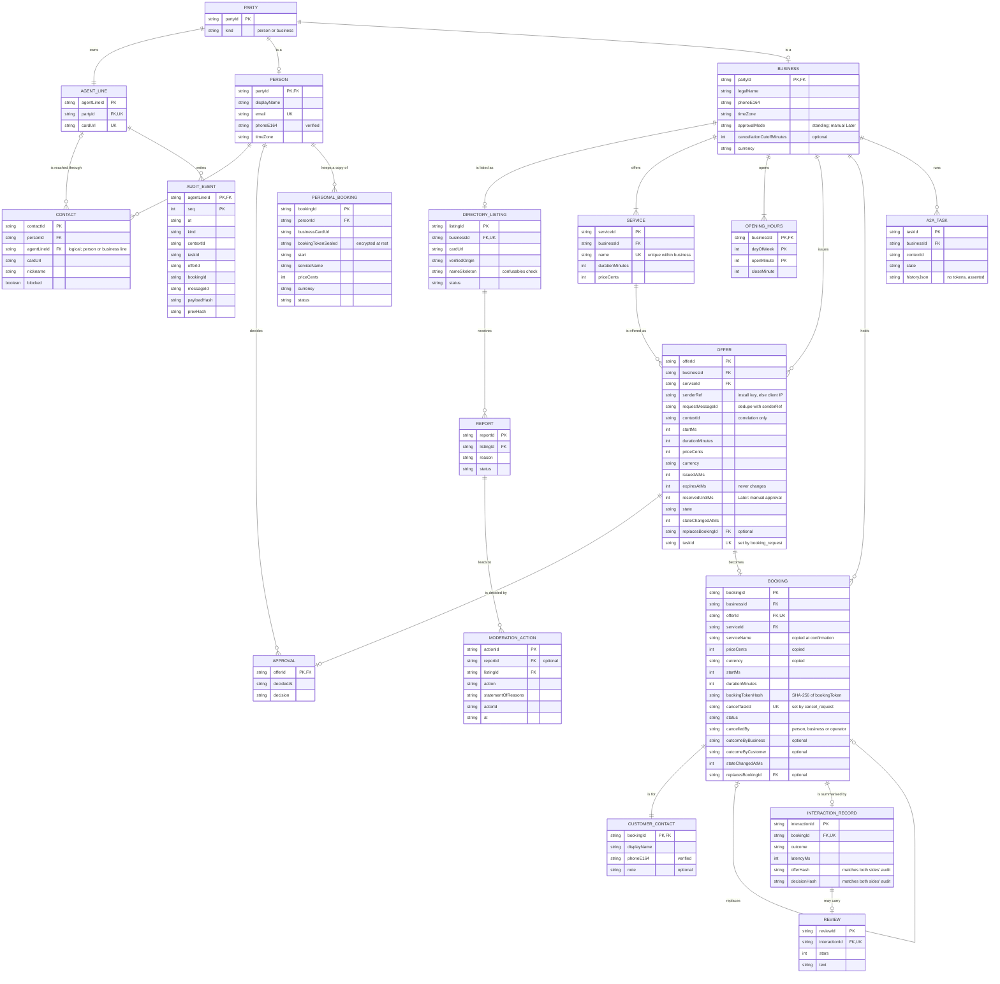

# HP-SAD-08 · Data design

| Field       | Value                                                                                                   |
| ----------- | ------------------------------------------------------------------------------------------------------- |
| Document ID | HP-SAD-08                                                                                               |
| Version     | 1.5                                                                                                     |
| Status      | Frozen for Phase 2 spike                                                                                |
| Date        | 2026-11-09                                                                                              |
| Owner       | Sanaullah Jannisar, product and engineering lead                                                        |
| Conforms to | IEEE 1016-2009 (information and logical viewpoints); ISO/IEC/IEEE 29148 (logical database requirements) |

The entities Hitchpost handles, who owns each, where it is stored in each phase, how long it is kept and how sensitive it is. Hitchpost is a network of agent lines between users: every person and every business has an agent line, and contacts can be either. Barbers are the first vertical, so the booking entities are worked out in the most detail. Attribute types and limits are defined once in [09 Data dictionary](09-data-dictionary.md); the conceptual EER model, mapping and DDL are in [22 Enhanced entity relationship model](22-enhanced-entity-relationship-model.md); timing and retention values are normative parameters (P-IDs) in [00 Document control](00-document-control.md).

## 1. Entity relationship model

Keys: `PK` primary key, `FK` foreign key, `UK` unique. Cardinalities match the dictionary in [09](09-data-dictionary.md). Entities live in different stores (see §2), so a foreign key that crosses a store boundary is a logical reference, not a database constraint; those are marked "logical" in §3.



`AgentCard` is not stored as a row: each agent serves its own card at `/.well-known/agent-card.json` (Built, `barberCard()` in `packages/barber-agent/src/server.ts`); the directory keeps only `cardUrl` and the verified origin. The A2A SDK's own task table (`A2A_TASK`) is modelled because it holds message history: it is purged with the offers and bookings it belongs to, and a test asserts no `bookingToken` ever appears in it (§3).

## 2. Entities

| Entity                | Owner (stores it)                                       | Privacy class                    | Status                                | Notes                                                                                                                                                                                       |
| --------------------- | ------------------------------------------------------- | -------------------------------- | ------------------------------------- | ------------------------------------------------------------------------------------------------------------------------------------------------------------------------------------------- |
| Party, AgentLine      | App (people), business agent and directory (businesses) | Public (line), Personal (person) | Phase 2 (business), Phase 4 (people)  | Every person and business has one agent line; contacts point at lines, so person-to-person contacts (UC-11) and person-to-business contacts are the same thing.                             |
| Person                | Personal side (app)                                     | Personal                         | Phase 4                               | Never sent to business agents beyond the customer contact block a booking needs (NFR-PRIV-01).                                                                                              |
| Business              | Business agent; public subset in the directory          | Public                           | Phase 2 (agent), Phase 3 (directory)  | Legal name and phone are shown on every offer. `approvalMode` is `standing` in the pilot; `manual` is Later.                                                                                |
| Service, OpeningHours | Business agent                                          | Public                           | Built (as `Book`)                     | `Book.services`, `Book.hours` in `book.ts`. Phase 2 adds the `serviceId` surrogate key. Hours become minutes of the local day in Phase 6 (ADR 0018).                                        |
| Offer                 | Business agent stores; personal agent keeps a copy      | Personal                         | Phase 2                               | Built only as a message type (`Offer` in `core/src/booking.ts`). De-duplicated on (`senderRef`, `requestMessageId`). FR-BOOK-01.                                                            |
| Approval              | Personal agent only                                     | Personal                         | Phase 2                               | Never leaves the personal side; the business sees only `booking_request` or `offer_declined`. FR-GATE-02.                                                                                   |
| Booking               | Business agent                                          | Personal                         | Built (as `Book.booked`, time ranges) | The source of truth for bookings; A2A Task state is rebuilt from it at startup. Copies service name, price, currency and duration at confirmation so the evidence outlives the offer purge. |
| CustomerContact       | Business agent                                          | Sensitive                        | Phase 2                               | Display name, verified phone, optional note; sent only after the person approves, only to that business; deleted with the booking (P-12).                                                   |
| PersonalBooking       | Personal agent                                          | Personal (token Sensitive)       | Phase 2                               | The person's copy: what was booked, where, and the `bookingToken` sealed at rest, needed for cancel and reschedule (O-8).                                                                   |
| A2ATask               | Business agent (SDK `DatabaseTaskStore`)                | Personal                         | Phase 2                               | Derived state: rebuildable from `bookings`; purged with its offer or booking; never holds a token.                                                                                          |
| AuditEvent            | Each side, own log                                      | Personal                         | Phase 2                               | Append-only, correlation ids (`contextId`, `taskId`, `offerId`, `bookingId`, `messageId`) from Phase 2. FR-GATE-03.                                                                         |
| DirectoryListing      | Directory                                               | Public                           | Phase 3                               | FR-DIR-01..03; `nameSkeleton` for the confusables check (T-30).                                                                                                                             |
| Contact               | Personal side (app)                                     | Personal                         | Phase 4                               | Points at an agent line, person or business. FR-APP-01, UC-11.                                                                                                                              |
| InteractionRecord     | Ratings service, built from both sides' logs            | Personal (pseudonymous)          | Phase 5                               | One per booking; outcome `completed`, `no_show`, `cancelled` or `disputed`. Accepted only when both sides' audit hashes match (Phase 5); signatures Phase 6 (ADR 0017). FR-RATE-02.         |
| Review                | Ratings service                                         | Public text, personal author     | Phase 5                               | Only on a verified interaction. FR-RATE-01.                                                                                                                                                 |
| Report                | Directory                                               | Personal (reporter)              | Phase 5                               | FR-ADMIN-01.                                                                                                                                                                                |
| ModerationAction      | Directory                                               | Personal (actor)                 | Phase 5                               | Every takedown or reinstatement with a statement of reasons and appeal route. FR-ADMIN-02.                                                                                                  |
| AnalyticsEvent        | App analytics store                                     | Personal (pseudonymous)          | Phase 4                               | Salted per-account `personKey`; test bookings excluded; weekly snapshot table keeps aggregates when retention deletes rows.                                                                 |

No entity holds payment data before a payments ADR. Calendars are never copied: the personal agent writes one event and keeps only the booking reference (NFR-PRIV-01).

## 3. Integrity rules

| Rule                                                                                                                                                                                                    | Enforced where                                                                                  | Status                                 |
| ------------------------------------------------------------------------------------------------------------------------------------------------------------------------------------------------------- | ----------------------------------------------------------------------------------------------- | -------------------------------------- |
| No two bookings overlap in a business's book                                                                                                                                                            | `findFreeSlot` overlap check (Built); Phase 6 `slot_claims` exclusion constraint (§4)           | Built (search), Phase 6 (database)     |
| Held offers count as taken                                                                                                                                                                              | Offer store consulted by slot search; re-checked inside the booking write transaction           | Phase 2                                |
| A booking needs an unexpired offer issued by this business (the `offerId` is the capability; `contextId` is not checked)                                                                                | Booking handler, one transaction: read offer, re-check slot, write booking and customer contact | Phase 2                                |
| One booking per offer; a resent `booking_request` gets the original result with `duplicateOf`                                                                                                           | `UK` on `Booking.offerId` and `Offer.taskId`; a UNIQUE violation maps to the duplicate reply    | Phase 2                                |
| One offer per (sender, request message)                                                                                                                                                                 | `UK` on (`senderRef`, `requestMessageId`) in `offers`                                           | Phase 2                                |
| Cancel and reschedule need the booking's `bookingToken`                                                                                                                                                 | Compare SHA-256 of the presented token with `bookingTokenHash`                                  | Phase 2                                |
| No token is stored in plain text in the business tables; the SDK task history holds it inside the confirmation, readable only with the taskId (ADR 0021)                                                | Hash only; test asserts no token string in `a2a_tasks.history`                                  | Phase 2                                |
| Open holds per sender are capped (P-07); sender is the install key, else the client IP. Open holds per business are capped too (P-31, default 10, configurable per business), independent of the sender | Offer store count before issuing                                                                | Phase 2                                |
| An Approval names exactly one offer and is made before the local deadline                                                                                                                               | `Approval` type, created only by the gate; deadline per P-09                                    | Phase 2                                |
| A booking's outcome resolves by rule: business mark, customer answer, Disputed on disagreement, Unresolved after P-25                                                                                   | Outcome resolver job and the dashboard and app answers                                          | Phase 4 (business), Phase 5 (customer) |
| Audit events are never updated or deleted, except by retention (P-12)                                                                                                                                   | Append-only interface; `seq` allocated inside `BEGIN IMMEDIATE`; `prevHash` chain               | Phase 2 (chain Phase 6)                |
| Timestamps have one canonical form                                                                                                                                                                      | SQLite: INTEGER epoch milliseconds with CHECK; Postgres: `timestamptz`                          | Phase 2                                |
| A review needs a verified interaction                                                                                                                                                                   | Ratings ingest                                                                                  | Phase 5                                |
| A listing's card URL origin equals its verified origin; its name skeleton doesn't collide with another listing's                                                                                        | Directory on register and on every card refresh                                                 | Phase 3                                |
| All instants exchanged in UTC                                                                                                                                                                           | `toInstant` in `core/src/booking.ts`                                                            | Built                                  |
| Shop hours in the shop's IANA zone                                                                                                                                                                      | ADR 0018                                                                                        | Phase 6                                |
| The shop's own `Book` configuration is valid (hours, unique services, currency, parseable booked ranges)                                                                                                | Validation at load; invalid config refuses to start (D-15)                                      | Phase 2                                |
| `Contact.agentLineId`, cross-store `FK`s                                                                                                                                                                | Logical references, checked by the owning service; no cross-store constraint                    | Phase 3 to 5                           |

## 4. Storage by phase

| Phase     | Storage                                                                                                                                                                                                                                                                                                                                                                                                                                                                                     | Why                                                                                   |
| --------- | ------------------------------------------------------------------------------------------------------------------------------------------------------------------------------------------------------------------------------------------------------------------------------------------------------------------------------------------------------------------------------------------------------------------------------------------------------------------------------------------- | ------------------------------------------------------------------------------------- |
| 1 (Built) | In memory (`Book` object passed to `BarberExecutor`); `InMemoryTaskStore`                                                                                                                                                                                                                                                                                                                                                                                                                   | Nothing to persist yet ([ADR 0011](../decisions/0011-in-memory-appointment-book.md)). |
| 2         | **Business side:** one SQLite file in WAL mode holding `offers`, `bookings`, `customer_contacts`, `audit_events` and the SDK's `DatabaseTaskStore` tables (created with `a2a-db`). Writes use `BEGIN IMMEDIATE` with a `busy_timeout`; timestamps are INTEGER epoch milliseconds. Backup by Litestream (or a nightly `VACUUM INTO`), with a restore drill before Phase 2 exit. **Personal side:** append-only JSONL audit file plus a JSONL `personal_bookings` file with the token sealed. | Bookings and audit survive a restart from Phase 2 (NFR-REL-02); no server to run.     |
| 3         | Postgres for the directory                                                                                                                                                                                                                                                                                                                                                                                                                                                                  | Search, uniqueness, verification state.                                               |
| 4         | Postgres for app accounts, contacts and the pseudonymous analytics store; the browser holds nothing sensitive beyond the session                                                                                                                                                                                                                                                                                                                                                            | One database to operate.                                                              |
| 5         | Postgres tables for interaction records, reviews, reports and moderation actions                                                                                                                                                                                                                                                                                                                                                                                                            | Same.                                                                                 |
| 6         | Postgres for hosted business agents, with the `slot_claims` table below, one database role per service and row-level security per business; the shop's own booking system over MCP when it has one                                                                                                                                                                                                                                                                                          | Multi-instance hosting needs a database-level guarantee and tenant isolation.         |

**Bookings are the source of truth.** The SDK's `DatabaseTaskStore` writes its own rows outside the booking transaction, so a crash between the two writes could leave them apart. The booking transaction therefore commits the `bookings` row first, and at startup the business agent rebuilds the state of any non-terminal A2A Task from `bookings` and `offers` (a Task whose offer became a booking is set COMPLETED with the stored result; one whose offer expired is set REJECTED `expired`). The Task table is a cache, never the record.

**Phase 6 concurrency guarantee.** Holds and bookings share one table, so no two can overlap even with several instances serving one shop:

```sql
CREATE TABLE slot_claims (
  business_id text NOT NULL,
  claim_id    text NOT NULL,           -- offerId for a hold, bookingId for a booking
  kind        text NOT NULL CHECK (kind IN ('hold', 'booking')),
  during      tstzrange NOT NULL,
  expires_at  timestamptz,             -- null for bookings
  PRIMARY KEY (business_id, claim_id),
  EXCLUDE USING gist (business_id WITH =, during WITH &&)
);
```

Expired holds are deleted by the expiry job before a new claim is tried, and the insert is retried once. (A `reserved` claim kind returns with manual approval, which is Later.) When the shop uses its own booking system over MCP (FR-BOOK-06), the write to that system must be conditional (fails if the slot is taken); a connector that cannot do that is not supported ([17 Transition plan](17-transition-plan.md)).

## 5. Retention

| Data                                                            | Parameter                                           | Then                                                                                                       |
| --------------------------------------------------------------- | --------------------------------------------------- | ---------------------------------------------------------------------------------------------------------- |
| Expired or declined offers, and their A2A Tasks                 | P-11                                                | Deleted                                                                                                    |
| Bookings, customer contacts, audit events, interaction records  | P-12                                                | Hard-deleted by the retention job (the only deletion path); weekly aggregates kept without personal fields |
| Person, contacts and their personal data after account deletion | P-13                                                | Erased from live systems within 30 days; backup copies expire within P-15, so gone within 60 days          |
| Resolved reports and their moderation actions                   | P-14                                                | Deleted                                                                                                    |
| Reviews                                                         | Until the author deletes them or the listing closes | Deleted                                                                                                    |
| Analytics events                                                | P-12                                                | Deleted; the weekly snapshot table keeps history without personal keys                                     |
| Operational logs                                                | P-23                                                | Deleted                                                                                                    |
| Backups                                                         | P-15                                                | Expire; no separate cold-storage export exists                                                             |

The retention job (event E-14 in [07](07-process-and-behaviour-models.md)) applies these daily. [12 Security and privacy](12-security-and-privacy.md) records the legal basis for each.

## 6. Migrations

- SQL migrations in each service (`packages/<service>/migrations/NNNN_name.sql`), applied on deploy, forward only. SQLite and Postgres migrations carry the same CHECK constraints ([22 §8](22-enhanced-entity-relationship-model.md#8-integrity-constraints-and-ddl)); where the SQL differs, both files ship in the same change and a test runs both.
- Expand then contract: add new columns or tables, deploy code that writes both, backfill, then remove the old shape in a later release.
- SQLite to Postgres (Phase 6): no automatic carry-over of pilot-era data is assumed; any carried data is exported with a script, verified by row counts and hash totals, and rehearsed on staging first.
- Message shapes on the wire follow the versioning rules in [13](13-interfaces.md#2-versioning-and-compatibility); stored data never depends on a field a peer may stop sending.
- The A2A SDK ships the `a2a-db` CLI for its task tables; run it as one migration step.

## Revision history

| Version | Date       | Change                                                                                                                                                                                                                                                                                                                                                                                                                         | Author      |
| ------- | ---------- | ------------------------------------------------------------------------------------------------------------------------------------------------------------------------------------------------------------------------------------------------------------------------------------------------------------------------------------------------------------------------------------------------------------------------------ | ----------- |
| 0.1     | 2026-11-08 | First draft                                                                                                                                                                                                                                                                                                                                                                                                                    | S. Jannisar |
| 1.0     | 2026-11-09 | Baselined: renumbered into lifecycle order, formal document control, standards conformance                                                                                                                                                                                                                                                                                                                                     | S. Jannisar |
| 1.1     | 2026-11-09 | Remediation after independent review: ERD with keys, retention via P-IDs, SQLite/JSONL in Phase 2, `slot_claims` exclusion table, time zones Phase 6                                                                                                                                                                                                                                                                           | S. Jannisar |
| 1.2     | 2026-11-09 | Second remediation after regrade: `reservedUntil` on Offer (`expiresAt` never changes); `bookingTokenHash` and `cancelTaskId` on Booking; interaction record hashes for Phase 5 attestation; integrity rules use capabilities and a per-sender hold cap instead of `contextId`                                                                                                                                                 | S. Jannisar |
| 1.3     | 2026-11-09 | Round 3: expert panel audit, user-to-user reframing, US jurisdiction: Party and AgentLine model for person-to-person contacts; CustomerContact, PersonalBooking, A2ATask, ModerationAction, AnalyticsEvent; `serviceId`; booking copies offer fields; `stateChangedAtMs`; outcome resolution; one deletion path; epoch-ms timestamps, WAL, Litestream; bookings as source of truth with Task rebuild; role per service and RLS | S. Jannisar |
| 1.5     | 2026-11-09 | Round 5: protocol first (no pricing), minimal MCP gateway in v1, final QA fixes, frozen for the Phase 2 spike                                                                                                                                                                                                                                                                                                                  | S. Jannisar |
