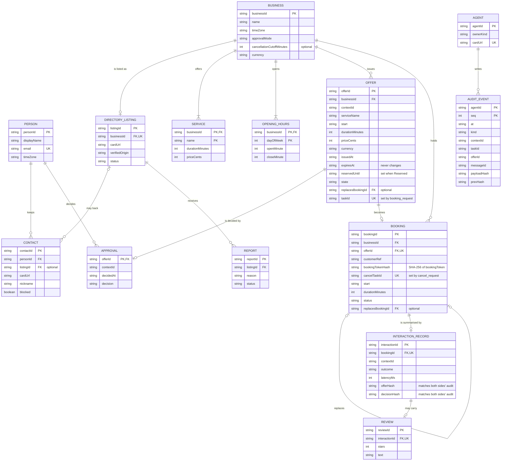

# HP-SAD-08 · Data design

| Field       | Value                                                                                                   |
| ----------- | ------------------------------------------------------------------------------------------------------- |
| Document ID | HP-SAD-08                                                                                               |
| Version     | 1.2                                                                                                     |
| Status      | Baselined for Phase 2                                                                                   |
| Date        | 2026-11-09                                                                                              |
| Owner       | Sanaullah Jannisar, product and engineering lead                                                        |
| Conforms to | IEEE 1016-2009 (information and logical viewpoints); ISO/IEC/IEEE 29148 (logical database requirements) |

The entities Hitchpost handles, who owns each, where it is stored in each phase, how long it is kept and how sensitive it is. Attribute types and limits are defined once in [09 Data dictionary](09-data-dictionary.md); timing and retention values are normative parameters (P-IDs) in [00 Document control](00-document-control.md).

## 1. Entity relationship model

Keys: `PK` primary key, `FK` foreign key, `UK` unique. Cardinalities match the dictionary in [09](09-data-dictionary.md). Entities live in different stores (see §2), so a foreign key that crosses a store boundary is a logical reference, not a database constraint; those are marked "logical" in §3.



`AgentCard` is not stored as a row: each agent serves its own card at `/.well-known/agent-card.json` (Built, `barberCard()` in `packages/barber-agent/src/server.ts`); the directory keeps only `cardUrl` and the verified origin.

## 2. Entities

| Entity                | Owner (stores it)                                  | Privacy class                | Status                                | Notes                                                                                                                                                                                       |
| --------------------- | -------------------------------------------------- | ---------------------------- | ------------------------------------- | ------------------------------------------------------------------------------------------------------------------------------------------------------------------------------------------- |
| Person                | Personal side (app)                                | Personal                     | Phase 4                               | Never sent to business agents beyond what a booking needs (NFR-PRIV-01).                                                                                                                    |
| Business              | Business agent; public subset in the directory     | Public                       | Phase 2 (agent), Phase 3 (directory)  | `approvalMode`, `cancellationCutoffMinutes` (P-10) live with the agent.                                                                                                                     |
| Agent                 | Each agent publishes its own card                  | Public                       | Built                                 | Card in `barberCard()`.                                                                                                                                                                     |
| Service, OpeningHours | Business agent                                     | Public                       | Built (as `Book`)                     | `Book.services`, `Book.hours` in `book.ts`. Hours become minutes of the local day in Phase 6 (ADR 0018).                                                                                    |
| Booking               | Business agent                                     | Personal                     | Built (as `Book.booked`, time ranges) | Phase 2 adds `bookingId`, `status`, `customerRef`, `replacesBookingId`, and `bookingTokenHash` (the `bookingToken` itself is never stored).                                                 |
| Offer                 | Business agent stores; personal agent keeps a copy | Personal                     | Phase 2                               | Built only as a message type (`Offer` in `core/src/booking.ts`). FR-BOOK-01.                                                                                                                |
| Approval              | Personal agent only                                | Personal                     | Phase 2                               | Never leaves the personal side; the business sees only `booking_request` or `offer_declined`. FR-GATE-02.                                                                                   |
| AuditEvent            | Each side, own log                                 | Personal                     | Phase 2                               | Append-only, correlation ids from Phase 2. FR-GATE-03.                                                                                                                                      |
| DirectoryListing      | Directory                                          | Public                       | Phase 3                               | FR-DIR-01..03.                                                                                                                                                                              |
| Contact               | Personal side (app)                                | Personal                     | Phase 4                               | Listing link optional: contacts added by URL have none. FR-APP-01.                                                                                                                          |
| InteractionRecord     | Ratings service, built from both sides' logs       | Personal (pseudonymous)      | Phase 5                               | One per booking; outcome includes `no_show`. Accepted only when both sides' audit hashes of the offer and the decision match (Phase 5); signatures added in Phase 6 (ADR 0017). FR-RATE-02. |
| Review                | Ratings service                                    | Public text, personal author | Phase 5                               | Only on a verified interaction. FR-RATE-01.                                                                                                                                                 |
| Report                | Directory                                          | Personal (reporter)          | Phase 5 to 6                          | FR-ADMIN-01.                                                                                                                                                                                |

No entity holds payment data before a payments ADR. Calendars are never copied: the personal agent writes one event and keeps only the booking reference (NFR-PRIV-01).

## 3. Integrity rules

| Rule                                                                                                                     | Enforced where                                                                        | Status                             |
| ------------------------------------------------------------------------------------------------------------------------ | ------------------------------------------------------------------------------------- | ---------------------------------- |
| No two bookings overlap in a business's book                                                                             | `findFreeSlot` overlap check (Built); Phase 6 `slot_claims` exclusion constraint (§4) | Built (search), Phase 6 (database) |
| Held and reserved offers count as taken                                                                                  | Offer store consulted by slot search; re-checked inside the booking write transaction | Phase 2                            |
| A booking needs an unexpired offer issued by this business (the `offerId` is the capability; `contextId` is not checked) | Booking handler, one transaction: read offer, re-check slot, write booking            | Phase 2                            |
| One booking per offer; a resent `booking_request` gets the original result with `duplicateOf`                            | `UK` on `Booking.offerId` and `Offer.taskId`                                          | Phase 2                            |
| Cancel and reschedule need the booking's `bookingToken`                                                                  | Compare SHA-256 of the presented token with `bookingTokenHash`                        | Phase 2                            |
| Open holds per sender are capped (P-07)                                                                                  | Offer store count before issuing                                                      | Phase 2                            |
| An Approval names exactly one offer and is made before the local deadline                                                | `Approval` type, created only by the gate; deadline per P-09                          | Phase 2                            |
| Audit events are never updated or deleted, except by retention (P-12)                                                    | Append-only interface; `seq` monotonic; `prevHash` chain                              | Phase 2 (chain Phase 6)            |
| A review needs a verified interaction                                                                                    | Ratings ingest                                                                        | Phase 5                            |
| A listing's card URL origin equals its verified origin                                                                   | Directory on register and on every card refresh                                       | Phase 3                            |
| All instants stored in UTC                                                                                               | `toInstant` in `core/src/booking.ts`                                                  | Built                              |
| Shop hours in the shop's IANA zone                                                                                       | ADR 0018                                                                              | Phase 6                            |
| The shop's own `Book` configuration is valid (hours, unique services, currency, parseable booked ranges)                 | Validation at load; invalid config refuses to start (D-15)                            | Phase 2                            |
| `Contact.listingId`, `Booking.customerRef`, cross-store `FK`s                                                            | Logical references, checked by the owning service; no cross-store constraint          | Phase 3 to 5                       |

## 4. Storage by phase

| Phase     | Storage                                                                                                                                                                                         | Why                                                                                   |
| --------- | ----------------------------------------------------------------------------------------------------------------------------------------------------------------------------------------------- | ------------------------------------------------------------------------------------- |
| 1 (Built) | In memory (`Book` object passed to `BarberExecutor`); `InMemoryTaskStore`                                                                                                                       | Nothing to persist yet ([ADR 0011](../decisions/0011-in-memory-appointment-book.md)). |
| 2         | **Business side:** SQLite file holding the SDK's `DatabaseTaskStore` tables (created with `a2a-db`) plus `offers`, `bookings`, `audit_events`. **Personal side:** append-only JSONL audit file. | Bookings and audit survive a restart from Phase 2 (NFR-REL-02); no server to run.     |
| 3         | Postgres for the directory                                                                                                                                                                      | Search, uniqueness, verification state.                                               |
| 4         | Postgres for app accounts and contacts; the browser holds nothing sensitive beyond the session                                                                                                  | One database to operate.                                                              |
| 5         | Postgres tables for interaction records and reviews                                                                                                                                             | Same.                                                                                 |
| 6         | Postgres for hosted business agents, with the `slot_claims` table below; the shop's own booking system over MCP when it has one                                                                 | Multi-instance hosting needs a database-level guarantee.                              |

**Phase 6 concurrency guarantee.** Holds and bookings share one table, so no two can overlap even with several instances serving one shop:

```sql
CREATE TABLE slot_claims (
  business_id text NOT NULL,
  claim_id    text NOT NULL,           -- offerId for a hold, bookingId for a booking
  kind        text NOT NULL,           -- 'hold' | 'reserved' | 'booking'
  during      tstzrange NOT NULL,
  expires_at  timestamptz,             -- null for bookings
  PRIMARY KEY (business_id, claim_id),
  EXCLUDE USING gist (business_id WITH =, during WITH &&)
);
```

Expired holds are deleted by the expiry job before a new claim is tried, and the insert is retried once. When the shop uses its own booking system over MCP (FR-BOOK-06), the write to that system must be conditional (fails if the slot is taken); a connector that cannot do that is not supported ([17 Transition plan](17-transition-plan.md)).

## 5. Retention

| Data                                                            | Parameter                                           | Then                                                   |
| --------------------------------------------------------------- | --------------------------------------------------- | ------------------------------------------------------ |
| Expired or declined offers                                      | P-11                                                | Deleted                                                |
| Bookings, audit events, interaction records                     | P-12                                                | Deleted; aggregate counts without personal fields kept |
| Person, contacts and their personal data after account deletion | P-13                                                | Erased, including from backups as they expire (P-15)   |
| Resolved reports                                                | P-14                                                | Deleted                                                |
| Reviews                                                         | Until the author deletes them or the listing closes | Deleted                                                |
| Backups                                                         | P-15                                                | Expire; no separate cold-storage export exists         |

The retention job (event E-14 in [07](07-process-and-behaviour-models.md)) applies these daily. [12 Security and privacy](12-security-and-privacy.md) records the lawful basis for each.

## 6. Migrations

- SQL migrations in each service (`packages/<service>/migrations/NNNN_name.sql`), applied by CI on deploy, forward only. Phase 2 SQLite uses the same files where the SQL is portable.
- Expand then contract: add new columns or tables, deploy code that writes both, backfill, then remove the old shape in a later release.
- Message shapes on the wire follow the versioning rules in [13](13-interfaces.md#2-versioning-and-compatibility); stored data never depends on a field a peer may stop sending.
- The A2A SDK ships the `a2a-db` CLI for its task tables; run it as one migration step.

## Revision history

| Version | Date       | Change                                                                                                                                                                                                                                                                         | Author      |
| ------- | ---------- | ------------------------------------------------------------------------------------------------------------------------------------------------------------------------------------------------------------------------------------------------------------------------------ | ----------- |
| 0.1     | 2026-11-08 | First draft                                                                                                                                                                                                                                                                    | S. Jannisar |
| 1.0     | 2026-11-09 | Baselined: renumbered into lifecycle order, formal document control, standards conformance                                                                                                                                                                                     | S. Jannisar |
| 1.1     | 2026-11-09 | Remediation after independent review: ERD with keys, retention via P-IDs, SQLite/JSONL in Phase 2, `slot_claims` exclusion table, time zones Phase 6                                                                                                                           | S. Jannisar |
| 1.2     | 2026-11-09 | Second remediation after regrade: `reservedUntil` on Offer (`expiresAt` never changes); `bookingTokenHash` and `cancelTaskId` on Booking; interaction record hashes for Phase 5 attestation; integrity rules use capabilities and a per-sender hold cap instead of `contextId` | S. Jannisar |
