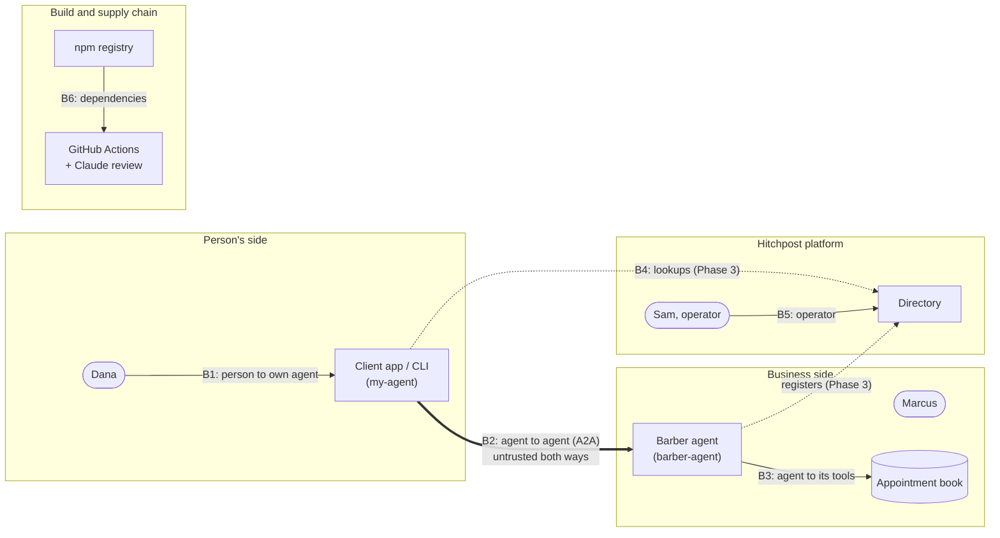

# 08. Security and privacy

Hitchpost lets agents act for people, so security is part of the product. This document covers the trust boundaries, the threat model, how injection is handled once a language model arrives, identity, privacy, abuse controls and the security process.

Status labels follow the [index](README.md): **Built** means it's in the code now (with a path).

## Trust boundaries

The rule for B2 holds in both directions: **whatever arrives from another agent is data, never instructions** ([ADR 0007](../decisions/0007-human-approval-gate.md), [ADR 0010](../decisions/0010-typed-data-parts-before-llm.md)).

## Threat model (STRIDE)

S = spoofing, T = tampering, R = repudiation, I = information disclosure, D = denial of service, E = elevation of privilege.

### B2: agent to agent

| ID   | STRIDE | Threat                                                                                                 | Control                                                                                                                                                                                                                 | Status                                                                                    | Requirement            |
| ---- | ------ | ------------------------------------------------------------------------------------------------------ | ----------------------------------------------------------------------------------------------------------------------------------------------------------------------------------------------------------------------- | ----------------------------------------------------------------------------------------- | ---------------------- |
| T-01 | T      | Hostile agent sends malformed or oversized data to crash or confuse the other side                     | Strict validation and rebuild of every inbound message; unknown fields dropped; 100 kB body limit (Express default)                                                                                                     | **Built** `packages/core/src/booking.ts` (`parseAvailabilityRequest`, `parseBarberReply`) | FR-MSG-03, NFR-SEC-01  |
| T-02 | T      | Free text hidden in typed fields ("IGNORE PREVIOUS INSTRUCTIONS 2026-11-10")                           | Strict ISO 8601 with zone, rebuilt as canonical UTC; text fields reject control characters, max 200 chars                                                                                                               | **Built** `booking.ts` (`toInstant`, `SAFE_TEXT`)                                         | FR-MSG-03, NFR-SEC-01  |
| T-03 | T      | Well formed but wrong offer (other service, other time, absurd price) shown to the person for approval | `offerMatches` binds offer to request; duration and price caps                                                                                                                                                          | **Built** `booking.ts`, `packages/my-agent/src/ask.ts`                                    | FR-MSG-04              |
| T-04 | T, E   | Acceptance of an offer the barber never made, or approval of offer A used to book offer B              | Barber stores issued offers with `expiresAt`; `booking_request` accepted only for a stored, unexpired offer in the same A2A task (ADR 0012); approval is a type only the gate can create, bound to one offer (ADR 0013) | Phase 2                                                                                   | FR-GATE-02, FR-BOOK-01 |
| T-05 | D      | Huge search window pins the barber's CPU                                                               | Window capped at 31 days; slot search starts no earlier than now                                                                                                                                                        | **Built** `booking.ts` (`MAX_WINDOW_DAYS`), `packages/barber-agent/src/book.ts`           | NFR-SEC-03             |
| T-06 | D      | Request flood from one sender                                                                          | Per-sender rate limits; contact-request flow before first message                                                                                                                                                       | Phase 6 (limits), Phase 4 (contacts)                                                      | NFR-SEC-03             |
| T-07 | S      | Fake agent claims to be Main Street Barbers                                                            | Verified business identity in the directory; signed Agent Cards; client checks card origin against directory entry (ADR 0015, ADR 0017)                                                                                 | Phase 3 (directory checks), Phase 6 (signatures required)                                 | FR-DIR-03, NFR-SEC-02  |
| T-08 | I      | Error pages leak stack traces and file paths                                                           | Final JSON error handler; `x-powered-by` off                                                                                                                                                                            | **Built** `packages/barber-agent/src/server.ts`                                           | NFR-SEC-01             |
| T-09 | R      | A party denies an offer, approval or booking happened                                                  | Append-only audit log on both sides, keyed by offer and task id                                                                                                                                                         | Phase 2                                                                                   | FR-GATE-03             |
| T-10 | E      | An agent commits a person's time or money without their yes                                            | Approval gate: only the gate can create an approval; only booking takes one                                                                                                                                             | Phase 2                                                                                   | FR-GATE-01             |

### B1: person to own agent (CLI and app)

| ID   | STRIDE | Threat                                                                     | Control                                                                                                               | Status                                                  | Requirement           |
| ---- | ------ | -------------------------------------------------------------------------- | --------------------------------------------------------------------------------------------------------------------- | ------------------------------------------------------- | --------------------- |
| T-11 | S, T   | Terminal escape codes paint a fake "BOOKED and APPROVED"                   | Control characters rejected in all text fields; CLI prints only its own error messages                                | **Built** `booking.ts`, `packages/my-agent/src/main.ts` | NFR-SEC-01            |
| T-12 | D      | Agent card discovery hangs forever                                         | One deadline over the whole exchange, card fetch included; redirects refused                                          | **Built** `ask.ts`                                      | NFR-REL-01            |
| T-13 | I      | Directory supplies a URL that steers the client to an internal host (SSRF) | Card interface URL must match the directory entry's origin; block private and link-local addresses; response size cap | Phase 3                                                 | NFR-SEC-01            |
| T-14 | S      | Someone else uses Dana's app session to approve bookings                   | Device-bound sign-in, re-confirmation for approvals over a set value                                                  | Phase 4                                                 | FR-APP-02, NFR-SEC-02 |

### B4 and B5: directory and operator

| ID   | STRIDE | Threat                                               | Control                                                                                 | Status  | Requirement |
| ---- | ------ | ---------------------------------------------------- | --------------------------------------------------------------------------------------- | ------- | ----------- |
| T-15 | S      | Business listed by someone who doesn't own it        | Ownership check (domain, phone or existing business profile) before a listing goes live | Phase 3 | FR-DIR-03   |
| T-16 | T      | Fake reviews and rating manipulation                 | Only verified interactions can be rated; one review per completed booking               | Phase 5 | FR-RATE-01  |
| T-17 | E      | Operator account takeover alters or removes listings | Operator sign-in with 2FA; all moderation actions logged                                | Phase 6 | FR-ADMIN-01 |
| T-18 | I      | Directory leaks private contact data                 | Directory holds business data only; no personal data of customers                       | Phase 3 | NFR-PRIV-01 |

### B6: CI/CD and supply chain

| ID   | STRIDE | Threat                                                | Control                                                                                                                                                       | Status                                                                      | Requirement  |
| ---- | ------ | ----------------------------------------------------- | ------------------------------------------------------------------------------------------------------------------------------------------------------------- | --------------------------------------------------------------------------- | ------------ |
| T-19 | T      | Compromised action tag steals the `ANTHROPIC_API_KEY` | Actions pinned to commit SHAs; `persist-credentials: false`; default token read-only                                                                          | **Built** `.github/workflows/*.yml` (SHA pins); token setting at first push | NFR-MAINT-01 |
| T-20 | E      | PR content steers the review bot                      | Runs on `pull_request`, not `pull_request_target`; forks and Dependabot skipped; tools limited to diff, view and commenting on its own PR; review is advisory | **Built** `.github/workflows/claude-review.yml`                             | NFR-SEC-01   |
| T-21 | T      | Malicious dependency update                           | Frozen lockfile in CI; pnpm blocks install scripts by default; Dependabot PRs go through CI; `pnpm audit` in CI                                               | Built (lockfile, scripts), Phase 6 (`pnpm audit`, release-age delay)        | NFR-MAINT-01 |
| T-22 | T      | Unreviewed code reaches `main`                        | Ruleset: PRs required, squash only, required check `lint, typecheck, test`                                                                                    | At first push                                                               | NFR-MAINT-01 |

## Prompt injection once a language model is added

Phase 1 has no model. The plan for when one arrives ([ADR 0010](../decisions/0010-typed-data-parts-before-llm.md)):

1. **The model only translates the person's own words into a typed request.** "Thursday after work" becomes an `availability_request`. It never reads another agent's messages as instructions.
2. **Messages from other agents never reach the model's instruction channel.** If a model must summarise an offer, it gets the validated typed fields, quoted and labelled as untrusted data.
3. **Free-text fields from other agents (`service`, `reason`) are shown to the person, not acted on.** Before a model reads them they are length-limited, control-character-free (Built) and wrapped as data.
4. **Actions only through typed tool calls behind the gate.** No model output can book, pay or share data without an approval value from the person (T-10).
5. **Adversarial tests:** a fixed corpus of injection strings runs against every model-facing path in CI (see [10](10-test-strategy.md)).

## Identity and authentication roadmap

| Stage                | Who proves what                                | Mechanism                                                                         | Phase                      |
| -------------------- | ---------------------------------------------- | --------------------------------------------------------------------------------- | -------------------------- |
| Today                | Nothing; local only, bound to `127.0.0.1`      | `UserBuilder.noAuthentication` in `server.ts`                                     | Built                      |
| Directory listing    | Business owns the listing                      | Domain or phone verification, or an existing business profile                     | 3                          |
| Agent identity       | The card really belongs to the listed business | A2A signed Agent Cards (JWS); the directory stores the public key; clients verify | 3 (optional), 6 (required) |
| Agent to agent calls | The caller is who it says                      | Signed cards plus per-contact tokens issued when a contact is accepted (ADR 0017) | 6                          |
| Person to app        | Dana is Dana                                   | Passkeys first, email link fallback                                               | 4                          |
| Operator             | Sam is Sam                                     | SSO or passkey with 2FA                                                           | 6                          |

## Privacy

Not legal advice. A lawyer reviews this before production.

### Data inventory (summary)

Full model and retention rules in [07](07-data-design.md). Risk R-04 in the [business case](02-business-case.md) points here.

| Data                                                        | Whose                    | Where             | Class                                   |
| ----------------------------------------------------------- | ------------------------ | ----------------- | --------------------------------------- |
| Business listing (name, services, hours, prices, agent URL) | Business                 | Directory         | Public                                  |
| Appointment book                                            | Business                 | Business agent    | Business confidential                   |
| Requests, offers, bookings                                  | Person and business      | Both agents' logs | Personal                                |
| Contacts, chat history, approvals                           | Person                   | Client app        | Personal                                |
| Reviews                                                     | Person, about a business | Directory         | Public once posted, author pseudonymous |
| Operator and moderation logs                                | Platform                 | Directory         | Internal                                |

### Lawful basis notes (GDPR / CCPA)

- **Bookings and approvals:** performance of a contract the person asked for.
- **Audit logs:** legitimate interest (proving what was approved), with limited retention.
- **Reviews:** consent at posting time, withdrawable.
- **No sale or sharing of personal data** for advertising, so CCPA "sale" opt-outs are not triggered. This needs confirming before production.

### Minimisation (NFR-PRIV-01)

- My agent shares a **window**, not a calendar. The barber learns only the slot picked.
- Requests carry no name or contact details until the person approves a booking.
- The directory never stores customer data.

### Retention, deletion and export

| Data                                        | Retention                                | Deletion and export                              |
| ------------------------------------------- | ---------------------------------------- | ------------------------------------------------ |
| Expired, unaccepted offers                  | 7 days                                   | Automatic                                        |
| Bookings, audit events, interaction records | 2 years, then deleted                    | Exported on request as JSON                      |
| Everything tied to a deleted account        | 30 days after deletion (backups age out) | Export offered before deletion                   |
| Resolved abuse reports                      | 1 year                                   | Not exported (contains third-party data)         |
| Chat history                                | Until the person deletes it              | Delete per contact or all; export as JSON        |
| Reviews                                     | Until withdrawn                          | Author can withdraw at any time                  |
| Server logs                                 | 30 days, no message bodies               | Not exported; no personal data in them by design |

## Abuse and spam controls

- **Contact requests** (Phase 4): an unknown agent's first message lands as a request the person accepts or blocks, like a messaging app.
- **Rate limits** (Phase 6): per sender and per destination agent, plus global limits at the proxy.
- **Sender reputation** (Phase 5): agents with many rejected or reported interactions get throttled, then delisted after review.
- **Reports** (UC-09, Phase 5) go to the moderation queue (UC-10, FR-ADMIN-01).
- **Request bounds** (Built): window cap, body size limit, validation before any work.

## Security process

- **Reporting:** private vulnerability reporting through GitHub, described in [SECURITY.md](../../SECURITY.md). Acknowledgement within 72 hours.
- **Disclosure:** coordinated. A fix ships first, then a GitHub Security Advisory with credit to the reporter.
- **Dependencies:** Dependabot weekly for npm and Actions (`.github/dependabot.yml`), actions pinned to SHAs, frozen lockfile, critical CVEs patched within 7 days ([12](12-maintenance-and-evolution.md)).
- **Reviews:** every PR gets the automated review. Changes touching validation, the gate or auth also get a manual security check against this threat model.
- **Re-audit:** before Phase 2 ships, before production, and yearly after that, in the same five-reviewer format as the [Phase 1 audit](../audits/2026-11-08-phase-1.md).
