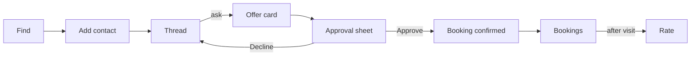

# 09. Interface design

The contracts Hitchpost exposes: the agent message contract (agent to agent), the directory REST API (app and agents to directory) and the client app's screens.

## 1. Agent message contract

Messages travel as A2A **data parts** (`mediaType: application/json`), built with `dataPart()` in `packages/core/src/a2a.ts`. Every message has a `kind`. Every receiver validates and rebuilds what it gets; unknown fields are dropped (NFR-SEC-01, FR-MSG-03).

### Shared field rules (Built, `packages/core/src/booking.ts`)

| Type                                  | Rule                                                                                    |
| ------------------------------------- | --------------------------------------------------------------------------------------- |
| Instant                               | Strict ISO 8601 with `Z` or `±hh:mm`, real calendar day, rebuilt as UTC `toISOString()` |
| Text (`service`, `reason`, `offerId`) | 1 to 200 characters, no control characters (`\p{C}`)                                    |
| `durationMinutes`                     | Safe integer, 1 to 1440                                                                 |
| `priceCents`                          | Safe integer, 0 to 10,000,000                                                           |
| `currency`                            | Three capital letters (ISO 4217 shape)                                                  |
| Window                                | `earliest < latest`, at most 31 days (`MAX_WINDOW_DAYS`)                                |

### Kinds

| Kind                   | Direction         | Fields                                                                                                         | Status  |
| ---------------------- | ----------------- | -------------------------------------------------------------------------------------------------------------- | ------- |
| `availability_request` | person → business | `service`, `earliest`, `latest`                                                                                | Built   |
| `offer`                | business → person | `offerId`, `service`, `start`, `durationMinutes`, `priceCents`, `currency`; Phase 2 adds `expiresAt` (instant) | Built   |
| `no_availability`      | business → person | `service`                                                                                                      | Built   |
| `rejected`             | business → person | `reason`                                                                                                       | Built   |
| `booking_request`      | person → business | `offerId` (sent in the offer's `contextId`)                                                                    | Phase 2 |
| `booking_confirmed`    | business → person | `bookingId`, `offerId`, `service`, `start`, `durationMinutes`, `priceCents`, `currency`                        | Phase 2 |
| `booking_rejected`     | business → person | `offerId`, `reason` (`expired`, `unknown_offer`, `slot_taken`, `other`)                                        | Phase 2 |
| `cancel_request`       | person → business | `bookingId`                                                                                                    | Phase 2 |
| `cancelled`            | business → person | `bookingId`                                                                                                    | Phase 2 |
| `reschedule_request`   | person → business | `bookingId`, `earliest`, `latest` → answered with an `offer`, then the normal approve and book flow            | Phase 2 |

The receiving personal agent also checks that an offer answers its own request (`offerMatches`: same service, start within the window), FR-MSG-04. A `booking_confirmed` must match the approved offer field for field before it is written to a calendar.

### Timing defaults (Phase 2)

I set these as starting values. Each is a per-shop setting where noted and gets revisited after the A-01 and A-02 tests.

| Setting                                                             | Default                                                 | Why                                                                                                                            |
| ------------------------------------------------------------------- | ------------------------------------------------------- | ------------------------------------------------------------------------------------------------------------------------------ |
| Offer hold (`expiresAt` = issued + hold)                            | 10 minutes                                              | Long enough to read and approve on a phone, short enough not to block a chair from other customers.                            |
| Manual approval wait (shop set to approve each booking, FR-GATE-05) | 30 minutes, then `booking_rejected` with reason `other` | A barber mid-cut can check between customers. The person's approval is already recorded, so only the shop's answer is pending. |
| Cancellation cutoff                                                 | None by default; per shop, for example 2 hours          | No-show policy is the shop's call, not the platform's.                                                                         |
| Rate limit per sender (NFR-SEC-03)                                  | 60 requests per minute                                  | Far above a person's use, low enough to blunt scripted flooding.                                                               |

### A2A usage

| Exchange                    | A2A shape                                                                                                     | Why                                                                                                                                 |
| --------------------------- | ------------------------------------------------------------------------------------------------------------- | ----------------------------------------------------------------------------------------------------------------------------------- |
| Availability                | `SendMessage` → `Message` reply                                                                               | Stateless question; nothing to track (Built, `executor.ts`).                                                                        |
| Booking, cancel, reschedule | `SendMessage` → `Task` (`COMPLETED` with `booking_confirmed`/`cancelled`, `REJECTED` with `booking_rejected`) | A durable id for audit and retries (proposed ADR 0012).                                                                             |
| Agent card                  | `GET /.well-known/agent-card.json`                                                                            | Skills: `offer_appointment` (Built), `book_appointment`, `cancel_appointment` (Phase 2). Input and output modes `application/json`. |

Transport: JSON-RPC binding (Built). REST and gRPC bindings are available in the SDK but not advertised until tested (NFR-INT-01).

## 2. Versioning and compatibility

- The contract version is the agent card skill set plus a `contract` field in card metadata: `hitchpost/1` from Phase 2.
- **Additive changes** (a new optional field, a new `kind`) keep the version. Receivers ignore unknown fields and reply `rejected` to unknown kinds.
- **Breaking changes** (removing or retyping a field, tightening a limit) bump to `hitchpost/2`. Agents advertise every version they accept; senders pick the highest shared one.
- A version is supported for at least 6 months after its successor ships (see [12 Maintenance](12-maintenance-and-evolution.md)).
- Contract tests in `packages/e2e` run each supported version against the current agents (Phase 2).

## 3. Directory REST API (Phase 3)

Base path `/v1`. JSON only. Errors use the model in section 5.

| Method and path                                                      | Auth             | Purpose                                                                                      |
| -------------------------------------------------------------------- | ---------------- | -------------------------------------------------------------------------------------------- |
| `POST /v1/listings`                                                  | Business account | Create a listing with `cardUrl`; status `pending`                                            |
| `POST /v1/listings/{id}/verify`                                      | Business account | Start origin verification (well-known token or DNS TXT)                                      |
| `GET /v1/listings/{id}`                                              | None             | Public listing: name, address, services summary, `cardUrl`, `verifiedOrigin`, rating summary |
| `GET /v1/listings?q=&near=lat,lng&radiusKm=&service=&cursor=&limit=` | None             | Search verified listings (FR-DIR-02). `limit` 1 to 50, default 20; cursor pagination         |
| `PATCH /v1/listings/{id}`                                            | Business account | Update public fields; changing `cardUrl` resets verification                                 |
| `DELETE /v1/listings/{id}`                                           | Business account | Close the listing                                                                            |
| `POST /v1/reports`                                                   | Person account   | Report a listing (FR-ADMIN-01)                                                               |
| `GET /v1/admin/reports`, `POST /v1/admin/listings/{id}/suspend`      | Operator role    | Moderation (Phase 6)                                                                         |

Rules: the directory fetches cards server-side with a timeout, no redirects, a size cap and private-address blocking (NFR-SEC-01). Search returns only `verified` listings. Rate limits per IP and per account (NFR-SEC-03); a `429` carries `Retry-After`.

## 4. Client app (Phase 4)

### Screens

| Screen         | Purpose                                                                | Requirement           |
| -------------- | ---------------------------------------------------------------------- | --------------------- |
| Contacts       | Agents you've added, with verified badge and rating                    | FR-APP-01             |
| Find           | Directory search and add contact                                       | FR-DIR-02             |
| Thread         | Conversation with one business agent; typed cards for offers           | FR-MSG-02             |
| Approval sheet | The validated offer, the business's verified name, Approve and Decline | FR-APP-02, FR-GATE-01 |
| Bookings       | Upcoming and past bookings; cancel, reschedule                         | FR-BOOK-03            |
| Rate           | Stars and optional text after a completed booking                      | FR-RATE-01            |
| Settings       | Account, data export and deletion                                      | NFR-PRIV-01           |

### Main flow

The approval sheet renders only fields that passed validation, from structured data, never from free text, and states plainly that nothing is booked until Approve is pressed.

### Accessibility (NFR-A11Y-01, WCAG 2.2 AA)

- Approve and Decline are real buttons, at least 24 by 24 CSS px, reachable by keyboard, never colour-only.
- Times shown in the person's time zone with the zone named; prices with currency.
- Offer cards and status changes announced through a polite live region.
- No time limit on approving shorter than the offer's own expiry, and the remaining time is shown as text.

## 5. Error model

| Layer                        | Shape                                                                | Rule                                                                                   |
| ---------------------------- | -------------------------------------------------------------------- | -------------------------------------------------------------------------------------- |
| Agent message                | `rejected {reason}` or `booking_rejected {offerId, reason}`          | Reasons are short codes or plain sentences; no stack traces                            |
| A2A transport                | JSON-RPC error                                                       | Logged with `contextId`; never shown to a person verbatim                              |
| HTTP (agent host, directory) | `{"error": "<code>", "message": "<safe text>"}` with matching status | Built in minimal form: `{"error":"bad request"}` from the error handler in `server.ts` |
| CLI and app                  | Own messages only                                                    | Built: `AskError` in `my-agent/src/ask.ts`; any other error shows a fixed message      |
