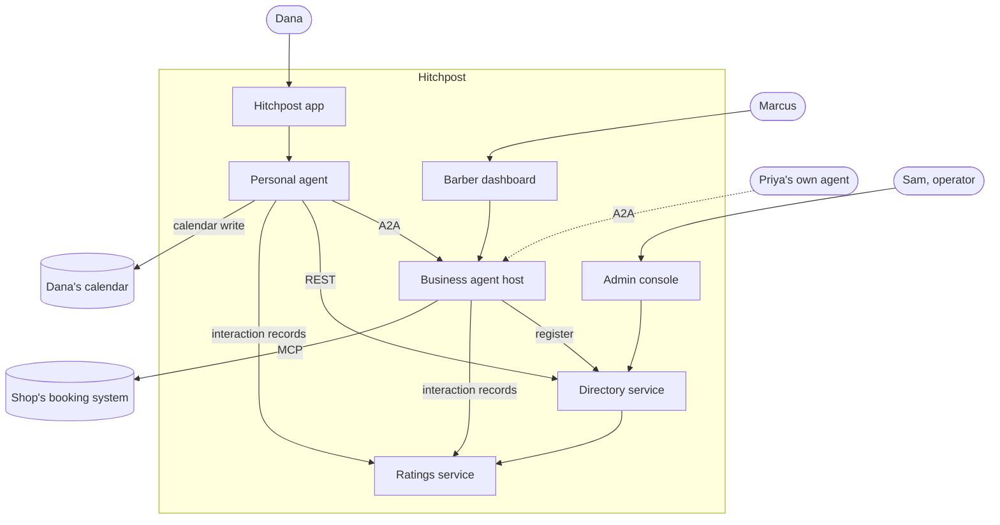
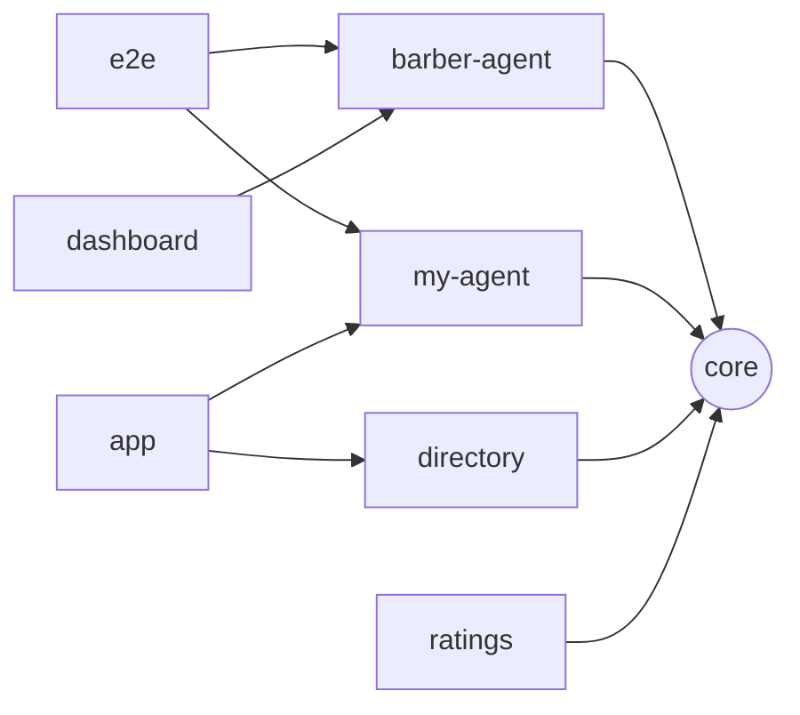
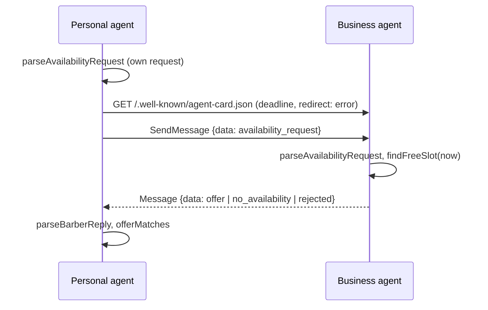
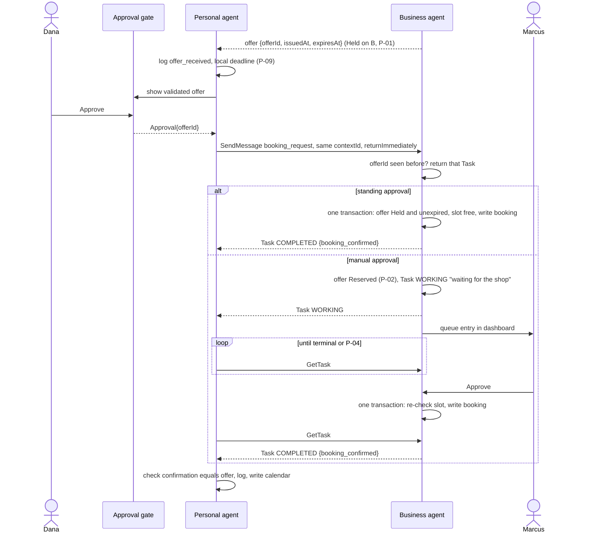
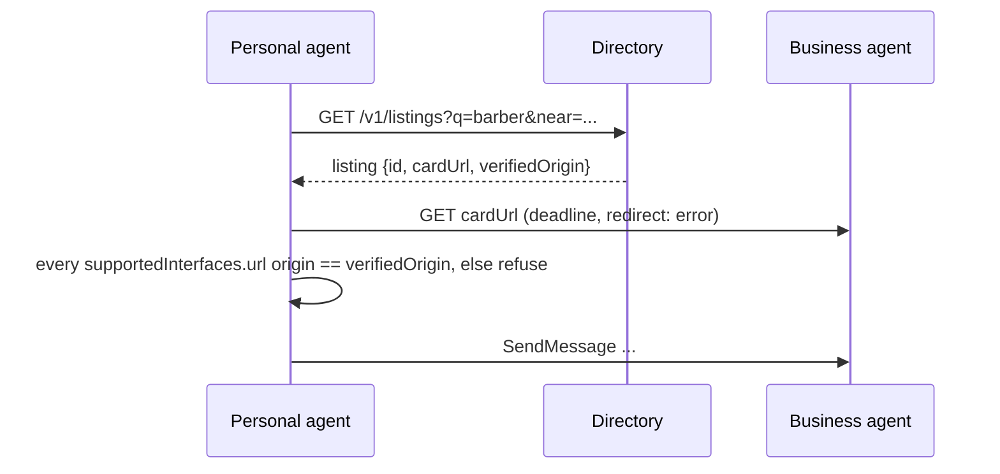
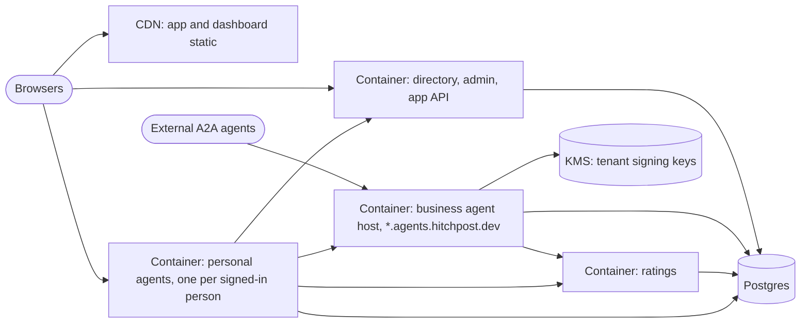

# HP-SAD-10 · System architecture

| Field       | Value                                                                                               |
| ----------- | --------------------------------------------------------------------------------------------------- |
| Document ID | HP-SAD-10                                                                                           |
| Version     | 1.1                                                                                                 |
| Status      | Baselined for Phase 2                                                                               |
| Date        | 2026-11-09                                                                                          |
| Owner       | Sanaullah Jannisar, product and engineering lead                                                    |
| Conforms to | ISO/IEC/IEEE 42010:2022 (architecture description: views, viewpoints, rationale); C4 model notation |

How Hitchpost is put together today, and how it grows to v1 (Phase 6) and beyond. Status labels follow [00 Document control](00-document-control.md#9-conventions): **Built**, **Phase N**, **Later**. Timing values are normative parameters (P-IDs) in 00; requirements are in [05 Requirements](05-requirements.md) (functional in §5, non-functional in §6).

## 1. Drivers and constraints

| Driver                                  | Source                                                                   | Architectural consequence                                                                                           |
| --------------------------------------- | ------------------------------------------------------------------------ | ------------------------------------------------------------------------------------------------------------------- |
| Interoperate with any A2A agent         | NFR-INT-01, [ADR 0003](../decisions/0003-build-on-a2a-and-mcp.md)        | A2A v1.0 on the wire, official `@a2a-js/sdk`. No private protocol between our own parts.                            |
| Never commit a person without their yes | FR-GATE-01..03, [ADR 0007](../decisions/0007-human-approval-gate.md)     | The gate is a component of the _personal_ agent, and the only producer of an `Approval` value.                      |
| Other agents are untrusted              | NFR-SEC-01, [ADR 0010](../decisions/0010-typed-data-parts-before-llm.md) | Every boundary parses and rebuilds input (`packages/core/src/booking.ts`). Free text never drives an action.        |
| No double booking                       | FR-BOOK-01..02, NFR-REL-02                                               | The business agent owns the book; holds and bookings are claimed in one transaction (§8).                           |
| Small team, one language                | [ADR 0002](../decisions/0002-typescript-monorepo.md)                     | TypeScript monorepo, Node 24, shared types in `@hitchpost/core`.                                                    |
| Responsive conversations                | NFR-PERF-01 (p95 under 2 s per availability exchange)                    | Synchronous request and reply for availability; Tasks only where state must persist.                                |
| Directory uptime                        | NFR-REL-01 (99.5%)                                                       | Directory is a separate stateless service with its own database, so agents keep working peer to peer if it is down. |
| Data minimisation                       | NFR-PRIV-01                                                              | Agents share a free slot, never a calendar. Personal data stays on the person's side.                               |

Constraints: open source under MIT ([ADR 0004](../decisions/0004-mit-open-source.md)); Node type stripping, so only erasable TypeScript syntax (see [bug log](../bugs.md)); no paid infrastructure before Phase 6; A2A SDK 1.3 behaviour (for example, it stops draining a task's events at `INPUT_REQUIRED`, `server/index.js:2181`).

## 2. Architecture description framework (ISO/IEC/IEEE 42010)

### 2.1 Stakeholders and concerns

| Stakeholder             | Key concerns                                                              |
| ----------------------- | ------------------------------------------------------------------------- |
| Dana (customer)         | Nothing booked without her yes; correct times; her calendar stays private |
| Marcus (shop owner)     | No double bookings; control over approvals; works with his booking tool   |
| Priya (agent developer) | Stable, documented contract; fair verification; how to prove identity     |
| Sam (operator)          | Uptime, abuse handling, cost, recoverability                              |
| Maintainer (me)         | Simplicity, testability, one language, safe evolution of the contract     |
| Assessor or reviewer    | Traceability from requirements to design to tests                         |

### 2.2 Viewpoint catalogue

| Viewpoint               | Concerns framed                                            | Stakeholders                | Model kinds                                                                       | View in this document |
| ----------------------- | ---------------------------------------------------------- | --------------------------- | --------------------------------------------------------------------------------- | --------------------- |
| Context                 | Scope, external actors and systems, trust                  | All                         | C4 system context (Mermaid flowchart)                                             | §3                    |
| Logical (containers)    | Responsibilities, dependencies, ownership of data          | Maintainer, Priya, assessor | C4 container table and dependency graph                                           | §4                    |
| Component               | Internal structure of each container                       | Maintainer                  | Component tables                                                                  | §5                    |
| Behaviour (interaction) | Message order, failure paths, state across agents          | Maintainer, Priya, Marcus   | UML sequence diagrams; state machines in [07](07-process-and-behaviour-models.md) | §6                    |
| Deployment              | Where things run, tenancy, keys, scaling                   | Sam, maintainer             | C4 deployment diagram, option table                                               | §7                    |
| Cross-cutting           | Concurrency, time, identity, errors, observability, limits | All engineering             | Rule tables                                                                       | §8                    |
| Information             | Entities, keys, retention                                  | Maintainer, Sam, assessor   | ERD in [08](08-data-design.md), dictionary in [09](09-data-dictionary.md)         | external              |
| Security                | Trust boundaries, threats, controls                        | Sam, Dana, Marcus           | Boundary diagram, STRIDE table in [12](12-security-and-privacy.md)                | external              |

### 2.3 Correspondence rules

| ID   | Rule                                                                                                                                      | Checked by                |
| ---- | ----------------------------------------------------------------------------------------------------------------------------------------- | ------------------------- |
| CR-1 | Every container in §4 appears in the deployment view (§7) or is marked test-only (`e2e`)                                                  | Review at each phase gate |
| CR-2 | Every message in the §6 sequences is a kind defined in [13 Interfaces](13-interfaces.md) and [09 §4](09-data-dictionary.md)               | Package consistency check |
| CR-3 | Every state reached in a §6 sequence exists in the matching state machine in [07 §8](07-process-and-behaviour-models.md#8-state-machines) | Review                    |
| CR-4 | Every entity a component stores is in the ERD in [08](08-data-design.md) with the same owner                                              | Review                    |
| CR-5 | Every trust boundary crossed in §6 has threats in [12](12-security-and-privacy.md)                                                        | Review                    |
| CR-6 | Every timing value is a P-ID from [00](00-document-control.md), never a literal repeated across documents                                 | Package consistency check |

## 3. Context

### Today (Phase 1, Built)

Both agents run on one machine, bound to `127.0.0.1` (`packages/barber-agent/src/server.ts`).

### v1 (Phase 6)

## 4. Containers

| Container                              | Responsibility                                                                                                   | Status                                        | Code                                                       |
| -------------------------------------- | ---------------------------------------------------------------------------------------------------------------- | --------------------------------------------- | ---------------------------------------------------------- |
| **core**                               | Message types, validators, A2A part helpers. No I/O.                                                             | Built                                         | `packages/core/src/booking.ts`, `packages/core/src/a2a.ts` |
| **barber-agent** (business agent host) | A2A server per business: agent card, availability, booking, cancel. Owns the book, offers and its audit log.     | Built (availability only)                     | `packages/barber-agent/src/`                               |
| **my-agent** (personal agent)          | Asks business agents, validates replies, runs the approval gate, polls booking Tasks, writes the calendar event. | Built (ask only)                              | `packages/my-agent/src/`                                   |
| **e2e**                                | End-to-end tests that start several agents together. Replaces my-agent's dev dependency on barber-agent.         | Phase 2                                       | `packages/e2e/`                                            |
| **directory**                          | Register, verify and search business agents. REST API. Hosts the admin console.                                  | Phase 3                                       | `packages/directory/`                                      |
| **dashboard** (barber dashboard)       | Web UI for shop owners: services, hours, approval mode, manual-approval queue, mark completed or no-show.        | Phase 3 (setup), Phase 4 (queue and outcomes) | `packages/dashboard/`                                      |
| **app**                                | Web client for people: contacts are agents, chat, approval sheet, bookings. Hosts the personal agent per person. | Phase 4                                       | `packages/app/`                                            |
| **ratings**                            | Builds interaction records from both sides' logs, computes behaviour metrics, accepts verified reviews.          | Phase 5                                       | `packages/ratings/`                                        |

Rule: `core` depends only on SDK _types_. Nothing depends on `e2e`. Services talk over A2A or REST, never by importing each other's internals; the dashboard uses the business agent host's owner API, the app hosts my-agent as a library.

## 5. Components

### Business agent (barber-agent)

| Component                                            | Role                                                                                                                              | Status  |
| ---------------------------------------------------- | --------------------------------------------------------------------------------------------------------------------------------- | ------- |
| `server.ts` `startBarberAgent(name, executor, port)` | Express app: agent card, JSON-RPC handler, JSON error handler, `x-powered-by` off                                                 | Built   |
| `executor.ts` `BarberExecutor`                       | Parses the request, finds a slot, replies with one Message                                                                        | Built   |
| `book.ts` `findFreeSlot`                             | Slot search over time ranges, never in the past                                                                                   | Built   |
| Book loader                                          | Validates the shop's configuration at start (hours, unique services, currency, booked ranges); refuses to start if invalid (D-15) | Phase 2 |
| Offer store                                          | Offers with `issuedAt`, `expiresAt`, state and `taskId`; held and reserved offers count as taken; caps open holds (P-07)          | Phase 2 |
| Booking handler                                      | `booking_request` → Task; idempotent on `offerId`; one transaction re-checks the slot and writes (§8)                             | Phase 2 |
| Approval queue                                       | Manual mode: Task stays `WORKING` with a "waiting for the shop" status until the owner decides or P-03 passes                     | Phase 2 |
| Audit log                                            | `append(event)` with `contextId`, `taskId`, `offerId`, `messageId`; SQLite table                                                  | Phase 2 |
| Rate limiter                                         | P-08 per client IP                                                                                                                | Phase 2 |
| Booking tool adapter                                 | Replaces the local book with an MCP client to the shop's system; writes must be conditional                                       | Phase 6 |

### Personal agent (my-agent)

| Component             | Role                                                                                                                            | Status  |
| --------------------- | ------------------------------------------------------------------------------------------------------------------------------- | ------- |
| `ask.ts` `askForSlot` | Card discovery and message under one deadline (P-05), no redirects, reply validated and matched                                 | Built   |
| `main.ts`             | CLI; prints only validated fields and its own errors                                                                            | Built   |
| Approval gate         | Shows the validated offer with a local deadline (P-09), records the decision, returns an `Approval` (only constructor)          | Phase 2 |
| `bookOffer(approval)` | The only function that sends `booking_request` (with `returnImmediately: true`); polls `GetTask` until a terminal state or P-04 | Phase 2 |
| `declineOffer`        | Sends `offer_declined` so the hold is released at once                                                                          | Phase 2 |
| Audit log             | JSONL file, same event shape as the business side                                                                               | Phase 2 |
| Directory client      | Resolves a listing, checks the card's interface URL origin against the listing                                                  | Phase 3 |
| Calendar adapter      | Writes the confirmed booking to the person's calendar                                                                           | Phase 4 |
| Language front end    | Turns "Thursday after work" into an `availability_request`. Never decides what is booked.                                       | Later   |

### Directory, dashboard, app, ratings

| Component           | Role                                                                                      | Status       |
| ------------------- | ----------------------------------------------------------------------------------------- | ------------ |
| Directory API       | `POST /v1/listings`, verification, search, card fetch with SSRF guards                    | Phase 3      |
| Verification worker | Domain proof (`/.well-known` token or DNS TXT); in person for shops without a site (D-14) | Phase 3      |
| JWKS registry       | Stores each listing's JWKS URL and verifies card signatures on refresh                    | Phase 6      |
| Dashboard           | Shop setup, approval mode, manual-approval queue, outcome marking                         | Phase 3 to 4 |
| App shell           | Contacts list, chat thread, approval sheet, bookings                                      | Phase 4      |
| Rating ingest       | Builds interaction records from both sides' audit events                                  | Phase 5      |
| Review service      | Reviews only on verified interactions                                                     | Phase 5      |
| Moderation          | Report queue, takedown, appeal                                                            | Phase 6      |

## 6. Key sequences

### Availability (Built, UC-01)

### Approve and book (Phase 2, UC-02)

Failure paths: expired or unknown offer, slot taken, shop declined or shop timeout (P-03) end the Task `REJECTED` with `booking_rejected {reason}`. A decline sends `offer_declined` and releases the hold at once (UC-03). The Task never uses `INPUT_REQUIRED`: in A2A that state asks the _client_ for input, and SDK 1.3 stops processing the task's events there.

### Directory lookup with origin check (Phase 3, UC-06)

## 7. Deployment view

| Option                                                               | Fit                | Cost           | Notes                                                                                       |
| -------------------------------------------------------------------- | ------------------ | -------------- | ------------------------------------------------------------------------------------------- |
| A. One container host (Fly.io, Render or Railway) + managed Postgres | Good               | Low            | Several instances share Postgres; one subdomain per hosted business agent. Simplest to run. |
| B. Serverless functions + serverless Postgres                        | Medium             | Lowest at idle | Cold starts threaten p95 under 2 s; long-lived booking Tasks awkward.                       |
| C. Kubernetes                                                        | Poor at this stage | High           | Operational load out of proportion to one area of barbers.                                  |

**Recommendation: A** (to be recorded as ADR 0014). One region near the pilot area, Postgres for directory, offers, bookings, audit and ratings, a CDN in front of the app and dashboard.

**Tenancy.** Each hosted business agent gets its own subdomain, `<slug>.agents.hitchpost.dev`, served by the shared host. Path routing (`/a/<listingId>/`) was rejected: every shop would share one origin, so origin verification (BR-12) could not tell them apart, and `/.well-known/` is only defined at an origin's root (RFC 8615). Self-hosted agents keep their own origin.

**Keys (Phase 6, ADR 0017).** Agent cards are signed with JWS over the JCS (RFC 8785) canonical card. Keys are published as a JWKS at a URL registered on the listing. For hosted agents the platform holds one key per tenant in a managed KMS; self-hosted agents hold their own. Scheduled rotation keeps the old key valid for verification for 30 days; a suspected compromise revokes it at once (removed from the JWKS, listing flagged).

## 8. Cross-cutting concerns

| Concern                 | Today                                                                                      | Design                                                                                                                                                                                                                                                                   |
| ----------------------- | ------------------------------------------------------------------------------------------ | ------------------------------------------------------------------------------------------------------------------------------------------------------------------------------------------------------------------------------------------------------------------------ |
| **Time zones**          | UTC only; inputs must carry a zone and are normalised to UTC (`toInstant` in `booking.ts`) | Phase 6 (ADR 0018), before any real booking: hours as minutes of the local day in the shop's IANA zone; slot grid starts from the local opening time; skipped local times give no slot; repeated local times are offered once (first occurrence). Wire format stays UTC. |
| **Clocks**              | Not needed                                                                                 | The business clock is authoritative: offers carry `issuedAt` and `expiresAt`. The personal agent never compares clocks; it sets a local deadline of receive time plus the hold, minus P-09.                                                                              |
| **Idempotency**         | Not needed (availability is read-only)                                                     | The business keeps `offerId → taskId`; a repeated `booking_request`, in any state, returns the existing Task. Clients reuse `messageId` on retry.                                                                                                                        |
| **Concurrency**         | None                                                                                       | Phase 2: one SQLite transaction re-checks the slot against holds and bookings and writes. Phase 6: the `slot_claims` exclusion table in [08 §4](08-data-design.md#4-storage-by-phase) makes it safe across instances; MCP writes must be conditional.                    |
| **Persistence**         | In memory                                                                                  | Phase 2: SQLite on the business side (SDK `DatabaseTaskStore` plus offers, bookings, audit), JSONL audit on the personal side. Phase 6: Postgres.                                                                                                                        |
| **Errors**              | Server returns `{"error":"bad request"}`; CLI shows only its own messages (`AskError`)     | Error model in [13](13-interfaces.md#5-error-model); never echo remote text to a person.                                                                                                                                                                                 |
| **Configuration**       | `PORT` env var in `barber-agent/src/main.ts`                                               | Env vars only (`PUBLIC_URL`, `DATABASE_URL`, limits). Public card URL from config, not the bind address.                                                                                                                                                                 |
| **Observability**       | Console logs                                                                               | Phase 2: every audit event carries `contextId`, `taskId`, `offerId`, `messageId`. Phase 6 (NFR-OBS-01): structured JSON logs and OpenTelemetry traces across agents.                                                                                                     |
| **Auth between agents** | None, localhost only                                                                       | Until Phase 6 the server-minted `contextId` is a bearer capability: logged, never shown in UIs or URLs. Phase 6 (NFR-SEC-02): signed cards plus per-contact tokens.                                                                                                      |
| **Abuse limits**        | None                                                                                       | Phase 2: P-07 hold caps and P-08 rate limit per client IP. Phase 6 (NFR-SEC-03): per agent identity, at the edge and in the host.                                                                                                                                        |

## 9. Architecture decisions

Existing: [0002](../decisions/0002-typescript-monorepo.md) monorepo, [0003](../decisions/0003-build-on-a2a-and-mcp.md) A2A and MCP, [0005](../decisions/0005-ci-and-review-policy.md) CI and review, [0007](../decisions/0007-human-approval-gate.md) approval gate, [0010](../decisions/0010-typed-data-parts-before-llm.md) typed data, [0011](../decisions/0011-in-memory-appointment-book.md) in-memory book.

New and proposed:

| ADR  | Title                                                                                                      | Needed by                   |
| ---- | ---------------------------------------------------------------------------------------------------------- | --------------------------- |
| 0012 | Booking protocol: Tasks for commitments, holds and reservations, manual approval as `WORKING`, idempotency | Phase 2                     |
| 0013 | Approval is a type only the gate can create                                                                | Phase 2                     |
| 0014 | Hosting: one container platform plus managed Postgres, subdomain per tenant                                | Phase 6 (decide in Phase 3) |
| 0015 | Directory verifies origin; clients enforce card URL origin                                                 | Phase 3                     |
| 0016 | Compile packages for deployment instead of running `.ts` from `node_modules`                               | Phase 6                     |
| 0017 | Agent-to-agent authentication: signed cards (JWS over JCS), JWKS, per-tenant KMS keys, per-contact tokens  | Phase 6                     |
| 0018 | Shop time zones: IANA zone per business, minutes of the local day, UTC on the wire                         | Phase 6                     |

## Revision history

| Version | Date       | Change                                                                                                                                                                                                                                                                        | Author      |
| ------- | ---------- | ----------------------------------------------------------------------------------------------------------------------------------------------------------------------------------------------------------------------------------------------------------------------------- | ----------- |
| 0.1     | 2026-11-08 | First draft                                                                                                                                                                                                                                                                   | S. Jannisar |
| 1.0     | 2026-11-09 | Baselined: renumbered into lifecycle order, formal document control, standards conformance                                                                                                                                                                                    | S. Jannisar |
| 1.1     | 2026-11-09 | Remediation after independent review: 42010 viewpoint catalogue and correspondence rules, corrected booking sequence (Reserved, `WORKING`, polling), deployment with personal agents, ratings, dashboard, subdomain tenancy and signing keys, concurrency, time zones Phase 6 | S. Jannisar |
