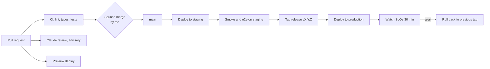

# 11. Deployment and operations

How code gets from a branch to production, where it runs, and how it's watched and recovered.

## Environments

| Environment | Purpose                                                 | Data                                             | Status                                                         |
| ----------- | ------------------------------------------------------- | ------------------------------------------------ | -------------------------------------------------------------- |
| Local       | Development; both agents on `127.0.0.1`                 | Demo book in `packages/barber-agent/src/main.ts` | **Built**                                                      |
| CI          | Lint, type check and tests on every PR and push         | Test fixtures only                               | **Built** in `.github/workflows/ci.yml`, not yet run on GitHub |
| Preview     | One deploy per PR for the directory and app             | Seeded fake data                                 | Phase 3                                                        |
| Staging     | Mirrors production; release candidates; pilot rehearsal | Fake businesses plus my own test bookings        | Phase 6                                                        |
| Production  | Real barbers in one area                                | Real                                             | Phase 6                                                        |

## CI/CD today

- **CI:** `ci.yml` runs install with the frozen lockfile, Biome, tsc and tests on Node from `.nvmrc` (24). The actions are pinned to commit SHAs. Superseded PR runs are cancelled; runs on `main` always finish.
- **Review:** `claude-review.yml` runs an advisory review on same-repo PRs. It needs the Claude GitHub App and the `ANTHROPIC_API_KEY` secret.
- **Dependencies:** Dependabot weekly for npm and GitHub Actions (`.github/dependabot.yml`).
- **Not yet:** no remote, so nothing is enforced and nothing deploys.

### First push checklist

From the [DevOps audit](../audits/2026-11-08-phase-1.md#first-push-checklist):

1. Create `Jannisar01/hitchpost`, push `main`, confirm CI green.
2. Merge settings: squash only, PR title and body as the commit, delete branches on merge.
3. Default workflow token: read-only; workflows can't approve PRs.
4. Ruleset on `main`: no deletion, no force push, PR required (0 approvals, since I'm the sole maintainer), squash only, required check `lint, typecheck, test`.
5. Turn on private vulnerability reporting and vulnerability alerts.
6. Install the Claude GitHub App; add `ANTHROPIC_API_KEY`.
7. Open the Phase 1 branch as the first real PR.

## CI/CD target

- **Preview deploys** (Phase 3): each PR gets its own directory and app URL, torn down on merge.
- **Staging** deploys automatically from `main`.
- **Production** deploys only from a release tag, after the [release checklist](10-test-strategy.md#release-acceptance-checklist).
- **Rollback** means redeploying the previous tag. Database migrations must be backward compatible for one release so rollback is always safe.
- **Build step:** before hosting, packages need a compile step (ADR 0016). Today `exports` point at `.ts` source, which only works locally ([12](12-maintenance-and-evolution.md), debt D-02).

## Versioning and releases

- **Packages:** semantic versioning. Releases are tagged `vX.Y.Z` with release notes drawn from the PR titles.
- **Message contract:** versioned separately from the code, as `hitchpost/1`, carried in the A2A message metadata from Phase 2 ([09](09-interfaces.md)).
  - A minor version adds optional fields only.
  - A major version can change shapes, and both majors are accepted during the deprecation window ([12](12-maintenance-and-evolution.md#message-contract-versioning-and-deprecation)).
- **A2A protocol:** pinned to the SDK's spec version (v1.0 today). SDK upgrades go through their own PR with the e2e tests.

## Hosting

Proposed as ADR 0014 (one container platform plus managed Postgres). The options:

| Option                                              | Fits                                                                    | Costs                 | Concerns                                                   |
| --------------------------------------------------- | ----------------------------------------------------------------------- | --------------------- | ---------------------------------------------------------- |
| **Fly.io or Render** (containers, managed Postgres) | Long-running Node servers, WebSockets/SSE for A2A streaming, simple ops | Low at pilot scale    | Smaller vendors; check region and backup options           |
| Cloudflare Workers + D1                             | Cheap, global, the A2A SDK supports D1 stores                           | Very low              | Express-based server needs porting; Workers runtime limits |
| AWS (ECS Fargate + RDS)                             | Scales anywhere, every compliance box                                   | Higher, more ops work | Overkill for one-area pilot                                |
| Serverless functions (Vercel)                       | Fine for the app front end                                              | Low                   | Poor fit for long agent tasks and streaming                |

**Proposed (ADR 0014):** option A. One container platform (Fly.io or Render) with managed Postgres. The directory (which also hosts the admin pages), the ratings service and the hosted business agents run there. Hosted business agents share one host and are routed by `/a/<listingId>/`. The app front end goes on a static or edge host. The vendor choice between Fly.io and Render is confirmed with a pilot cost estimate before Phase 6.

## Configuration and secrets

- **Config through environment variables**, validated at startup. The server refuses to start on a missing or bad value. Today only `PORT` exists (`packages/barber-agent/src/main.ts`).
- **The public agent URL comes from config** (`PUBLIC_URL`), not from the bind address as it does today (`server.ts`).
- **Secrets** (database URLs, signing keys, API keys) live in the host's secret store and GitHub Actions secrets. Never in the repo: `.env*` is git-ignored, except `.env.example`.
- **Card signing keys** are rotated yearly or on suspicion; old public keys stay published for 30 days.

## Observability

- **Logs:** structured JSON, one line per request.
  - **Fields:** request id, agent, method, outcome, latency.
  - **No message bodies, no personal data** (see [08](08-security-and-privacy.md#retention-deletion-and-export)).
  - **Retention:** 30 days.
- **Metrics:** requests by outcome (`offer`, `no_availability`, `rejected`, error), latency histograms, approvals and declines, bookings, rate-limit hits, card-fetch failures.
- **Traces:** OpenTelemetry across directory lookup, agent-to-agent call and booking write. One trace id flows through the A2A message metadata.
- **Product metrics,** from the audit logs:
  - the north star: weekly human-approved bookings that were honored
  - counter-metrics: first-offer rejection rate, median time to approve, booking errors, reports per 100 interactions, repeat use within 60 days

### SLOs (pilot)

| SLI                                             | SLO                      | Requirement |
| ----------------------------------------------- | ------------------------ | ----------- |
| Availability request to reply, p95              | under 1 s; p99 under 3 s | NFR-PERF-01 |
| Directory search, p95                           | under 500 ms             | NFR-PERF-01 |
| Successful agent replies (non-5xx) over 30 days | 99.5%                    | NFR-REL-01  |
| Booking writes lost                             | 0                        | NFR-REL-01  |

### Dashboards and alerts

One dashboard per service: traffic, errors, latency, saturation, plus a product panel.

| Alert                                       | When                               | Severity |
| ------------------------------------------- | ---------------------------------- | -------- |
| Error budget burn                           | 2% of the monthly budget in 1 hour | Page     |
| Booking write failures                      | Any                                | Page     |
| p95 latency over SLO                        | 15 minutes                         | Ticket   |
| Card-fetch failure spike or rate-limit hits | Over baseline                      | Ticket   |
| Certificate expiry, backup failure          | Any                                | Ticket   |

## Incident response (runbook outline)

1. **Detect:** an alert or a user report (issue, email, in-app).
2. **Triage:** SEV1 means bookings wrong or lost, or a security breach. SEV2 means the service is down or degraded. SEV3 means minor.
3. **Mitigate first:** roll back to the previous tag, turn on rate limits, or delist an abusive agent.
4. **Communicate:** a status note on the repo and to affected businesses. For SEV1, update every hour.
5. **Resolve and verify** against the SLO dashboard.
6. **Post-incident review** within 5 days, blameless. Add it to the [bug log](../bugs.md) with root cause and prevention, and add a test.
7. **Security incidents** also follow [SECURITY.md](../../SECURITY.md) and the breach-notification duties in [08](08-security-and-privacy.md).

## Backups and disaster recovery

| Data                              | Backup                                                                    | RPO       | RTO      |
| --------------------------------- | ------------------------------------------------------------------------- | --------- | -------- |
| Directory and bookings (Postgres) | Managed point-in-time recovery plus a daily snapshot to another region    | 5 minutes | 4 hours  |
| Audit logs                        | Append-only; replicated with the database; monthly export to cold storage | 5 minutes | 24 hours |
| Config and code                   | Git and the host's config history                                         | 0         | 1 hour   |

- **Restore drills:** quarterly, into staging, timed against the RTO. One tested restore and one incident drill are part of v1 release criterion 4 ([01](01-vision-and-scope.md#v1-release-criteria-end-of-phase-6)).

## Capacity and cost notes

- **Pilot load:** about 20 barbers, a few hundred people, under 1 request per second at peak. One small container per service and a small Postgres cover it.
- **Hosting estimate:** roughly $20 to $60 a month plus the domain. To be confirmed in the hosting ADR.
- **The Claude review's API spend is the main variable cost.** If it grows, limit the review to code paths with `paths-ignore` for docs.
- **Scale-up triggers:** p95 latency near the SLO, CPU above 70% sustained, or more than one area live.
