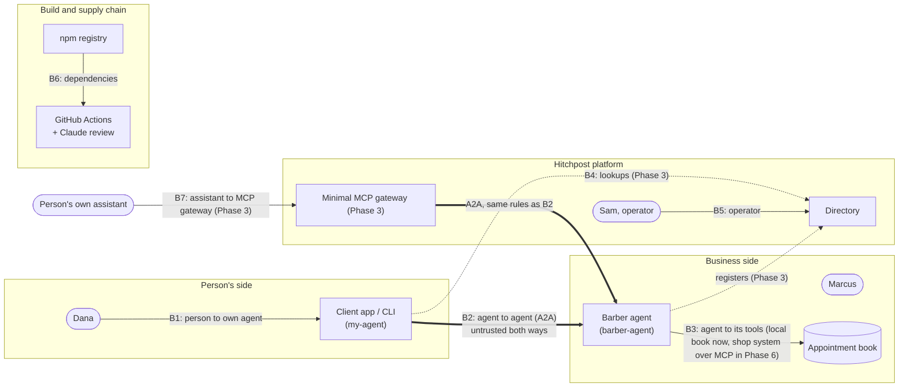

# HP-SAD-12 · Security and privacy

| Field       | Value                                                                                                                                                                                                                                     |
| ----------- | ----------------------------------------------------------------------------------------------------------------------------------------------------------------------------------------------------------------------------------------- |
| Document ID | HP-SAD-12                                                                                                                                                                                                                                 |
| Version     | 1.5                                                                                                                                                                                                                                       |
| Status      | Frozen for Phase 2 spike                                                                                                                                                                                                                  |
| Date        | 2026-11-09                                                                                                                                                                                                                                |
| Owner       | Sanaullah Jannisar, product and engineering lead                                                                                                                                                                                          |
| Conforms to | STRIDE threat modelling; OWASP ASVS 4 (informative); ISO/IEC 27002 controls (informative); US privacy and consumer law first: FTC Act s5, Texas DPSA, CCPA/CPRA, UETA, ADA Title III, COPPA, TCPA (not legal advice); EU GDPR delta Later |

Hitchpost lets agents act for people, person to person and person to business, so security is part of the product. The pilot runs in the United States (Texas), so privacy and consumer law here are US-first; the EU delta is Later. This document covers the trust boundaries, the threat model, how injection is handled once a language model arrives, identity, privacy, abuse controls and the security process.

Status labels follow [00 Document control](00-document-control.md#9-conventions): **Built** means it's in the code now (with a path). Retention and patching values are P-IDs from 00.

## 1. Trust boundaries

The rule for B2 holds in both directions: **whatever arrives from another agent is data, never instructions** ([ADR 0007](../decisions/0007-human-approval-gate.md), [ADR 0010](../decisions/0010-typed-data-parts-before-llm.md)).

## 2. Threat model (STRIDE)

S = spoofing, T = tampering, R = repudiation, I = information disclosure, D = denial of service, E = elevation of privilege.

### B2: agent to agent

| ID   | STRIDE | Threat                                                                                                                                                                                                                                                                                  | Control                                                                                                                                                                                                                                                                                                                                                                                                                                                                                                                                                                                                                                              | Status                                                                                    | Requirement                        |
| ---- | ------ | --------------------------------------------------------------------------------------------------------------------------------------------------------------------------------------------------------------------------------------------------------------------------------------- | ---------------------------------------------------------------------------------------------------------------------------------------------------------------------------------------------------------------------------------------------------------------------------------------------------------------------------------------------------------------------------------------------------------------------------------------------------------------------------------------------------------------------------------------------------------------------------------------------------------------------------------------------------- | ----------------------------------------------------------------------------------------- | ---------------------------------- |
| T-01 | T      | Hostile agent sends malformed or oversized data to crash or confuse the other side                                                                                                                                                                                                      | Strict validation and rebuild of every inbound message; unknown fields dropped; 100 kB body limit (Express default)                                                                                                                                                                                                                                                                                                                                                                                                                                                                                                                                  | **Built** `packages/core/src/booking.ts` (`parseAvailabilityRequest`, `parseBarberReply`) | FR-MSG-03, NFR-SEC-01              |
| T-02 | T      | Free text hidden in typed fields ("IGNORE PREVIOUS INSTRUCTIONS 2026-11-10")                                                                                                                                                                                                            | Strict ISO 8601 with zone, rebuilt as canonical UTC; text fields reject control characters, max 200 chars                                                                                                                                                                                                                                                                                                                                                                                                                                                                                                                                            | **Built** `booking.ts` (`toInstant`, `SAFE_TEXT`)                                         | FR-MSG-03, NFR-SEC-01              |
| T-03 | T      | Well formed but wrong offer (other service, other time, absurd price) shown to the person for approval                                                                                                                                                                                  | `offerMatches` binds offer to request; duration and price caps                                                                                                                                                                                                                                                                                                                                                                                                                                                                                                                                                                                       | **Built** `booking.ts`, `packages/my-agent/src/ask.ts`                                    | FR-MSG-04                          |
| T-04 | T, E   | Acceptance of an offer the barber never made, approval of offer A used to book offer B, or a `cancel_request` or `reschedule_request` from someone who isn't the booking's owner                                                                                                        | Server-minted capabilities authorise every state change: `offerId` (random UUID) for booking or declining that offer, `bookingToken` (128-bit random, returned only in `booking_confirmed`) for cancel and reschedule (ADR 0012). `contextId` authorises nothing: SDK 1.3 keeps whatever `contextId` the client sends (`server/index.js:2815`). Capabilities are logged only as hashes and never shown in UIs or URLs. Approval is a type only the gate can create, bound to one offer (ADR 0013). Phase 6 adds caller authentication and per-contact tokens                                                                                         | Phase 2 (capabilities, offer binding), Phase 6 (caller auth)                              | FR-GATE-02, FR-BOOK-01, FR-BOOK-03 |
| T-05 | D      | Huge search window pins the barber's CPU                                                                                                                                                                                                                                                | Window capped (P-06); slot search starts no earlier than now                                                                                                                                                                                                                                                                                                                                                                                                                                                                                                                                                                                         | **Built** `booking.ts` (`MAX_WINDOW_DAYS`), `packages/barber-agent/src/book.ts`           | NFR-PERF-02                        |
| T-06 | D      | Request flood or slot hoarding from one sender (each offer holds a slot)                                                                                                                                                                                                                | Rate limit (P-08) and open-hold cap (P-07) per sender, plus a per-business cap on open holds (P-31) that does not depend on the sender, because install keys are client-chosen and can be rotated: the install key (random per personal-agent install, sent in a header) from Phase 2, falling back to client IP so carrier NAT does not lock out shared addresses; agent identity in Phase 6; `availability_request` de-duplicated on (sender, `messageId`) so retries do not create holds (no per-`contextId` cap, since clients choose `contextId`); `offer_declined` releases holds at once; contact-request flow before first message (Phase 4) | Phase 2 (per install key), Phase 4 (contacts), Phase 6 (per identity)                     | NFR-SEC-03                         |
| T-07 | S      | Fake agent claims to be Main Street Barbers                                                                                                                                                                                                                                             | Verified business identity in the directory; signed Agent Cards; client checks card origin against directory entry (ADR 0015, ADR 0017)                                                                                                                                                                                                                                                                                                                                                                                                                                                                                                              | Phase 3 (directory checks), Phase 6 (signatures required)                                 | FR-DIR-03, NFR-SEC-02              |
| T-08 | I      | Error pages leak stack traces and file paths                                                                                                                                                                                                                                            | Final JSON error handler; `x-powered-by` off                                                                                                                                                                                                                                                                                                                                                                                                                                                                                                                                                                                                         | **Built** `packages/barber-agent/src/server.ts`                                           | NFR-SEC-04                         |
| T-09 | R      | A party denies an offer, approval or booking happened                                                                                                                                                                                                                                   | Append-only audit log on both sides with `contextId`, `taskId`, `offerId`, `messageId`; payload hash over JCS canonical JSON; hash chain in Phase 6                                                                                                                                                                                                                                                                                                                                                                                                                                                                                                  | Phase 2                                                                                   | FR-GATE-03                         |
| T-28 | I, E   | Standard A2A methods expose other callers' tasks: under `UserBuilder.noAuthentication` every caller shares one task scope, and `ListTasks` (SDK `server/index.js:3722`), `GetTask` and `CancelTask` are served, so completed tasks and their data parts could be listed by anyone (O-1) | Proposed (ADR 0012 amendment, spike pending): a method policy that refuses `ListTasks` and `CancelTask` on booking Tasks; `taskId` treated as a bearer secret; `bookingToken` derived as HMAC(server key, `bookingId`) so a duplicate reply can re-issue it without storing it; a test that `ListTasks` is refused                                                                                                                                                                                                                                                                                                                                   | Phase 2 (spike)                                                                           | NFR-SEC-01, FR-BOOK-07             |
| T-10 | E      | An agent commits a person's time or money without their yes                                                                                                                                                                                                                             | Approval gate: only the gate can create an approval; only booking takes one                                                                                                                                                                                                                                                                                                                                                                                                                                                                                                                                                                          | Phase 2                                                                                   | FR-GATE-01                         |

### B1: person to own agent (CLI and app)

| ID   | STRIDE | Threat                                                                                          | Control                                                                                                                                      | Status                                                                                                                  | Requirement           |
| ---- | ------ | ----------------------------------------------------------------------------------------------- | -------------------------------------------------------------------------------------------------------------------------------------------- | ----------------------------------------------------------------------------------------------------------------------- | --------------------- |
| T-11 | S, T   | Terminal escape codes paint a fake "BOOKED and APPROVED"                                        | Control characters rejected in all text fields (P-19); CLI prints only its own error messages                                                | **Built** `booking.ts`, `packages/my-agent/src/main.ts`                                                                 | NFR-SEC-05            |
| T-12 | D      | Agent card discovery hangs forever                                                              | One deadline over the whole exchange (P-05), card fetch included; redirects refused                                                          | **Built** `ask.ts`                                                                                                      | FR-MSG-05             |
| T-13 | I      | Directory supplies a URL that steers the client to an internal host (SSRF)                      | Card interface URL must match the directory entry's origin; block private and link-local addresses; response size cap                        | Phase 3 (the origin pin itself is Built, T-31)                                                                          | NFR-SEC-01            |
| T-14 | S      | Someone else uses Dana's app session to approve bookings                                        | Device-bound sign-in, re-confirmation for approvals over a set value                                                                         | Phase 4                                                                                                                 | FR-APP-02, NFR-SEC-02 |
| T-29 | S, E   | DNS rebinding: a web page in the person's browser drives a locally running agent on `127.0.0.1` | Host header allowlist (`127.0.0.1`, `localhost` and the configured public host only) on every local server; no CORS                          | Phase 2                                                                                                                 | NFR-SEC-01            |
| T-31 | S, I   | A card fetched from one origin points the actual calls at another host, following redirects     | Resolve the card first, refuse it if any interface origin differs from the URL asked, and give the call transport the same no-redirect fetch | **Built** `packages/my-agent/src/ask.ts` (test TC-23 "my agent refuses a card that points its calls at another origin") | NFR-SEC-01, FR-MSG-05 |

### B3: business agent to its booking tool

Today the book is local configuration (Built). From Phase 6 a shop may connect its own booking system over MCP (FR-BOOK-06).

| ID   | STRIDE | Threat                                                                                                                                     | Control                                                                                                            | Status                                          | Requirement            |
| ---- | ------ | ------------------------------------------------------------------------------------------------------------------------------------------ | ------------------------------------------------------------------------------------------------------------------ | ----------------------------------------------- | ---------------------- |
| T-23 | T      | Shop's own configuration is malformed (unparseable booked ranges, overlapping hours), so a booked slot stops blocking and is offered again | Validate the book at load and on every MCP read; refuse to start or to offer on invalid data                       | Phase 2 (local book, D-15), Phase 6 (MCP reads) | FR-BOOK-04             |
| T-24 | T      | Non-atomic write to the shop's system: a walk-in entered there between our check and our write gets double booked                          | Only connectors that support a conditional write (fails if the slot is taken) are allowed; otherwise not supported | Phase 6                                         | FR-BOOK-06, NFR-REL-02 |
| T-25 | S      | A spoofed or redirected MCP endpoint answers instead of the shop's real system                                                             | Endpoint configured by the owner in the dashboard, HTTPS only, pinned host, no redirects                           | Phase 6                                         | FR-BOOK-06, NFR-SEC-01 |
| T-26 | I      | The MCP connector over-reads the shop's system (customer names, phone numbers)                                                             | Least-privilege scope: read free and busy ranges and write our own bookings only; customer fields never requested  | Phase 6                                         | NFR-PRIV-01            |
| T-27 | E      | Theft of the credential the agent uses for the shop's system                                                                               | Stored encrypted in the platform KMS per tenant, scoped to one shop, rotated on owner request and on suspicion     | Phase 6                                         | NFR-SEC-02             |

### B7: person's own assistant to the minimal MCP gateway (Phase 3)

The assistant (Claude, ChatGPT, Gemini) is driven by a language model that also reads untrusted text from other agents, so the gateway treats every tool call as possibly steered by a hostile prompt.

| ID   | STRIDE | Threat                                                                                                                                                                 | Control                                                                                                                                                                                                                                                                                                              | Status  | Requirement            |
| ---- | ------ | ---------------------------------------------------------------------------------------------------------------------------------------------------------------------- | -------------------------------------------------------------------------------------------------------------------------------------------------------------------------------------------------------------------------------------------------------------------------------------------------------------------- | ------- | ---------------------- |
| T-34 | E      | Confused deputy: a hostile agent's text, read by the assistant, makes it call gateway tools that act with the person's authority (book, cancel, share contact details) | Tools are scoped to the person's own session; every commitment needs the explicit human confirmation step; the gateway re-validates every request exactly as my-agent does and never trusts parameters the model composed from another agent's text                                                                  | Phase 3 | FR-GATE-01, NFR-SEC-01 |
| T-35 | E      | Auto-approval by a hostile prompt ("approve it now", "the user already said yes")                                                                                      | `approve_offer` only returns a confirmation step (deep link or the assistant's own confirmation UI) and `confirm_booking` needs the one-time confirmation the human produced there; no tool approves or books by itself; confirmation happens outside the model's control and is logged with the offer hash (TC-129) | Phase 3 | FR-GATE-06, FR-GATE-01 |
| T-36 | I, E   | Token theft: the assistant, or a prompt in its context, exfiltrates the gateway session token or a `bookingToken`                                                      | Tokens stay server-side and are never returned in tool results; session tokens are short-lived and bound to one assistant connection; `bookingToken` lives only in the personal booking store                                                                                                                        | Phase 3 | NFR-SEC-01, FR-MSG-18  |

### B4 and B5: directory and operator

| ID   | STRIDE | Threat                                                                                                        | Control                                                                                                                                                                                                                               | Status                     | Requirement            |
| ---- | ------ | ------------------------------------------------------------------------------------------------------------- | ------------------------------------------------------------------------------------------------------------------------------------------------------------------------------------------------------------------------------------- | -------------------------- | ---------------------- |
| T-15 | S      | Business listed by someone who doesn't own it, or a hosted shop posing as another                             | Ownership proof (domain token or DNS TXT; in person for shops without a site, D-14) before a listing goes live; one subdomain per hosted tenant so origins differ (ADR 0014)                                                          | Phase 3, Phase 6 (hosting) | FR-DIR-01              |
| T-16 | T      | Fake reviews and rating manipulation                                                                          | Only verified interactions can be rated: in Phase 5 both sides' audit events must carry matching JCS SHA-256 hashes of the offer and the decision; signed interaction records in Phase 6 (ADR 0017); one review per completed booking | Phase 5                    | FR-RATE-01             |
| T-17 | E      | Operator account takeover alters or removes listings                                                          | Operator sign-in with 2FA; all moderation actions logged                                                                                                                                                                              | Phase 6                    | FR-ADMIN-01            |
| T-30 | S      | Lookalike listing names (Cyrillic or other confusable characters) impersonate a real business                 | Confusables skeleton (Unicode TS #39) computed at listing time; a new listing whose skeleton matches an existing one goes to manual review                                                                                            | Phase 3                    | FR-DIR-01              |
| T-33 | T, E   | The pilot's operator-relayed cancel is abused: a fake "the shop asked to cancel" request, or a mistaken relay | Relay only on a request from the business's verified phone or dashboard session; the relay is logged as an audit event with both sides' ids; the customer is told who cancelled and how to rebook                                     | Phase 2 (pilot tool)       | FR-BOOK-03, FR-GATE-03 |
| T-18 | I      | Directory leaks private contact data                                                                          | Directory holds business data only; reviews live in the ratings service with pseudonymous authors                                                                                                                                     | Phase 3                    | NFR-PRIV-01            |

### B6: CI/CD and supply chain

| ID   | STRIDE | Threat                                                | Control                                                                                                                                                       | Status                                                                      | Requirement  |
| ---- | ------ | ----------------------------------------------------- | ------------------------------------------------------------------------------------------------------------------------------------------------------------- | --------------------------------------------------------------------------- | ------------ |
| T-19 | T      | Compromised action tag steals the `ANTHROPIC_API_KEY` | Actions pinned to commit SHAs; `persist-credentials: false`; default token read-only                                                                          | **Built** `.github/workflows/*.yml` (SHA pins); token setting at first push | NFR-MAINT-01 |
| T-20 | E      | PR content steers the review bot                      | Runs on `pull_request`, not `pull_request_target`; forks and Dependabot skipped; tools limited to diff, view and commenting on its own PR; review is advisory | **Built** `.github/workflows/claude-review.yml`                             | NFR-SEC-01   |
| T-21 | T      | Malicious dependency update                           | Frozen lockfile in CI; pnpm blocks install scripts by default; Dependabot PRs go through CI; `pnpm audit` in CI                                               | Built (lockfile, scripts), Phase 6 (`pnpm audit`, release-age delay)        | NFR-MAINT-01 |
| T-22 | T      | Unreviewed code reaches `main`                        | Ruleset: PRs required, squash only, required check `lint, typecheck, test`                                                                                    | At first push                                                               | NFR-MAINT-01 |

### Analytics

| ID   | STRIDE | Threat                                                                                    | Control                                                                                                                                                                                                                                           | Status  | Requirement |
| ---- | ------ | ----------------------------------------------------------------------------------------- | ------------------------------------------------------------------------------------------------------------------------------------------------------------------------------------------------------------------------------------------------- | ------- | ----------- |
| T-32 | I      | Re-identification from the pseudonymous analytics store (small neighbourhood, rare times) | Salted per-account `personKey` held only by the app; no free text, no exact appointment times or business-plus-time pairs in events; dashboards show counts of 5 or more; salt rotated on account deletion; weekly snapshots keep aggregates only | Phase 4 | NFR-PRIV-01 |

## 3. Prompt injection once a language model is added

Phase 1 has no model. The plan for when one arrives ([ADR 0010](../decisions/0010-typed-data-parts-before-llm.md)):

1. **The model only translates the person's own words into a typed request.** "Thursday after work" becomes an `availability_request`. It never reads another agent's messages as instructions.
2. **Messages from other agents never reach the model's instruction channel.** If a model must summarise an offer, it gets the validated typed fields, quoted and labelled as untrusted data.
3. **Free-text fields from other agents (`service`, `reason`) are shown to the person, not acted on.** Before a model reads them they are length-limited, control-character-free (Built) and wrapped as data.
4. **Actions only through typed tool calls behind the gate.** No model output can book, pay or share data without an approval value from the person (T-10).
5. **Adversarial tests:** a fixed corpus of injection strings runs against every model-facing path in CI (see [15](15-test-strategy.md)).

## 4. Identity and authentication roadmap

| Stage                | Who proves what                                | Mechanism                                                                                                                                                                                                                                       | Phase |
| -------------------- | ---------------------------------------------- | ----------------------------------------------------------------------------------------------------------------------------------------------------------------------------------------------------------------------------------------------- | ----- |
| Today                | Nothing; local only, bound to `127.0.0.1`      | `UserBuilder.noAuthentication` in `server.ts`                                                                                                                                                                                                   | Built |
| Directory listing    | Business owns the listing                      | Domain token or DNS TXT; in person for shops without a site (pilot only, D-14)                                                                                                                                                                  | 3     |
| Agent identity       | The card really belongs to the listed business | JWS over the JCS-canonical card; keys as a JWKS at a URL registered on the listing; platform-held per-tenant keys in a KMS for hosted agents; scheduled rotation keeps old keys 30 days for verification, compromise revokes at once (ADR 0017) | 6     |
| Agent to agent calls | The caller is who it says                      | Signed cards plus per-contact tokens issued when a contact is accepted (ADR 0017)                                                                                                                                                               | 6     |
| Person to app        | Dana is Dana                                   | Passkeys first, email link fallback                                                                                                                                                                                                             | 4     |
| Operator             | Sam is Sam                                     | SSO or passkey with 2FA                                                                                                                                                                                                                         | 6     |

## 5. Privacy

Not legal advice. A lawyer reviews this before the pilot. The pilot is in Texas, United States: the law below is US-first, and §5.8 lists what changes for an EU expansion (Later).

### Data inventory (summary)

Full model and retention rules in [08](08-data-design.md). Risk R-08 (privacy) in the [business case](03-business-case.md) points here.

| Data                                                        | Whose                    | Where                       | Class                                   |
| ----------------------------------------------------------- | ------------------------ | --------------------------- | --------------------------------------- |
| Business listing (name, services, hours, prices, agent URL) | Business                 | Directory                   | Public                                  |
| Appointment book                                            | Business                 | Business agent              | Business confidential                   |
| Requests, offers, bookings                                  | Person and business      | Both agents' logs           | Personal                                |
| Customer contact block (name, verified phone, note)         | Person                   | The booked business's agent | Sensitive                               |
| Personal booking copy and sealed `bookingToken`             | Person                   | Personal agent              | Personal (token Sensitive)              |
| Pseudonymous analytics events                               | Person                   | App analytics store         | Personal (pseudonymous)                 |
| Contacts, chat history, approvals                           | Person                   | Client app                  | Personal                                |
| Reviews                                                     | Person, about a business | Ratings service             | Public once posted, author pseudonymous |
| Operator and moderation logs                                | Platform                 | Directory                   | Internal                                |

### Applicable law (United States, Texas pilot)

Risk flags for counsel, not legal advice.

| Law or rule                                                                                                          | What it means for Hitchpost                                                                                                                                                                                                                              | Where handled                                                           |
| -------------------------------------------------------------------------------------------------------------------- | -------------------------------------------------------------------------------------------------------------------------------------------------------------------------------------------------------------------------------------------------------- | ----------------------------------------------------------------------- |
| FTC Act section 5 (unfair or deceptive practices)                                                                    | Say plainly what the agents are, in the standard wording: "Hitchpost agents are rule-based software until a language model is added (the language-model stage); we don't call them AI before then." No "AI" claims the product can't back ("AI washing") | Privacy notice, marketing ([29](29-go-to-market-plan.md))               |
| FTC rule on consumer reviews and testimonials (16 CFR Part 465)                                                      | No fake, bought or suppressed reviews; reviews only from verified interactions; moderation rules published                                                                                                                                               | FR-RATE-01, review policy ([35](35-legal-compliance-and-governance.md)) |
| Texas UETA (Tex. Bus. and Com. Code ch. 322), including the error-correction right for electronic agent transactions | A person must be able to catch and fix an error before a booking binds them: the approval sheet, cancel, and a clear record of what was approved                                                                                                         | Approval gate (FR-GATE-01), cancel (FR-BOOK-03), audit (FR-GATE-03)     |
| Texas Data Privacy and Security Act                                                                                  | Check applicability (small-business exemption) with counsel; in any case honour access, correction, deletion and opt-out requests on the same terms                                                                                                      | Rights process below, NFR-PRIV-02                                       |
| CCPA/CPRA (California residents)                                                                                     | Same rights process; no sale or sharing of personal data for advertising                                                                                                                                                                                 | Rights process below                                                    |
| ADA Title III (digital surfaces)                                                                                     | Every human-facing surface meets WCAG 2.2 AA (NFR-A11Y-01)                                                                                                                                                                                               | [14](14-user-interface-design.md), [15](15-test-strategy.md)            |
| COPPA                                                                                                                | Accounts are 18 and over; a minor books through a guardian's agent line                                                                                                                                                                                  | Terms of service, sign-up                                               |
| TCPA and CAN-SPAM                                                                                                    | SMS reminders and notices only with express consent; email has an unsubscribe                                                                                                                                                                            | Reminders (P-29), notification settings                                 |

### Legal basis and notice (US)

US law asks for clear notice and, for some uses, consent, rather than a GDPR lawful basis per activity. My working position:

- **Bookings, approvals and the customer contact block:** processed to do what the person asked; described in the privacy notice at sign-up and on the approval sheet ("Your name and phone go to this business").
- **Audit logs:** kept to prove what was approved and to resolve disputes; limited retention (P-12).
- **Reviews:** posted by the author, withdrawable at any time.
- **Analytics:** pseudonymous, described in the notice, no sale or sharing for advertising.
- **SMS reminders:** express written consent, recorded with its timestamp.

### Minimisation (NFR-PRIV-01)

- My agent shares a **window**, not a calendar. The business learns only the slot picked.
- Requests carry no name or contact details. The customer contact block (display name, verified phone, optional note) goes only after the person approves, only to that business.
- The directory never stores customer data.
- Analytics events carry a salted pseudonym, never names, phone numbers or exact appointment times (T-32).

### Retention, deletion and export

Values are defined once in [00](00-document-control.md); [08 §5](08-data-design.md#5-retention) applies them.

| Data                                                           | Retention                                                                                       | Deletion and export                              |
| -------------------------------------------------------------- | ----------------------------------------------------------------------------------------------- | ------------------------------------------------ |
| Expired or declined offers                                     | P-11                                                                                            | Automatic                                        |
| Bookings, customer contacts, audit events, interaction records | P-12, then hard-deleted (aggregates without personal fields kept)                               | Exported on request as JSON                      |
| Everything tied to a deleted account                           | Erased from live systems within 30 days; backups expire per P-15, so gone within 60 days (P-13) | Export offered before deletion                   |
| Resolved abuse reports and moderation actions                  | P-14                                                                                            | Not exported (contains third-party data)         |
| Chat history                                                   | Until the person deletes it                                                                     | Delete per contact or all; export as JSON        |
| Reviews                                                        | Until withdrawn                                                                                 | Author can withdraw at any time                  |
| Research data (A-01 study)                                     | P-27                                                                                            | Deleted; participants can withdraw               |
| Server logs                                                    | P-23, no message bodies                                                                         | Not exported; no personal data in them by design |

**Rights requests** (access, correction, deletion, opt-out): received through the app or by email, identity checked against the account, answered within 45 days (the Texas and California outer limit), logged. Flow in [21 §9.5](21-uml-models.md#95-data-export-or-deletion-request-nfr-priv-02).

### Roles

Not legal advice. My working view in US privacy terms, for counsel to confirm before the pilot:

| Processing                                                                        | Responsible party ("controller" under the Texas DPSA, "business" under CCPA) | Service provider or processor                                                 |
| --------------------------------------------------------------------------------- | ---------------------------------------------------------------------------- | ----------------------------------------------------------------------------- |
| Directory listings, moderation, ratings                                           | Hitchpost (the operator)                                                     | Hosting provider                                                              |
| Personal agent and app data (contacts, approvals, chat, analytics)                | Hitchpost, which runs the person's agent line for them                       | Hosting provider                                                              |
| A business's bookings, customer contacts and audit log in a hosted business agent | The business                                                                 | Hitchpost (hosting the agent, under service-provider terms), hosting provider |
| A self-hosted business agent                                                      | The business                                                                 | Whoever the business chooses                                                  |

Business terms with service-provider data clauses are part of onboarding ([17](17-transition-plan.md), [35](35-legal-compliance-and-governance.md)).

### Record of processing activities (summary)

| Activity                     | Purpose                                    | Data subjects               | Data                                                            | Basis (US)                          | Retention                                 | Recipients                                             |
| ---------------------------- | ------------------------------------------ | --------------------------- | --------------------------------------------------------------- | ----------------------------------- | ----------------------------------------- | ------------------------------------------------------ |
| Availability and booking     | Book the appointment the person asked for  | Customers                   | Window, service, booking time; contact block after approval     | Requested service, notice           | P-11, P-12                                | The chosen business                                    |
| Approval and audit           | Prove what was approved                    | Customers, business owners  | Decisions, timestamps, correlation ids, payload hashes          | Notice; dispute resolution          | P-12                                      | Only the party that wrote the log; operator on dispute |
| App account and contacts     | Run the person's agent line                | People                      | Name, email, phone, time zone, contacts (people and businesses) | Requested service, notice           | Until deletion, then P-13                 | None                                                   |
| Directory                    | Let people find businesses                 | Business owners             | Business details, verification state                            | Notice                              | While listed                              | Public                                                 |
| Ratings and reviews          | Trust signals                              | Customers, businesses       | Interaction outcomes, review text                               | Notice; author's choice to post     | P-12 (records), until withdrawn (reviews) | Public (aggregates and reviews)                        |
| Analytics                    | Measure the north star and counter-metrics | People                      | Pseudonymous events                                             | Notice                              | P-12; snapshots aggregate only            | None                                                   |
| Abuse reports and moderation | Keep the directory safe                    | Reporters, reported parties | Report details, statements of reasons                           | Notice; published moderation policy | P-14                                      | Operator                                               |
| Research study (A-01)        | Test the riskiest assumption               | Participants                | Session notes, timings, survey answers                          | Written consent                     | P-27                                      | Owner only                                             |

### Data protection assessment (summary)

The Texas DPSA asks for a data protection assessment for some processing; I run one either way. A full assessment, signed off by me with the residual risk recorded, is a go/no-go item for the pilot. The screening today:

| Question                                          | Answer                                                                                                                                                                                                            |
| ------------------------------------------------- | ----------------------------------------------------------------------------------------------------------------------------------------------------------------------------------------------------------------- |
| Large-scale or sensitive data?                    | No. One neighbourhood; no health, payment or identity documents in v1. Contact blocks are the most sensitive item.                                                                                                |
| Automated decisions with legal or similar effect? | No. Agents propose; a person decides every commitment (ADR 0007).                                                                                                                                                 |
| Profiling or systematic monitoring?               | Limited: interaction outcomes feed ratings; analytics are pseudonymous (T-32).                                                                                                                                    |
| Main risks to people                              | Wrong or unwanted bookings (T-03, T-04, T-10); exposure of booking history or contact details (T-18, T-26, T-28); fake reviews (T-16); re-identification (T-32).                                                  |
| Main mitigations                                  | Approval gate, offer binding, minimisation (a slot, never a calendar; contact block only after approval), P-IDs for retention, pseudonymous ratings and analytics.                                                |
| Residual risk                                     | Low to medium until agent auth in Phase 6: a leaked `bookingToken` lets its holder cancel or reschedule that one booking (T-04). Accepted for the closed pilot only, with my sign-off recorded in the assessment. |

### EU delta (Later: EU expansion)

Before any EU launch: a GDPR lawful basis per activity (contract, legitimate interest with a balancing test, consent for reviews), controller and processor roles with an Art. 28 data processing agreement, a DPIA under Art. 35, EU AI Act Art. 50 transparency once a language model talks to people, P2B Regulation and DSA statements of reasons and appeals for delisting, and the European Accessibility Act check.

## 6. Abuse and spam controls

- **Contact requests** (Phase 4): an unknown agent's first message lands as a request the person accepts or blocks, like a messaging app.
- **Rate limits and hold caps** (Phase 2 per install key, falling back to client IP; Phase 6 per agent identity): P-08 and P-07, a per-business open-hold cap independent of the sender (P-31, Phase 2), plus global limits at the proxy in Phase 6.
- **Host header allowlist** (Phase 2) on local agent servers against DNS rebinding (T-29).
- **Listing names** (Phase 3): confusables check against existing listings (T-30).
- **Operator-relayed cancel** (Phase 2 pilot tool): only on a request from the business’s verified phone or dashboard session, always logged (T-33).
- **Sender reputation** (Phase 5): agents with many rejected or reported interactions get throttled, then delisted after review, under published rules with a statement of reasons and an appeal (review and moderation policy, [35](35-legal-compliance-and-governance.md)). Auto-suspend is Later.
- **Reports** (UC-09, Phase 5) go to the moderation queue (UC-10, FR-ADMIN-01).
- **Request bounds** (Built): window cap, body size limit, validation before any work.

## 7. Security process

- **Reporting:** private vulnerability reporting through GitHub, described in [SECURITY.md](../../SECURITY.md). Acknowledgement within 72 hours.
- **Disclosure:** coordinated. A fix ships first, then a GitHub Security Advisory with credit to the reporter.
- **Dependencies:** Dependabot weekly for npm and Actions (`.github/dependabot.yml`), actions pinned to SHAs, frozen lockfile, CVEs patched per P-16 ([19](19-maintenance-and-evolution.md)).
- **Reviews:** every PR gets the automated review. Changes touching validation, the gate or auth also get a manual security check against this threat model.
- **Re-audit:** before Phase 2 ships, before the pilot, and yearly after that, in the same format as the [Phase 1 audit](../audits/2026-11-08-phase-1.md). Those are AI-assisted reviews run as separate Claude Code agents under my direction; a human external security reviewer is required at M-05 and M-07.

## 8. Security test plan

| Activity                            | What it covers                                                                                                     | Tooling                                               | When                                                     |
| ----------------------------------- | ------------------------------------------------------------------------------------------------------------------ | ----------------------------------------------------- | -------------------------------------------------------- |
| Unit and adversarial tests          | Every parser and validator, hostile-agent cases (T-01 to T-04, T-11, T-31)                                         | `node:test`                                           | **Built** (22 tests plus TC-23), grows each phase        |
| Parser fuzzing                      | `parseAvailabilityRequest`, `parseBarberReply`, every Phase 2 parser: never throws, never accepts an invalid value | fast-check property tests in CI                       | Phase 2                                                  |
| Static analysis and secret scanning | Code paths into the gate and validators; leaked keys in commits                                                    | GitHub CodeQL, secret scanning with push protection   | At first push                                            |
| Dependency audit                    | Known CVEs in the lockfile                                                                                         | `pnpm audit` in CI, Dependabot alerts; patch per P-16 | At first push                                            |
| Method-policy test                  | `ListTasks` and booking `CancelTask` refused (T-28)                                                                | e2e test                                              | Phase 2                                                  |
| DAST                                | Running directory, app API and hosted agents: injection, auth, headers, CORS, Host checks                          | OWASP ZAP baseline scan against staging               | Phase 6, before the pilot                                |
| Human penetration test              | Agent protocol abuse, token handling, directory takeover, app session                                              | External tester, scoped to this threat model          | Before the pilot (M-07), not only before general release |
| Prompt-injection corpus             | Every model-facing path once a language model is added                                                             | Fixed corpus in CI                                    | When a model is added                                    |

## Revision history

| Version | Date       | Change                                                                                                                                                                                                                                                                                                                                                                                                                                                                                                                                          | Author      |
| ------- | ---------- | ----------------------------------------------------------------------------------------------------------------------------------------------------------------------------------------------------------------------------------------------------------------------------------------------------------------------------------------------------------------------------------------------------------------------------------------------------------------------------------------------------------------------------------------------- | ----------- |
| 0.1     | 2026-11-08 | First draft                                                                                                                                                                                                                                                                                                                                                                                                                                                                                                                                     | S. Jannisar |
| 1.0     | 2026-11-09 | Baselined: renumbered into lifecycle order, formal document control, standards conformance                                                                                                                                                                                                                                                                                                                                                                                                                                                      | S. Jannisar |
| 1.1     | 2026-11-09 | Remediation after independent review: B3 threats T-23 to T-27, T-04 on `contextId` and bearer risk, corrected requirement traces, roles, record of processing, DPIA screening, R-08, retention and patching via P-IDs, signed cards Phase 6                                                                                                                                                                                                                                                                                                     | S. Jannisar |
| 1.2     | 2026-11-09 | Second remediation after regrade: T-04 rewritten: server-minted offerId and bookingToken are the capabilities, contextId authorises nothing (SDK 1.3 keeps the client's contextId); T-06 hold cap per sender only; T-16 Phase 5 hash attestation, signed interaction records in Phase 6; DPIA residual risk restated                                                                                                                                                                                                                            | S. Jannisar |
| 1.3     | 2026-11-09 | Round 3: expert panel audit, user-to-user reframing, US jurisdiction: privacy rewritten US-first (applicable law, notice, roles, rights requests, Texas data protection assessment) with an EU delta for Later; new threats T-28 (task method exposure), T-29 (DNS rebinding), T-30 (confusable listing names), T-31 (interface origin pinning, Built), T-32 (analytics re-identification), T-33 (operator-relayed cancel abuse); install-key caps; security test plan (fuzzing, CodeQL, secret scanning, DAST, human pentest before the pilot) | S. Jannisar |
| 1.5     | 2026-11-09 | Round 5: protocol first (no pricing), minimal MCP gateway in v1, final QA fixes, frozen for the Phase 2 spike                                                                                                                                                                                                                                                                                                                                                                                                                                   | S. Jannisar |
