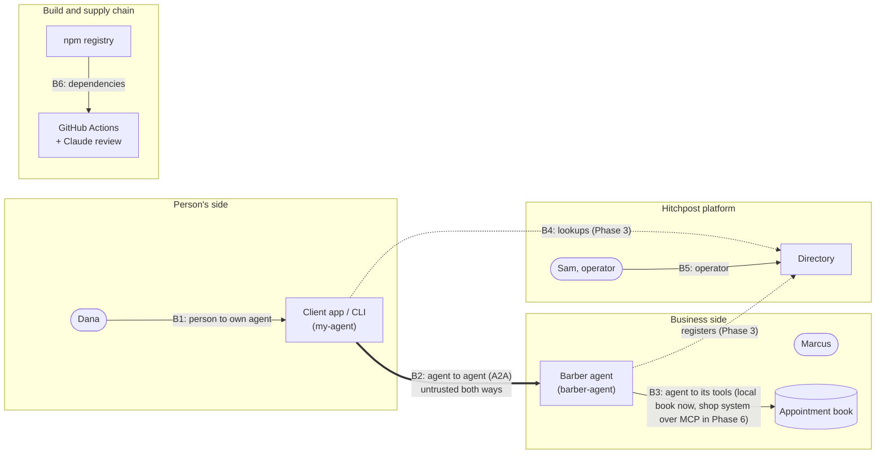

# HP-SAD-12 · Security and privacy

| Field       | Value                                                                                                                                  |
| ----------- | -------------------------------------------------------------------------------------------------------------------------------------- |
| Document ID | HP-SAD-12                                                                                                                              |
| Version     | 1.2                                                                                                                                    |
| Status      | Baselined for Phase 2                                                                                                                  |
| Date        | 2026-11-09                                                                                                                             |
| Owner       | Sanaullah Jannisar, product and engineering lead                                                                                       |
| Conforms to | STRIDE threat modelling; OWASP ASVS 4 (informative); ISO/IEC 27002 controls (informative); GDPR and CCPA principles (not legal advice) |

Hitchpost lets agents act for people, so security is part of the product. This document covers the trust boundaries, the threat model, how injection is handled once a language model arrives, identity, privacy, abuse controls and the security process.

Status labels follow [00 Document control](00-document-control.md#9-conventions): **Built** means it's in the code now (with a path). Retention and patching values are P-IDs from 00.

## 1. Trust boundaries

The rule for B2 holds in both directions: **whatever arrives from another agent is data, never instructions** ([ADR 0007](../decisions/0007-human-approval-gate.md), [ADR 0010](../decisions/0010-typed-data-parts-before-llm.md)).

## 2. Threat model (STRIDE)

S = spoofing, T = tampering, R = repudiation, I = information disclosure, D = denial of service, E = elevation of privilege.

### B2: agent to agent

| ID   | STRIDE | Threat                                                                                                                                                                           | Control                                                                                                                                                                                                                                                                                                                                                                                                                                                                                                                                                      | Status                                                                                    | Requirement                        |
| ---- | ------ | -------------------------------------------------------------------------------------------------------------------------------------------------------------------------------- | ------------------------------------------------------------------------------------------------------------------------------------------------------------------------------------------------------------------------------------------------------------------------------------------------------------------------------------------------------------------------------------------------------------------------------------------------------------------------------------------------------------------------------------------------------------ | ----------------------------------------------------------------------------------------- | ---------------------------------- |
| T-01 | T      | Hostile agent sends malformed or oversized data to crash or confuse the other side                                                                                               | Strict validation and rebuild of every inbound message; unknown fields dropped; 100 kB body limit (Express default)                                                                                                                                                                                                                                                                                                                                                                                                                                          | **Built** `packages/core/src/booking.ts` (`parseAvailabilityRequest`, `parseBarberReply`) | FR-MSG-03, NFR-SEC-01              |
| T-02 | T      | Free text hidden in typed fields ("IGNORE PREVIOUS INSTRUCTIONS 2026-11-10")                                                                                                     | Strict ISO 8601 with zone, rebuilt as canonical UTC; text fields reject control characters, max 200 chars                                                                                                                                                                                                                                                                                                                                                                                                                                                    | **Built** `booking.ts` (`toInstant`, `SAFE_TEXT`)                                         | FR-MSG-03, NFR-SEC-01              |
| T-03 | T      | Well formed but wrong offer (other service, other time, absurd price) shown to the person for approval                                                                           | `offerMatches` binds offer to request; duration and price caps                                                                                                                                                                                                                                                                                                                                                                                                                                                                                               | **Built** `booking.ts`, `packages/my-agent/src/ask.ts`                                    | FR-MSG-04                          |
| T-04 | T, E   | Acceptance of an offer the barber never made, approval of offer A used to book offer B, or a `cancel_request` or `reschedule_request` from someone who isn't the booking's owner | Server-minted capabilities authorise every state change: `offerId` (random UUID) for booking or declining that offer, `bookingToken` (128-bit random, returned only in `booking_confirmed`) for cancel and reschedule (ADR 0012). `contextId` authorises nothing: SDK 1.3 keeps whatever `contextId` the client sends (`server/index.js:2815`). Capabilities are logged only as hashes and never shown in UIs or URLs. Approval is a type only the gate can create, bound to one offer (ADR 0013). Phase 6 adds caller authentication and per-contact tokens | Phase 2 (capabilities, offer binding), Phase 6 (caller auth)                              | FR-GATE-02, FR-BOOK-01, FR-BOOK-03 |
| T-05 | D      | Huge search window pins the barber's CPU                                                                                                                                         | Window capped (P-06); slot search starts no earlier than now                                                                                                                                                                                                                                                                                                                                                                                                                                                                                                 | **Built** `booking.ts` (`MAX_WINDOW_DAYS`), `packages/barber-agent/src/book.ts`           | NFR-PERF-02                        |
| T-06 | D      | Request flood or slot hoarding from one sender (each offer holds a slot)                                                                                                         | Rate limit (P-08) and open-hold cap (P-07) per sender: client IP in Phase 2, agent identity in Phase 6 (no per-`contextId` cap, since clients choose `contextId`); `offer_declined` releases holds at once; contact-request flow before first message (Phase 4)                                                                                                                                                                                                                                                                                              | Phase 2 (per IP), Phase 4 (contacts), Phase 6 (per identity)                              | NFR-SEC-03                         |
| T-07 | S      | Fake agent claims to be Main Street Barbers                                                                                                                                      | Verified business identity in the directory; signed Agent Cards; client checks card origin against directory entry (ADR 0015, ADR 0017)                                                                                                                                                                                                                                                                                                                                                                                                                      | Phase 3 (directory checks), Phase 6 (signatures required)                                 | FR-DIR-03, NFR-SEC-02              |
| T-08 | I      | Error pages leak stack traces and file paths                                                                                                                                     | Final JSON error handler; `x-powered-by` off                                                                                                                                                                                                                                                                                                                                                                                                                                                                                                                 | **Built** `packages/barber-agent/src/server.ts`                                           | NFR-SEC-04                         |
| T-09 | R      | A party denies an offer, approval or booking happened                                                                                                                            | Append-only audit log on both sides with `contextId`, `taskId`, `offerId`, `messageId`; payload hash over JCS canonical JSON; hash chain in Phase 6                                                                                                                                                                                                                                                                                                                                                                                                          | Phase 2                                                                                   | FR-GATE-03                         |
| T-10 | E      | An agent commits a person's time or money without their yes                                                                                                                      | Approval gate: only the gate can create an approval; only booking takes one                                                                                                                                                                                                                                                                                                                                                                                                                                                                                  | Phase 2                                                                                   | FR-GATE-01                         |

### B1: person to own agent (CLI and app)

| ID   | STRIDE | Threat                                                                     | Control                                                                                                               | Status                                                  | Requirement           |
| ---- | ------ | -------------------------------------------------------------------------- | --------------------------------------------------------------------------------------------------------------------- | ------------------------------------------------------- | --------------------- |
| T-11 | S, T   | Terminal escape codes paint a fake "BOOKED and APPROVED"                   | Control characters rejected in all text fields (P-19); CLI prints only its own error messages                         | **Built** `booking.ts`, `packages/my-agent/src/main.ts` | NFR-SEC-05            |
| T-12 | D      | Agent card discovery hangs forever                                         | One deadline over the whole exchange (P-05), card fetch included; redirects refused                                   | **Built** `ask.ts`                                      | FR-MSG-05             |
| T-13 | I      | Directory supplies a URL that steers the client to an internal host (SSRF) | Card interface URL must match the directory entry's origin; block private and link-local addresses; response size cap | Phase 3                                                 | NFR-SEC-01            |
| T-14 | S      | Someone else uses Dana's app session to approve bookings                   | Device-bound sign-in, re-confirmation for approvals over a set value                                                  | Phase 4                                                 | FR-APP-02, NFR-SEC-02 |

### B3: business agent to its booking tool

Today the book is local configuration (Built). From Phase 6 a shop may connect its own booking system over MCP (FR-BOOK-06).

| ID   | STRIDE | Threat                                                                                                                                     | Control                                                                                                            | Status                                          | Requirement            |
| ---- | ------ | ------------------------------------------------------------------------------------------------------------------------------------------ | ------------------------------------------------------------------------------------------------------------------ | ----------------------------------------------- | ---------------------- |
| T-23 | T      | Shop's own configuration is malformed (unparseable booked ranges, overlapping hours), so a booked slot stops blocking and is offered again | Validate the book at load and on every MCP read; refuse to start or to offer on invalid data                       | Phase 2 (local book, D-15), Phase 6 (MCP reads) | FR-BOOK-04             |
| T-24 | T      | Non-atomic write to the shop's system: a walk-in entered there between our check and our write gets double booked                          | Only connectors that support a conditional write (fails if the slot is taken) are allowed; otherwise not supported | Phase 6                                         | FR-BOOK-06, NFR-REL-02 |
| T-25 | S      | A spoofed or redirected MCP endpoint answers instead of the shop's real system                                                             | Endpoint configured by the owner in the dashboard, HTTPS only, pinned host, no redirects                           | Phase 6                                         | FR-BOOK-06, NFR-SEC-01 |
| T-26 | I      | The MCP connector over-reads the shop's system (customer names, phone numbers)                                                             | Least-privilege scope: read free and busy ranges and write our own bookings only; customer fields never requested  | Phase 6                                         | NFR-PRIV-01            |
| T-27 | E      | Theft of the credential the agent uses for the shop's system                                                                               | Stored encrypted in the platform KMS per tenant, scoped to one shop, rotated on owner request and on suspicion     | Phase 6                                         | NFR-SEC-02             |

### B4 and B5: directory and operator

| ID   | STRIDE | Threat                                                                            | Control                                                                                                                                                                                                                               | Status                     | Requirement |
| ---- | ------ | --------------------------------------------------------------------------------- | ------------------------------------------------------------------------------------------------------------------------------------------------------------------------------------------------------------------------------------- | -------------------------- | ----------- |
| T-15 | S      | Business listed by someone who doesn't own it, or a hosted shop posing as another | Ownership proof (domain token or DNS TXT; in person for shops without a site, D-14) before a listing goes live; one subdomain per hosted tenant so origins differ (ADR 0014)                                                          | Phase 3, Phase 6 (hosting) | FR-DIR-01   |
| T-16 | T      | Fake reviews and rating manipulation                                              | Only verified interactions can be rated: in Phase 5 both sides' audit events must carry matching JCS SHA-256 hashes of the offer and the decision; signed interaction records in Phase 6 (ADR 0017); one review per completed booking | Phase 5                    | FR-RATE-01  |
| T-17 | E      | Operator account takeover alters or removes listings                              | Operator sign-in with 2FA; all moderation actions logged                                                                                                                                                                              | Phase 6                    | FR-ADMIN-01 |
| T-18 | I      | Directory leaks private contact data                                              | Directory holds business data only; reviews live in the ratings service with pseudonymous authors                                                                                                                                     | Phase 3                    | NFR-PRIV-01 |

### B6: CI/CD and supply chain

| ID   | STRIDE | Threat                                                | Control                                                                                                                                                       | Status                                                                      | Requirement  |
| ---- | ------ | ----------------------------------------------------- | ------------------------------------------------------------------------------------------------------------------------------------------------------------- | --------------------------------------------------------------------------- | ------------ |
| T-19 | T      | Compromised action tag steals the `ANTHROPIC_API_KEY` | Actions pinned to commit SHAs; `persist-credentials: false`; default token read-only                                                                          | **Built** `.github/workflows/*.yml` (SHA pins); token setting at first push | NFR-MAINT-01 |
| T-20 | E      | PR content steers the review bot                      | Runs on `pull_request`, not `pull_request_target`; forks and Dependabot skipped; tools limited to diff, view and commenting on its own PR; review is advisory | **Built** `.github/workflows/claude-review.yml`                             | NFR-SEC-01   |
| T-21 | T      | Malicious dependency update                           | Frozen lockfile in CI; pnpm blocks install scripts by default; Dependabot PRs go through CI; `pnpm audit` in CI                                               | Built (lockfile, scripts), Phase 6 (`pnpm audit`, release-age delay)        | NFR-MAINT-01 |
| T-22 | T      | Unreviewed code reaches `main`                        | Ruleset: PRs required, squash only, required check `lint, typecheck, test`                                                                                    | At first push                                                               | NFR-MAINT-01 |

## 3. Prompt injection once a language model is added

Phase 1 has no model. The plan for when one arrives ([ADR 0010](../decisions/0010-typed-data-parts-before-llm.md)):

1. **The model only translates the person's own words into a typed request.** "Thursday after work" becomes an `availability_request`. It never reads another agent's messages as instructions.
2. **Messages from other agents never reach the model's instruction channel.** If a model must summarise an offer, it gets the validated typed fields, quoted and labelled as untrusted data.
3. **Free-text fields from other agents (`service`, `reason`) are shown to the person, not acted on.** Before a model reads them they are length-limited, control-character-free (Built) and wrapped as data.
4. **Actions only through typed tool calls behind the gate.** No model output can book, pay or share data without an approval value from the person (T-10).
5. **Adversarial tests:** a fixed corpus of injection strings runs against every model-facing path in CI (see [15](15-test-strategy.md)).

## 4. Identity and authentication roadmap

| Stage                | Who proves what                                | Mechanism                                                                                                                                                                                                                                       | Phase |
| -------------------- | ---------------------------------------------- | ----------------------------------------------------------------------------------------------------------------------------------------------------------------------------------------------------------------------------------------------- | ----- |
| Today                | Nothing; local only, bound to `127.0.0.1`      | `UserBuilder.noAuthentication` in `server.ts`                                                                                                                                                                                                   | Built |
| Directory listing    | Business owns the listing                      | Domain token or DNS TXT; in person for shops without a site (pilot only, D-14)                                                                                                                                                                  | 3     |
| Agent identity       | The card really belongs to the listed business | JWS over the JCS-canonical card; keys as a JWKS at a URL registered on the listing; platform-held per-tenant keys in a KMS for hosted agents; scheduled rotation keeps old keys 30 days for verification, compromise revokes at once (ADR 0017) | 6     |
| Agent to agent calls | The caller is who it says                      | Signed cards plus per-contact tokens issued when a contact is accepted (ADR 0017)                                                                                                                                                               | 6     |
| Person to app        | Dana is Dana                                   | Passkeys first, email link fallback                                                                                                                                                                                                             | 4     |
| Operator             | Sam is Sam                                     | SSO or passkey with 2FA                                                                                                                                                                                                                         | 6     |

## 5. Privacy

Not legal advice. A lawyer reviews this before production.

### Data inventory (summary)

Full model and retention rules in [08](08-data-design.md). Risk R-08 (privacy) in the [business case](03-business-case.md) points here.

| Data                                                        | Whose                    | Where             | Class                                   |
| ----------------------------------------------------------- | ------------------------ | ----------------- | --------------------------------------- |
| Business listing (name, services, hours, prices, agent URL) | Business                 | Directory         | Public                                  |
| Appointment book                                            | Business                 | Business agent    | Business confidential                   |
| Requests, offers, bookings                                  | Person and business      | Both agents' logs | Personal                                |
| Contacts, chat history, approvals                           | Person                   | Client app        | Personal                                |
| Reviews                                                     | Person, about a business | Ratings service   | Public once posted, author pseudonymous |
| Operator and moderation logs                                | Platform                 | Directory         | Internal                                |

### Lawful basis notes (GDPR / CCPA)

- **Bookings and approvals:** performance of a contract the person asked for.
- **Audit logs:** legitimate interest (proving what was approved), with limited retention.
- **Reviews:** consent at posting time, withdrawable.
- **No sale or sharing of personal data** for advertising, so CCPA "sale" opt-outs are not triggered. This needs confirming before production.

### Minimisation (NFR-PRIV-01)

- My agent shares a **window**, not a calendar. The barber learns only the slot picked.
- Requests carry no name or contact details until the person approves a booking.
- The directory never stores customer data.

### Retention, deletion and export

Values are defined once in [00](00-document-control.md); [08 §5](08-data-design.md#5-retention) applies them.

| Data                                        | Retention                                                    | Deletion and export                              |
| ------------------------------------------- | ------------------------------------------------------------ | ------------------------------------------------ |
| Expired or declined offers                  | P-11                                                         | Automatic                                        |
| Bookings, audit events, interaction records | P-12, then deleted (aggregates without personal fields kept) | Exported on request as JSON                      |
| Everything tied to a deleted account        | Erased within P-13; backups expire per P-15                  | Export offered before deletion                   |
| Resolved abuse reports                      | P-14                                                         | Not exported (contains third-party data)         |
| Chat history                                | Until the person deletes it                                  | Delete per contact or all; export as JSON        |
| Reviews                                     | Until withdrawn                                              | Author can withdraw at any time                  |
| Server logs                                 | 30 days, no message bodies                                   | Not exported; no personal data in them by design |

### Roles

Not legal advice. My working view, for a lawyer to confirm before production:

| Processing                                                 | Controller                        | Processor                                       |
| ---------------------------------------------------------- | --------------------------------- | ----------------------------------------------- |
| Directory listings, moderation, ratings                    | Hitchpost (the operator)          | Hosting provider                                |
| Personal agent and app data (contacts, approvals, chat)    | Hitchpost, on the person's behalf | Hosting provider                                |
| A shop's bookings and audit log in a hosted business agent | The shop                          | Hitchpost (hosting the agent), hosting provider |
| A self-hosted business agent                               | The shop                          | Whoever the shop chooses                        |

A data processing agreement with each pilot shop is part of onboarding ([17](17-transition-plan.md)).

### Record of processing activities (summary)

| Activity                 | Purpose                                   | Data subjects               | Data                                                     | Lawful basis                                         | Retention                                 | Recipients                                             |
| ------------------------ | ----------------------------------------- | --------------------------- | -------------------------------------------------------- | ---------------------------------------------------- | ----------------------------------------- | ------------------------------------------------------ |
| Availability and booking | Book the appointment the person asked for | Customers                   | Window, service, booking time, pseudonymous customer ref | Contract                                             | P-11, P-12                                | The chosen shop                                        |
| Approval and audit       | Prove what was approved                   | Customers, shop owners      | Decisions, timestamps, correlation ids, payload hashes   | Legitimate interest                                  | P-12                                      | Only the party that wrote the log; operator on dispute |
| App account              | Run the person's agent                    | Customers                   | Name, email, time zone, contacts                         | Contract                                             | Until deletion, then P-13                 | None                                                   |
| Directory                | Let people find shops                     | Shop owners                 | Business details, verification state                     | Legitimate interest                                  | While listed                              | Public                                                 |
| Ratings and reviews      | Trust signals                             | Customers, shops            | Interaction outcomes, review text                        | Legitimate interest (metrics), consent (review text) | P-12 (records), until withdrawn (reviews) | Public (aggregates and reviews)                        |
| Abuse reports            | Keep the directory safe                   | Reporters, reported parties | Report details                                           | Legitimate interest                                  | P-14                                      | Operator                                               |

### Data protection impact assessment (summary)

A full DPIA is due before the Phase 6 pilot. The screening today:

| Question                                          | Answer                                                                                                                                                               |
| ------------------------------------------------- | -------------------------------------------------------------------------------------------------------------------------------------------------------------------- |
| Large-scale or special-category data?             | No. One neighbourhood; no health, payment or identity documents in v1.                                                                                               |
| Automated decisions with legal or similar effect? | No. Agents propose; a person decides every commitment (ADR 0007).                                                                                                    |
| Systematic monitoring?                            | Limited: interaction outcomes feed ratings. Mitigated by pseudonymous records and verified-only reviews.                                                             |
| Main risks to people                              | Wrong or unwanted bookings (T-03, T-04, T-10); exposure of booking history (T-18, T-26); fake reviews (T-16).                                                        |
| Main mitigations                                  | Approval gate, offer binding, minimisation (a slot, never a calendar), P-IDs for retention, pseudonymous ratings.                                                    |
| Residual risk                                     | Low to medium until agent auth in Phase 6: a leaked `bookingToken` lets its holder cancel or reschedule that one booking (T-04); accepted for the closed pilot only. |

## 6. Abuse and spam controls

- **Contact requests** (Phase 4): an unknown agent's first message lands as a request the person accepts or blocks, like a messaging app.
- **Rate limits and hold caps** (Phase 2 per client IP, Phase 6 per agent identity): P-08 and P-07, plus global limits at the proxy in Phase 6.
- **Sender reputation** (Phase 5): agents with many rejected or reported interactions get throttled, then delisted after review.
- **Reports** (UC-09, Phase 5) go to the moderation queue (UC-10, FR-ADMIN-01).
- **Request bounds** (Built): window cap, body size limit, validation before any work.

## 7. Security process

- **Reporting:** private vulnerability reporting through GitHub, described in [SECURITY.md](../../SECURITY.md). Acknowledgement within 72 hours.
- **Disclosure:** coordinated. A fix ships first, then a GitHub Security Advisory with credit to the reporter.
- **Dependencies:** Dependabot weekly for npm and Actions (`.github/dependabot.yml`), actions pinned to SHAs, frozen lockfile, CVEs patched per P-16 ([19](19-maintenance-and-evolution.md)).
- **Reviews:** every PR gets the automated review. Changes touching validation, the gate or auth also get a manual security check against this threat model.
- **Re-audit:** before Phase 2 ships, before production, and yearly after that, in the same five-reviewer format as the [Phase 1 audit](../audits/2026-11-08-phase-1.md). Those reviews are run as separate Claude Code agents under my direction; an outside human security review is planned before production.

## Revision history

| Version | Date       | Change                                                                                                                                                                                                                                                                                                               | Author      |
| ------- | ---------- | -------------------------------------------------------------------------------------------------------------------------------------------------------------------------------------------------------------------------------------------------------------------------------------------------------------------- | ----------- |
| 0.1     | 2026-11-08 | First draft                                                                                                                                                                                                                                                                                                          | S. Jannisar |
| 1.0     | 2026-11-09 | Baselined: renumbered into lifecycle order, formal document control, standards conformance                                                                                                                                                                                                                           | S. Jannisar |
| 1.1     | 2026-11-09 | Remediation after independent review: B3 threats T-23 to T-27, T-04 on `contextId` and bearer risk, corrected requirement traces, roles, record of processing, DPIA screening, R-08, retention and patching via P-IDs, signed cards Phase 6                                                                          | S. Jannisar |
| 1.2     | 2026-11-09 | Second remediation after regrade: T-04 rewritten: server-minted offerId and bookingToken are the capabilities, contextId authorises nothing (SDK 1.3 keeps the client's contextId); T-06 hold cap per sender only; T-16 Phase 5 hash attestation, signed interaction records in Phase 6; DPIA residual risk restated | S. Jannisar |
