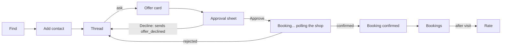

# HP-SAD-13 · Interface design

| Field       | Value                                                                 |
| ----------- | --------------------------------------------------------------------- |
| Document ID | HP-SAD-13                                                             |
| Version     | 1.1                                                                   |
| Status      | Baselined for Phase 2                                                 |
| Date        | 2026-11-09                                                            |
| Owner       | Sanaullah Jannisar, product and engineering lead                      |
| Conforms to | IEEE 1016-2009 (interface viewpoint); A2A protocol specification v1.0 |

The contracts Hitchpost exposes: the agent message contract (agent to agent), the directory REST API (app and agents to directory) and the client app's screens. The booking protocol's rationale is in [ADR 0012](../decisions/0012-booking-protocol.md). Timing and limit values are not repeated here: they are the normative parameters P-01 to P-20 in [00 Document control](00-document-control.md), referenced by ID.

## 1. Agent message contract

Messages travel as A2A **data parts** (`mediaType: application/json`), built with `dataPart()` in `packages/core/src/a2a.ts`. Every message has a `kind`. Every receiver validates and rebuilds what it gets; unknown fields are dropped (NFR-SEC-01, FR-MSG-03).

### Shared field rules (Built, `packages/core/src/booking.ts`)

| Type                                  | Rule                                                                                    |
| ------------------------------------- | --------------------------------------------------------------------------------------- |
| Instant                               | Strict ISO 8601 with `Z` or `±hh:mm`, real calendar day, rebuilt as UTC `toISOString()` |
| Text (`service`, `reason`, `offerId`) | Text limit (P-19): 1 to 200 characters, no control characters (`\p{C}`)                 |
| `durationMinutes`                     | Safe integer within the duration cap (P-20)                                             |
| `priceCents`                          | Safe integer within the price cap (P-20)                                                |
| `currency`                            | Three capital letters (ISO 4217 shape)                                                  |
| Window                                | `earliest < latest`, within the maximum search window (P-06)                            |

All instants are UTC on the wire. Shop-local time zones arrive in Phase 6 ([ADR 0018](../decisions/0018-shop-time-zones.md)); before then every booking is a UTC demo booking.

### Kinds

| Kind                   | Direction         | Fields                                                                                                                                                      | Carried in                          | Status  |
| ---------------------- | ----------------- | ----------------------------------------------------------------------------------------------------------------------------------------------------------- | ----------------------------------- | ------- |
| `availability_request` | person → business | `service`, `earliest`, `latest`                                                                                                                             | Message                             | Built   |
| `offer`                | business → person | `offerId`, `service`, `start`, `durationMinutes`, `priceCents`, `currency`; Phase 2 adds `issuedAt`, `expiresAt` and, for a reschedule, `replacesBookingId` | Message                             | Built   |
| `no_availability`      | business → person | `service`                                                                                                                                                   | Message                             | Built   |
| `rejected`             | business → person | `reason`                                                                                                                                                    | Message                             | Built   |
| `offer_declined`       | person → business | `offerId`                                                                                                                                                   | Message (releases the hold at once) | Phase 2 |
| `booking_request`      | person → business | `offerId`                                                                                                                                                   | Task                                | Phase 2 |
| `booking_confirmed`    | business → person | `bookingId`, `offerId`, `service`, `start`, `durationMinutes`, `priceCents`, `currency`                                                                     | Task `COMPLETED`                    | Phase 2 |
| `booking_rejected`     | business → person | `offerId`, `reason`: `expired`, `unknown_offer`, `slot_taken`, `shop_declined`, `shop_timeout`, `other`                                                     | Task `REJECTED`                     | Phase 2 |
| `cancel_request`       | person → business | `bookingId`                                                                                                                                                 | Task                                | Phase 2 |
| `cancelled`            | business → person | `bookingId`                                                                                                                                                 | Task `COMPLETED`                    | Phase 2 |
| `cancel_rejected`      | business → person | `bookingId`, `reason`: `cutoff`, `unknown_booking`, `other`                                                                                                 | Task `REJECTED`                     | Phase 2 |
| `reschedule_request`   | person → business | `bookingId`, `earliest`, `latest`; answered with an `offer` carrying `replacesBookingId`, then the normal approve and book flow                             | Task                                | Phase 2 |

The receiving personal agent also checks that an offer answers its own request (`offerMatches`: same service, start within the window), FR-MSG-04. A `booking_confirmed` must match the approved offer field for field before it is written to a calendar.

### Protocol rules (Phase 2, ADR 0012)

- **Offer clock.** The business clock is authoritative. `expiresAt` = `issuedAt` + offer hold (P-01). The personal agent computes its own local deadline as receivedAt + (`expiresAt` − `issuedAt`) and treats the offer as expired the clock margin (P-09) before it, so clock skew between machines never lets an approval land after the business considers the offer gone.
- **Reserved.** When a `booking_request` is accepted for a shop on manual approval (FR-GATE-05), the offer moves from Held to Reserved and stays held until the shop decides, at most the manual approval wait (P-03). A shop on standing approval goes straight from Held to Booked.
- **Recheck at write.** The slot is checked again inside the same transaction that writes the booking. If it is no longer free, the Task ends `REJECTED` with `slot_taken`.
- **Waiting on the shop.** The Task stays `WORKING` with a status message "Waiting for the shop", never `INPUT_REQUIRED`: in A2A that state asks the _client_ for input, and SDK 1.3 stops draining executor events at it (`server/index.js:2181`). The personal agent sends `booking_request` with `returnImmediately: true` and polls `GetTask` until a final state or its booking deadline (P-04). There are no push notifications in v1.
- **Context binding.** `booking_request`, `offer_declined`, `cancel_request` and `reschedule_request` must arrive in the `contextId` of the original offer; anything else is answered `unknown_offer` or `unknown_booking`. The server mints the `contextId`, so until agent authentication in Phase 6 it is a bearer capability: it is logged, never shown in a UI and never put in a URL.
- **Idempotency.** The business keeps `offerId → taskId`. A repeated `booking_request` for the same offer returns the existing Task in whatever state it is, including while it is still waiting on the shop. Clients reuse the same `messageId` on a retry.
- **Hold caps.** At most the open holds cap (P-07) per `contextId` and per sender. Beyond it the business answers `rejected` and issues no new hold. Requests per sender are limited by the rate limit (P-08).
- **Reschedule as an atomic swap.** The old booking is cancelled only in the same transaction that confirms the new one. If the new booking fails, the old one stands.
- **Shop-side cancellation** of a confirmed booking is Later: `hitchpost/1` has no business-to-person push. In v1 the shop contacts the customer outside Hitchpost.
- **Correlation.** From Phase 2 both sides record `contextId`, `taskId`, `offerId` and `messageId` on every audit event. Audit `payloadHash` is SHA-256 over the JCS (RFC 8785) canonical JSON of the data part.

### A2A usage

| Exchange                    | A2A shape                                                                                                                        | Why                                                                                                                |
| --------------------------- | -------------------------------------------------------------------------------------------------------------------------------- | ------------------------------------------------------------------------------------------------------------------ |
| Availability, decline       | `SendMessage` → `Message` reply                                                                                                  | Stateless; nothing to track (availability Built, `executor.ts`).                                                   |
| Booking, cancel, reschedule | `SendMessage` (`returnImmediately: true`) → `Task`; `WORKING` while the shop decides; `COMPLETED` or `REJECTED` with a data part | A durable id for audit, polling and idempotent retries (ADR 0012).                                                 |
| Agent card                  | `GET /.well-known/agent-card.json`                                                                                               | Skills: `offer_appointment` (Built), `book_appointment`, `cancel_appointment` (Phase 2). Modes `application/json`. |

Transport: JSON-RPC binding (Built). REST and gRPC bindings are available in the SDK but not advertised until tested (NFR-INT-01).

## 2. Versioning and compatibility

- **Where the version lives.** The A2A `AgentCard` has no metadata field. The contract is declared as an entry in `capabilities.extensions`: uri `https://hitchpost.dev/ext/contract/v1`, `required: true`. Every message lists that uri in its `extensions` field.
- **Major versions only.** Additive changes (a new optional field, a new `kind`) keep the version. Receivers ignore unknown fields and reply `rejected` to unknown kinds. There are no minor versions.
- **Breaking changes** (removing or retyping a field, tightening a limit) publish a new extension uri, `.../contract/v2`. An agent lists every version it accepts; a sender uses the highest one both cards list.
- Each major version is supported for the period in P-18 after its successor ships (see [19 Maintenance](19-maintenance-and-evolution.md)).
- Contract tests in `packages/e2e` run each supported version against the current agents (Phase 2).

## 3. Directory REST API (Phase 3)

Base path `/v1`. JSON only. Errors use the model in section 5.

| Method and path                                                      | Auth             | Purpose                                                                                      |
| -------------------------------------------------------------------- | ---------------- | -------------------------------------------------------------------------------------------- |
| `POST /v1/listings`                                                  | Business account | Create a listing with `cardUrl`; status `pending`                                            |
| `POST /v1/listings/{id}/verify`                                      | Business account | Start origin verification (well-known token or DNS TXT)                                      |
| `GET /v1/listings/{id}`                                              | None             | Public listing: name, address, services summary, `cardUrl`, `verifiedOrigin`, rating summary |
| `GET /v1/listings?q=&near=lat,lng&radiusKm=&service=&cursor=&limit=` | None             | Search verified listings (FR-DIR-02). `limit` 1 to 50, default 20; cursor pagination         |
| `PATCH /v1/listings/{id}`                                            | Business account | Update public fields; changing `cardUrl` resets verification                                 |
| `DELETE /v1/listings/{id}`                                           | Business account | Close the listing                                                                            |
| `POST /v1/reports`                                                   | Person account   | Report a listing (FR-ADMIN-01)                                                               |
| `GET /v1/admin/reports`, `POST /v1/admin/listings/{id}/suspend`      | Operator role    | Moderation (Phase 6)                                                                         |

Rules: the directory fetches cards server-side with a timeout, no redirects, a size cap and private-address blocking (NFR-SEC-01). Search returns only `verified` listings. Rate limits per IP and per account (P-08, NFR-SEC-03); a `429` carries `Retry-After`. Hosted business agents each get their own subdomain so origin verification can tell them apart (Phase 6).

## 4. Client app (Phase 4)

### Screens

| Screen         | Purpose                                                                | Requirement           |
| -------------- | ---------------------------------------------------------------------- | --------------------- |
| Contacts       | Agents you've added, with verified badge and rating                    | FR-APP-01             |
| Find           | Directory search and add contact                                       | FR-DIR-02             |
| Thread         | Conversation with one business agent; typed cards for offers           | FR-MSG-02             |
| Approval sheet | The validated offer, the business's verified name, Approve and Decline | FR-APP-02, FR-GATE-01 |
| Bookings       | Upcoming and past bookings; cancel, reschedule                         | FR-BOOK-03            |
| Rate           | Stars and optional text after a completed booking                      | FR-RATE-01            |
| Settings       | Account, data export and deletion                                      | NFR-PRIV-01           |

Full screen designs are in [14 User interface design](14-user-interface-design.md).

### Main flow

The approval sheet renders only fields that passed validation, from structured data, never from free text, and states plainly that nothing is booked until Approve is pressed. Decline sends `offer_declined`, so the shop's chair is freed at once.

### Accessibility (NFR-A11Y-01, WCAG 2.2 AA)

- Approve and Decline are real buttons, at least 24 by 24 CSS px, reachable by keyboard, never colour-only.
- Times shown in the person's time zone with the zone named; prices with currency.
- Offer cards and status changes announced through a polite live region.
- No time limit on approving shorter than the offer's own local deadline (P-01, P-09), and the remaining time is shown as text.

## 5. Error model

| Layer                        | Shape                                                                                            | Rule                                                                                   |
| ---------------------------- | ------------------------------------------------------------------------------------------------ | -------------------------------------------------------------------------------------- |
| Agent message                | `rejected {reason}`, `booking_rejected {offerId, reason}`, `cancel_rejected {bookingId, reason}` | Reasons are the listed codes or short plain sentences; no stack traces                 |
| A2A transport                | JSON-RPC error                                                                                   | Logged with `contextId`; never shown to a person verbatim                              |
| HTTP (agent host, directory) | `{"error": "<code>", "message": "<safe text>"}` with matching status                             | Built in minimal form: `{"error":"bad request"}` from the error handler in `server.ts` |
| CLI and app                  | Own messages only                                                                                | Built: `AskError` in `my-agent/src/ask.ts`; any other error shows a fixed message      |

## Revision history

| Version | Date       | Change                                                                                                                                                                                                      | Author      |
| ------- | ---------- | ----------------------------------------------------------------------------------------------------------------------------------------------------------------------------------------------------------- | ----------- |
| 0.1     | 2026-11-08 | First draft                                                                                                                                                                                                 | S. Jannisar |
| 1.0     | 2026-11-09 | Baselined: renumbered into lifecycle order, formal document control, standards conformance                                                                                                                  | S. Jannisar |
| 1.1     | 2026-11-09 | Remediation after independent review: booking protocol rules (Reserved, WORKING not input-required, recheck, polling, idempotency, hold caps, clock), new kinds, contract version in card extensions, P-IDs | S. Jannisar |
