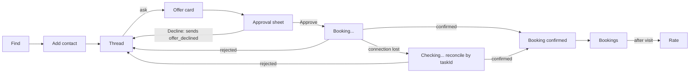

# HP-SAD-13 · Interface design

| Field       | Value                                                                 |
| ----------- | --------------------------------------------------------------------- |
| Document ID | HP-SAD-13                                                             |
| Version     | 1.3                                                                   |
| Status      | Baselined for Phase 2                                                 |
| Date        | 2026-11-09                                                            |
| Owner       | Sanaullah Jannisar, product and engineering lead                      |
| Conforms to | IEEE 1016-2009 (interface viewpoint); A2A protocol specification v1.0 |

The contracts Hitchpost exposes between agent lines: the agent message contract (agent to agent, person to business and person to person), the directory REST API (app and agents to directory), and the App API plus screens of the client app. The booking protocol's rationale is in [ADR 0012](../decisions/0012-booking-protocol.md). Timing and limit values are not repeated here: they are the normative parameters in [00 Document control](00-document-control.md), referenced by ID.

## 1. Agent message contract

Messages travel as A2A **data parts** (`mediaType: application/json`), built with `dataPart()` in `packages/core/src/a2a.ts`. Every message has a `kind`. Every receiver validates and rebuilds what it gets; unknown fields are dropped (NFR-SEC-01, FR-MSG-03). The same kinds serve person-to-business booking and person-to-person time agreement (UC-11): in the second case the responding agent is another person's agent and its owner approves through their own gate.

### Shared field rules (Built, `packages/core/src/booking.ts`)

| Type                                  | Rule                                                                                                                           |
| ------------------------------------- | ------------------------------------------------------------------------------------------------------------------------------ |
| Instant                               | Strict ISO 8601 with `Z` or `±hh:mm`, real calendar day, hours 00 to 23, offsets within ±14:00, rebuilt as UTC `toISOString()` |
| Text (`service`, `reason`, `offerId`) | Text limit (P-19): 1 to 200 characters, no control characters (`\p{C}`)                                                        |
| `serviceId`                           | Phase 2: stable opaque id (1 to 64 characters, `[A-Za-z0-9_-]`); the service name is display only (FR-MSG-17)                  |
| `durationMinutes`                     | Safe integer within the duration cap (P-20)                                                                                    |
| `priceCents`                          | Safe integer within the price cap (P-20)                                                                                       |
| `currency`                            | Three capital letters (ISO 4217 shape); displayed with `Intl.NumberFormat`, never a fixed two decimals                         |
| Window                                | `earliest < latest`, within the maximum search window (P-06)                                                                   |

All instants are UTC on the wire. Business-local IANA zones arrive in Phase 6 ([ADR 0018](../decisions/0018-shop-time-zones.md)); before then every booking is a UTC demo booking.

### Kinds

| Kind                            | Direction             | Fields                                                                                                                                                                                                                                                                                                | Carried in                                          | Status                                      |
| ------------------------------- | --------------------- | ----------------------------------------------------------------------------------------------------------------------------------------------------------------------------------------------------------------------------------------------------------------------------------------------------- | --------------------------------------------------- | ------------------------------------------- |
| `availability_request`          | requester → responder | `service` (Phase 2 adds `serviceId`), `earliest`, `latest`                                                                                                                                                                                                                                            | Message                                             | Built                                       |
| `offer`                         | responder → requester | `offerId`, `service`, `start`, `durationMinutes`, `priceCents`, `currency`. Phase 2 adds `serviceId`, `issuedAt`, `expiresAt`, the disclosure block (`businessLegalName`, `businessPhone`, `taxIncluded`, `cancellationCutoffMinutes` or null, FR-BOOK-17) and, for a reschedule, `replacesBookingId` | Message                                             | Built                                       |
| `no_availability`               | responder → requester | `service`                                                                                                                                                                                                                                                                                             | Message                                             | Built                                       |
| `rejected`                      | responder → requester | `reason` from `RejectReason`, optional `detail` text (P-19). Today a free-text reason (Built); the enumeration lands in Phase 2                                                                                                                                                                       | Message                                             | Built                                       |
| `offer_declined`                | requester → responder | `offerId`                                                                                                                                                                                                                                                                                             | Message (releases the hold at once)                 | Phase 2                                     |
| `booking_request`               | requester → responder | `offerId` (the capability to book that offer); `customer` block: `displayName`, `phone` (E.164, verified by the app), optional `note` (P-19), shared only with that business (FR-BOOK-14)                                                                                                             | Task                                                | Phase 2                                     |
| `booking_confirmed`             | responder → requester | `bookingId`, `bookingToken`, `offerId`, `serviceId`, `service`, `start`, `durationMinutes`, `priceCents`, `currency`; `duplicateOf` when answering a resent request                                                                                                                                   | Task `COMPLETED`                                    | Phase 2                                     |
| `booking_rejected`              | responder → requester | `offerId`, `reason` from `BookingRejectReason`                                                                                                                                                                                                                                                        | Task `REJECTED`                                     | Phase 2                                     |
| `cancel_request`                | requester → responder | `bookingId`, `bookingToken`                                                                                                                                                                                                                                                                           | Task                                                | Phase 2                                     |
| `cancelled`                     | responder → requester | `bookingId`; `duplicateOf` when answering a resent request                                                                                                                                                                                                                                            | Task `COMPLETED`                                    | Phase 2                                     |
| `cancel_rejected`               | responder → requester | `bookingId`, `reason` from `CancelRejectReason`                                                                                                                                                                                                                                                       | Task `REJECTED`                                     | Phase 2                                     |
| `reschedule_request`            | requester → responder | `bookingId`, `bookingToken`, `earliest`, `latest`; answered with an `offer` carrying `replacesBookingId`, or `no_availability`, or `rejected` with reason `cutoff`; then the normal approve and book flow                                                                                             | Message (a question)                                | Phase 2                                     |
| `booking_cancelled_by_business` | business → person     | `bookingId`, `reasonText` (P-19), `businessPhone`                                                                                                                                                                                                                                                     | Message to the person's agent, delivered to the app | Phase 4 (pilot: operator relay, FR-BOOK-15) |
| `booking_pending`               | business → person     | `offerId`, `reservedUntil`                                                                                                                                                                                                                                                                            | Status message of a `WORKING` Task                  | Later (manual approval only)                |

The receiving personal agent also checks that an offer answers its own request (`offerMatches`: same service, start within the window), FR-MSG-04. A `booking_confirmed` must match the approved offer field for field before it is written to a calendar.

### Reason enumerations (Phase 2, O-6)

| Enumeration           | Values                                                                                                                          |
| --------------------- | ------------------------------------------------------------------------------------------------------------------------------- |
| `RejectReason`        | `invalid_request`, `unknown_service`, `hold_cap`, `cutoff`, `unknown_booking`, `paused`, `unsupported_kind`, `rate_limited`     |
| `BookingRejectReason` | `expired`, `unknown_offer`, `slot_taken`, `cutoff`, `paused`, `other`; Later (manual approval): `shop_declined`, `shop_timeout` |
| `CancelRejectReason`  | `cutoff`, `unknown_booking`, `other`                                                                                            |

A paused listing (rollback or operator pause) answers new requests with `rejected` reason `paused` and new booking requests with `booking_rejected` reason `paused`; confirmed bookings stand. Exact names are mirrored in [09 Data dictionary](09-data-dictionary.md).

### Protocol rules (Phase 2, ADR 0012)

- **Standing approval only in the pilot.** A valid `booking_request` inside opening hours is decided at once: Held goes straight to Booked in one transaction, and the Task completes within the request. Manual approval by the business owner (offer Reserved, Task kept `WORKING`, `booking_pending` with `reservedUntil`, client polling `GetTask` up to P-04, `shop_timeout` after P-03) stays designed here and in ADR 0012 but is Later (FR-GATE-05). It never uses `INPUT_REQUIRED`: in A2A that state asks the _client_ for input, and SDK 1.3 stops draining executor events at it (`server/index.js:2181`).
- **Offer clock.** The business clock is authoritative. `expiresAt` = `issuedAt` + offer hold (P-01). The personal agent computes its own local deadline as receivedAt + (`expiresAt` − `issuedAt`) on a monotonic clock and treats the offer as expired the clock margin (P-09) before it. Screens show the deadline as an absolute "held until" time (FR-APP-11).
- **Slot selection duty.** The offer is the earliest slot that fits the request, never a slot the business prefers (FR-BOOK-16).
- **Recheck at write.** The slot is checked again inside the same transaction that writes the booking. If it is no longer free, the Task ends `REJECTED` with `slot_taken`.
- **Capabilities, not contexts.** Authority comes from server-minted secrets, never from `contextId`. The SDK keeps whatever `contextId` the client sends (`server/index.js:2815`), so a client can choose it and it proves nothing. `offerId` (random UUID v4, minted by the business) authorises `booking_request` and `offer_declined` for that offer. `booking_confirmed` carries a `bookingToken` that `cancel_request` and `reschedule_request` must present with the `bookingId`; a wrong or missing token is answered `unknown_booking`. `contextId` is kept for correlation only. Until agent authentication in Phase 6 these secrets are bearer capabilities: logged as hashes, never shown in a UI and never put in a URL.
- **Method policy (proposed, O-1; confirmed by the Phase 2 spike).** Under `noAuthentication` every caller shares one task scope, so the business agent refuses `ListTasks` for everyone and `CancelTask` on booking and cancel Tasks (cancellation goes through `cancel_request`). A `taskId` is a bearer secret. The `bookingToken` is HMAC(server key, `bookingId`), base64url, so a duplicate reply can re-issue it without the token ever being stored or written into Task history; the server key rotates with the overlap in P-24 (FR-MSG-18).
- **Task resolution (proposed, O-2; confirmed by the Phase 2 spike).** The bookings table is the source of truth. At startup the business agent rebuilds Task state from it and sweeps expired holds. A Task that must finish after its executor returned (manual approval, Later) is completed by a resolver that writes the final status under the original task scope (FR-BOOK-13).
- **Idempotency.** The SDK gives a send without `taskId` a new random task id (`server/index.js:2801`) and throws `UnsupportedOperationError` when a send names a finished task (`server/index.js:2789`), so retries work like this. A client that has the `taskId` retries with `GetTask`, never with a new send. A client that lost the response resends `booking_request` without a `taskId`; the business looks up `offerId → taskId` and the new Task completes at once with the same result plus `duplicateOf: <original taskId>`. Two concurrent sends for one offer resolve the same way: the loser of the unique-key race gets the `duplicateOf` reply, never an error. `cancel_request` works the same way through `bookingId → taskId`. Clients reuse the same `messageId` on a resend.
- **Availability de-duplication.** A resent `availability_request` with the same `messageId` from the same sender returns the original reply and creates no new hold (FR-MSG-13).
- **Hold caps and the sender.** At most the open holds cap (P-07) per sender. The sender is the `Hitchpost-Install-Key` header (a random 128-bit key per personal-agent install), falling back to the client IP, which is shared behind carrier NAT and so is only a fallback; from Phase 6 it is the verified agent identity. Beyond the cap the business answers `rejected` reason `hold_cap` and issues no new hold. Requests per sender are limited by the rate limit (P-08).
- **Unknown kinds.** A request of an unknown `kind` gets `rejected` reason `unsupported_kind`. A client treats an unknown reply kind as "unsupported reply": it logs it, books nothing and tells the person. A business sends a new reply kind only to a client that listed it in the extension's `params.replyKinds` (FR-MSG-14).
- **Reschedule.** `reschedule_request` is a question, so it is a Message: the business checks the token and the cancellation cutoff (P-10) and answers with an offer carrying `replacesBookingId`, `no_availability`, or `rejected` with reason `cutoff`. The person approves that offer like any other. At the swap the business checks P-10 again: past the cutoff the Task ends `booking_rejected` with reason `cutoff`. Otherwise the old booking is cancelled only in the same transaction that confirms the new one; if the new booking fails, the old one stands.
- **Business cancellation (FR-BOOK-15).** In the pilot the business asks the operator, who contacts the customer through the relay tool; both audit logs record a `booking_cancelled_by_business` event. From Phase 4 the business agent sends `booking_cancelled_by_business` to the person's agent, which notifies the app.
- **Person to person (UC-11, Phase 4).** The responding personal agent builds its offer from its owner's free and busy times and never sends calendar contents (NFR-PRIV-01). Its owner's gate approves on that side; the requester's gate approves on the other. Both agents write the event to their owner's calendar after a matching `booking_confirmed`.
- **Correlation.** From Phase 2 both sides record `contextId`, `taskId`, `offerId` and `messageId` on every audit event. Audit `payloadHash` is SHA-256 over the JCS (RFC 8785) canonical JSON of the data part.

### A2A usage

| Exchange                                   | A2A shape                                                                                                      | Why                                                                                                                |
| ------------------------------------------ | -------------------------------------------------------------------------------------------------------------- | ------------------------------------------------------------------------------------------------------------------ |
| Availability, decline, reschedule question | `SendMessage` → `Message` reply                                                                                | Questions; nothing to track (availability Built, `executor.ts`).                                                   |
| Booking, cancel                            | `SendMessage` → `Task`; `COMPLETED` or `REJECTED` with a data part, within the request under standing approval | A durable id for audit and idempotent retries (ADR 0012).                                                          |
| Agent card                                 | `GET /.well-known/agent-card.json`                                                                             | Skills: `offer_appointment` (Built), `book_appointment`, `cancel_appointment` (Phase 2). Modes `application/json`. |
| Refused methods                            | `ListTasks` for everyone; `CancelTask` on booking and cancel Tasks                                             | Proposed method policy (O-1).                                                                                      |

Transport: JSON-RPC binding (Built). REST and gRPC bindings are available in the SDK but not advertised until tested (NFR-INT-01). The requesting agent only calls interface URLs on the origin it asked, and refuses redirects (Built, FR-MSG-16).

## 2. Versioning and compatibility

- **Where the version lives.** The A2A `AgentCard` has no metadata field. The contract is declared as an entry in `capabilities.extensions`: uri `https://hitchpost.dev/ext/contract/v1`, `required: true`, `params.replyKinds` listing the reply kinds the agent understands.
- **How a client declares it.** The SDK checks required extensions against `context.requestedExtensions`, which comes from the `A2A-Extensions` HTTP header, not from `message.extensions` (`server/index.js:2775-2781`). A client that leaves the header out gets `ExtensionSupportRequiredError` on every send. So every client sends the uri in the `A2A-Extensions` header (in the JS SDK, through `serviceParameters` on each call) and also lists it in each message's `extensions`. Today's `askForSlot` sends neither: adding it is Phase 2 work, proved by a contract test.
- **Major versions only.** A new optional request field or a new request kind keeps the version (receivers drop unknown fields and answer `unsupported_kind`). A new reply kind keeps the version only because businesses send it to clients that advertise it (FR-MSG-14). There are no minor versions.
- **Breaking changes** (removing or retyping a field, tightening a limit) publish a new extension uri, `.../contract/v2`. An agent lists every version it accepts; a sender uses the highest one both cards list.
- Each major version is supported for the period in P-18 after its successor ships (see [19 Maintenance](19-maintenance-and-evolution.md)).

### Conformance kit (Phase 2, FR-MSG-15)

- **JSON Schemas.** One JSON Schema (draft 2020-12) per message kind, generated from the same definitions as the parsers in `packages/core`, published with each contract version at `https://hitchpost.dev/ext/contract/v1/schemas/`. The parsers stay the enforcement; the schemas are the language-neutral description, and a test fails if the two disagree.
- **Runner.** A conformance runner (`packages/conformance`, run as `pnpm conformance <agent-url>`) plays the requester against any agent URL: card shape, extension declaration, every kind, every rejection reason, idempotent resend, hold cap, unknown kind. It prints a pass or fail per check and exits non-zero on failure, so third-party agents (Priya, booking platforms) can test before listing.
- **Contract tests** in `packages/e2e` run the runner against our own agents for each supported version.

## 3. Directory REST API (Phase 3)

Base path `/v1`. JSON only. Errors use the model in section 5.

| Method and path                                                                             | Auth             | Purpose                                                                                                                          |
| ------------------------------------------------------------------------------------------- | ---------------- | -------------------------------------------------------------------------------------------------------------------------------- |
| `POST /v1/listings`                                                                         | Business account | Create a listing with `cardUrl`; status `pending`; held for review if the name is confusable with a verified listing (FR-DIR-06) |
| `POST /v1/listings/{id}/verify`                                                             | Business account | Start origin verification (well-known token or DNS TXT)                                                                          |
| `GET /v1/listings/{id}`                                                                     | None             | Public listing: name, address, services summary, `cardUrl`, `verifiedOrigin`, rating summary                                     |
| `GET /v1/listings?q=&near=lat,lng&radiusKm=&service=&cursor=&limit=`                        | None             | Search verified listings (FR-DIR-02). `limit` 1 to 50, default 20; cursor pagination                                             |
| `PATCH /v1/listings/{id}`                                                                   | Business account | Update public fields; changing `cardUrl` resets verification                                                                     |
| `DELETE /v1/listings/{id}`                                                                  | Business account | Close the listing                                                                                                                |
| `POST /v1/reports`                                                                          | Person account   | Report a listing (FR-ADMIN-01)                                                                                                   |
| `GET /v1/admin/reports`, `POST /v1/admin/listings/{id}/suspend`, `POST /v1/admin/pause-all` | Operator role    | Moderation (Phase 5), pause every listing (FR-ADMIN-03)                                                                          |

Rules: the directory fetches cards server-side with a timeout, no redirects, a size cap and private-address blocking (NFR-SEC-01). Search returns only `verified` listings. Rate limits per IP and per account (P-08, NFR-SEC-03); a `429` carries `Retry-After`. Hosted business agents each get their own subdomain so origin verification can tell them apart (Phase 6). A suspension carries a statement of reasons and an appeal route.

## 4. Client app (Phase 4)

The client is a progressive web app first (installable, Web Push), with its personal agent running server-side ([26 Service architecture](26-service-architecture.md), [27 Frontend technical specification](27-frontend-technical-specification.md)). The app never speaks A2A itself: it talks to its own personal agent through the App API below, and the personal agent speaks A2A to other agent lines.

### 4.1 App API

Base path `/app/v1` on the person's personal-agent host. JSON over HTTPS; Server-Sent Events for updates (FR-APP-12).

| Method and path                                                                                                                                                                 | Purpose                                                                                                                               |
| ------------------------------------------------------------------------------------------------------------------------------------------------------------------------------- | ------------------------------------------------------------------------------------------------------------------------------------- |
| `POST /app/v1/session`                                                                                                                                                          | Sign in with a passkey (WebAuthn) or an email magic link; sets the session cookie                                                     |
| `GET /app/v1/me`, `GET /app/v1/me/export`, `DELETE /app/v1/me`                                                                                                                  | Profile, data export, account deletion (NFR-PRIV-02)                                                                                  |
| `GET /app/v1/contacts`, `POST /app/v1/contacts`, `DELETE /app/v1/contacts/{id}`                                                                                                 | Agent-line contacts: businesses, people, or any A2A URL (FR-APP-01, FR-APP-05)                                                        |
| `POST /app/v1/contacts/{id}/ask`                                                                                                                                                | Send an `availability_request` (service, window) to that contact; returns the thread entry                                            |
| `GET /app/v1/threads/{contactId}`                                                                                                                                               | Typed history with one contact: requests, offers, decisions, results                                                                  |
| `POST /app/v1/offers/{offerId}/approve`, `POST /app/v1/offers/{offerId}/decline`                                                                                                | The gate's only commit and release actions; approve returns the booking `taskId`                                                      |
| `GET /app/v1/tasks/{taskId}`                                                                                                                                                    | Reconcile an approval or cancel whose outcome is unknown (FR-APP-10)                                                                  |
| `GET /app/v1/bookings`, `POST /app/v1/bookings/{id}/cancel`, `POST /app/v1/bookings/{id}/reschedule`, `POST /app/v1/bookings/{id}/repeat`, `POST /app/v1/bookings/{id}/problem` | Bookings, cancel, reschedule, "same as last time" (FR-APP-09), "This booking went wrong" (FR-APP-04)                                  |
| `POST /app/v1/bookings/{id}/outcome`                                                                                                                                            | "Did it go as booked?" answer (FR-RATE-05)                                                                                            |
| `POST /app/v1/push-subscriptions`                                                                                                                                               | Register a Web Push subscription (VAPID)                                                                                              |
| `GET /app/v1/events`                                                                                                                                                            | Server-Sent Events: `offer.received`, `task.updated`, `booking.cancelled_by_business`, `reminder.due`; resumable with `Last-Event-ID` |

Rules:

- **Session.** `HttpOnly`, `Secure`, `SameSite=Lax` session cookie; a CSRF token on every state-changing request.
- **Idempotency.** Every POST that commits or releases (approve, decline, cancel, reschedule, repeat) carries an `Idempotency-Key` header; a repeat with the same key returns the original result.
- **Reconciliation.** After Approve the app holds the `taskId`. If the connection drops, the app shows "Checking…", reconnects the event stream with `Last-Event-ID` and calls `GET /app/v1/tasks/{taskId}` until it has a final state; it never shows "Booked" without a matching `booking_confirmed` (FR-APP-10).
- **Errors** use the HTTP envelope in section 5. Rate limits per account (P-08).

### 4.2 Screens

| Screen         | Purpose                                                                                          | Requirement                       |
| -------------- | ------------------------------------------------------------------------------------------------ | --------------------------------- |
| Chats          | Agent-line contacts (businesses and people) with verified badge and rating                       | FR-APP-01                         |
| Find           | Directory search and add contact                                                                 | FR-DIR-02                         |
| Thread         | Conversation with one agent line; typed cards for offers                                         | FR-MSG-02                         |
| Approval sheet | The validated offer with disclosure fields, the business's verified name, Approve and Decline    | FR-APP-02, FR-GATE-01, FR-BOOK-17 |
| Time agreement | Propose and agree a time with a person's agent line                                              | FR-APP-07                         |
| Bookings       | Upcoming and past bookings with the business phone; cancel, reschedule, repeat, report a problem | FR-BOOK-03, FR-APP-04, FR-APP-09  |
| Rate           | Stars and optional text after a completed booking                                                | FR-RATE-01                        |
| Settings       | Account, reminders and SMS consent, data export and deletion                                     | FR-APP-08, NFR-PRIV-02            |

Full screen designs are in [14 User interface design](14-user-interface-design.md).

### 4.3 Main flow

The approval sheet renders only fields that passed validation, from structured data, never from free text, and states plainly that nothing is booked until Approve is pressed. Decline sends `offer_declined`, so the business's slot is freed at once.

### 4.4 Accessibility (NFR-A11Y-01, WCAG 2.2 AA)

- Approve and Decline are real buttons, at least 24 by 24 CSS px, reachable by keyboard, never colour-only.
- Times shown in the business's local time first, with the zone named, and the person's own time second when it differs; prices with currency.
- Offer cards and status changes announced through a polite live region.
- The hold is shown as an absolute "held until" time; "Ask again" is always offered after it passes.

## 5. Error model

| Layer                     | Shape                                                                                                                           | Rule                                                                                                                                                                                                                                   |
| ------------------------- | ------------------------------------------------------------------------------------------------------------------------------- | -------------------------------------------------------------------------------------------------------------------------------------------------------------------------------------------------------------------------------------- |
| Agent message             | `rejected {reason, detail?}`, `booking_rejected {offerId, reason}`, `cancel_rejected {bookingId, reason}`                       | Reasons are the enumerations in section 1; `detail` is optional safe text; no stack traces                                                                                                                                             |
| A2A transport             | JSON-RPC error envelope (`code`, `message`) with the 4xx and 5xx distinction kept                                               | Logged as a structured line with the correlation ids; never shown to a person verbatim. Today the agent host answers `{"error":"bad request"}` for every error (Built, minimal); Phase 2 replaces it on the JSON-RPC path (NFR-SEC-04) |
| HTTP (directory, App API) | `{"error": {"code": "<code>", "message": "<safe text>", "retryable": true or false, "requestId": "<id>"}}` with matching status | `requestId` matches the server log line                                                                                                                                                                                                |
| CLI and app               | Own messages only                                                                                                               | Built: `AskError` in `my-agent/src/ask.ts`; any other error shows a fixed message                                                                                                                                                      |

## Revision history

| Version | Date       | Change                                                                                                                                                                                                                                                                                                                                                                                                                                                                                                                                                                                                                                                                                                                        | Author      |
| ------- | ---------- | ----------------------------------------------------------------------------------------------------------------------------------------------------------------------------------------------------------------------------------------------------------------------------------------------------------------------------------------------------------------------------------------------------------------------------------------------------------------------------------------------------------------------------------------------------------------------------------------------------------------------------------------------------------------------------------------------------------------------------- | ----------- |
| 0.1     | 2026-11-08 | First draft                                                                                                                                                                                                                                                                                                                                                                                                                                                                                                                                                                                                                                                                                                                   | S. Jannisar |
| 1.0     | 2026-11-09 | Baselined: renumbered into lifecycle order, formal document control, standards conformance                                                                                                                                                                                                                                                                                                                                                                                                                                                                                                                                                                                                                                    | S. Jannisar |
| 1.1     | 2026-11-09 | Remediation after independent review: booking protocol rules (Reserved, WORKING not input-required, recheck, polling, idempotency, hold caps, clock), new kinds, contract version in card extensions, P-IDs                                                                                                                                                                                                                                                                                                                                                                                                                                                                                                                   | S. Jannisar |
| 1.2     | 2026-11-09 | Second remediation after regrade: extension declared in the `A2A-Extensions` header; idempotency rebuilt on SDK behaviour (GetTask, `duplicateOf`); `offerId` and `bookingToken` as capabilities instead of `contextId`; hold cap per sender only; reschedule as a Message with cutoff checks; `reservedUntil`; `cutoff` reject reason                                                                                                                                                                                                                                                                                                                                                                                        | S. Jannisar |
| 1.3     | 2026-11-09 | Round 3: expert panel audit, user-to-user reframing, US jurisdiction: one contract for person-to-business and person-to-person (UC-11); standing approval only in the pilot, manual approval and `booking_pending` Later; reason enumerations `RejectReason`, `BookingRejectReason`, `CancelRejectReason` (O-6); `serviceId`, offer disclosure block, customer block; `booking_cancelled_by_business`; method policy and HMAC `bookingToken` (O-1), task resolution and rebuild (O-2) as proposed design; availability de-duplication; install-key caps; unknown kinds and `params.replyKinds`; conformance kit and JSON Schemas; App API (REST plus SSE, session, idempotency keys, reconciliation); JSON-RPC error envelope | S. Jannisar |
