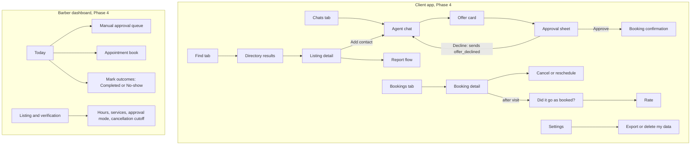

# HP-SAD-14 · User interface design

| Field       | Value                                                                            |
| ----------- | -------------------------------------------------------------------------------- |
| Document ID | HP-SAD-14                                                                        |
| Version     | 1.1                                                                              |
| Status      | Baselined for Phase 2                                                            |
| Date        | 2026-11-09                                                                       |
| Owner       | Sanaullah Jannisar, product and engineering lead                                 |
| Conforms to | IEEE 1016 (interface viewpoint), ISO 9241-110 (dialogue principles), WCAG 2.2 AA |

## 1. Purpose and scope

This document designs the human-facing surfaces of Hitchpost: the client app Dana uses (Phase 4), the barber dashboard Marcus uses (Phase 4, including the manual-approval queue and outcome marking), and the report flow (Phase 5). It sets the principles, the navigation, low-fidelity wireframes, interaction states, exact copy for the moments that matter, accessibility rules and the usability test plan.

Today (Phase 1) the only interface is the command line in `packages/my-agent/src/main.ts`. Its rules (show only validated fields, show only my own error messages, say plainly that nothing is booked) are the seed of everything below. In Phases 2 and 3 a command-line stand-in plays both sides, including the shop's manual approval; the screens below replace it in Phase 4 ([00 phase map](00-document-control.md#10-normative-parameters-and-phase-map)).

Timing values shown on screen come from the parameter register in [00](00-document-control.md#10-normative-parameters-and-phase-map): offer hold P-01, manual approval wait P-03, clock margin P-09. The strings below quote today's values; if a P-value changes, the strings change with it.

Related: screen inventory and agent contract in [13 Interfaces](13-interfaces.md), personas in [04 Stakeholders and personas](04-stakeholders-and-personas.md), flows in [06 Use cases](06-use-cases.md), states in [07 Process and behaviour models](07-process-and-behaviour-models.md).

## 2. Design principles

UI principles are numbered UP-1 to UP-7 so they don't collide with the DFD processes P1 to P7 in [07](07-process-and-behaviour-models.md) or the parameters P-01 to P-20 in [00](00-document-control.md).

| #    | Principle                             | What it means on screen                                                                                                                                       | Requirement                        |
| ---- | ------------------------------------- | ------------------------------------------------------------------------------------------------------------------------------------------------------------- | ---------------------------------- |
| UP-1 | Nothing commits without a visible yes | The only control that books is a button labelled **Approve**. No swipe, auto-confirm or default-on toggle commits anything.                                   | FR-GATE-01                         |
| UP-2 | Approval clarity                      | The approval sheet shows who, what, when, how long, how much and when the offer expires, all from validated structured data, before the button.               | FR-APP-02                          |
| UP-3 | Structured over chatty                | Offers, bookings and refusals render as typed cards, never as free text from the other agent. The other agent's words never appear in a bold or system style. | FR-MSG-03, NFR-SEC-05              |
| UP-4 | Plain language                        | Short sentences, no jargon. "Approve" not "Confirm transaction". Times say the day and zone.                                                                  | NFR-A11Y-01                        |
| UP-5 | Honest states                         | Expired, refused, declined, timed-out and failed states are said out loud, with what happens next. Nothing silently disappears.                               | FR-MSG-04, FR-MSG-05               |
| UP-6 | Trust is visible                      | Verified badge, rating and listing origin appear wherever a business agent is named. Unverified agents look different and say so.                             | FR-DIR-05, FR-DIR-03               |
| UP-7 | Reversible where possible             | Decline releases the hold at once; cancel and reschedule are one tap from a booking, within the shop's rules.                                                 | FR-BOOK-03, FR-BOOK-08, FR-BOOK-10 |

## 3. Information architecture

Three tabs for Dana, one dashboard for Marcus. Everything Dana does starts from a contact or a booking.



## 4. Wireframes

Low fidelity, mobile first, 360 px wide. `[ ]` is a button, `( )` a toggle, `>` a navigation row.

### 4.1 Chats list (FR-APP-01)

```text
+--------------------------------------+
| Chats                     [Find]     |
+--------------------------------------+
| (MS) Main Street Barbers  ✓ 4.8      |
|      Offer: Thu 5:30 pm · expires 8m |
|--------------------------------------|
| (CL) Corner Laundry       ✓ 4.5      |
|      Booked: Sat 10:00 am            |
|--------------------------------------|
| (??) Quick Cuts         Not verified |
|      You declined an offer           |
+--------------------------------------+
| [Chats]     [Bookings]    [Settings] |
+--------------------------------------+
```

### 4.2 Agent chat (FR-MSG-02)

```text
+--------------------------------------+
| < Main Street Barbers  ✓ 4.8   [...] |
|   mainstreetbarbers.example          |
+--------------------------------------+
|                 You: Haircut Thursday|
|                      after 5 pm      |
|                                      |
| +----------------------------------+ |
| | OFFER                            | |
| | Haircut · 30 min                 | |
| | Thu 12 Nov, 5:30 pm (CST)        | |
| | $30.00 USD                       | |
| | Expires in 8 min                 | |
| | [Review and approve]             | |
| +----------------------------------+ |
|                                      |
+--------------------------------------+
| [ Ask for a time...            ][>] |
+--------------------------------------+
```

### 4.3 Offer card states

```text
Valid              Expired                    Refused by my agent
+---------------+  +----------------------+  +-------------------------+
| OFFER         |  | OFFER EXPIRED        |  | OFFER NOT SHOWN         |
| Haircut 30min |  | The slot was held    |  | This offer didn't match |
| Thu 5:30 pm   |  | for 10 minutes.      |  | what you asked for, so  |
| $30.00 USD    |  | [Ask again]          |  | I didn't show it.       |
| Expires in 8m |  +----------------------+  | [Ask again] [Report]    |
| [Review]      |                            +-------------------------+
+---------------+
```

### 4.4 Approval sheet (FR-APP-02, FR-GATE-01)

```text
+--------------------------------------+
| Approve this booking?                |
+--------------------------------------+
| Main Street Barbers   ✓ Verified     |
| mainstreetbarbers.example            |
|                                      |
| Service   Haircut                    |
| When      Thu 12 Nov, 5:30 pm CST    |
| Length    30 minutes                 |
| Price     $30.00 USD, pay at shop    |
| Offer     expires in 7 min 40 s      |
|                                      |
| Nothing is booked until you approve. |
|                                      |
| [ Decline ]          [ Approve ]     |
+--------------------------------------+
```

Approve is the primary button but never pre-focused. Decline sits on the left so a reflexive thumb tap on the right edge on small phones still lands on a deliberate target, and both meet the size rule in section 7.

**Decline** sends `offer_declined`, which releases the shop's hold at once (FR-BOOK-08), and the card changes to "You declined this offer." **Expiry** shown here uses the clock margin P-09: my agent counts down from its own receipt time and treats the offer as expired 30 seconds early, so Approve is never pressed on an offer the shop has already let go.

### 4.5 Booking confirmation (UC-02 postcondition)

```text
+--------------------------------------+
|              Booked                  |
|                                      |
| Haircut at Main Street Barbers       |
| Thu 12 Nov, 5:30 pm CST              |
| Added to your calendar               |
|                                      |
| [View booking]      [Done]           |
+--------------------------------------+
```

Shown only after `booking_confirmed` arrives and matches the approved offer field for field ([13 Interfaces](13-interfaces.md)); only then is it written to the calendar (FR-APP-06). Until then the sheet shows "Booking…" with the Approve button disabled. If the shop is on manual approval the sheet switches to "Waiting for the shop" (section 5) and my agent polls the booking Task (P-04); the person can close the sheet and gets a notification when the shop answers.

### 4.6 Bookings list and detail (FR-APP-04, FR-BOOK-03)

```text
+--------------------------------------+   +--------------------------------------+
| Bookings                             |   | < Booking                            |
| Upcoming                             |   | Haircut · Main Street Barbers        |
| > Thu 12 Nov 5:30 pm  Haircut        |   | Thu 12 Nov, 5:30 pm CST · 30 min     |
| > Sat 14 Nov 10:00 am Laundry pickup |   | $30.00 USD, pay at shop              |
| Past                                 |   |                                      |
| > Thu 15 Oct 6:00 pm  Haircut [Rate] |   | [Reschedule]   [Cancel booking]      |
| > Thu 22 Oct 5:30 pm  Haircut        |   +--------------------------------------+
|   Did it go as booked? [Yes] [No]    |
+--------------------------------------+
```

### 4.7 Directory search (FR-DIR-02)

```text
+--------------------------------------+
| < Find                               |
| [ fade near Downtown             ][Q]|
| Filters: (✓) Verified only  Open now |
+--------------------------------------+
| Main Street Barbers   ✓ 4.8 (212)    |
| Haircut, beard trim · 0.4 mi         |
|--------------------------------------|
| Fade Factory          ✓ 4.6 (88)     |
| Haircut, fade · 0.9 mi               |
+--------------------------------------+
```

Verified only is on by default. Turning it off shows unverified listings with a grey "Not verified" label, never the check mark.

### 4.8 Listing detail (FR-DIR-05, FR-RATE-02)

```text
+--------------------------------------+
| < Main Street Barbers                |
| ✓ Verified business (domain checked) |
| mainstreetbarbers.example            |
|                                      |
| Rating 4.8 from 212 verified visits  |
| Agent record: answers in 1 s ·       |
|   offers honored 99% · 0 reports     |
|                                      |
| Services  Haircut 30 min $30         |
|           Beard trim 15 min $15      |
| Hours     Tue to Sat, 9 am to 6 pm   |
|                                      |
| [Add contact]          [Report]      |
+--------------------------------------+
```

The agent record line is the structured behaviour metric from FR-RATE-02, separate from human stars.

### 4.9 Barber dashboard: manual-approval queue and outcomes (FR-GATE-05, FR-RATE-04)

```text
+--------------------------------------------------------------------------+
| Main Street Barbers · Today, Thu 12 Nov          Approval: Manual (switch) |
+--------------------------------------------------------------------------+
| Waiting for you (2)                                                      |
| Haircut  5:30 pm  Dana R.    approved by customer  [Decline] [Accept]    |
|          answer within 24 min, or it is declined automatically           |
| Beard    6:00 pm  J. Okafor  approved by customer  [Decline] [Accept]    |
+--------------------------------------------------------------------------+
| Book                                                                     |
| 9:00  ███ Haircut      10:00 ░░░ free       ...                          |
| 17:00 ███ Haircut      17:30 ▓▓▓ reserved   18:00 closed                 |
+--------------------------------------------------------------------------+
| How did today go? (mark after the appointment)                           |
| 9:00  Haircut  M. Silva     [Completed] [No-show]                        |
| 11:30 Beard    T. Nguyen    Completed ✓                                  |
+--------------------------------------------------------------------------+
```

Legend: `███` booked, `▓▓▓` reserved (customer approved, waiting for Marcus, P-02), `▒▒▒` held by an open offer (P-01), `░░░` free. Holds use pattern, not just colour.

- **Accept** completes the booking Task with `booking_confirmed`; **Decline** ends it with `booking_rejected` reason `shop_declined`. If Marcus does nothing for P-03 (30 minutes), the Task ends with reason `shop_timeout` and the slot is released.
- **Outcomes:** each past booking is marked Completed or No-show by Marcus here, or by the customer's "Did it go as booked?" answer. Completed bookings are what the north star counts ([01](01-vision-and-scope.md)). If the two sides disagree, the booking is flagged for Sam and counts as neither until resolved.

### 4.10 Report flow (UC-09, FR-ADMIN-01)

```text
+--------------------------------------+
| Report Quick Cuts                    |
| What happened?                       |
| ( ) Pretends to be another business  |
| ( ) Offered something I didn't ask   |
| ( ) Spam or too many messages        |
| ( ) Something else                   |
| Details (optional) [              ]  |
| (✓) Block this contact too           |
| [Cancel]               [Send report] |
+--------------------------------------+
```

The report attaches the conversation's stored, validated records automatically. Dana doesn't need to screenshot anything.

## 5. Interaction states

| State                    | Where             | What the person sees                                                                      | What the system does                                                                                                 |
| ------------------------ | ----------------- | ----------------------------------------------------------------------------------------- | -------------------------------------------------------------------------------------------------------------------- |
| Loading                  | Chat after asking | "Asking Main Street Barbers…" with a progress indicator, announced politely               | Single deadline per exchange (FR-MSG-05)                                                                             |
| Empty                    | Chats, Bookings   | "No chats yet. Find a business to start." with [Find]                                     | Nothing                                                                                                              |
| No availability          | Chat              | Card: "No haircut slots between Thu 5 pm and 7 pm. Try another time?" [Pick another time] | Shows `no_availability`                                                                                              |
| Rejected request         | Chat              | Card: "Main Street Barbers couldn't read that request." [Try again]                       | Shows `rejected`; reason shown only if it passed validation                                                          |
| Timeout or network error | Chat              | "Couldn't get an answer from that agent. Nothing was booked." [Try again]                 | Own message only, never remote text (NFR-SEC-04)                                                                     |
| Expired offer            | Offer card, sheet | "This offer expired. The slot was held for 10 minutes." [Ask again]; Approve removed      | Hold released at `expiresAt` (P-01); my agent hides Approve 30 s early (P-09)                                        |
| Declined by you          | Offer card        | "You declined this offer." [Ask for another time]                                         | `offer_declined` sent; hold released at once (FR-BOOK-08)                                                            |
| Mismatched offer refused | Chat              | "Offer not shown: it didn't match what you asked for." [Ask again] [Report]               | `offerMatches` failed (FR-MSG-04)                                                                                    |
| Slot taken at booking    | Sheet             | "That slot was just taken. Nothing was booked." [See next time]                           | `booking_rejected` reason `slot_taken`                                                                               |
| Waiting on shop          | Sheet, chat       | "Approved by you. Waiting for Main Street Barbers to accept, up to 30 min."               | Booking Task stays WORKING with status "waiting for the shop"; my agent polls `GetTask` (P-04); slot reserved (P-02) |
| Shop declined            | Sheet, chat       | "Main Street Barbers declined this booking. Nothing was booked." [Ask for another time]   | `booking_rejected` reason `shop_declined`                                                                            |
| Shop didn't answer       | Sheet, chat       | "Main Street Barbers didn't answer in 30 minutes. Nothing was booked." [Ask again]        | `booking_rejected` reason `shop_timeout` (P-03)                                                                      |
| Offline                  | Any               | Banner "You're offline. Nothing will be sent."                                            | Queues nothing that commits                                                                                          |

## 6. Content and microcopy

Rules: say what happened, then what to do; name the business; give day, time and zone; never blame the person; never print the other agent's free text in our voice.

Exact strings for critical moments:

| Moment                             | String                                                                    |
| ---------------------------------- | ------------------------------------------------------------------------- |
| Approval sheet footer              | Nothing is booked until you approve.                                      |
| Approve button                     | Approve                                                                   |
| Decline button                     | Decline                                                                   |
| After Approve, before confirmation | Booking…                                                                  |
| Confirmation title                 | Booked                                                                    |
| Offer expired                      | This offer expired. The slot was held for 10 minutes.                     |
| Mismatched offer                   | Offer not shown: it didn't match what you asked for.                      |
| Network or timeout                 | Couldn't get an answer from that agent. Nothing was booked.               |
| Slot taken                         | That slot was just taken. Nothing was booked.                             |
| Declined by the person             | You declined this offer.                                                  |
| Waiting on the shop                | Approved by you. Waiting for Main Street Barbers to accept, up to 30 min. |
| Shop declined                      | Main Street Barbers declined this booking. Nothing was booked.            |
| Shop timed out                     | Main Street Barbers didn't answer in 30 minutes. Nothing was booked.      |
| Outcome question (customer)        | Did it go as booked?                                                      |
| Outcome buttons (Marcus)           | Completed · No-show                                                       |
| Unverified agent label             | Not verified                                                              |
| Cancel confirm                     | Cancel your haircut on Thu 12 Nov at 5:30 pm?                             |
| Cancel done                        | Cancelled. Main Street Barbers has been told.                             |
| Marcus queue item                  | Approved by customer. Accept to book.                                     |
| Report sent                        | Thanks. We'll review this within 2 working days.                          |

Numbers: prices always with currency code; times in the person's zone with the zone abbreviation; durations in minutes.

## 7. Accessibility (WCAG 2.2 AA, NFR-A11Y-01)

| WCAG 2.2 criterion                              | Rule for Hitchpost                                                                                                                                            |
| ----------------------------------------------- | ------------------------------------------------------------------------------------------------------------------------------------------------------------- |
| 1.3.1 Info and relationships                    | Offer and booking cards use real headings and description lists, so a screen reader reads "Service, Haircut".                                                 |
| 1.4.1 Use of colour                             | Verified, held and booked states always carry text or pattern, never colour alone.                                                                            |
| 1.4.3 Contrast (minimum)                        | Text at least 4.5:1, large text 3:1, checked in light and dark themes.                                                                                        |
| 1.4.11 Non-text contrast                        | Buttons, toggles and focus rings at least 3:1 against their background.                                                                                       |
| 2.1.1 Keyboard                                  | Every action, including Approve and Decline, works by keyboard and switch access.                                                                             |
| 2.2.1 Timing adjustable                         | The offer timer is the business's hold, not a UI time limit. Remaining time is shown as text, and "Ask again" is always offered after expiry.                 |
| 2.4.3 Focus order                               | Approval sheet: title, business, each detail row, expiry, footer sentence, Decline, Approve. Focus lands on the title when the sheet opens, never on Approve. |
| 2.4.7 and 2.4.11 Focus visible, not obscured    | 2 px focus ring; the sticky composer never covers a focused element.                                                                                          |
| 2.5.8 Target size (minimum)                     | Every target at least 24 by 24 CSS px; Approve and Decline at least 44 by 44 for comfort.                                                                     |
| 3.3.4 Error prevention (legal, financial, data) | Booking is reviewable (sheet), confirmable (Approve) and reversible (cancel).                                                                                 |
| 4.1.3 Status messages                           | "Booking…", "Booked", expiry and refusals announced through a polite live region.                                                                             |

Screen reader labels for the approval sheet:

| Element        | Accessible name                                                        |
| -------------- | ---------------------------------------------------------------------- |
| Sheet (dialog) | Approve booking with Main Street Barbers, verified                     |
| Detail list    | Booking details                                                        |
| Expiry text    | Offer expires in 7 minutes 40 seconds (announced at 5, 2 and 1 minute) |
| Decline        | Decline offer from Main Street Barbers                                 |
| Approve        | Approve haircut on Thursday 12 November at 5:30 pm Central, 30 dollars |

## 8. Responsive behaviour

| Width          | Layout                                                                                 |
| -------------- | -------------------------------------------------------------------------------------- |
| Under 600 px   | Single column, bottom tabs, approval as a bottom sheet covering at least 60% of height |
| 600 to 1024 px | Chats list and thread side by side; approval as a centred dialog                       |
| Over 1024 px   | Three panes for Marcus: queue, book, detail; Dana's app caps content width at 720 px   |

Text scales to 200% without loss of content or two-dimensional scrolling (WCAG 1.4.4, 1.4.10). Orientation is never locked.

## 9. Usability test plan

Method: moderated sessions, think-aloud, 5 customers matching Dana and 5 barbers matching Marcus per round, on a clickable prototype first (before Phase 4 build) and on the real app before v1 release. Rounds repeat until targets are met.

| #     | Persona | Task                                                                 | Success metric                                              | Target                    |
| ----- | ------- | -------------------------------------------------------------------- | ----------------------------------------------------------- | ------------------------- |
| UT-1  | Dana    | Book a haircut for Thursday after 5 pm at a shop you've used         | Completed without help; time from opening the app to Booked | 5 of 5; median under 60 s |
| UT-2  | Dana    | Before approving, tell me the price, time and when the offer expires | All four stated correctly from the sheet                    | 5 of 5                    |
| UT-3  | Dana    | An offer arrives that doesn't match your request. What happened?     | Says nothing was booked and why                             | 4 of 5                    |
| UT-4  | Dana    | Cancel Thursday's booking                                            | Completed; no accidental cancel of another booking          | 5 of 5                    |
| UT-5  | Dana    | Find a verified barber near you and add it                           | Chooses a verified listing; can explain the check mark      | 4 of 5                    |
| UT-6  | Dana    | Report an agent pretending to be a shop                              | Report sent in under 90 s                                   | 4 of 5                    |
| UT-7  | Marcus  | Switch your shop to manual approval                                  | Completed without help                                      | 5 of 5                    |
| UT-8  | Marcus  | Accept one waiting booking and decline another between customers     | Both correct; under 20 s each                               | 5 of 5                    |
| UT-9  | Marcus  | Tell me which slots are held, reserved, and booked                   | Correctly reads all three patterns                          | 4 of 5                    |
| UT-10 | Marcus  | Mark this morning's appointments: one came, one didn't               | Both outcomes correct                                       | 5 of 5                    |

Also recorded: System Usability Scale (target 80 or more), every point where a participant thought something was booked when it wasn't (target zero; any instance blocks release), and accessibility passes with one screen reader user and one keyboard-only user per round.

## Revision history

| Version | Date       | Change                                                                                                                                                                                                                                                                                                                                                                                                         | Author      |
| ------- | ---------- | -------------------------------------------------------------------------------------------------------------------------------------------------------------------------------------------------------------------------------------------------------------------------------------------------------------------------------------------------------------------------------------------------------------- | ----------- |
| 1.0     | 2026-11-09 | First baseline                                                                                                                                                                                                                                                                                                                                                                                                 | S. Jannisar |
| 1.1     | 2026-11-09 | Remediation after independent review: principles renamed UP-1 to UP-7 and usability tasks UT-1 to UT-10 to avoid ID collisions; barber dashboard placed in Phase 4 with outcome marking (Completed, No-show) and reserved state; Decline sends `offer_declined`; waiting-on-shop uses a WORKING Task with polling, plus shop-declined and shop-timeout states and strings; timings cite P-01, P-03, P-04, P-09 | S. Jannisar |
