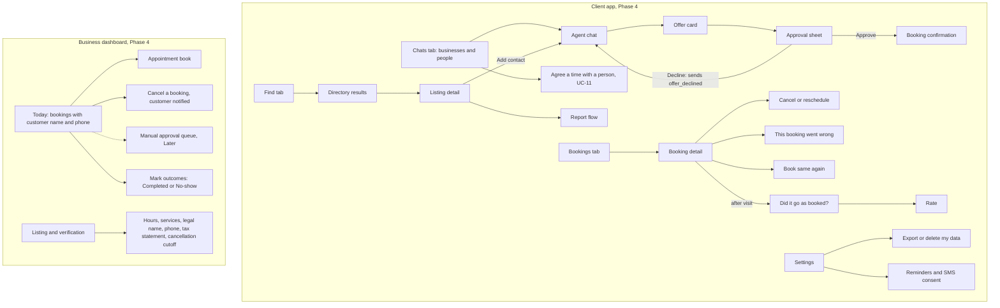

# HP-SAD-14 · User interface design

| Field       | Value                                                                            |
| ----------- | -------------------------------------------------------------------------------- |
| Document ID | HP-SAD-14                                                                        |
| Version     | 1.3                                                                              |
| Status      | Baselined for Phase 2                                                            |
| Date        | 2026-11-09                                                                       |
| Owner       | Sanaullah Jannisar, product and engineering lead                                 |
| Conforms to | IEEE 1016 (interface viewpoint), ISO 9241-110 (dialogue principles), WCAG 2.2 AA |

## 1. Purpose and scope

This document designs the human-facing surfaces of Hitchpost, a network of agent lines between users: the client app Dana uses to reach businesses and other people (Phase 4), the business dashboard Marcus uses (Phase 4: today's bookings with each customer's name and phone, outcome marking, cancellations), the directory web pages, notifications and email, and the report flow (Phase 5). In the pilot businesses use standing approval only; the manual-approval queue is designed below but is Later. It sets the principles, the navigation, low-fidelity wireframes, interaction states, exact copy for the moments that matter, accessibility rules and the usability test plan.

Today (Phase 1) the only interface is the command line in `packages/my-agent/src/main.ts`. Its rules (show only validated fields, show only my own error messages, say plainly that nothing is booked) are the seed of everything below. In Phases 2 and 3 a command-line stand-in plays both sides; the screens below replace it in Phase 4 ([00 phase map](00-document-control.md#10-normative-parameters-and-phase-map)).

Timing values shown on screen come from the parameter register in [00](00-document-control.md#10-normative-parameters-and-phase-map): offer hold P-01, clock margin P-09, outcome resolution P-25, reminders P-29 (and, Later, manual approval wait P-03). The strings below quote today's values; if a P-value changes, the strings change with it. Every time is shown in the business's local time first, with the person's own time second when it differs (FR-APP-11), and a hold is shown as an absolute "held until" time, never a ticking countdown.

Related: screen inventory and agent contract in [13 Interfaces](13-interfaces.md), personas in [04 Stakeholders and personas](04-stakeholders-and-personas.md), flows in [06 Use cases](06-use-cases.md), states in [07 Process and behaviour models](07-process-and-behaviour-models.md).

## 2. Design principles

UI principles are numbered UP-1 to UP-7 so they don't collide with the DFD processes P1 to P7 in [07](07-process-and-behaviour-models.md) or the parameters P-01 to P-20 in [00](00-document-control.md).

| #    | Principle                             | What it means on screen                                                                                                                                                                                                   | Requirement                        |
| ---- | ------------------------------------- | ------------------------------------------------------------------------------------------------------------------------------------------------------------------------------------------------------------------------- | ---------------------------------- |
| UP-1 | Nothing commits without a visible yes | The only control that books is a button labelled **Approve**. No swipe, auto-confirm or default-on toggle commits anything.                                                                                               | FR-GATE-01                         |
| UP-2 | Approval clarity                      | The approval sheet shows who (legal name, phone), what, when, how long, the total with its tax statement, the cancellation terms and until when the offer is held, all from validated structured data, before the button. | FR-APP-02, FR-BOOK-17              |
| UP-3 | Structured over chatty                | Offers, bookings and refusals render as typed cards, never as free text from the other agent. The other agent's words never appear in a bold or system style.                                                             | FR-MSG-03, NFR-SEC-05              |
| UP-4 | Plain language                        | Short sentences, no jargon. "Approve" not "Confirm transaction". Times say the day and zone.                                                                                                                              | NFR-A11Y-01                        |
| UP-5 | Honest states                         | Expired, refused, declined, timed-out and failed states are said out loud, with what happens next. Nothing silently disappears.                                                                                           | FR-MSG-04, FR-MSG-05               |
| UP-6 | Trust is visible                      | Verified badge, rating and listing origin appear wherever a business agent is named. Unverified agents look different and say so.                                                                                         | FR-DIR-05, FR-DIR-03               |
| UP-7 | Reversible where possible             | Decline releases the hold at once; cancel and reschedule are one tap from a booking, within the shop's rules.                                                                                                             | FR-BOOK-03, FR-BOOK-08, FR-BOOK-10 |

## 3. Information architecture

Three tabs for Dana, one dashboard for Marcus. Everything Dana does starts from a contact or a booking.



## 4. Wireframes

Low fidelity, mobile first, 360 px wide. `[ ]` is a button, `( )` a toggle, `>` a navigation row.

### 4.1 Chats list (FR-APP-01)

```text
+--------------------------------------+
| Chats                     [Find]     |
+--------------------------------------+
| (MS) Main Street Barbers  ✓ 4.8      |
|      Offer: Thu 5:30 pm · held 5:42  |
|--------------------------------------|
| (JO) Jordan              Person      |
|      Tue 6:00 pm coffee · agreed     |
|--------------------------------------|
| (CL) Corner Laundry       ✓ 4.5      |
|      Booked: Sat 10:00 am            |
|--------------------------------------|
| (??) Quick Cuts         Not verified |
|      You declined an offer           |
+--------------------------------------+
| [Chats]     [Bookings]    [Settings] |
+--------------------------------------+
```

### 4.2 Agent chat (FR-MSG-02)

```text
+--------------------------------------+
| < Main Street Barbers  ✓ 4.8   [...] |
|   mainstreetbarbers.example          |
+--------------------------------------+
|                 You: Haircut Thursday|
|                      after 5 pm      |
|                                      |
| +----------------------------------+ |
| | OFFER                            | |
| | Haircut · 30 min                 | |
| | Thu 12 Nov, 5:30 pm (CST)        | |
| | $30.00 USD, tax included         | |
| | Held until 5:42 pm               | |
| | [Review and approve]             | |
| +----------------------------------+ |
|                                      |
+--------------------------------------+
| [ Ask for a time...            ][>] |
+--------------------------------------+
```

### 4.3 Offer card states

```text
Valid              Expired                    Refused by my agent
+---------------+  +----------------------+  +-------------------------+
| OFFER         |  | OFFER EXPIRED        |  | OFFER NOT SHOWN         |
| Haircut 30min |  | The slot was held    |  | This offer didn't match |
| Thu 5:30 pm   |  | until 5:42 pm.       |  | what you asked for, so  |
| $30.00 USD    |  | [Ask again]          |  | I didn't show it.       |
| Held to 5:42  |  +----------------------+  | [Ask again] [Report]    |
| [Review]      |                            +-------------------------+
+---------------+
```

### 4.4 Approval sheet (FR-APP-02, FR-GATE-01)

```text
+--------------------------------------+
| Approve this booking?                |
+--------------------------------------+
| Main Street Barbers   ✓ Verified     |
| Main Street Barbers LLC              |
| mainstreetbarbers.example            |
| (512) 555-0142                       |
|                                      |
| Service   Haircut                    |
| When      Thu 12 Nov, 5:30 pm CST    |
| Length    30 minutes                 |
| Total     $30.00 USD, tax included,  |
|           pay at shop                |
| Cancel    Free until 3:30 pm Thu     |
| Held      until 5:42 pm today        |
|                                      |
| Shared    Your name and phone, with  |
|           this business only         |
|                                      |
| Nothing is booked until you approve. |
|                                      |
| [ Decline ]          [ Approve ]     |
+--------------------------------------+
```

Approve is the primary button on the right, following the platform convention for a horizontal pair, and it is never pre-focused: focus lands on the sheet title. The protection against a reflexive tap is the review step itself (the sheet opens from a card, Approve is not where the card's own button was, and nothing is pre-focused), not button placement. Both buttons meet the size rule in section 7. The "Cancel" row is the business's cancellation cutoff (P-10) or "Free to cancel any time" when it has none; the "Shared" row states the customer block before it is sent (FR-BOOK-14).

For a business on manual approval (Later), the primary button reads **Request booking** and the footer reads "The shop confirms within 30 minutes. Nothing is booked until they do." In the pilot every business is on standing approval, so Approve books at once.

**Decline** sends `offer_declined`, which releases the shop's hold at once (FR-BOOK-08), and the card changes to "You declined this offer." **Held until** uses the clock margin P-09: my agent computes the deadline from its own receipt time on a monotonic clock, recomputes it when the app returns to the foreground, and treats the offer as expired 30 seconds early, so Approve is never pressed on an offer the business has already let go.

### 4.5 Booking confirmation (UC-02 postcondition)

```text
+--------------------------------------+
|              Booked                  |
|                                      |
| Haircut at Main Street Barbers       |
| Thu 12 Nov, 5:30 pm CST              |
| Added to your calendar               |
|                                      |
| [View booking]      [Done]           |
+--------------------------------------+
```

Shown only after `booking_confirmed` arrives and matches the approved offer field for field ([13 Interfaces](13-interfaces.md)); only then is it written to the calendar (FR-APP-06). Until then the sheet shows "Booking…" with the Approve button disabled; under standing approval this takes seconds. If the connection drops before the result arrives, the sheet shows "Checking…" and the app reconciles by `taskId` (FR-APP-10); it never shows "Booked" without a matching confirmation. Reminders are scheduled at P-29 (FR-APP-08).

### 4.6 Bookings list and detail (FR-APP-04, FR-BOOK-03)

```text
+--------------------------------------+   +--------------------------------------+
| Bookings                             |   | < Booking                            |
| Upcoming                             |   | Haircut · Main Street Barbers        |
| > Thu 12 Nov 5:30 pm  Haircut        |   | Thu 12 Nov, 5:30 pm CST · 30 min     |
| > Tue 17 Nov 6:00 pm  Jordan, coffee |   | $30.00 USD, tax included             |
| Past                                 |   | Free to cancel until 3:30 pm Thu     |
| > Thu 15 Oct 6:00 pm  Haircut [Rate] |   | Shop phone (512) 555-0142 [Call]     |
|   [Book same again]                  |   |                                      |
| > Thu 22 Oct 5:30 pm  Haircut        |   | [Reschedule]   [Cancel booking]      |
|   Did it go as booked? [Yes] [No]    |   | This booking went wrong >            |
+--------------------------------------+   +--------------------------------------+
```

### 4.7 Directory search (FR-DIR-02)

```text
+--------------------------------------+
| < Find                               |
| [ fade near Downtown             ][Q]|
| Filters: (✓) Verified only  Open now |
+--------------------------------------+
| Main Street Barbers   ✓ 4.8 (212)    |
| Haircut, beard trim · 0.4 mi         |
|--------------------------------------|
| Fade Factory          ✓ 4.6 (88)     |
| Haircut, fade · 0.9 mi               |
+--------------------------------------+
```

Verified only is on by default. Turning it off shows unverified listings with a grey "Not verified" label, never the check mark.

### 4.8 Listing detail (FR-DIR-05, FR-RATE-02)

```text
+--------------------------------------+
| < Main Street Barbers                |
| ✓ Verified business (domain checked) |
| mainstreetbarbers.example            |
|                                      |
| Rating 4.8 from 212 verified visits  |
| Agent record: answers in 1 s ·       |
|   offers honored 99% · 0 reports     |
|                                      |
| Services  Haircut 30 min $30         |
|           Beard trim 15 min $15      |
| Hours     Tue to Sat, 9 am to 6 pm   |
|                                      |
| [Add contact]          [Report]      |
+--------------------------------------+
```

The agent record line is the structured behaviour metric from FR-RATE-02, separate from human stars.

### 4.9 Business dashboard: today's bookings and outcomes (FR-BOOK-14, FR-BOOK-15, FR-RATE-04, FR-RATE-06)

```text
+--------------------------------------------------------------------------+
| Main Street Barbers · Today, Thu 12 Nov     Approval: Opening hours (auto) |
+--------------------------------------------------------------------------+
| New since you last looked (2)                              live ●        |
| Haircut  5:30 pm  Dana R.    (512) 555-0199  "first time here"  [Cancel] |
| Beard    6:00 pm  J. Okafor  (512) 555-0177                     [Cancel] |
+--------------------------------------------------------------------------+
| Book                                                                     |
| 9:00  ███ Haircut      10:00 ░░░ free       ...                          |
| 17:00 ███ Haircut      17:30 ███ Dana R.    18:00 closed                 |
| 16:00 ▒▒▒ held for an open offer                                         |
+--------------------------------------------------------------------------+
| How did today go? (mark after the appointment)                           |
| 9:00  Haircut  M. Silva     [Completed] [No-show]                        |
| 11:30 Beard    T. Nguyen    Completed ✓                                  |
+--------------------------------------------------------------------------+
```

Legend: `███` booked, `▒▒▒` held by an open offer (P-01), `░░░` free. Holds use pattern, not just colour. (Later, with manual approval, `▓▓▓` would mark a reserved slot waiting for Marcus, P-02.)

- **Customer block.** Each booking shows the customer's display name, verified phone and optional note (FR-BOOK-14). Nothing else about the customer is shared.
- **Refresh and alerts.** The dashboard keeps a live event stream open; a new booking adds a row at the top with a short sound (off by default, switchable), a badge on the tab, and a polite live-region announcement. If the stream drops, it falls back to refreshing every 30 seconds and shows "Reconnecting". Nothing on this screen needs an answer within a time limit under standing approval.
- **Cancel** opens a confirm step with a required reason; the customer is notified (pilot: through the operator relay; Phase 4: a `booking_cancelled_by_business` notice) and both audit logs record it (FR-BOOK-15).
- **Outcomes:** each past booking is marked Completed or No-show here. Marking is never billed, so there is nothing to gain from leaving it blank. A booking still unmarked after P-25 becomes Unresolved; if the customer's "Did it go as booked?" answer disagrees with the mark, the booking is Disputed and goes to Sam. Completed bookings are what the north star counts ([01](01-vision-and-scope.md)); Disputed and Unresolved count as neither (FR-RATE-06).
- **Later: manual approval queue.** With manual approval a "Waiting for you" list would show Accept and Decline per request, with an absolute "answer by 6:02 pm" time (P-03), a sound and a push notification; it is not part of the pilot.

### 4.10 Report flow (UC-09, FR-ADMIN-01)

```text
+--------------------------------------+
| Report Quick Cuts                    |
| What happened?                       |
| ( ) Pretends to be another business  |
| ( ) Offered something I didn't ask   |
| ( ) Spam or too many messages        |
| ( ) Something else                   |
| Details (optional) [              ]  |
| ( ) Block this contact too           |
| [Cancel]               [Send report] |
+--------------------------------------+
```

The report attaches the conversation's stored, validated records automatically. Dana doesn't need to screenshot anything. "Block this contact too" is never pre-ticked.

### 4.11 Agree a time with a person (UC-11, FR-APP-07)

```text
+--------------------------------------+   +--------------------------------------+
| < Jordan                    Person   |   | Jordan's phone                       |
|                                      |   | Dana wants to meet                   |
|   You: Coffee next week, weekday     |   | Tue 17 Nov, 6:00 pm CST · 60 min     |
|        after 6 pm, about an hour     |   | Coffee                               |
|                                      |   | Your calendar is not shared; only    |
| +----------------------------------+ |   | this time is.                        |
| | JORDAN IS FREE                   | |   |                                      |
| | Tue 17 Nov, 6:00 pm CST · 60 min | |   | Nothing is scheduled until you       |
| | Held until 6:12 pm today         | |   | approve.                             |
| | [Review and approve]             | |   | [ Decline ]          [ Approve ]     |
| +----------------------------------+ |   +--------------------------------------+
+--------------------------------------+
```

Both people approve: Dana on her sheet, then Jordan on his. Neither agent sends calendar contents, only the offered time. The event goes into both calendars only after the confirmation matches the offer.

### 4.12 Reminders (FR-APP-08)

| When (P-29)     | Channel                              | Content                                                                                                     |
| --------------- | ------------------------------------ | ----------------------------------------------------------------------------------------------------------- |
| 24 hours before | Push; SMS only with recorded consent | "Tomorrow 5:30 pm CST: haircut at Main Street Barbers. Free to cancel until 3:30 pm. [Cancel] [Directions]" |
| 2 hours before  | Push; SMS only with recorded consent | "Haircut at Main Street Barbers at 5:30 pm CST. Running late? Call (512) 555-0142."                         |

SMS consent is a separate, unticked opt-in in Settings with the exact wording "Text me appointment reminders. Message and data rates may apply. Reply STOP to stop." (TCPA). Reminders are also announced as notifications, never as sounds alone.

## 5. Interaction states

| State                      | Where             | What the person sees                                                                                              | What the system does                                                                                       |
| -------------------------- | ----------------- | ----------------------------------------------------------------------------------------------------------------- | ---------------------------------------------------------------------------------------------------------- |
| Loading                    | Chat after asking | "Asking Main Street Barbers…" with a progress indicator, announced politely                                       | Single deadline per exchange (FR-MSG-05)                                                                   |
| Empty                      | Chats, Bookings   | "No chats yet. Find a business to start." with [Find]                                                             | Nothing                                                                                                    |
| No availability            | Chat              | Card: "No haircut slots between Thu 5 pm and 7 pm. Try another time?" [Pick another time]                         | Shows `no_availability`                                                                                    |
| Rejected request           | Chat              | Card: "Main Street Barbers couldn't read that request." [Try again]                                               | Shows `rejected`; reason shown only if it passed validation                                                |
| Timeout or network error   | Chat              | "Couldn't get an answer from that agent. Nothing was booked." [Try again]                                         | Own message only, never remote text (NFR-SEC-04)                                                           |
| Expired offer              | Offer card, sheet | "This offer expired. The slot was held until 5:42 pm." [Ask again]; Approve removed                               | Hold released at `expiresAt` (P-01); my agent hides Approve 30 s early (P-09)                              |
| Declined by you            | Offer card        | "You declined this offer." [Ask for another time]                                                                 | `offer_declined` sent; hold released at once (FR-BOOK-08)                                                  |
| Mismatched offer refused   | Chat              | "Offer not shown: it didn't match what you asked for." [Ask again] [Report]                                       | `offerMatches` failed (FR-MSG-04)                                                                          |
| Slot taken at booking      | Sheet             | "That slot was just taken. Nothing was booked." [See next time]                                                   | `booking_rejected` reason `slot_taken`                                                                     |
| Checking (unknown outcome) | Sheet, chat       | "Checking whether Main Street Barbers booked it…" then Booked or Not booked                                       | Reconciles by `taskId` through the App API (FR-APP-10); never shows Booked without a matching confirmation |
| Business paused            | Chat, sheet       | "Main Street Barbers isn't taking agent bookings right now. Call (512) 555-0142."                                 | `rejected` or `booking_rejected` reason `paused` (BR-26)                                                   |
| Business cancelled         | Bookings, push    | "Main Street Barbers cancelled your 5:30 pm haircut: shop closed today. Call (512) 555-0142." [Find another time] | `booking_cancelled_by_business` (FR-BOOK-15)                                                               |
| Outcome disputed           | Booking detail    | "You and Main Street Barbers disagree about this visit. We'll look into it within 2 working days."                | Booking Disputed (FR-RATE-06)                                                                              |
| Unsupported reply          | Chat              | "Main Street Barbers sent something this app can't read yet. Nothing was booked."                                 | Unknown reply kind (FR-MSG-14)                                                                             |
| Waiting on shop (Later)    | Sheet, chat       | "Requested. Main Street Barbers confirms by 6:02 pm. Nothing is booked until they do."                            | Manual approval only (Later): Task WORKING, polling (P-04); `shop_declined` and `shop_timeout` outcomes    |
| Offline                    | Any               | Banner "You're offline. Nothing will be sent."                                                                    | Queues nothing that commits                                                                                |

## 6. Content and microcopy

Rules: say what happened, then what to do; name the business; give day, time and zone; never blame the person; never print the other agent's free text in our voice.

Exact strings for critical moments:

| Moment                             | String                                                                               |
| ---------------------------------- | ------------------------------------------------------------------------------------ |
| Approval sheet footer              | Nothing is booked until you approve.                                                 |
| Approve button                     | Approve                                                                              |
| Decline button                     | Decline                                                                              |
| After Approve, before confirmation | Booking…                                                                             |
| Confirmation title                 | Booked                                                                               |
| Offer expired                      | This offer expired. The slot was held until 5:42 pm.                                 |
| Offer hold                         | Held until 5:42 pm today                                                             |
| Cancellation row                   | Free to cancel until 3:30 pm Thu · or · Free to cancel any time                      |
| Shared data row                    | Your name and phone, with this business only                                         |
| Unknown outcome                    | Checking whether Main Street Barbers booked it…                                      |
| Business cancelled                 | Main Street Barbers cancelled your 5:30 pm haircut: <reason>. Call <phone>.          |
| Repeat booking                     | Book same again                                                                      |
| Problem entry                      | This booking went wrong                                                              |
| Person-to-person approval          | Dana wants to meet Tue 17 Nov, 6:00 pm CST. Approve?                                 |
| Mismatched offer                   | Offer not shown: it didn't match what you asked for.                                 |
| Network or timeout                 | Couldn't get an answer from that agent. Nothing was booked.                          |
| Slot taken                         | That slot was just taken. Nothing was booked.                                        |
| Declined by the person             | You declined this offer.                                                             |
| Manual approval button (Later)     | Request booking                                                                      |
| Waiting on the shop (Later)        | Requested. Main Street Barbers confirms by 6:02 pm. Nothing is booked until they do. |
| Shop declined (Later)              | Main Street Barbers declined this booking. Nothing was booked.                       |
| Shop timed out (Later)             | Main Street Barbers didn't answer in time. Nothing was booked.                       |
| Outcome question (customer)        | Did it go as booked?                                                                 |
| Outcome buttons (Marcus)           | Completed · No-show                                                                  |
| Unverified agent label             | Not verified                                                                         |
| Cancel confirm                     | Cancel your haircut on Thu 12 Nov at 5:30 pm?                                        |
| Cancel done                        | Cancelled. Main Street Barbers has been told.                                        |
| Marcus new booking row             | New booking: Dana R., haircut 5:30 pm                                                |
| Report sent                        | Thanks. We'll review this within 2 working days.                                     |

Numbers: prices formatted with `Intl.NumberFormat` for their currency (never a fixed two decimals) and the tax statement; times in the business's local time first with the zone abbreviation, the person's own time second when it differs; durations in minutes; holds as absolute times.

## 7. Accessibility (WCAG 2.2 AA, NFR-A11Y-01)

These rules apply to every human-facing surface: the client app, the business dashboard, the directory web pages, notifications and email. Each release is checked with an automated audit and a manual pass with VoiceOver (iOS), TalkBack (Android) and NVDA (Windows).

| WCAG 2.2 criterion                              | Rule for Hitchpost                                                                                                                                                                                                                                                                       |
| ----------------------------------------------- | ---------------------------------------------------------------------------------------------------------------------------------------------------------------------------------------------------------------------------------------------------------------------------------------- |
| 1.3.1 Info and relationships                    | Offer and booking cards use real headings and description lists, so a screen reader reads "Service, Haircut".                                                                                                                                                                            |
| 1.4.1 Use of colour                             | Verified, held and booked states always carry text or pattern, never colour alone.                                                                                                                                                                                                       |
| 1.4.3 Contrast (minimum)                        | Text at least 4.5:1, large text 3:1, checked in light and dark themes.                                                                                                                                                                                                                   |
| 1.4.11 Non-text contrast                        | Buttons, toggles and focus rings at least 3:1 against their background.                                                                                                                                                                                                                  |
| 2.1.1 Keyboard                                  | Every action, including Approve and Decline, works by keyboard and switch access.                                                                                                                                                                                                        |
| 2.2.1 Timing adjustable                         | The hold is a real-time limit set by another party's resource (a chair at a time), which is the criterion's real-time exception; I still show it as an absolute "held until" time rather than a countdown, never hide it, and always offer "Ask again" for a fresh hold after it passes. |
| 2.4.3 Focus order                               | Approval sheet: title, business, each detail row, expiry, footer sentence, Decline, Approve. Focus lands on the title when the sheet opens, never on Approve.                                                                                                                            |
| 2.4.7 and 2.4.11 Focus visible, not obscured    | 2 px focus ring; the sticky composer never covers a focused element.                                                                                                                                                                                                                     |
| 2.5.8 Target size (minimum)                     | Every target at least 24 by 24 CSS px; Approve and Decline at least 44 by 44 for comfort.                                                                                                                                                                                                |
| 3.3.4 Error prevention (legal, financial, data) | Booking is reviewable (sheet), confirmable (Approve) and reversible (cancel).                                                                                                                                                                                                            |
| 3.3.7 Redundant entry                           | "Book same again" and saved contacts mean a person never re-enters a service or business they already gave.                                                                                                                                                                              |
| 3.1.1 Language of page                          | Every page and email declares its language.                                                                                                                                                                                                                                              |
| 2.5.7 Dragging movements                        | Nothing on the dashboard needs dragging; every action is a button.                                                                                                                                                                                                                       |
| 2.3.3 and reduced motion                        | Respects `prefers-reduced-motion`; status changes never rely on animation.                                                                                                                                                                                                               |
| 4.1.3 Status messages                           | "Booking…", "Booked", expiry and refusals announced through a polite live region.                                                                                                                                                                                                        |

Screen reader labels for the approval sheet:

| Element        | Accessible name                                                        |
| -------------- | ---------------------------------------------------------------------- |
| Sheet (dialog) | Approve booking with Main Street Barbers, verified                     |
| Detail list    | Booking details                                                        |
| Hold text      | Offer held until 5:42 pm today (announced again 2 minutes before)      |
| Cancel row     | Free to cancel until 3:30 pm Thursday                                  |
| Decline        | Decline offer from Main Street Barbers                                 |
| Approve        | Approve haircut on Thursday 12 November at 5:30 pm Central, 30 dollars |

## 8. Responsive behaviour

| Width          | Layout                                                                                 |
| -------------- | -------------------------------------------------------------------------------------- |
| Under 600 px   | Single column, bottom tabs, approval as a bottom sheet covering at least 60% of height |
| 600 to 1024 px | Chats list and thread side by side; approval as a centred dialog                       |
| Over 1024 px   | Three panes for Marcus: queue, book, detail; Dana's app caps content width at 720 px   |

Text scales to 200% without loss of content or two-dimensional scrolling (WCAG 1.4.4, 1.4.10). Orientation is never locked.

## 9. Usability test plan

Method: moderated sessions, think-aloud, 5 customers matching Dana and 5 barbers matching Marcus per round, on a clickable prototype first (before Phase 4 build) and on the real app before v1 release. Rounds repeat until targets are met.

| #     | Persona | Task                                                                     | Success metric                                                                 | Target                    |
| ----- | ------- | ------------------------------------------------------------------------ | ------------------------------------------------------------------------------ | ------------------------- |
| UT-1  | Dana    | Book a haircut for Thursday after 5 pm at a shop you've used             | Completed without help; time from opening the app to Booked                    | 5 of 5; median under 60 s |
| UT-2  | Dana    | Look at this offer and tell me what you'd be agreeing to                 | States price with tax, time, cancellation terms and hold correctly, unprompted | 5 of 5                    |
| UT-3  | Dana    | An offer arrives that doesn't match your request. What happened?         | Says nothing was booked and why                                                | 4 of 5                    |
| UT-4  | Dana    | Cancel Thursday's booking                                                | Completed; no accidental cancel of another booking                             | 5 of 5                    |
| UT-5  | Dana    | Find a verified barber near you and add it                               | Chooses a verified listing; can explain the check mark                         | 4 of 5                    |
| UT-6  | Dana    | Report an agent pretending to be a shop                                  | Report sent in under 90 s                                                      | 4 of 5                    |
| UT-7  | Marcus  | A new booking just came in. Who is coming, and how would you reach them? | Names the customer and finds the phone without help                            | 5 of 5                    |
| UT-8  | Marcus  | You're sick tomorrow: cancel your 10 am and make sure the customer knows | Completed with a reason; says the customer will be told                        | 5 of 5                    |
| UT-9  | Marcus  | Tell me which slots are held and which are booked                        | Correctly reads both patterns                                                  | 4 of 5                    |
| UT-10 | Marcus  | Mark this morning's appointments: one came, one didn't                   | Both outcomes correct                                                          | 5 of 5                    |
| UT-11 | Dana    | Your phone lost signal right after you tapped Approve. Is it booked?     | Reads the Checking state correctly; doesn't book elsewhere                     | 5 of 5                    |
| UT-12 | Dana    | Agree a coffee time with Jordan next week                                | Completed; can say what Jordan's agent could and couldn't see                  | 4 of 5                    |
| UT-13 | Dana    | Book the same haircut as last time                                       | Completed in under 30 s                                                        | 4 of 5                    |

Also recorded: System Usability Scale (target 80 or more), every point where a participant thought something was booked when it wasn't, including in the Checking state (target zero; any instance blocks release), and accessibility passes with one screen reader user and one keyboard-only user per round.

## Revision history

| Version | Date       | Change                                                                                                                                                                                                                                                                                                                                                                                                                                                                                                                                                                                                                                                                                                                                                                                                                                                                                                                                                                                                                              | Author      |
| ------- | ---------- | ----------------------------------------------------------------------------------------------------------------------------------------------------------------------------------------------------------------------------------------------------------------------------------------------------------------------------------------------------------------------------------------------------------------------------------------------------------------------------------------------------------------------------------------------------------------------------------------------------------------------------------------------------------------------------------------------------------------------------------------------------------------------------------------------------------------------------------------------------------------------------------------------------------------------------------------------------------------------------------------------------------------------------------- | ----------- |
| 1.0     | 2026-11-09 | First baseline                                                                                                                                                                                                                                                                                                                                                                                                                                                                                                                                                                                                                                                                                                                                                                                                                                                                                                                                                                                                                      | S. Jannisar |
| 1.1     | 2026-11-09 | Remediation after independent review: principles renamed UP-1 to UP-7 and usability tasks UT-1 to UT-10 to avoid ID collisions; barber dashboard placed in Phase 4 with outcome marking (Completed, No-show) and reserved state; Decline sends `offer_declined`; waiting-on-shop uses a WORKING Task with polling, plus shop-declined and shop-timeout states and strings; timings cite P-01, P-03, P-04, P-09                                                                                                                                                                                                                                                                                                                                                                                                                                                                                                                                                                                                                      | S. Jannisar |
| 1.3     | 2026-11-09 | Round 3: expert panel audit, user-to-user reframing, US jurisdiction: scope covers people and businesses as contacts, business dashboard, directory web, notifications and email; standing approval only in the pilot (manual queue, "Request booking" label and waiting states marked Later); approval sheet adds legal name, phone, total with tax statement, cancellation row and shared-data row; absolute "held until" times instead of countdowns; business-local time first; button-placement rationale corrected; Checking state for unknown outcomes; dashboard shows the customer block, live refresh and alert model, business cancellation, unbilled outcome marking with Unresolved and Disputed; report block box unticked; new person-to-person time agreement (UC-11) and reminders with TCPA consent; repeat booking and "This booking went wrong"; accessibility applies to every surface with an AT test matrix and 2.2.1 rationale fixed; usability tasks UT-2 and UT-7 to UT-9 rewritten, UT-11 to UT-13 added | S. Jannisar |
