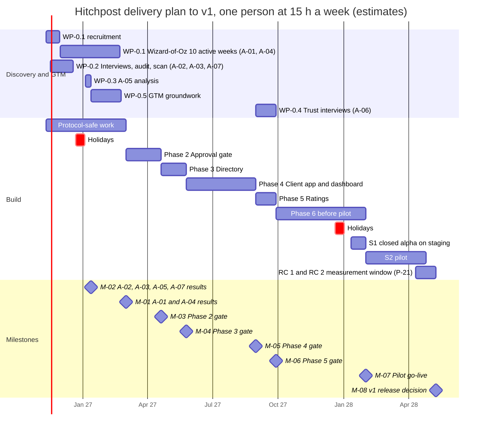

# HP-SAD-16 · Project plan

| Field       | Value                                                                                                                                                                                                            |
| ----------- | ---------------------------------------------------------------------------------------------------------------------------------------------------------------------------------------------------------------- |
| Document ID | HP-SAD-16                                                                                                                                                                                                        |
| Version     | 1.3                                                                                                                                                                                                              |
| Status      | Baselined for Phase 2                                                                                                                                                                                            |
| Date        | 2026-11-09                                                                                                                                                                                                       |
| Owner       | Sanaullah Jannisar, product and engineering lead                                                                                                                                                                 |
| Conforms to | ISO/IEC/IEEE 15288:2023, Project planning, Project assessment and control, Decision management, Risk management and Configuration management processes; ISO/IEC/IEEE 16326:2019, project management plan content |

## 1. Purpose and scope

How Hitchpost gets from Phase 1 (built) to the v1 release decision at the end of Phase 6. The plan covers the delivery approach, the work breakdown, estimates, a resource-loaded schedule, milestones and phase gates, resourcing and budget, risk-driven ordering, and governance.

Hitchpost is a network of agent lines between users, person to person and person to business; barbers are the beachhead vertical that proves it ([01 Vision and scope](01-vision-and-scope.md)). Scope is Phases 2 to 6, plus the discovery work that tests the assumptions in [03 Business case](03-business-case.md) and the go-to-market groundwork in [29 Go-to-market plan](29-go-to-market-plan.md). Phases and values come from the phase map and parameter register in [00 Document control](00-document-control.md#10-normative-parameters-and-phase-map). The statement of work in [25](25-statement-of-work.md) contracts the deliverables; this plan schedules them. Work after v1 is in [19 Maintenance and evolution](19-maintenance-and-evolution.md).

## 2. Delivery approach

- **Iterative, with phase gates.** Each phase ships in small pull requests to `main`, each passing CI and review ([ADR 0005](../decisions/0005-ci-and-review-policy.md)). A phase closes only when its gate criteria in section 6 are met.
- **One resource.** All work, discovery and build, is done by one person at 15 hours a week. Discovery is not "off the critical path": it takes the same hours as build, and the schedule in section 5 shows them competing.
- **Discovery before the effort it protects.** A failed assumption test must stop work before effort is spent on it. The one exception is stated openly: during the A-01 window I build only **protocol-safe work**, meaning work that is worth keeping even if A-01 fails and the project stops at Phase 1 (section 5.1).
- **Standing approval only in the pilot.** Business-side manual approval (P-02, P-03, P-04, the Reserved state and client polling) stays designed in [13 Interfaces](13-interfaces.md) but is **Later**. No work package below builds it, which removes the 30-minute customer wait and the shop's approval queue from the pilot.
- **Test-first.** Every bug fix and every new behaviour lands with a test that failed before it (NFR-MAINT-02). This is the lesson from the [Phase 1 audit](../audits/2026-11-08-phase-1.md).
- **Team model.** One lead (me) owns product, architecture, review and every merge. An AI pair (Claude Code) writes most code to my specs. Estimates in this plan are for that team.
- **Reviews at each gate.** Before Phases 2, 4 and 6 close, AI-assisted reviews run as separate Claude Code agents (QA, security, architecture, DevOps, product), described as such in [00](00-document-control.md) section 8. At least one **human external reviewer** reviews at M-05 and again at M-07.

## 3. Work breakdown structure

Estimates are three-point, in hours, for the lead plus AI pair: O optimistic, M most likely, P pessimistic. E = (O + 4M + P) / 6. **All figures are estimates.** Totals are summed from unrounded E values.

### 3.0 Discovery and go-to-market groundwork

| WP     | Work package                                                                                                                                                                                                                 | Traces to        | O   | M   | P   | E         |
| ------ | ---------------------------------------------------------------------------------------------------------------------------------------------------------------------------------------------------------------------------- | ---------------- | --- | --- | --- | --------- |
| WP-0.1 | Disclosed Wizard-of-Oz, n = 30 strangers recruited by screener, 10 active weeks, scripted persona with fixed latency; research consent form and P-27 retention; pre-registered decision bands; owner excluded from baselines | A-01, A-04       | 40  | 56  | 80  | 57.3      |
| WP-0.2 | 10 business interviews (barbers first) incl. past-behaviour price questions; booking-tool API desk audit; verified competitor scan ([30](30-competitive-heuristic-evaluation.md))                                            | A-02, A-03, A-07 | 20  | 30  | 50  | 31.7      |
| WP-0.3 | Defensibility and price analysis from WP-0.2 data; A-05 decision record                                                                                                                                                      | A-05             | 6   | 10  | 16  | 10.3      |
| WP-0.4 | Trust interviews with listing mockups                                                                                                                                                                                        | A-06             | 4   | 6   | 10  | 6.3       |
| WP-0.5 | Go-to-market groundwork from [29](29-go-to-market-plan.md): positioning per audience, ICP, pilot recruitment script, one-page value story, objection sheet                                                                   | A-02, R-12       | 8   | 12  | 20  | 12.7      |
|        | **Discovery total**                                                                                                                                                                                                          |                  |     |     |     | **118.3** |

### 3.1 Phase 2: Approval gate (standing approval)

| WP      | Work package                                                                                                                                                                                                                  | Traces to                                    | O   | M   | P   | E         |
| ------- | ----------------------------------------------------------------------------------------------------------------------------------------------------------------------------------------------------------------------------- | -------------------------------------------- | --- | --- | --- | --------- |
| WP-2.1  | Offer store: `issuedAt`, `expiresAt`, hold (P-01), `offer_declined`; earliest-fitting-slot rule                                                                                                                               | FR-BOOK-01, FR-BOOK-08                       | 5   | 8   | 14  | 8.5       |
| WP-2.2  | `booking_request` as an A2A Task completed under standing approval, re-check at write; the bookings table is the source of truth and Task state is rebuilt from it at startup; ADR 0012                                       | FR-BOOK-02, FR-BOOK-07, FR-MSG-10, FR-MSG-12 | 10  | 16  | 28  | 17.0      |
| WP-2.3  | `Approval` type and the gate in my agent; ADR 0013                                                                                                                                                                            | FR-GATE-01, FR-GATE-02, FR-GATE-04           | 5   | 8   | 14  | 8.5       |
| WP-2.4  | Append-only audit log on both sides with correlation fields                                                                                                                                                                   | FR-GATE-03, FR-MSG-11                        | 5   | 8   | 14  | 8.5       |
| WP-2.5  | Cancel, `cancel_rejected`, reschedule as an atomic swap                                                                                                                                                                       | FR-BOOK-03, FR-BOOK-10, FR-BOOK-11           | 8   | 14  | 24  | 14.7      |
| WP-2.6  | Customer contact block after approval (display name, phone, note; Sensitive; P-12)                                                                                                                                            | FR-BOOK-02, NFR-PRIV-01                      | 3   | 5   | 8   | 5.2       |
| WP-2.7  | `packages/e2e` with contract tests; contract version as an `AgentCapabilities.extensions` entry                                                                                                                               | FR-MSG-09, NFR-MAINT-01                      | 4   | 6   | 10  | 6.3       |
| WP-2.8  | Persistence: SQLite in WAL mode with `BEGIN IMMEDIATE` and `busy_timeout`; offers, bookings, audit tables; SDK task table purged with retention jobs; Litestream backup and a restore drill; JSONL audit on the personal side | NFR-REL-02                                   | 8   | 12  | 20  | 12.7      |
| WP-2.9  | ADRs, documentation, gate audit                                                                                                                                                                                               | NFR-MAINT-01                                 | 4   | 8   | 12  | 8.0       |
| WP-2.10 | Validate the shop's book configuration at load (debt D-15)                                                                                                                                                                    | FR-BOOK-12                                   | 2   | 3   | 6   | 3.3       |
| WP-2.11 | Caps keyed per install key (P-07, P-08), falling back to IP; `availability_request` de-duplicated on (sender, `messageId`)                                                                                                    | FR-BOOK-09, NFR-SEC-03                       | 4   | 6   | 10  | 6.3       |
| WP-2.12 | Clients declare the contract extension in the `A2A-Extensions` header (`ask.ts` now, the app later); contract test                                                                                                            | FR-MSG-09                                    | 2   | 3   | 5   | 3.2       |
| WP-2.13 | Server-minted capabilities (`offerId`, `bookingToken`), duplicate handling with `duplicateOf`, cutoff at reschedule question and swap                                                                                         | FR-MSG-12, FR-BOOK-07, FR-BOOK-11            | 3   | 5   | 8   | 5.2       |
| WP-2.14 | Conformance kit: JSON Schemas for every message kind and a runner a developer points at their agent's URL                                                                                                                     | NFR-INT-01, FR-MSG-09                        | 8   | 12  | 20  | 12.7      |
| WP-2.15 | Operator-relayed business cancel tool (operator contacts the customer; logged)                                                                                                                                                | FR-BOOK-03, UC-04                            | 2   | 4   | 6   | 4.0       |
| WP-2.16 | `/healthz`, graceful shutdown, structured JSON logs, Host header allowlist, `unsupported_kind` replies, stable `serviceId`                                                                                                    | NFR-OBS-01, NFR-SEC-01                       | 4   | 6   | 10  | 6.3       |
| WP-2.17 | Security and quality CI: CodeQL, secret scanning, fast-check parser fuzzing, coverage, mutation job ([15](15-test-strategy.md) section 9)                                                                                     | NFR-SEC-01, NFR-MAINT-01                     | 4   | 6   | 10  | 6.3       |
|         | **Phase 2 total**                                                                                                                                                                                                             |                                              |     |     |     | **136.7** |

- **Manual approval** (the 1.2 plan's WP-2.6: per-shop switch, decision stand-in, P-03 timeout, client polling of `GetTask`) is **Later**. Its number was reused for the customer contact block; it is not planned capacity.

### 3.2 Phase 3: Directory

| WP     | Work package                                                                                                                           | Traces to            | O   | M   | P   | E        |
| ------ | -------------------------------------------------------------------------------------------------------------------------------------- | -------------------- | --- | --- | --- | -------- |
| WP-3.2 | Directory service and its schema, including listing edit                                                                               | FR-DIR-01, FR-DIR-04 | 20  | 32  | 50  | 33.0     |
| WP-3.3 | Business verification (well-known token, DNS TXT)                                                                                      | FR-DIR-01            | 8   | 12  | 20  | 12.7     |
| WP-3.4 | Search API `/v1/listings`                                                                                                              | FR-DIR-02, FR-DIR-05 | 8   | 12  | 20  | 12.7     |
| WP-3.5 | Listing-origin match between directory and card (client origin pinning is already Built); confusables check on listing names; ADR 0015 | FR-DIR-03            | 6   | 10  | 16  | 10.3     |
|        | **Phase 3 total**                                                                                                                      |                      |     |     |     | **68.7** |

- **WP-3.1** retired: its research moved to WP-0.2. Hosted business agents moved to Phase 6 (WP-6.10), because each needs its own subdomain for origin verification to work.

### 3.3 Phase 4: Client app and business dashboard

| WP      | Work package                                                                                                                                                              | Traces to                                         | O   | M   | P   | E         |
| ------- | ------------------------------------------------------------------------------------------------------------------------------------------------------------------------- | ------------------------------------------------- | --- | --- | --- | --------- |
| WP-4.1  | UI design and prototype test with 5 people                                                                                                                                | [14 UI design](14-user-interface-design.md), A-08 | 12  | 20  | 32  | 20.7      |
| WP-4.2  | PWA shell (installable), contacts (people and businesses) and chat                                                                                                        | FR-APP-01                                         | 24  | 40  | 64  | 41.3      |
| WP-4.3  | Built-in personal agent                                                                                                                                                   | FR-APP-03                                         | 12  | 20  | 36  | 21.3      |
| WP-4.4  | Approval screen: legal name, total with tax statement, cancellation terms, business phone, business-local time first, "held until" time; unknown-outcome "checking" state | FR-APP-02, FR-BOOK-08                             | 8   | 12  | 20  | 12.7      |
| WP-4.5  | Bookings view, reschedule, cancel, block contact, calendar write                                                                                                          | FR-APP-04, FR-APP-05, FR-APP-06                   | 10  | 16  | 28  | 17.0      |
| WP-4.6  | Accessibility audit and fixes on every human-facing surface; assistive-technology matrix (VoiceOver, TalkBack, NVDA)                                                      | NFR-A11Y-01                                       | 8   | 12  | 20  | 12.7      |
| WP-4.7  | Business dashboard (`packages/dashboard`): book view and outcome marking (Completed or NoShow)                                                                            | FR-RATE-04                                        | 10  | 16  | 26  | 16.7      |
| WP-4.8  | App API: REST plus Server-Sent Events for task state ([13](13-interfaces.md) section 4)                                                                                   | FR-APP-01, FR-APP-04                              | 8   | 12  | 20  | 12.7      |
| WP-4.9  | UC-11: two people's agents agree a time                                                                                                                                   | UC-11                                             | 8   | 14  | 24  | 14.7      |
| WP-4.10 | Appointment reminders (P-29) and PWA Web Push; SMS only with TCPA consent                                                                                                 | FR-APP-04                                         | 6   | 10  | 16  | 10.3      |
| WP-4.11 | `booking_cancelled_by_business` notice delivered through the app                                                                                                          | FR-BOOK-03                                        | 2   | 4   | 8   | 4.3       |
| WP-4.12 | Analytics: pseudonymous event store, SQL definition and owner per metric, weekly snapshot table                                                                           | G-1, NFR-PRIV-01                                  | 6   | 10  | 16  | 10.3      |
| WP-4.13 | Human external review at M-05: preparation and fixes                                                                                                                      | NFR-MAINT-01                                      | 3   | 5   | 8   | 5.2       |
|         | **Phase 4 total**                                                                                                                                                         |                                                   |     |     |     | **199.8** |

### 3.4 Phase 5: Ratings

| WP     | Work package                                                                                                                                                  | Traces to                              | O   | M   | P   | E        |
| ------ | ------------------------------------------------------------------------------------------------------------------------------------------------------------- | -------------------------------------- | --- | --- | --- | -------- |
| WP-5.1 | Interaction records and behaviour metrics                                                                                                                     | FR-RATE-02                             | 10  | 16  | 26  | 16.7     |
| WP-5.2 | Reviews from verified interactions only (hash attestation); customer "Did it go as booked?" prompt; outcome resolution rule (Disputed, Unresolved after P-25) | FR-RATE-01, FR-RATE-03, FR-RATE-05     | 10  | 16  | 26  | 16.7     |
| WP-5.3 | Basic moderation: report, manual takedown with statement of reasons and appeal, moderation trail                                                              | FR-ADMIN-01, FR-ADMIN-02, UC-09, UC-10 | 10  | 16  | 28  | 17.0     |
|        | **Phase 5 total**                                                                                                                                             |                                        |     |     |     | **50.3** |

- **WP-5.4** retired: the trust interviews moved to WP-0.4. Auto-suspend is **Later**.

### 3.5 Phase 6: Production

| WP      | Work package                                                                                                                                                                                                                       | Traces to                | O   | M   | P   | E         |
| ------- | ---------------------------------------------------------------------------------------------------------------------------------------------------------------------------------------------------------------------------------- | ------------------------ | --- | --- | --- | --------- |
| WP-6.1  | Hosting, staging and production environments, preview deploys, infrastructure as code, compile step; ADRs 0014, 0016                                                                                                               | NFR-REL-01               | 16  | 24  | 40  | 25.3      |
| WP-6.2  | Agent-to-agent authentication and signed cards; ADR 0017                                                                                                                                                                           | NFR-SEC-02               | 16  | 24  | 40  | 25.3      |
| WP-6.3  | Per-identity rate limits and abuse controls                                                                                                                                                                                        | NFR-SEC-03               | 6   | 10  | 16  | 10.3      |
| WP-6.4  | Shop time zones; ADR 0018                                                                                                                                                                                                          | FR-BOOK-05               | 8   | 12  | 20  | 12.7      |
| WP-6.5  | Connector to one real booking system over MCP, with conditional writes                                                                                                                                                             | FR-BOOK-06, A-03         | 20  | 36  | 60  | 37.3      |
| WP-6.6  | Observability and operations: trace ids, SLOs, alerts, paging, auto-pause (P-28), status page, uptime monitor, synthetic canary booking, budget alert; cross-region backups, restore drill, SQLite to Postgres migration rehearsal | NFR-OBS-01, NFR-REL-01   | 16  | 24  | 40  | 25.3      |
| WP-6.7  | Legal pack with counsel review ([35](35-legal-compliance-and-governance.md)): terms, privacy notice, business terms, review and moderation policy, accessibility statement; retention jobs, export and delete                      | NFR-PRIV-01, NFR-PRIV-02 | 12  | 20  | 32  | 20.7      |
| WP-6.8  | Pre-pilot security audit, human pentest, human external review at M-07, fixes                                                                                                                                                      | NFR-SEC-01 to NFR-SEC-05 | 12  | 20  | 36  | 21.3      |
| WP-6.9  | Pilot run, stage S2 ([17 Transition plan](17-transition-plan.md)), 12 weeks                                                                                                                                                        | G-1, G-2                 | 30  | 45  | 70  | 46.7      |
| WP-6.10 | Hosted business agents, one subdomain each, per-tenant keys in a KMS; Postgres `slot_claims`, one role per service, row-level security per business                                                                                | FR-DIR-01, NFR-REL-02    | 12  | 18  | 30  | 19.0      |
| WP-6.11 | Closed alpha, stage S1: 2 businesses, 10 people, 3 weeks on staging                                                                                                                                                                | RC 1                     | 10  | 16  | 26  | 16.7      |
| WP-6.12 | Third-party interop: an A2A agent not written by me books end to end on staging (TC-64), using the conformance kit; the agent author is recruited through the A2A community                                                        | RC 6, NFR-INT-01         | 6   | 10  | 16  | 10.3      |
| WP-6.13 | Backup operator: recruit, hand over runbooks, drill the one-command pause (go/no-go condition)                                                                                                                                     | P-28, RC 4               | 3   | 5   | 8   | 5.2       |
| WP-6.14 | Pilot recruitment per [29](29-go-to-market-plan.md); letters of intent or refundable $10 deposits at S1                                                                                                                            | A-02, A-05               | 4   | 6   | 10  | 6.3       |
|         | **Phase 6 total**                                                                                                                                                                                                                  |                          |     |     |     | **282.5** |

## 4. Estimate summary

| Block                       | E (hours) | σ (hours) |
| --------------------------- | --------- | --------- |
| Discovery and GTM           | 118.3     | 8.8       |
| 2. Approval gate            | 136.7     | 6.3       |
| 3. Directory                | 68.7      | 6.0       |
| 4. Client app and dashboard | 199.8     | 10.7      |
| 5. Ratings                  | 50.3      | 4.8       |
| 6. Production               | 282.5     | 13.8      |
| **Total**                   | **856.3** | **21.9**  |

σ per work package is (P − O) / 6. The total σ is the square root of the sum of the variances.

- **P80** ≈ E + 0.84σ ≈ **875 hours**. **P95** ≈ E + 1.65σ ≈ **892 hours**.
- PERT assumes work packages are independent, which understates real risk: a slow WP-6.5 also delays WP-6.11 and WP-6.9. A **20% management reserve (171 hours, which the round-up rule in section 5 makes 12 weeks) gives about 1,028 hours**.
- **Capacity:** 15 hours a week (**estimate** of sustainable solo time), with 2 holiday weeks at each year end. Re-planned if actual capacity runs below 12 hours a week for 4 weeks in a row.
- **What changed in version 1.3:** the six-panel expert audit and the user-to-user reframing added work the 1.2 plan didn't carry: a larger, disclosed A-01 (n = 30, 10 weeks), go-to-market groundwork, a conformance kit, the customer contact block, the operator cancel tool, operational basics in Phase 2, security CI, the App API, UC-11, reminders and push, analytics, a human pentest, two human external reviews, a backup operator and pilot recruitment with letters of intent. Manual approval moved to Later. Expected effort rose from 715.7 to 856.3 hours, and the v1 decision moved from 2028-02-08 to **2028-05-09**.

## 5. Schedule

Start 2026-11-10. Durations are hours divided by 15 hours a week, rounded up to whole weeks, plus holidays. Every block draws on the same 15 hours. Year-end holidays: 2026-12-21 to 2027-01-03 and 2027-12-20 to 2028-01-02. These are the owner's holidays, not a pause of live listings: no pilot listing is live in either window, and from the pilot on, listings are never paused for holidays ([17](17-transition-plan.md)).

### 5.1 Window 1: discovery and protocol-safe work (2026-11-10 to 2027-03-02)

Fourteen working weeks (210 hours; the year-end holiday is excluded) hold:

| Work                                                          | Hours     | Why it's here                                                                                                                                  |
| ------------------------------------------------------------- | --------- | ---------------------------------------------------------------------------------------------------------------------------------------------- |
| WP-0.1 Wizard-of-Oz                                           | 57.3      | Recruitment 2026-11-10 to 2026-11-29; 10 active study weeks 2026-11-30 to 2027-02-21, with the study paused over the holiday; analysis by M-01 |
| WP-0.2 Interviews, audit, scan                                | 31.7      | Businesses interviewed in November and early December, before the holiday                                                                      |
| WP-0.3 A-05 analysis                                          | 10.3      | Uses the WP-0.2 data                                                                                                                           |
| WP-0.5 Go-to-market groundwork                                | 12.7      | Positioning and the recruitment script are needed before pilot recruitment, and the WP-0.2 data feeds them                                     |
| WP-2.10 Book configuration validation                         | 3.3       | **Protocol-safe:** fixes a real gap in Built code; worth keeping if the project stops                                                          |
| WP-2.7 e2e package and contract tests                         | 6.3       | **Protocol-safe:** hardens the Phase 1 reference implementation                                                                                |
| WP-2.12 Contract extension header in `ask.ts`                 | 3.2       | **Protocol-safe:** without it no client can talk to a Phase 2 agent at all                                                                     |
| WP-2.14 Conformance kit                                       | 12.7      | **Protocol-safe:** useful to any A2A developer whatever A-01 says                                                                              |
| WP-2.16 Health, shutdown, logs, Host allowlist                | 6.3       | **Protocol-safe:** hardens the reference agents                                                                                                |
| WP-2.17 Security and quality CI                               | 6.3       | **Protocol-safe:** applies to the code that exists today                                                                                       |
| WP-2.9 part: ADR 0012 implementation notes and ADR 0013 draft | 4.0       | **Protocol-safe:** turns the accepted booking protocol into contract-test fixtures                                                             |
| **Total**                                                     | **154.2** | 55.8 hours of slack absorb recruiting 30 strangers and interview scheduling; unused slack is released to the reserve                           |

Nothing else in Phase 2 starts until M-01 records a result on A-01 and A-04 inside the continue band.

### 5.2 Build windows

| Block                                                            | Hours | Weeks                    | Start      | End (milestone)   |
| ---------------------------------------------------------------- | ----- | ------------------------ | ---------- | ----------------- |
| Phase 2 rest (136.7 − 42.2)                                      | 94.5  | 7                        | 2027-03-02 | 2027-04-20 (M-03) |
| Phase 3                                                          | 68.7  | 5                        | 2027-04-20 | 2027-05-25 (M-04) |
| Phase 4                                                          | 199.8 | 14                       | 2027-05-25 | 2027-08-31 (M-05) |
| Phase 5 plus WP-0.4                                              | 56.7  | 4                        | 2027-08-31 | 2027-09-28 (M-06) |
| Phase 6 before the pilot (282.5 − WP-6.9 − WP-6.12; incl. S1)    | 225.5 | 16 (18 with the holiday) | 2027-09-28 | 2028-02-01 (M-07) |
| Pilot S2 (WP-6.9 and WP-6.12, about 5 h a week), 12 active weeks | 57.0  | 12                       | 2028-02-01 | 2028-04-25        |
| Pilot review and v1 decision; listings stay live                 |       | 2                        | 2028-04-25 | 2028-05-09 (M-08) |

**Reserve.** The pilot has 12 working weeks (180 hours) and needs 57, so about **123 hours** are free; that absorbs most of the 171-hour reserve if overruns happen there. If the whole reserve is consumed **before** the pilot, M-07 slides by 12 weeks (the round-up rule) to 2028-04-25, and M-08 to **2028-07-18** at the latest. So the honest target for the v1 decision is **2028-05-09, no later than 2028-07-18**.

**RC measurement window.** Per P-21, RC 1 and RC 2 are measured over the 4 weeks ending at M-08: 2028-04-11 to 2028-05-09. Pilot listings stay live through the review, so the window measures real use throughout.

**Critical path:** discovery window → Phase 2 → Phase 3 → Phase 4 → Phase 5 → Phase 6 (WP-6.1 staging → WP-6.11 S1 → go/no-go) → S2 → M-08. Discovery is on it: if A-01 lands in the kill band at M-01, everything after stops. WP-6.5 (connector) is the least certain item before the pilot.

## 6. Milestones and phase-gate exit criteria

A gate passes only when every criterion holds. The v1 release criteria (RC) are the six numbered criteria in [01 Vision and scope](01-vision-and-scope.md).

| Milestone          | Date       | Exit criteria                                                                                                                                                                                                                                                                                                                                                                                                                                                                                                  | Traces to              |
| ------------------ | ---------- | -------------------------------------------------------------------------------------------------------------------------------------------------------------------------------------------------------------------------------------------------------------------------------------------------------------------------------------------------------------------------------------------------------------------------------------------------------------------------------------------------------------- | ---------------------- |
| M-02               | 2027-01-12 | A-02, A-03, A-05 and A-07 measured; booking-tool shortlist chosen                                                                                                                                                                                                                                                                                                                                                                                                                                              | A-02, A-03, A-05, A-07 |
| M-01               | 2027-03-02 | A-01 and A-04 measured against their pre-registered bands with 95% confidence intervals; continue, iterate or kill recorded; protocol-safe work merged                                                                                                                                                                                                                                                                                                                                                         | A-01, A-04             |
| M-03 Phase 2 gate  | 2027-04-20 | No booking without a logged approval, proven by tests; our clients send the contract extension header (TC-51); duplicate retries and capability tokens behave per TC-36 and TC-48; no double booking under concurrent requests; offers, bookings and audit survive a restart, and a Litestream restore drill passes; the customer contact block reaches only the booked business; the conformance kit passes against both reference agents; gate review has no open high findings; ADRs 0012 and 0013 accepted | RC 1, RC 3             |
| M-04 Phase 3 gate  | 2027-05-25 | Verified registration works and unverified is refused; listing-origin match enforced; confusable names refused; search works against the seeded directory                                                                                                                                                                                                                                                                                                                                                      | RC 3, RC 6             |
| M-05 Phase 4 gate  | 2027-08-31 | A person completes UC-02 and UC-11 end to end in the app; reminders arrive per P-29; the business marks outcomes in the dashboard (FR-RATE-04); approval screen shows only validated data; WCAG 2.2 AA audit across every human-facing surface has no open blockers; the human external review has no open high findings                                                                                                                                                                                       | RC 1, RC 2             |
| M-06 Phase 5 gate  | 2027-09-28 | Only verified interactions (matching hashes, TC-87) can be rated; the customer outcome prompt works (FR-RATE-05); the outcome resolution rule produces Disputed and Unresolved correctly (P-25); report and takedown work end to end with a statement of reasons, appeal and moderation trail                                                                                                                                                                                                                  | RC 2, RC 3             |
| M-07 Pilot go-live | 2028-02-01 | S1 exit criteria met; go/no-go checklist in [17 Transition plan](17-transition-plan.md) section 7 fully met, including the backup operator, the counsel-reviewed legal pack, the human pentest and the human external review                                                                                                                                                                                                                                                                                   | RC 3, RC 4, RC 5       |
| M-08 v1 decision   | 2028-05-09 | All six RC hold over the P-21 window (RC 6 through WP-6.12); otherwise extend the pilot, or apply the kill criteria in [03](03-business-case.md)                                                                                                                                                                                                                                                                                                                                                               | RC 1 to RC 6           |

M-02 comes before M-01 because the interviews finish before the 10-week Wizard-of-Oz does. The milestone numbers are kept so earlier references stay valid.

## 7. Resourcing and budget

### 7.1 People

| Role                                           | Who                                                     | Allocation                                          |
| ---------------------------------------------- | ------------------------------------------------------- | --------------------------------------------------- |
| Product and engineering lead, reviewer, merger | Sanaullah Jannisar                                      | 15 h/week (**estimate**), the only planned capacity |
| AI engineering pair                            | Claude Code                                             | Implementation to spec, under review                |
| AI-assisted reviewers at gates                 | Claude Code review agents and the review bot, run by me | At M-03, M-05 and before M-07                       |
| Human external reviewer                        | Paid honorarium, to be found                            | At M-05 (WP-4.13) and before M-07 (WP-6.8)          |
| Human penetration tester                       | Freelance, scoped engagement                            | Before M-07 (WP-6.8)                                |
| Backup operator                                | To be recruited (WP-6.13)                               | Pilot cover per P-28; a go/no-go condition          |
| Legal counsel                                  | External, paid per task                                 | Before M-07 (WP-6.7)                                |
| Contributors                                   | Open-source community                                   | Welcome; not planned capacity                       |

### 7.2 Cash budget to the v1 decision (estimates)

November 2026 to May 2028, 19 months. This is the one budget figure for the package; [02 Feasibility study](02-feasibility-study.md) section 4.2 reconciles to it. Monthly running costs come from the cost model in [18](18-deployment-and-operations.md) section 10.

| Item                                | Basis                                                                                                     | Amount      |
| ----------------------------------- | --------------------------------------------------------------------------------------------------------- | ----------- |
| AI pair and tools                   | About $100 a month × 19                                                                                   | $1,900      |
| Domain and DNS                      | 2 years                                                                                                   | $40         |
| Phase 2 backup storage (Litestream) | About $1 a month, March 2027 to May 2028                                                                  | $15         |
| Staging hosting                     | About $10 a month, October 2027 to May 2028 (8 months; staging exists from WP-6.1 in Phase 6)             | $80         |
| Production and operations           | About $80 a month, October 2027 to May 2028 (8 months; compute, Postgres, backups, KMS keys, paging, SMS) | $640        |
| Research incentives                 | 30 × $25 (Wizard-of-Oz) + 10 × $25 (businesses) + 5 × $15 (trust interviews) + 5 × $15 (prototype test)   | $1,150      |
| Legal pack counsel review           | Range $5,000 to $8,000; planned at the midpoint; the top of the range fits inside contingency             | $6,500      |
| Human external reviews              | 2 × $500 honorarium (M-05, M-07)                                                                          | $1,000      |
| Human penetration test              | Scoped freelance test of the pilot surface                                                                | $1,500      |
| **Subtotal**                        |                                                                                                           | **$12,825** |
| Contingency                         | 20%                                                                                                       | $2,565      |
| **Total to v1**                     |                                                                                                           | **$15,390** |

GitHub Actions and hosting the public repository cost nothing. Refundable deposits from pilot businesses (WP-6.14) are held, not spent, and are not revenue in this budget.

## 8. Risk-driven ordering

The plan is ordered so the work that retires the biggest risks comes before the work those risks would waste. Risk IDs are from [03 Business case](03-business-case.md); the consolidated view is the [33 RAID log](33-raid-log.md).

| Risk                                     | Retired or reduced by                                                                                                                                     | When                                                 |
| ---------------------------------------- | --------------------------------------------------------------------------------------------------------------------------------------------------------- | ---------------------------------------------------- |
| R-01 people don't adopt                  | WP-0.1 Wizard-of-Oz                                                                                                                                       | M-01, before Phase 2 build beyond protocol-safe work |
| R-03 booking tools block API access      | WP-0.2 desk audit                                                                                                                                         | M-02, before Phase 3                                 |
| R-02 platforms build their own           | Now an issue (rivals ship agent access, [30](30-competitive-heuristic-evaluation.md)); answered by WP-0.3, WP-2.14 conformance kit and the open extension | M-02 and Window 1                                    |
| R-12 cold start                          | WP-0.2 and WP-0.5 recruitment, WP-4.3 built-in agent, WP-4.9 person-to-person                                                                             | Window 1 and Phase 4                                 |
| R-04 prompt injection and hostile agents | WP-2.3 gate, WP-2.17 fuzzing, WP-6.2 auth, WP-6.8 audit and pentest                                                                                       | Phases 2 and 6                                       |
| R-05 fake business agents                | WP-3.3 verification, WP-3.5 confusables check, WP-5.3 reporting, WP-6.10 per-tenant origin                                                                | Phases 3, 5 and 6                                    |
| R-06 spam and hold exhaustion            | WP-2.11 install-key caps; WP-6.3 per-identity limits                                                                                                      | Phases 2 and 6                                       |
| R-08 privacy breach                      | WP-2.6 contact block scoping, WP-6.7 legal pack and privacy                                                                                               | Phase 2 and before M-07                              |
| R-10 A2A breaking changes                | WP-2.7 contract tests, WP-2.14 conformance kit                                                                                                            | Window 1 onward                                      |
| R-11 solo bandwidth                      | Capacity monitoring (section 4), WP-6.13 backup operator, scope cuts per 9.1                                                                              | Continuous                                           |

## 9. Governance

### 9.1 Change control

Changes to scope, schedule or a baselined document use the one change process in [00 Document control](00-document-control.md) section 6.2, labelled `docs-change`.

1. The change is proposed as a GitHub issue labelled `docs-change`.
2. I assess its impact on the goals, the release criteria, the estimates, the parameters in 00 section 10 and the risks.
3. Small changes (under 8 hours and no change to a gate criterion or a P-value) are decided in the issue.
4. Larger changes need a decision record, and the affected baselined documents get a new version with a revision history row.
5. **Scope cut order when behind:** Phase 5 moves after v1 first, then FR-APP-05, then FR-RATE-03, then UC-11 (person-to-person stays designed). The gate criteria themselves are never cut.

### 9.2 Decision process

Architecturally significant or hard-to-reverse choices get an ADR in [docs/decisions](../decisions/README.md) before the code that depends on them merges ([ADR 0001](../decisions/0001-record-decisions.md)). ADRs 0012 (booking protocol) and 0018 (time zones, implemented in Phase 6) are accepted. 0013 to 0017 are written as proposals, each with a decide-by milestone: 0013 (M-03), 0015 (M-04), 0014, 0016 and 0017 (before M-07). The service architecture decision is in [26 Service architecture](26-service-architecture.md).

### 9.3 Configuration management

- `main` is the only long-lived branch. It is protected, with squash merges only, 2FA required for the maintainer, and the required check `lint, typecheck, test` ([18 Deployment and operations](18-deployment-and-operations.md)). Branch protection is on before any Phase 2 merge.
- Releases are tagged with semantic versions. Baselined documents carry a version and a revision history.
- Dependencies are locked with the pnpm lockfile, and actions are pinned to commit SHAs.

### 9.4 Status reporting

| Report               | Cadence  | Content                                                                                       | Where                          |
| -------------------- | -------- | --------------------------------------------------------------------------------------------- | ------------------------------ |
| Progress             | Weekly   | Hours spent vs plan by block (discovery and build), work packages done, blockers, top 3 risks | Journey entry or pinned issue  |
| Metrics (from pilot) | Weekly   | North star and counter-metrics from [01](01-vision-and-scope.md)                              | Metrics review                 |
| Phase gate           | Per gate | Exit criteria evidence, review report, decision                                               | `docs/audits/` and the journey |

**Earned value check:** at each gate I compare the hours actually spent with the sum of E for completed work packages. If the ratio passes 1.3, I re-estimate the remaining phases before continuing.

### 9.5 Definition of done (per pull request)

- [ ] The behaviour matches its requirement and the acceptance criteria in [05 Requirements](05-requirements.md).
- [ ] Every new behaviour and every fix has a test that failed first.
- [ ] `pnpm check`, `pnpm typecheck`, `pnpm test` and `pnpm docs:check` pass in CI.
- [ ] Inbound data from other agents is validated at the boundary (NFR-SEC-01).
- [ ] The review bot's comments are resolved or answered.
- [ ] An ADR, bug log entry or journey entry is added where needed.
- [ ] Any affected baselined document is updated, with its version bumped; any value used in more than one document cites its P-ID.

## Revision history

| Version | Date       | Change                                                                                                                                                                                                                                                                                                                                                                                                                                                                                                                                                                                                                                                                                                                                                                                                                   | Author      |
| ------- | ---------- | ------------------------------------------------------------------------------------------------------------------------------------------------------------------------------------------------------------------------------------------------------------------------------------------------------------------------------------------------------------------------------------------------------------------------------------------------------------------------------------------------------------------------------------------------------------------------------------------------------------------------------------------------------------------------------------------------------------------------------------------------------------------------------------------------------------------------ | ----------- |
| 1.0     | 2026-11-09 | First baseline                                                                                                                                                                                                                                                                                                                                                                                                                                                                                                                                                                                                                                                                                                                                                                                                           | S. Jannisar |
| 1.1     | 2026-11-09 | Remediation after independent review: plan resource-loaded on one person at 15 h a week; discovery work packages WP-0.1 to WP-0.4 (A-01 now 8 weeks); protocol-safe work defined for the A-01 window; new WP-2.8 persistence, WP-2.10 book validation, WP-2.11 holds cap and rate limit, WP-4.7 barber dashboard (`packages/dashboard`), WP-6.10 hosted agents per subdomain, WP-6.11 S1 closed alpha on staging; estimate 697 h (P95 731, 836 with reserve); milestones re-baselined, M-07 2027-10-12, M-08 2028-01-18 (latest 2028-03-21); one budget figure, $4,140 ($4,968 with contingency), reconciled with 02; change process `docs-change`                                                                                                                                                                       | S. Jannisar |
| 1.2     | 2026-11-09 | Second remediation after regrade: added WP-2.12 (extension header), WP-2.13 (capability tokens, duplicates, reschedule cutoff) and WP-6.12 (RC 6 third-party interop); totals 715.7 h (P95 750, 859 with reserve); round-up rule applied (reserve 10 weeks) and the pilot holiday pause no longer counted as pilot time; M-03 2027-03-02, M-07 2027-10-19, M-08 2028-02-08 (latest 2028-04-18); RC 1 and RC 2 window before the pause; staging hosting only from Phase 6; budget $4,320 ($5,184 with contingency); ADRs 0013 to 0017 written as proposals                                                                                                                                                                                                                                                                | S. Jannisar |
| 1.3     | 2026-11-09 | Round 3: expert panel audit, user-to-user reframing, US jurisdiction: standing approval only (manual approval Later); A-01 disclosed, n = 30, 10 weeks; new WP-0.5 GTM, WP-2.6 contact block, WP-2.14 conformance kit, WP-2.15 operator cancel, WP-2.16 operational basics, WP-2.17 security CI, WP-4.8 App API, WP-4.9 UC-11, WP-4.10 reminders and push, WP-4.11 business cancel notice, WP-4.12 analytics, WP-4.13 and WP-6.8 human external reviews, WP-6.13 backup operator, WP-6.14 recruitment and letters of intent; legal pack re-costed $5,000 to $8,000; totals 856.3 h (P95 892, 1,028 with reserve, 12-week reserve); M-01 2027-03-02, M-03 2027-04-20, M-05 2027-08-31, M-07 2028-02-01, M-08 2028-05-09 (latest 2028-07-18); no holiday pause of live listings; budget $12,825 ($15,390 with contingency) | S. Jannisar |
