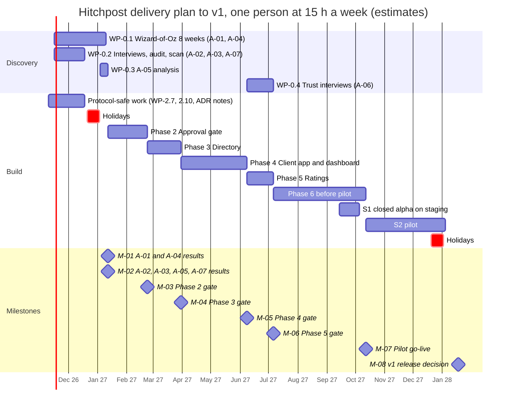

# HP-SAD-16 · Project plan

| Field       | Value                                                                                                                                                                                                            |
| ----------- | ---------------------------------------------------------------------------------------------------------------------------------------------------------------------------------------------------------------- |
| Document ID | HP-SAD-16                                                                                                                                                                                                        |
| Version     | 1.1                                                                                                                                                                                                              |
| Status      | Baselined for Phase 2                                                                                                                                                                                            |
| Date        | 2026-11-09                                                                                                                                                                                                       |
| Owner       | Sanaullah Jannisar, product and engineering lead                                                                                                                                                                 |
| Conforms to | ISO/IEC/IEEE 15288:2023, Project planning, Project assessment and control, Decision management, Risk management and Configuration management processes; ISO/IEC/IEEE 16326:2019, project management plan content |

## 1. Purpose and scope

How Hitchpost gets from Phase 1 (built) to the v1 release decision at the end of Phase 6. The plan covers the delivery approach, the work breakdown, estimates, a resource-loaded schedule, milestones and phase gates, resourcing and budget, risk-driven ordering, and governance.

Scope is Phases 2 to 6 as defined in [01 Vision and scope](01-vision-and-scope.md), plus the discovery work that tests the assumptions in [03 Business case](03-business-case.md). Phases and values come from the phase map and parameter register in [00 Document control](00-document-control.md#10-normative-parameters-and-phase-map). Work after v1 is in [19 Maintenance and evolution](19-maintenance-and-evolution.md).

## 2. Delivery approach

- **Iterative, with phase gates.** Each phase ships in small pull requests to `main`, each passing CI and review ([ADR 0005](../decisions/0005-ci-and-review-policy.md)). A phase closes only when its gate criteria in section 6 are met.
- **One resource.** All work, discovery and build, is done by one person at 15 hours a week. Discovery is not "off the critical path": it takes the same hours as build, and the schedule in section 5 shows them competing.
- **Discovery before the effort it protects.** A failed assumption test must stop work before effort is spent on it. The one exception is stated openly: during the 8-week A-01 test, I build only **protocol-safe work**, meaning work that is worth keeping even if A-01 fails and the project stops at Phase 1 (section 5.1).
- **Test-first.** Every bug fix and every new behaviour lands with a test that failed before it (NFR-MAINT-02). This is the lesson from the [Phase 1 audit](../audits/2026-11-08-phase-1.md).
- **Team model.** One lead (me) owns product, architecture, review and every merge. An AI pair (Claude Code) writes most code to my specs. Estimates in this plan are for that team.
- **Audit at each gate.** Before Phases 2, 4 and 6 close, independent reviews run in parallel (QA, security, architecture, DevOps, product). So far these are Claude Code agents run under my direction ([00](00-document-control.md) section 8); an external human review is added before Phase 6.

## 3. Work breakdown structure

Estimates are three-point, in hours, for the lead plus AI pair: O optimistic, M most likely, P pessimistic. E = (O + 4M + P) / 6. **All figures are estimates.**

### 3.0 Discovery

| WP     | Work package                                                                                         | Traces to        | O   | M   | P   | E        |
| ------ | ---------------------------------------------------------------------------------------------------- | ---------------- | --- | --- | --- | -------- |
| WP-0.1 | Wizard-of-Oz, 8 weeks, about 15 people; time-to-book baseline (pilot stage S0 in 17)                 | A-01, A-04       | 24  | 34  | 50  | 35.0     |
| WP-0.2 | 10 barber interviews incl. the price question; booking-tool API desk audit; verified competitor scan | A-02, A-03, A-07 | 20  | 30  | 50  | 31.7     |
| WP-0.3 | Defensibility and price analysis from WP-0.2 data; A-05 decision record                              | A-05             | 6   | 10  | 16  | 10.3     |
| WP-0.4 | Trust interviews with listing mockups                                                                | A-06             | 4   | 6   | 10  | 6.3      |
|        | **Discovery total**                                                                                  |                  |     |     |     | **83.3** |

### 3.1 Phase 2: Approval gate

| WP      | Work package                                                                                                                       | Traces to                                    | O   | M   | P   | E         |
| ------- | ---------------------------------------------------------------------------------------------------------------------------------- | -------------------------------------------- | --- | --- | --- | --------- |
| WP-2.1  | Offer store: `issuedAt`, `expiresAt`, hold (P-01), reserved hold (P-02), `offer_declined`                                          | FR-BOOK-01, FR-BOOK-08                       | 6   | 10  | 16  | 10.3      |
| WP-2.2  | `booking_request` as an A2A Task, WORKING while the shop decides, re-check at write; idempotency; ADR 0012                         | FR-BOOK-02, FR-BOOK-07, FR-MSG-10, FR-MSG-12 | 10  | 16  | 28  | 17.0      |
| WP-2.3  | `Approval` type and the gate in my agent; client polling of `GetTask` (P-04); ADR 0013                                             | FR-GATE-01, FR-GATE-02, FR-GATE-04           | 6   | 10  | 18  | 10.7      |
| WP-2.4  | Append-only audit log on both sides with correlation fields                                                                        | FR-GATE-03, FR-MSG-11                        | 5   | 8   | 14  | 8.5       |
| WP-2.5  | Cancel, `cancel_rejected`, reschedule as an atomic swap                                                                            | FR-BOOK-03, FR-BOOK-10, FR-BOOK-11           | 8   | 14  | 24  | 14.7      |
| WP-2.6  | Per-shop manual approval switch, shop decision through a command-line stand-in, timeout (P-03)                                     | FR-GATE-05                                   | 4   | 8   | 14  | 8.3       |
| WP-2.7  | `packages/e2e` with contract tests; contract version as an `AgentCapabilities.extensions` entry                                    | FR-MSG-09, NFR-MAINT-01                      | 4   | 6   | 10  | 6.3       |
| WP-2.8  | Persistence: SQLite through the SDK's `DatabaseTaskStore` plus offers, bookings and audit tables; JSONL audit on the personal side | NFR-REL-02                                   | 6   | 10  | 16  | 10.3      |
| WP-2.9  | ADRs, documentation, gate audit                                                                                                    | NFR-MAINT-01                                 | 4   | 8   | 12  | 8.0       |
| WP-2.10 | Validate the shop's book configuration at load (debt D-15)                                                                         | FR-BOOK-12                                   | 2   | 3   | 6   | 3.3       |
| WP-2.11 | Open-holds cap (P-07) and basic per-IP rate limit (P-08)                                                                           | FR-BOOK-09, NFR-SEC-03                       | 3   | 5   | 8   | 5.2       |
|         | **Phase 2 total**                                                                                                                  |                                              |     |     |     | **102.6** |

### 3.2 Phase 3: Directory

| WP     | Work package                                      | Traces to            | O   | M   | P   | E        |
| ------ | ------------------------------------------------- | -------------------- | --- | --- | --- | -------- |
| WP-3.2 | Directory service and its schema                  | FR-DIR-01, FR-DIR-04 | 20  | 32  | 50  | 33.0     |
| WP-3.3 | Business verification (well-known token, DNS TXT) | FR-DIR-01            | 8   | 12  | 20  | 12.7     |
| WP-3.4 | Search API `/v1/listings`                         | FR-DIR-02, FR-DIR-05 | 8   | 12  | 20  | 12.7     |
| WP-3.5 | Card origin check in the client; ADR 0015         | FR-DIR-03            | 6   | 10  | 16  | 10.3     |
|        | **Phase 3 total**                                 |                      |     |     |     | **68.7** |

- **WP-3.1** retired: its research moved to WP-0.2. Hosted business agents moved to Phase 6 (WP-6.10), because each needs its own subdomain for origin verification to work.

### 3.3 Phase 4: Client app and barber dashboard

| WP     | Work package                                                                               | Traces to                                         | O   | M   | P   | E         |
| ------ | ------------------------------------------------------------------------------------------ | ------------------------------------------------- | --- | --- | --- | --------- |
| WP-4.1 | UI design and prototype test with 5 people                                                 | [14 UI design](14-user-interface-design.md), A-08 | 12  | 20  | 32  | 20.7      |
| WP-4.2 | App shell, contacts and chat                                                               | FR-APP-01                                         | 24  | 40  | 64  | 41.3      |
| WP-4.3 | Built-in personal agent                                                                    | FR-APP-03                                         | 12  | 20  | 36  | 21.3      |
| WP-4.4 | Approval screen, including decline and waiting-on-shop states                              | FR-APP-02, FR-BOOK-08                             | 8   | 12  | 20  | 12.7      |
| WP-4.5 | Bookings view, reschedule, cancel, block contact, calendar write                           | FR-APP-04, FR-APP-05, FR-APP-06                   | 10  | 16  | 28  | 17.0      |
| WP-4.6 | Accessibility audit and fixes                                                              | NFR-A11Y-01                                       | 6   | 10  | 16  | 10.3      |
| WP-4.7 | Barber dashboard (`packages/dashboard`): manual approval queue, book view, outcome marking | FR-GATE-05, FR-RATE-04                            | 12  | 20  | 32  | 20.7      |
|        | **Phase 4 total**                                                                          |                                                   |     |     |     | **144.0** |

### 3.4 Phase 5: Ratings

| WP     | Work package                                                    | Traces to                              | O   | M   | P   | E        |
| ------ | --------------------------------------------------------------- | -------------------------------------- | --- | --- | --- | -------- |
| WP-5.1 | Interaction records and behaviour metrics                       | FR-RATE-02                             | 10  | 16  | 26  | 16.7     |
| WP-5.2 | Reviews from verified interactions only; "Did it go as booked?" | FR-RATE-01, FR-RATE-03, FR-RATE-04     | 8   | 14  | 24  | 14.7     |
| WP-5.3 | Reporting, suspension and moderation trail                      | FR-ADMIN-01, FR-ADMIN-02, UC-09, UC-10 | 10  | 16  | 28  | 17.0     |
|        | **Phase 5 total**                                               |                                        |     |     |     | **48.4** |

- **WP-5.4** retired: the trust interviews moved to WP-0.4.

### 3.5 Phase 6: Production

| WP      | Work package                                                                                        | Traces to                | O   | M   | P   | E         |
| ------- | --------------------------------------------------------------------------------------------------- | ------------------------ | --- | --- | --- | --------- |
| WP-6.1  | Hosting, staging and production environments, infrastructure as code, compile step; ADRs 0014, 0016 | NFR-REL-01               | 16  | 24  | 40  | 25.3      |
| WP-6.2  | Agent-to-agent authentication and signed cards; ADR 0017                                            | NFR-SEC-02               | 16  | 24  | 40  | 25.3      |
| WP-6.3  | Per-identity rate limits and abuse controls                                                         | NFR-SEC-03               | 6   | 10  | 16  | 10.3      |
| WP-6.4  | Shop time zones; ADR 0018                                                                           | FR-BOOK-05               | 8   | 12  | 20  | 12.7      |
| WP-6.5  | Connector to one real booking system over MCP, with conditional writes                              | FR-BOOK-06, A-03         | 20  | 36  | 60  | 37.3      |
| WP-6.6  | Observability, trace ids, SLOs, alerts, backups, tested restore                                     | NFR-OBS-01, NFR-REL-01   | 12  | 20  | 32  | 20.7      |
| WP-6.7  | Privacy notice, retention jobs (P-11 to P-15), export and delete                                    | NFR-PRIV-01, NFR-PRIV-02 | 10  | 16  | 26  | 16.7      |
| WP-6.8  | Pre-release security audit, external human review, fixes                                            | NFR-SEC-01 to NFR-SEC-05 | 12  | 20  | 36  | 21.3      |
| WP-6.9  | Pilot run, stage S2 ([17 Transition plan](17-transition-plan.md)), 12 weeks                         | G-1, G-2                 | 30  | 45  | 70  | 46.7      |
| WP-6.10 | Hosted business agents, one subdomain each, per-tenant keys in a KMS; Postgres `slot_claims`        | FR-DIR-01, NFR-REL-02    | 10  | 16  | 28  | 17.0      |
| WP-6.11 | Closed alpha, stage S1: 2 barbers, 10 people, 3 weeks on staging                                    | RC 1                     | 10  | 16  | 26  | 16.7      |
|         | **Phase 6 total**                                                                                   |                          |     |     |     | **250.0** |

## 4. Estimate summary

| Block            | E (hours) | σ (hours) |
| ---------------- | --------- | --------- |
| Discovery        | 83.3      | 6.9       |
| 2. Approval gate | 102.6     | 5.9       |
| 3. Directory     | 68.7      | 6.0       |
| 4. Client app    | 144.0     | 9.9       |
| 5. Ratings       | 48.4      | 4.8       |
| 6. Production    | 250.0     | 13.3      |
| **Total**        | **697.0** | **20.4**  |

σ per work package is (P − O) / 6. The total σ is the square root of the sum of the variances.

- **P80** ≈ E + 0.84σ ≈ **714 hours**. **P95** ≈ E + 1.65σ ≈ **731 hours**.
- PERT assumes work packages are independent, which understates real risk: a slow WP-6.5 also delays WP-6.11 and WP-6.9. A **20% management reserve gives about 836 hours**.
- **Capacity:** 15 hours a week (**estimate** of sustainable solo time), with 2 holiday weeks at each year end. Re-planned if actual capacity runs below 12 hours a week for 4 weeks in a row.
- **What changed from version 1.0:** the 1.0 plan scheduled 624 hours of build at 15 hours a week while also running discovery in parallel, as if discovery took no hours. It also put 170 hours of Phase 6 work into the 7 weeks before the pilot. Loading everything onto one person moves the v1 decision from 2027-10-19 to **2028-01-18**.

## 5. Schedule

Start 2026-11-10. Durations are hours divided by 15 hours a week, rounded up to whole weeks, plus holidays. Every block draws on the same 15 hours.

### 5.1 Window 1: discovery and protocol-safe work (2026-11-10 to 2027-01-12)

Seven working weeks (105 hours; 2026-12-21 to 2027-01-03 is holiday) hold:

| Work                                                          | Hours    | Why it's here                                                                                                                                                                                      |
| ------------------------------------------------------------- | -------- | -------------------------------------------------------------------------------------------------------------------------------------------------------------------------------------------------- |
| WP-0.1 Wizard-of-Oz (8 weeks elapsed)                         | 35.0     | Runs 2026-11-16 to 2027-01-10; about 4 to 5 hours a week of my time                                                                                                                                |
| WP-0.2 Interviews, audit, scan                                | 31.7     | Barbers interviewed in November and early December, before the holidays                                                                                                                            |
| WP-0.3 A-05 analysis                                          | 10.3     | Uses the WP-0.2 data                                                                                                                                                                               |
| WP-2.10 Book configuration validation                         | 3.3      | **Protocol-safe:** fixes a real gap in Built code; worth keeping if the project stops                                                                                                              |
| WP-2.7 e2e package and contract tests                         | 6.3      | **Protocol-safe:** hardens the Phase 1 reference implementation                                                                                                                                    |
| WP-2.9 part: ADR 0012 implementation notes and ADR 0013 draft | 4.0      | **Protocol-safe:** ADR 0012 (accepted 2026-11-09) fixes the booking protocol; turning it into contract-test fixtures and drafting ADR 0013 is useful to anyone building on A2A, whatever A-01 says |
| **Total**                                                     | **90.6** | 14.4 hours of slack absorb interview scheduling                                                                                                                                                    |

Nothing else in Phase 2 starts until M-01 records a pass on A-01 and A-04.

### 5.2 Build windows

| Block                               | Hours | Weeks | Start      | End (milestone)   |
| ----------------------------------- | ----- | ----- | ---------- | ----------------- |
| Phase 2 rest (102.6 − 13.6)         | 89.0  | 6     | 2027-01-12 | 2027-02-23 (M-03) |
| Phase 3                             | 68.7  | 5     | 2027-02-23 | 2027-03-30 (M-04) |
| Phase 4                             | 144.0 | 10    | 2027-03-30 | 2027-06-08 (M-05) |
| Phase 5 plus WP-0.4                 | 54.7  | 4     | 2027-06-08 | 2027-07-06 (M-06) |
| Phase 6 before the pilot (incl. S1) | 203.3 | 14    | 2027-07-06 | 2027-10-12 (M-07) |
| Pilot S2 (WP-6.9, about 4 h a week) | 46.7  | 12    | 2027-10-12 | 2028-01-04        |
| Holidays inside the pilot           |       | 2     | 2027-12-20 | 2028-01-02        |
| Pilot review and v1 decision        |       | 2     | 2028-01-04 | 2028-01-18 (M-08) |

**Reserve.** During the pilot about 11 hours a week are free, about 130 hours in total, which absorbs most of the 139-hour reserve if overruns happen there. If the reserve is consumed **before** the pilot, M-07 slides by up to 9 weeks and M-08 to **2028-03-21** at the latest. So the honest target for the v1 decision is **2028-01-18, no later than the end of Q1 2028**.

**Critical path:** discovery window → Phase 2 → 3 → 4 → 5 → 6 (WP-6.1 staging → WP-6.11 S1 → go/no-go) → S2 → M-08. Discovery is on it: if A-01 fails at M-01, everything after stops. WP-6.5 (connector) is the least certain item before the pilot.

## 6. Milestones and phase-gate exit criteria

A gate passes only when every criterion holds. The v1 release criteria (RC) are the six numbered criteria in [01 Vision and scope](01-vision-and-scope.md).

| Milestone          | Date       | Exit criteria                                                                                                                                                                                                                                               | Traces to              |
| ------------------ | ---------- | ----------------------------------------------------------------------------------------------------------------------------------------------------------------------------------------------------------------------------------------------------------- | ---------------------- |
| M-01               | 2027-01-12 | A-01 (8 weeks) and A-04 measured against their kill criteria; decision recorded; protocol-safe work merged                                                                                                                                                  | A-01, A-04             |
| M-02               | 2027-01-12 | A-02, A-03, A-05 and A-07 measured; booking-tool shortlist chosen                                                                                                                                                                                           | A-02, A-03, A-05, A-07 |
| M-03 Phase 2 gate  | 2027-02-23 | No booking without a logged approval, proven by tests; no double booking under concurrent requests; offers, bookings and audit survive a restart; audit logs complete for UC-02 to UC-04; gate audit has no open high findings; ADRs 0012 and 0013 accepted | RC 1, RC 3             |
| M-04 Phase 3 gate  | 2027-03-30 | Verified registration works and unverified is refused; card origin check enforced; search works against the seeded directory                                                                                                                                | RC 3, RC 6             |
| M-05 Phase 4 gate  | 2027-06-08 | A person completes UC-02 end to end in the app; Marcus accepts and declines in the dashboard; approval screen shows only validated data; WCAG 2.2 AA audit has no open blockers; gate audit clean                                                           | RC 1, RC 2             |
| M-06 Phase 5 gate  | 2027-07-06 | Only verified interactions can be rated; outcomes recorded from both sides; report and takedown works end to end with a moderation trail                                                                                                                    | RC 2, RC 3             |
| M-07 Pilot go-live | 2027-10-12 | S1 exit criteria met; go/no-go checklist in [17 Transition plan](17-transition-plan.md) section 7 fully met                                                                                                                                                 | RC 3, RC 4, RC 5       |
| M-08 v1 decision   | 2028-01-18 | All six RC hold; otherwise extend the pilot, or apply the kill criteria in [03](03-business-case.md)                                                                                                                                                        | RC 1 to RC 6           |

## 7. Resourcing and budget

### 7.1 People

| Role                                           | Who                                                     | Allocation                                          |
| ---------------------------------------------- | ------------------------------------------------------- | --------------------------------------------------- |
| Product and engineering lead, reviewer, merger | Sanaullah Jannisar                                      | 15 h/week (**estimate**), the only planned capacity |
| AI engineering pair                            | Claude Code                                             | Implementation to spec, under review                |
| Independent reviewers at gates                 | Claude Code review agents and the review bot, run by me | At M-03, M-05 and before M-07                       |
| External human reviewer                        | Paid or volunteer, to be found                          | Before M-07 (WP-6.8)                                |
| Legal review                                   | External, paid per task                                 | Before M-07                                         |
| Contributors                                   | Open-source community                                   | Welcome; not planned capacity                       |

### 7.2 Cash budget to the v1 decision (estimates)

November 2026 to January 2028, 15 months. This is the one budget figure for the package; [02 Feasibility study](02-feasibility-study.md) section 4.2 reconciles to it.

| Item                                     | Basis                                                                            | Amount     |
| ---------------------------------------- | -------------------------------------------------------------------------------- | ---------- |
| AI pair and tools                        | About $100 a month × 15                                                          | $1,500     |
| Domain and DNS                           | 2 years                                                                          | $40        |
| Staging hosting                          | About $10 a month, February to June 2027 (5 months)                              | $50        |
| Production hosting                       | About $50 a month, July 2027 to January 2028 (7 months)                          | $350       |
| Research incentives                      | 15 × $25 (8-week Wizard-of-Oz) + 10 × $25 (barbers) + 5 × $15 (trust interviews) | $700       |
| Legal review of privacy notice and terms | One-off                                                                          | $1,500     |
| **Subtotal**                             |                                                                                  | **$4,140** |
| Contingency                              | 20%                                                                              | $828       |
| **Total to v1**                          |                                                                                  | **$4,968** |

GitHub Actions and hosting the public repository cost nothing. The external human review (WP-6.8) is assumed unpaid; if it's paid, it comes out of contingency.

## 8. Risk-driven ordering

The plan is ordered so the work that retires the biggest risks comes before the work those risks would waste. Risk IDs are from [03 Business case](03-business-case.md).

| Risk                                     | Retired or reduced by                                            | When                                                 |
| ---------------------------------------- | ---------------------------------------------------------------- | ---------------------------------------------------- |
| R-01 people don't adopt                  | WP-0.1 Wizard-of-Oz                                              | M-01, before Phase 2 build beyond protocol-safe work |
| R-03 booking tools block API access      | WP-0.2 desk audit                                                | M-02, before Phase 3                                 |
| R-02 platforms build their own           | WP-0.2 scan, WP-0.3 A-05 decision                                | M-02                                                 |
| R-12 cold start                          | WP-0.2 recruitment, WP-4.3 built-in agent                        | Window 1 and Phase 4                                 |
| R-04 prompt injection and hostile agents | WP-2.3 gate, WP-6.2 auth, WP-6.8 audit                           | Phases 2 and 6                                       |
| R-05 fake business agents                | WP-3.3 verification, WP-5.3 reporting, WP-6.10 per-tenant origin | Phases 3, 5 and 6                                    |
| R-06 spam and hold exhaustion            | WP-2.11 holds cap and per-IP limit; WP-6.3 per-identity limits   | Phases 2 and 6                                       |
| R-08 privacy breach                      | WP-6.7 privacy                                                   | Before M-07                                          |
| R-10 A2A breaking changes                | WP-2.7 contract tests                                            | Window 1 onward                                      |
| R-11 solo bandwidth                      | Capacity monitoring (section 4), cutting scope per section 9.1   | Continuous                                           |

## 9. Governance

### 9.1 Change control

Changes to scope, schedule or a baselined document use the one change process in [00 Document control](00-document-control.md) section 6.2, labelled `docs-change`.

1. The change is proposed as a GitHub issue labelled `docs-change`.
2. I assess its impact on the goals, the release criteria, the estimates, the parameters in 00 section 10 and the risks.
3. Small changes (under 8 hours and no change to a gate criterion or a P-value) are decided in the issue.
4. Larger changes need a decision record, and the affected baselined documents get a new version with a revision history row.
5. **Scope cut order when behind:** Phase 5 moves after v1 first, then FR-APP-05, then FR-RATE-03. The gate criteria themselves are never cut.

### 9.2 Decision process

Architecturally significant or hard-to-reverse choices get an ADR in [docs/decisions](../decisions/README.md) before the code that depends on them merges ([ADR 0001](../decisions/0001-record-decisions.md)). ADRs 0012 (booking protocol) and 0018 (time zones, implemented in Phase 6) are accepted. Planned: 0013 (Phase 2), 0015 (Phase 3), 0014, 0016 and 0017 (Phase 6).

### 9.3 Configuration management

- `main` is the only long-lived branch. It is protected, with squash merges only and the required check `lint, typecheck, test` ([18 Deployment and operations](18-deployment-and-operations.md)).
- Releases are tagged with semantic versions. Baselined documents carry a version and a revision history.
- Dependencies are locked with the pnpm lockfile, and actions are pinned to commit SHAs.

### 9.4 Status reporting

| Report               | Cadence  | Content                                                                                       | Where                          |
| -------------------- | -------- | --------------------------------------------------------------------------------------------- | ------------------------------ |
| Progress             | Weekly   | Hours spent vs plan by block (discovery and build), work packages done, blockers, top 3 risks | Journey entry or pinned issue  |
| Metrics (from pilot) | Weekly   | North star and counter-metrics from [01](01-vision-and-scope.md)                              | Metrics review                 |
| Phase gate           | Per gate | Exit criteria evidence, audit report, decision                                                | `docs/audits/` and the journey |

**Earned value check:** at each gate I compare the hours actually spent with the sum of E for completed work packages. If the ratio passes 1.3, I re-estimate the remaining phases before continuing.

### 9.5 Definition of done (per pull request)

- [ ] The behaviour matches its requirement and the acceptance criteria in [05 Requirements](05-requirements.md).
- [ ] Every new behaviour and every fix has a test that failed first.
- [ ] `pnpm check`, `pnpm typecheck` and `pnpm test` pass in CI.
- [ ] Inbound data from other agents is validated at the boundary (NFR-SEC-01).
- [ ] The review bot's comments are resolved or answered.
- [ ] An ADR, bug log entry or journey entry is added where needed.
- [ ] Any affected baselined document is updated, with its version bumped; any value used in more than one document cites its P-ID.

## Revision history

| Version | Date       | Change                                                                                                                                                                                                                                                                                                                                                                                                                                                                                                                                                                                                                                             | Author      |
| ------- | ---------- | -------------------------------------------------------------------------------------------------------------------------------------------------------------------------------------------------------------------------------------------------------------------------------------------------------------------------------------------------------------------------------------------------------------------------------------------------------------------------------------------------------------------------------------------------------------------------------------------------------------------------------------------------- | ----------- |
| 1.0     | 2026-11-09 | First baseline                                                                                                                                                                                                                                                                                                                                                                                                                                                                                                                                                                                                                                     | S. Jannisar |
| 1.1     | 2026-11-09 | Remediation after independent review: plan resource-loaded on one person at 15 h a week; discovery work packages WP-0.1 to WP-0.4 (A-01 now 8 weeks); protocol-safe work defined for the A-01 window; new WP-2.8 persistence, WP-2.10 book validation, WP-2.11 holds cap and rate limit, WP-4.7 barber dashboard (`packages/dashboard`), WP-6.10 hosted agents per subdomain, WP-6.11 S1 closed alpha on staging; estimate 697 h (P95 731, 836 with reserve); milestones re-baselined, M-07 2027-10-12, M-08 2028-01-18 (latest 2028-03-21); one budget figure, $4,140 ($4,968 with contingency), reconciled with 02; change process `docs-change` | S. Jannisar |
