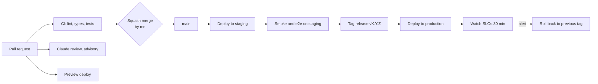

# HP-SAD-18 · Deployment and operations

| Field       | Value                                                                                   |
| ----------- | --------------------------------------------------------------------------------------- |
| Document ID | HP-SAD-18                                                                               |
| Version     | 1.1                                                                                     |
| Status      | Baselined for Phase 2                                                                   |
| Date        | 2026-11-09                                                                              |
| Owner       | Sanaullah Jannisar, product and engineering lead                                        |
| Conforms to | ISO/IEC/IEEE 12207 (transition and operation processes); ITIL 4 practices (informative) |

How code gets from a branch to production, where it runs, and how it's watched and recovered. Values (P-) and phases come from [00 Document control](00-document-control.md#10-normative-parameters-and-phase-map).

## 1. Environments

| Environment | Purpose                                                                  | Data                                                     | Status                                                         |
| ----------- | ------------------------------------------------------------------------ | -------------------------------------------------------- | -------------------------------------------------------------- |
| Local       | Development; both agents on `127.0.0.1`                                  | Demo book in `packages/barber-agent/src/main.ts`         | **Built**                                                      |
| CI          | Lint, type check and tests on every PR and push                          | Test fixtures only                                       | **Built** in `.github/workflows/ci.yml`, not yet run on GitHub |
| Preview     | One deploy per PR for the directory and app                              | Seeded fake data                                         | Phase 3                                                        |
| Staging     | Mirrors production; release candidates; closed alpha S1; pilot rehearsal | Fake businesses, my own test bookings, then the S1 shops | Phase 6 (created by WP-6.1, before S1)                         |
| Production  | Real barbers in one area                                                 | Real                                                     | Phase 6                                                        |

## 2. CI/CD today

- **CI:** `ci.yml` runs install with the frozen lockfile, Biome, tsc and tests on Node from `.nvmrc` (24). The actions are pinned to commit SHAs. Superseded PR runs are cancelled; runs on `main` always finish.
- **Review:** `claude-review.yml` runs an advisory review on same-repo PRs. It needs the Claude GitHub App and the `ANTHROPIC_API_KEY` secret.
- **Dependencies:** Dependabot weekly for npm and GitHub Actions (`.github/dependabot.yml`).
- **Not yet:** no remote, so nothing is enforced and nothing deploys.

### First push checklist

From the [DevOps audit](../audits/2026-11-08-phase-1.md#first-push-checklist-from-the-devops-review):

1. Create `Jannisar01/hitchpost`, push `main`, confirm CI green.
2. Merge settings: squash only, PR title and body as the commit, delete branches on merge.
3. Default workflow token: read-only; workflows can't approve PRs.
4. Ruleset on `main`: no deletion, no force push, PR required (0 approvals, since I'm the sole maintainer), squash only, required check `lint, typecheck, test`.
5. Turn on private vulnerability reporting and vulnerability alerts.
6. Install the Claude GitHub App; add `ANTHROPIC_API_KEY`.
7. Open the Phase 1 branch as the first real PR.

## 3. CI/CD target

- **Preview deploys** (Phase 3): each PR gets its own directory and app URL, torn down on merge.
- **Staging** deploys automatically from `main`.
- **Production** deploys only from a release tag, after the [release exit criteria](15-test-strategy.md#11-release-exit-criteria).
- **Rollback** means redeploying the previous tag. Database migrations must be backward compatible for one release so rollback is always safe.
- **Build step:** before hosting, packages need a compile step (ADR 0016). Today `exports` point at `.ts` source, which only works locally ([19](19-maintenance-and-evolution.md), debt D-02).

## 4. Versioning and releases

- **Packages:** semantic versioning. Releases are tagged `vX.Y.Z` with release notes drawn from the PR titles.
- **Message contract:** versioned separately from the code, from Phase 2 ([13](13-interfaces.md)).
  - Declared on the agent card as an `AgentCapabilities.extensions` entry with uri `https://hitchpost.dev/ext/contract/v1` and `required: true`; each message lists that uri in its `extensions`. The A2A `AgentCard` has no metadata field, so the version can't live there.
  - **Major versions only.** Additive changes (a new optional field, a new message kind) keep the version. A breaking change gets a new major uri, and both majors are accepted for P-18 (6 months) after the new one ships ([19](19-maintenance-and-evolution.md#4-message-contract-versioning-and-deprecation)).
- **A2A protocol:** pinned to the SDK's spec version (v1.0 today). SDK upgrades go through their own PR with the e2e tests.

## 5. Hosting

Proposed as ADR 0014 (one container platform plus managed Postgres). The options:

| Option                                              | Fits                                                                    | Costs                 | Concerns                                                   |
| --------------------------------------------------- | ----------------------------------------------------------------------- | --------------------- | ---------------------------------------------------------- |
| **Fly.io or Render** (containers, managed Postgres) | Long-running Node servers, WebSockets/SSE for A2A streaming, simple ops | Low at pilot scale    | Smaller vendors; check region and backup options           |
| Cloudflare Workers + D1                             | Cheap, global, the A2A SDK supports D1 stores                           | Very low              | Express-based server needs porting; Workers runtime limits |
| AWS (ECS Fargate + RDS)                             | Scales anywhere, every compliance box                                   | Higher, more ops work | Overkill for one-area pilot                                |
| Serverless functions (Vercel)                       | Fine for the app front end                                              | Low                   | Poor fit for long agent tasks and streaming                |

**Proposed (ADR 0014):** option A. One container platform (Fly.io or Render) with managed Postgres. The directory (which also hosts the admin pages), the ratings service, the barber dashboard and the hosted business agents run there. The app front end goes on a static or edge host. The vendor choice between Fly.io and Render is confirmed with a pilot cost estimate before Phase 6.

- **Hosted business agents get one subdomain each**, `<slug>.agents.hitchpost.dev`, served by the same container. One origin per shop is what lets origin verification tell hosted shops apart, and it keeps each agent card at its own origin root as `.well-known` requires (RFC 8615).
- **Bookings stay correct with more than one instance:** holds and bookings live in one Postgres `slot_claims` table with a time-range exclusion constraint per business, so two instances can't claim the same slot. With a real booking system over MCP, the write must be conditional or atomic on that system (FR-BOOK-06).
- **Before Phase 6** there is no hosting: Phase 2 to 5 run locally, with SQLite on the business side (phase map in [00](00-document-control.md#10-normative-parameters-and-phase-map)).

## 6. Configuration and secrets

- **Config through environment variables**, validated at startup. The server refuses to start on a missing or bad value. Today only `PORT` exists (`packages/barber-agent/src/main.ts`).
- **The public agent URL comes from config** (`PUBLIC_URL`), not from the bind address as it does today (`server.ts`).
- **Secrets** (database URLs, signing keys, API keys) live in the host's secret store and GitHub Actions secrets. Never in the repo: `.env*` is git-ignored, except `.env.example`.
- **Card signing keys** (Phase 6, NFR-SEC-02): cards are signed as a JWS over the JCS-canonical card (RFC 8785); public keys are published as a JWKS at a URL registered in the directory listing. Hosted shops' keys are held by the platform in a KMS, one key per tenant.
  - **Scheduled rotation**, yearly: the old public key stays in the JWKS for 30 days so recently signed cards still verify.
  - **Suspected compromise:** the key is revoked immediately, removed from the JWKS, and the listing is flagged until a new key is in place. There is no grace period in that case.

## 7. Observability

- **Logs:** structured JSON, one line per request.
  - **Fields:** request id, agent, method, outcome, latency, and from Phase 2 the correlation fields `contextId`, `taskId`, `offerId`, `messageId` (FR-MSG-11). `contextId` is a bearer capability until agent authentication, so logs that hold it are access-controlled like the audit log.
  - **No message bodies, no personal data** (see [12](12-security-and-privacy.md#retention-deletion-and-export)).
  - **Retention:** 30 days.
- **Metrics:** requests by outcome (`offer`, `no_availability`, `rejected`, error), latency histograms, approvals and declines, bookings, rate-limit hits, card-fetch failures.
- **Traces** (Phase 6): OpenTelemetry across directory lookup, agent-to-agent call and booking write. One trace id flows through the A2A message `metadata` field (the message has one; the card doesn't).
- **Product metrics,** from the audit logs:
  - the north star: weekly human-approved bookings that were honored
  - counter-metrics: first-offer rejection rate, median time to approve, booking errors, reports per 100 interactions, repeat use within 60 days

### SLOs (pilot)

| SLI                                                  | SLO              | Requirement                                                   |
| ---------------------------------------------------- | ---------------- | ------------------------------------------------------------- |
| Offer round trip (request to validated offer), p95   | under 2 s        | NFR-PERF-01                                                   |
| Directory availability, monthly                      | 99.5%            | NFR-REL-01                                                    |
| Confirmed bookings lost or duplicated                | 0                | NFR-REL-02                                                    |
| Booking path traceable end to end                    | 100% of bookings | NFR-OBS-01                                                    |
| Directory search, p95                                | under 500 ms     | Operational target only; no requirement sets it               |
| Successful business-agent replies (non-5xx), 30 days | 99.5%            | Operational target only; NFR-REL-01 covers the directory only |

### Dashboards and alerts

One dashboard per service: traffic, errors, latency, saturation, plus a product panel.

| Alert                                       | When                               | Severity |
| ------------------------------------------- | ---------------------------------- | -------- |
| Error budget burn                           | 2% of the monthly budget in 1 hour | Page     |
| Booking write failures                      | Any                                | Page     |
| p95 latency over SLO                        | 15 minutes                         | Ticket   |
| Card-fetch failure spike or rate-limit hits | Over baseline                      | Ticket   |
| Certificate expiry, backup failure          | Any                                | Ticket   |

## 8. Incident response (runbook outline)

1. **Detect:** an alert or a user report (issue, email, in-app).
2. **Triage:** SEV1 means bookings wrong or lost, or a security breach. SEV2 means the service is down or degraded. SEV3 means minor.
3. **Mitigate first:** roll back to the previous tag, turn on rate limits, or delist an abusive agent.
4. **Communicate:** a status note on the repo and to affected businesses. For SEV1, update every hour. Response targets per severity are P-17, kept in [19](19-maintenance-and-evolution.md#1-support-model).
5. **Resolve and verify** against the SLO dashboard.
6. **Post-incident review** within 5 days, blameless. Add it to the [bug log](../bugs.md) with root cause and prevention, and add a test.
7. **Security incidents** also follow [SECURITY.md](../../SECURITY.md) and the breach-notification duties in [12](12-security-and-privacy.md).

## 9. Backups and disaster recovery

Backups follow P-15: a daily full backup plus continuous WAL, expiring after 35 days, with no separate cold-storage export. Expiry is what lets an erasure request (P-13) also reach backups within 30 days plus the backup window.

| Data                              | Backup                                                                                     | RPO                                                                 | RTO     |
| --------------------------------- | ------------------------------------------------------------------------------------------ | ------------------------------------------------------------------- | ------- |
| Directory and bookings (Postgres) | Managed point-in-time recovery (continuous WAL) plus a daily full backup to another region | 5 minutes for infrastructure loss; 0 for confirmed bookings (below) | 4 hours |
| Audit logs                        | Append-only, in the same database, so covered by the same backups                          | 5 minutes                                                           | 4 hours |
| Config and code                   | Git and the host's config history                                                          | 0                                                                   | 1 hour  |

**Zero loss and RPO are not in conflict.** A booking is committed synchronously before `booking_confirmed` is sent, so a crash leaves either no booking and no confirmation, or both. The 5-minute RPO applies to everything else (offers, the audit tail, directory edits) and to loss of a whole region. The NFR-REL-02 target of zero lost confirmed bookings holds on that basis.

- **Restore drills:** quarterly, into staging, timed against the RTO. One tested restore and one incident drill are part of v1 release criterion 4 ([01](01-vision-and-scope.md#8-v1-release-criteria-end-of-phase-6)).

## 10. Capacity and cost notes

- **Pilot load:** about 20 barbers, a few hundred people, under 1 request per second at peak. One small container per service and a small Postgres cover it.
- **Hosting estimate:** roughly $20 to $60 a month plus the domain. To be confirmed in the hosting ADR.
- **The Claude review's API spend is the main variable cost.** If it grows, limit the review to code paths with `paths-ignore` for docs.
- **Scale-up triggers:** p95 latency near the SLO, CPU above 70% sustained, or more than one area live.

## Revision history

| Version | Date       | Change                                                                                                                                                                                                                                                                                                                                                                                                                                         | Author      |
| ------- | ---------- | ---------------------------------------------------------------------------------------------------------------------------------------------------------------------------------------------------------------------------------------------------------------------------------------------------------------------------------------------------------------------------------------------------------------------------------------------- | ----------- |
| 0.1     | 2026-11-08 | First draft                                                                                                                                                                                                                                                                                                                                                                                                                                    | S. Jannisar |
| 1.0     | 2026-11-09 | Baselined: renumbered into lifecycle order, formal document control, standards conformance                                                                                                                                                                                                                                                                                                                                                     | S. Jannisar |
| 1.1     | 2026-11-09 | Remediation after independent review: contract version as an `AgentCapabilities.extensions` entry, major versions only (P-18); hosted agents one subdomain each and `slot_claims` exclusion constraint; card signing and revocation specified; correlation fields from Phase 2; SLOs mapped to the right NFRs and operational targets marked; backups per P-15 with no cold-storage export; zero-loss vs RPO stated; staging created before S1 | S. Jannisar |
