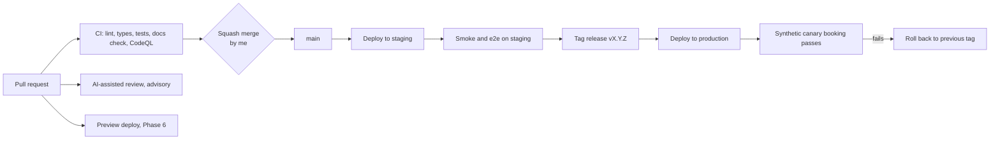

# HP-SAD-18 · Deployment and operations

| Field       | Value                                                                                   |
| ----------- | --------------------------------------------------------------------------------------- |
| Document ID | HP-SAD-18                                                                               |
| Version     | 1.5                                                                                     |
| Status      | Frozen for Phase 2 spike                                                                |
| Date        | 2026-11-09                                                                              |
| Owner       | Sanaullah Jannisar, product and engineering lead                                        |
| Conforms to | ISO/IEC/IEEE 12207 (transition and operation processes); ITIL 4 practices (informative) |

How code gets from a branch to production, where it runs, and how it's watched and recovered. Values (P-) and phases come from [00 Document control](00-document-control.md#10-normative-parameters-and-phase-map). The pilot runs in Texas, United States (America/Chicago), with standing approval only.

## 1. Environments

| Environment | Purpose                                                                  | Data                                                          | Status                                                         |
| ----------- | ------------------------------------------------------------------------ | ------------------------------------------------------------- | -------------------------------------------------------------- |
| Local       | Development; both agents on `127.0.0.1`                                  | Demo book in `packages/barber-agent/src/main.ts`              | **Built**                                                      |
| CI          | Lint, type check, tests and the docs check on every PR and push          | Test fixtures only                                            | **Built** in `.github/workflows/ci.yml`, not yet run on GitHub |
| Preview     | One deploy per PR for the directory and app                              | Seeded fake data                                              | Phase 6 (needs hosting, WP-6.1)                                |
| Staging     | Mirrors production; release candidates; closed alpha S1; pilot rehearsal | Fake businesses, my own test bookings, then the S1 businesses | Phase 6 (created by WP-6.1, before S1)                         |
| Production  | Real businesses and people in one area                                   | Real                                                          | Phase 6                                                        |

Before Phase 6 there is no hosting at all, so no preview or staging environment exists; Phases 2 to 5 run locally.

## 2. CI/CD today

- **CI:** `ci.yml` runs install with the frozen lockfile, Biome, tsc, the tests and `pnpm docs:check` on Node from `.nvmrc` (24). The actions are pinned to commit SHAs. Superseded PR runs are cancelled; runs on `main` always finish.
- **Review:** `claude-review.yml` runs an advisory, AI-assisted review on same-repo PRs. It needs the Claude GitHub App and the `ANTHROPIC_API_KEY` secret.
- **Dependencies:** Dependabot weekly for npm and GitHub Actions (`.github/dependabot.yml`).
- **Phase 2 additions (WP-2.17):** CodeQL, secret scanning, fast-check parser fuzzing, coverage and a mutation job ([15](15-test-strategy.md) section 9).
- **Not yet:** no remote, so nothing is enforced and nothing deploys.

### First push checklist

From the [DevOps audit](../audits/2026-11-08-phase-1.md#first-push-checklist-from-the-devops-review):

1. Create `Jannisar01/hitchpost`, push `main`, confirm CI green.
2. Merge settings: squash only, PR title and body as the commit, delete branches on merge.
3. Default workflow token: read-only; workflows can't approve PRs.
4. Ruleset on `main`: no deletion, no force push, PR required (0 approvals, since I'm the sole maintainer), squash only, required check `lint, typecheck, test`. 2FA required on the maintainer account. This is on before any Phase 2 merge.
5. Turn on private vulnerability reporting, vulnerability alerts and secret scanning.
6. Install the Claude GitHub App; add `ANTHROPIC_API_KEY`.
7. Open the Phase 1 branch as the first real PR.

## 3. CI/CD target

- **Preview deploys** (Phase 6, once hosting exists): each PR gets its own directory and app URL, torn down on merge.
- **Staging** (from Phase 6, WP-6.1) deploys automatically from `main`.
- **Production** deploys only from a release tag, after the [release exit criteria](15-test-strategy.md#11-release-exit-criteria).
- **Deploy check:** pilot traffic is too thin for a latency or burn-rate check right after a deploy, so the check is the synthetic canary booking (section 7): it must pass twice in a row after each production deploy, or the deploy is rolled back.
- **Rollback** means redeploying the previous tag. Database migrations must be backward compatible for one release so rollback is always safe; that is tested by deploying, rolling back and re-running the e2e suite on staging for every migration.
- **Build step:** before hosting, packages need a compile step (ADR 0016). Today `exports` point at `.ts` source, which only works locally ([19](19-maintenance-and-evolution.md), debt D-02).

## 4. Versioning and releases

- **Packages:** semantic versioning. Releases are tagged `vX.Y.Z` with release notes drawn from the PR titles.
- **Message contract:** versioned separately from the code, from Phase 2 ([13](13-interfaces.md)).
  - Declared on the agent card as an `AgentCapabilities.extensions` entry with uri `https://hitchpost.dev/ext/contract/v1` and `required: true`; clients declare it in the `A2A-Extensions` header. The A2A `AgentCard` has no metadata field, so the version can't live there.
  - **Major versions only.** Additive changes (a new optional field, a new request kind) keep the version; new reply kinds need the client to advertise support. A breaking change gets a new major uri, and both majors are accepted for P-18 (6 months) after the new one ships ([19](19-maintenance-and-evolution.md#4-message-contract-versioning-and-deprecation)).
  - The **conformance kit** (JSON Schemas for every message kind plus a runner, WP-2.14) is released with each contract version.
- **A2A protocol:** pinned to the SDK's spec version (v1.0 today). SDK upgrades go through their own PR with the e2e tests and the SDK-upgrade regression suite ([15](15-test-strategy.md)).

## 5. Hosting

Proposed as ADR 0014 (one container platform plus managed Postgres). The options:

| Option                                              | Fits                                                                    | Costs                 | Concerns                                                   |
| --------------------------------------------------- | ----------------------------------------------------------------------- | --------------------- | ---------------------------------------------------------- |
| **Fly.io or Render** (containers, managed Postgres) | Long-running Node servers, WebSockets/SSE for A2A streaming, simple ops | Low at pilot scale    | Smaller vendors; check region and backup options           |
| Cloudflare Workers + D1                             | Cheap, global, the A2A SDK supports D1 stores                           | Very low              | Express-based server needs porting; Workers runtime limits |
| AWS (ECS Fargate + RDS)                             | Scales anywhere, every compliance box                                   | Higher, more ops work | Overkill for one-area pilot                                |
| Serverless functions (Vercel)                       | Fine for the app front end                                              | Low                   | Poor fit for long agent tasks and streaming                |

**Proposed (ADR 0014):** option A. One container platform (Fly.io or Render) with managed Postgres in a US region. The directory (which also hosts the admin pages), the ratings service, the business dashboard (from Phase 4) and the hosted business agents run there. The app (a PWA) goes on a static or edge host. The vendor choice is confirmed with the cost model in section 10 before Phase 6. The service boundaries are in [26 Service architecture](26-service-architecture.md).

- **Hosted business agents get one subdomain each**, `<slug>.agents.hitchpost.dev`, served by the same container. One origin per business is what lets origin verification tell hosted businesses apart, and it keeps each agent card at its own origin root as `.well-known` requires (RFC 8615).
- **One container serves every hosted agent**, so a bad deploy affects all of them at once (trade-off TO-5 in [11](11-quality-attributes.md)). The synthetic canary and the deploy check above are the mitigation for the pilot; per-tenant canaries are Later.
- **Bookings stay correct with more than one instance:** holds and bookings live in one Postgres `slot_claims` table with a time-range exclusion constraint per business, so two instances can't claim the same slot. Each service connects with its own database role, and row-level security scopes rows per business. With a real booking system over MCP, the write must be conditional or atomic on that system (FR-BOOK-06).
- **Before Phase 6** there is no hosting: Phase 2 to 5 run locally, with SQLite on the business side (phase map in [00](00-document-control.md#10-normative-parameters-and-phase-map)).

## 6. Configuration and secrets

- **Config through environment variables**, validated at startup. The server refuses to start on a missing or bad value. Today only `PORT` exists (`packages/barber-agent/src/main.ts`).
- **The public agent URL comes from config** (`PUBLIC_URL`), not from the bind address as it does today (`server.ts`). Local servers allow only the configured Host header (DNS rebinding guard, WP-2.16).
- **Secrets** (database URLs, signing keys, API keys) live in the host's secret store and GitHub Actions secrets. Never in the repo: `.env*` is git-ignored, except `.env.example`. Secret scanning runs in CI.
- **Card signing keys** (Phase 6, NFR-SEC-02): cards are signed as a JWS over the JCS-canonical card (RFC 8785); public keys are published as a JWKS at a URL registered in the directory listing. Hosted businesses' keys are held by the platform in a KMS, one key per tenant.
  - **Scheduled rotation**, yearly: the old public key stays in the JWKS for P-24 (30 days) so recently signed cards still verify.
  - **Suspected compromise:** the key is revoked immediately, removed from the JWKS, and the listing is flagged until a new key is in place. There is no grace period in that case.

## 7. Observability

- **Phase 2 basics (WP-2.16):** a `/healthz` endpoint on every agent and service, graceful shutdown on SIGTERM (stop accepting, drain in-flight requests, close keep-alive connections), and structured JSON logs. They land with persistence, before anything is hosted.
- **Logs:** structured JSON, one line per request.
  - **Fields:** request id, agent, method, outcome, latency, and from Phase 2 the correlation fields `contextId`, `taskId`, `offerId`, `messageId` (FR-MSG-11). `contextId` is client-chosen and used for correlation only. The capabilities (`offerId`, `bookingToken`) are logged only as hashes, never in clear.
  - **No message bodies, no personal data** (see [12](12-security-and-privacy.md#retention-deletion-and-export)).
  - **Retention:** P-23 (30 days).
- **Metrics:** requests by outcome (`offer`, `no_availability`, `rejected`, error), latency histograms, approvals and declines, bookings, rate-limit hits, card-fetch failures, outcome marks and the unmarked rate (P-25).
- **Traces** (Phase 6): OpenTelemetry across directory lookup, agent-to-agent call and booking write. One trace id flows through the A2A message `metadata` field (the message has one; the card doesn't).
- **Synthetic canary** (Phase 6): every 5 minutes, a probe books and cancels a slot at a test business through the public path. Its success and latency are the SLIs for the alerts below, because real pilot traffic is under 1 request per second and would page on a single error. Canary bookings are excluded from every product metric.
- **Uptime monitor and status page** (Phase 6): an external monitor checks `/healthz` on each public service; a public status page shows current state and planned maintenance.
- **Product metrics** come from the pseudonymous analytics event store (WP-4.12), not from per-agent audit logs: the north star (weekly human-approved bookings that were honored) and the counter-metrics in [01](01-vision-and-scope.md), each with an SQL definition and owner, plus a weekly snapshot table so retention deletions don't rewrite history.

### SLOs (pilot)

| SLI                                                | SLO              | Requirement                                            |
| -------------------------------------------------- | ---------------- | ------------------------------------------------------ |
| Offer round trip (request to validated offer), p95 | under 2 s        | NFR-PERF-01                                            |
| Directory availability, monthly                    | 99.5%            | NFR-REL-01                                             |
| Confirmed bookings lost or duplicated (scope in 9) | 0                | NFR-REL-02                                             |
| Booking path traceable end to end                  | 100% of bookings | NFR-OBS-01                                             |
| Synthetic canary booking success, 30 days          | 99.5%            | Operational target only; it stands in for real traffic |
| Directory search, p95                              | under 500 ms     | Operational target only; no requirement sets it        |

### Dashboards, paging and alerts

One dashboard per service: traffic, errors, latency, saturation, plus a product panel. Pages go to a phone paging tool that reaches me and the backup operator (WP-6.13).

| Alert                                       | When                         | Severity | Runbook                                         |
| ------------------------------------------- | ---------------------------- | -------- | ----------------------------------------------- |
| Synthetic canary failing                    | 2 consecutive failures       | Page     | RB-1 Booking path down                          |
| Booking write failures                      | Any                          | Page     | RB-2 Booking write failure                      |
| Unacknowledged SEV1 page                    | 30 minutes (P-28)            | Auto     | RB-3 Auto-pause all listings, then resume       |
| p95 latency over SLO                        | 15 minutes of canary samples | Ticket   | RB-4 Latency                                    |
| Card-fetch failure spike or rate-limit hits | Over baseline                | Ticket   | RB-5 Abuse and hostile agents                   |
| Backup failure or restore-drill failure     | Any                          | Page     | RB-6 Backup and restore                         |
| Certificate expiry within 14 days           | Any                          | Ticket   | RB-7 Certificates and keys (incl. key rotation) |
| Monthly spend over the budget alert         | Over $120 (section 10)       | Ticket   | RB-8 Cost                                       |

Each runbook RB-1 to RB-8 is a page in `docs/runbooks/` before M-07, with symptoms, checks, the mitigation command and how to verify; the one-command pause (`pause-all`) and per-business pause are part of RB-3.

**Runbook catalogue**

| ID   | Runbook                              | Trigger                                                 | First action                                                                  | Severity |
| ---- | ------------------------------------ | ------------------------------------------------------- | ----------------------------------------------------------------------------- | -------- |
| RB-1 | Booking path down                    | Synthetic canary fails twice                            | Check `/healthz` on each agent host; roll back the last deploy if it changed  | SEV1     |
| RB-2 | Booking write failure                | Any failed booking write                                | Pause the affected business; verify no `booking_confirmed` went out unwritten | SEV1     |
| RB-3 | Auto-pause all listings, then resume | SEV1 unacknowledged for P-28, or `pause-all`            | Confirm listings show the business phone; find the cause before resuming      | SEV1     |
| RB-4 | Latency                              | p95 over the SLO for 15 minutes                         | Compare canary samples with the last deploy and store latency                 | SEV2     |
| RB-5 | Abuse and hostile agents             | Card-fetch failures or rate-limit hits spike            | Identify the sender keys; tighten caps or block the sender                    | SEV2     |
| RB-6 | Backup and restore                   | Backup or restore drill fails                           | Re-run the backup; if it fails again, restore to a scratch host and compare   | SEV2     |
| RB-7 | Certificates and keys                | Certificate expires within 14 days, or key rotation due | Renew or rotate per P-24; verify cards still validate                         | SEV3     |
| RB-8 | Cost                                 | Monthly spend over the budget alert                     | Break spend down by service; cut the biggest unplanned line                   | SEV3     |

## 8. Incident response (runbook outline)

1. **Detect:** an alert or a user report (issue, email, in-app, the support line in [36](36-customer-support-and-success-playbook.md)).
2. **Triage:** assign a severity from the single [SEV table in 19](19-maintenance-and-evolution.md#1-support-model).
3. **Mitigate first:** roll back to the previous tag, pause a listing or all listings, turn on rate limits, or delist an abusive agent.
4. **Communicate:** the status page and a note to affected businesses and people. For SEV1, update every hour. Response targets per severity are P-17 and coverage is P-28, both kept in [19](19-maintenance-and-evolution.md#1-support-model); a public holding statement follows the crisis comms in [29](29-go-to-market-plan.md).
5. **Resolve and verify** against the canary and the SLO dashboard.
6. **Post-incident review** within 5 days, blameless. Add it to the [bug log](../bugs.md) with root cause and prevention, and add a test.
7. **Security incidents** also follow [SECURITY.md](../../SECURITY.md) and the breach-notification duties in [12](12-security-and-privacy.md).

**Coverage (P-28).** The 1-hour SEV1 response applies during listed businesses' opening hours, shared by me and the backup operator. Outside those hours, and whenever a SEV1 page goes unacknowledged for 30 minutes, every listing pauses automatically: agents answer new requests with "temporarily unavailable" and the business phone is shown as the fallback. A named, drilled backup operator is a go/no-go condition for the pilot ([17](17-transition-plan.md) section 7).

## 9. Backups and disaster recovery

**Phase 2 (local, SQLite, WP-2.8).** The business-side SQLite database runs in WAL mode with `BEGIN IMMEDIATE` writes and a `busy_timeout`. Litestream streams it to object storage; a restore drill (restore to a fresh file, run the e2e suite against it) is part of the M-03 gate. The personal-side JSONL audit is copied with the same tool.

**Phase 6 (hosted, Postgres).** Backups follow P-15: a daily full backup plus continuous WAL, copied to a second US region, expiring after 30 days, with no separate cold-storage export. Expiry is what lets an erasure request (P-13) also reach backups: erased from live systems within 30 days, gone from backups within 60 days at most.

| Data                              | Backup                                                                                     | RPO                                                                                                | RTO     |
| --------------------------------- | ------------------------------------------------------------------------------------------ | -------------------------------------------------------------------------------------------------- | ------- |
| Directory and bookings (Postgres) | Managed point-in-time recovery (continuous WAL) plus a daily full backup to another region | 0 for process crash and single-node loss; 5 minutes for region loss, with bookings rebuilt (below) | 4 hours |
| Audit logs                        | Append-only, in the same database, so covered by the same backups                          | Same as above                                                                                      | 4 hours |
| Config and code                   | Git and the host's config history                                                          | 0                                                                                                  | 1 hour  |

**RPO, stated precisely.** A booking is committed synchronously before `booking_confirmed` is sent, so a process crash or the loss of a single node leaves either no booking and no confirmation, or both: RPO 0. Losing a whole region loses up to 5 minutes of writes, because cross-region copies are asynchronous. Confirmed bookings in that window are not lost to the people who made them: each personal agent holds its own `booking_confirmed` copy, and after a region restore the business side rebuilds those bookings from the personal-side copies and confirms each one with its business. NFR-REL-02 (zero lost confirmed bookings) is scoped on that basis.

- **Restore drills:** quarterly, into staging, timed against the RTO. One tested restore and one incident drill are part of v1 release criterion 4 ([01](01-vision-and-scope.md#8-v1-release-criteria-end-of-phase-6)).
- **Migration rehearsal, SQLite to Postgres (WP-6.6):** the SQLite data from the local build is migrated into a staging Postgres, row counts and a sample of bookings are compared, the e2e suite runs against it, and the rehearsal is repeated until it is clean before any production data exists. Pilot production starts empty, so no live migration is needed.

## 10. Capacity and cost model

- **Pilot load:** 5 to 10 businesses and 30 to 60 people (P-22), under 1 request per second at peak. One small container per service and a small Postgres cover it.

**Monthly running cost during the pilot (estimates, USD):**

| Item                                                      | Basis                                        | Per month |
| --------------------------------------------------------- | -------------------------------------------- | --------- |
| Compute (containers for services and hosted agents)       | Small instances on the chosen platform       | $30       |
| Managed Postgres                                          | Smallest tier with point-in-time recovery    | $15       |
| Cross-region backup storage                               | Daily full plus WAL, 30-day expiry           | $5        |
| KMS keys                                                  | About $1 per tenant key, up to 10 businesses | $10       |
| Paging                                                    | Phone paging tool, 2 users                   | $10       |
| SMS reminders (with TCPA consent) and transactional email | About 60 people, P-29 reminders              | $10       |
| Logging vendor, uptime monitor, status page               | Free tiers at pilot volume; logs kept P-23   | $0        |
| **Production and operations**                             |                                              | **$80**   |
| Staging                                                   | Smaller copy, from WP-6.1                    | $10       |

- **Budget alert:** a billing alert fires when monthly spend passes $120 (150% of the production estimate), routed to RB-8.
- **The budget in [16](16-project-plan.md) section 7.2** carries these figures for October 2027 to May 2028. If a free tier is outgrown, the logging line is the first to change (about $20 a month).
- **The AI-assisted review's API spend is the main variable development cost.** If it grows, limit the review to code paths with `paths-ignore` for docs.
- **Scale-up triggers:** canary p95 near the SLO, CPU above 70% sustained, or more than one area live.

## Revision history

| Version | Date       | Change                                                                                                                                                                                                                                                                                                                                                                                                                                                                                                                                                                                    | Author      |
| ------- | ---------- | ----------------------------------------------------------------------------------------------------------------------------------------------------------------------------------------------------------------------------------------------------------------------------------------------------------------------------------------------------------------------------------------------------------------------------------------------------------------------------------------------------------------------------------------------------------------------------------------- | ----------- |
| 0.1     | 2026-11-08 | First draft                                                                                                                                                                                                                                                                                                                                                                                                                                                                                                                                                                               | S. Jannisar |
| 1.0     | 2026-11-09 | Baselined: renumbered into lifecycle order, formal document control, standards conformance                                                                                                                                                                                                                                                                                                                                                                                                                                                                                                | S. Jannisar |
| 1.1     | 2026-11-09 | Remediation after independent review: contract version as an `AgentCapabilities.extensions` entry, major versions only (P-18); hosted agents one subdomain each and `slot_claims` exclusion constraint; card signing and revocation specified; correlation fields from Phase 2; SLOs mapped to the right NFRs and operational targets marked; backups per P-15 with no cold-storage export; zero-loss vs RPO stated; staging created before S1                                                                                                                                            | S. Jannisar |
| 1.2     | 2026-11-09 | Second remediation after regrade: triage cites the single SEV table in 19; backups expire after 30 days (P-15); logs record capabilities only as hashes, contextId is correlation only                                                                                                                                                                                                                                                                                                                                                                                                    | S. Jannisar |
| 1.3     | 2026-11-09 | Round 3: expert panel audit, user-to-user reframing, US jurisdiction: RPO restated (0 for crash and single node, 5 min for region loss with rebuild from personal-side copies); P-28 coverage and auto-pause; `/healthz`, graceful shutdown and JSON logs in Phase 2; synthetic canary, uptime monitor and status page in Phase 6; SQLite Litestream backup and restore drill; SQLite to Postgres migration rehearsal; preview deploys and staging Phase 6; per-alert runbooks RB-1 to RB-8; full cost model ($80 a month, budget alert at $120); role per service and row-level security | S. Jannisar |
| 1.5     | 2026-11-09 | Round 5: protocol first (no pricing), minimal MCP gateway in v1, final QA fixes, frozen for the Phase 2 spike                                                                                                                                                                                                                                                                                                                                                                                                                                                                             | S. Jannisar |
