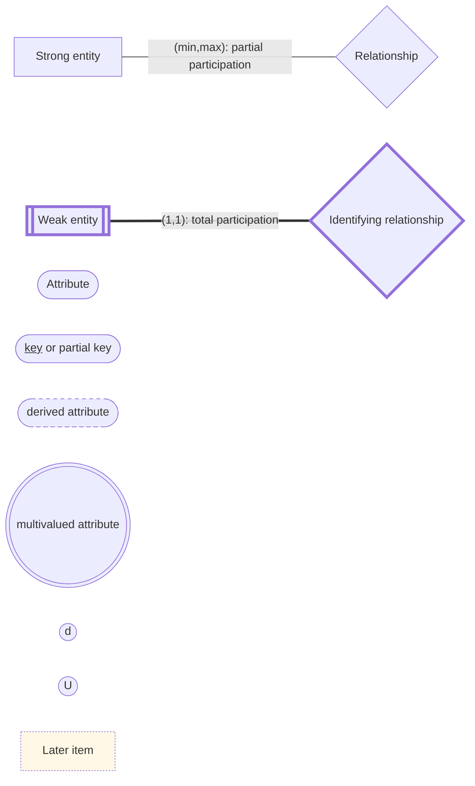
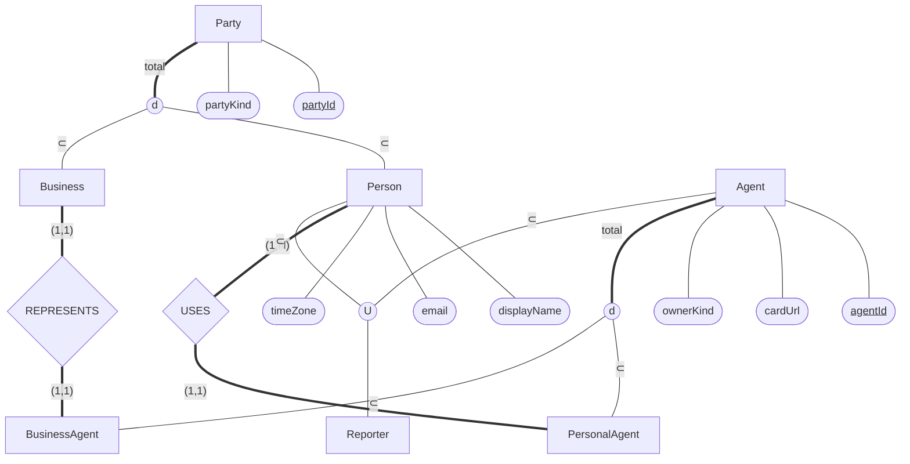
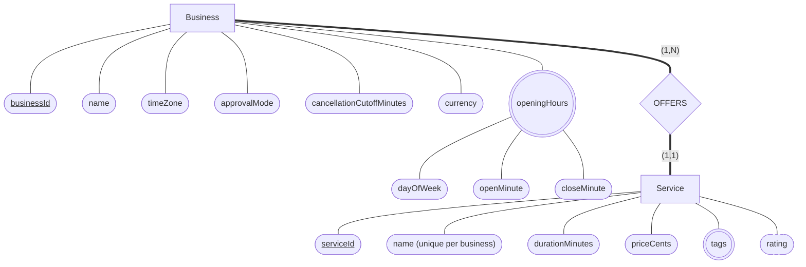
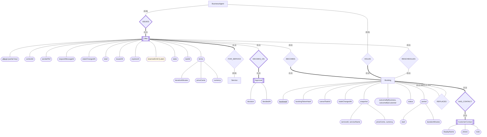
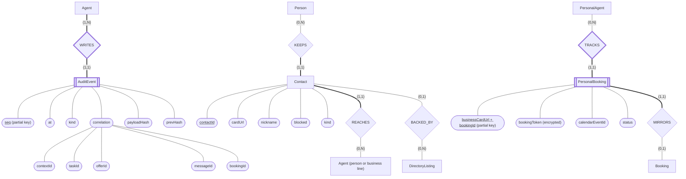
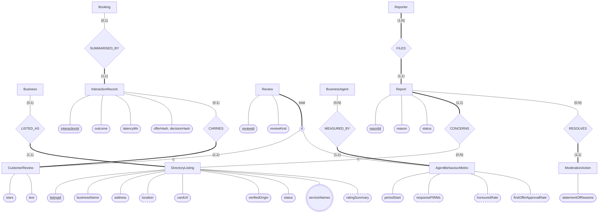
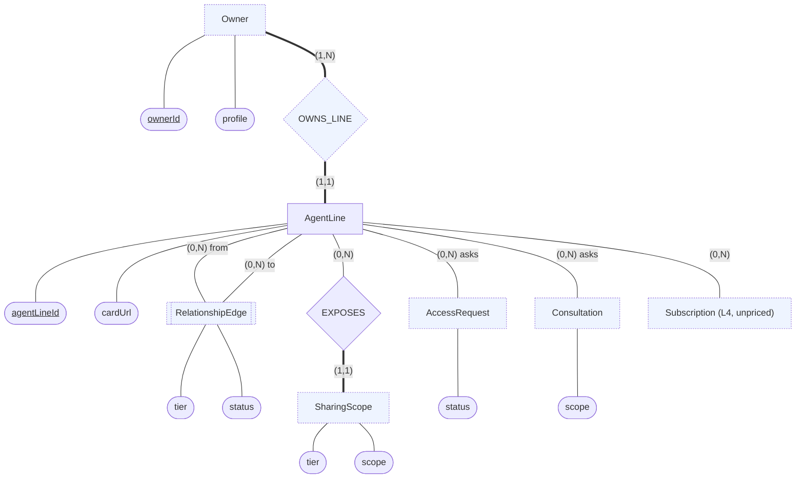
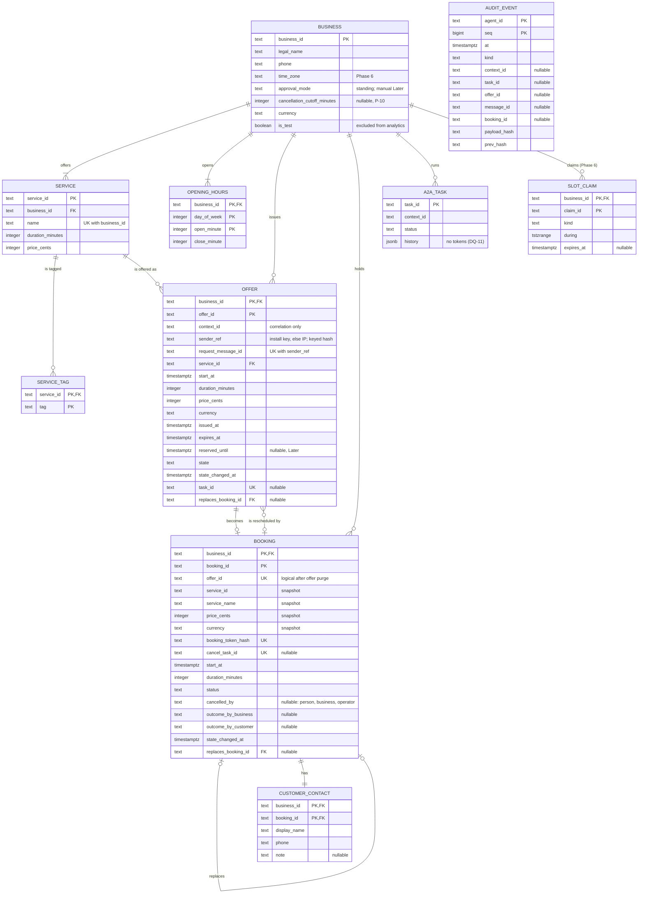
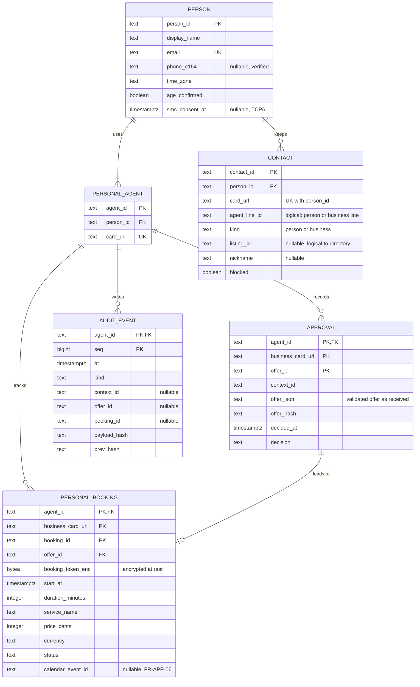
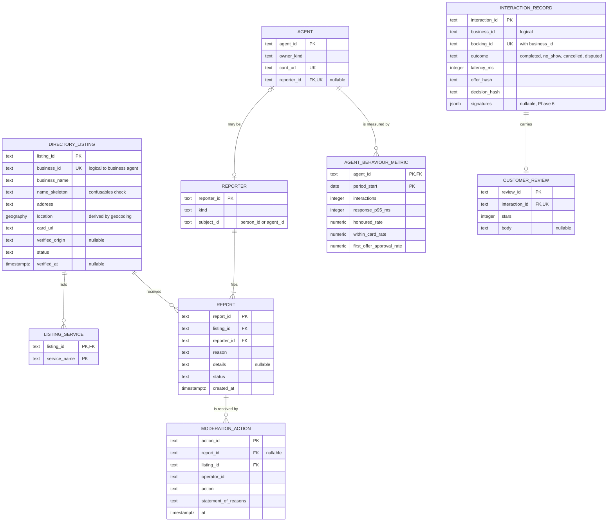

# HP-SAD-22 · Enhanced entity relationship model

| Field       | Value                                                                                         |
| ----------- | --------------------------------------------------------------------------------------------- |
| Document ID | HP-SAD-22                                                                                     |
| Version     | 1.2                                                                                           |
| Status      | Frozen for Phase 2 spike                                                                      |
| Date        | 2026-11-09                                                                                    |
| Owner       | Sanaullah Jannisar, product and engineering lead                                              |
| Conforms to | Elmasri and Navathe EER notation; Chen ER notation; ISO/IEC 9075 SQL for the DDL in section 7 |

## 1. Purpose and scope

[08 Data design](08-data-design.md) gives the entity list, owners and storage by phase, and [09 Data dictionary](09-data-dictionary.md) defines every attribute, type and enumeration. This document adds the full enhanced entity relationship (EER) treatment: a conceptual model in Chen notation with participation constraints, specialization and categories; a logical model per store; the EER-to-relational mapping; normalization; integrity rules and DDL; access paths; and a privacy overlay.

Names follow 09 exactly. Conceptual names are in `camelCase`; relational names are in `snake_case` (09 §2). Values such as hold times and retention periods are never restated: they are cited by P-ID from [00 §10](00-document-control.md#10-normative-parameters-and-phase-map).

Version 1.0 proposed these items as resolutions of open findings in the [SA&D review record](../audits/2026-11-09-sad-review.md). Round 3 adopted all of them, and they are now baselined in [08](08-data-design.md) and [09](09-data-dictionary.md) version 1.3:

| Item                                                              | Resolves                                                                  | Status (round 3)                                                 |
| ----------------------------------------------------------------- | ------------------------------------------------------------------------- | ---------------------------------------------------------------- |
| `CustomerContact` (weak entity of `Booking`)                      | O-4: the business saw no customer name or contact                         | Phase 2; replaces the pseudonymous `customerRef`                 |
| `PersonalBooking` (weak entity of `PersonalAgent`)                | O-8: no personal-side booking record                                      | Phase 2                                                          |
| `AuditEvent.bookingId`                                            | O-8: the audit entity lacked `bookingId`                                  | Phase 2                                                          |
| `Offer.senderRef` and `Offer.requestMessageId`                    | P-07 per-sender cap; de-duplication of retried questions                  | Phase 2; sender is the install key, else the client IP           |
| `ModerationAction`                                                | FR-ADMIN-02 needed a store                                                | Phase 5                                                          |
| `InteractionOutcome` without `rejected`                           | O-8: one record per booking, and a rejected request has no booking        | Phase 5; rejected requests are counted from audit events instead |
| `Service.serviceId` surrogate key                                 | A renamed service broke offers and cascades                               | Phase 2                                                          |
| Booking snapshot of service, price and currency; `stateChangedAt` | Booking evidence lost when offers are purged; the purge job had no column | Phase 2                                                          |
| SDK task table (`a2a_task`)                                       | The SDK's table held message history outside the model and retention      | Phase 2; derived cache, purged with its offer or booking         |

Hitchpost is a network of agent lines between users. An **agent** in this model is an agent line: every person and every business has one, and a person's contact can point at either kind (UC-11).

## 2. Conceptual EER model

### 2.1 Notation

I draw Chen notation in Mermaid flowcharts, so a few symbols are approximated. The legend applies to every diagram in this section.



- **Weak entity:** a double-bordered rectangle (`[[ ]]` with a heavy border). **Identifying relationship:** a heavy-bordered diamond.
- **Attributes:** ovals. A key is underlined; a weak entity's partial key is underlined and named "partial key". Derived attributes have a dashed border; multivalued attributes have a double circle. A composite attribute is an oval with its component ovals attached.
- **Participation:** every edge carries `(min,max)`, read as "each instance of the entity on this edge takes part in at least min and at most max relationship instances". A heavy line marks total participation (min at least 1).
- **Specialization:** a circle with `d` (disjoint) or `o` (overlapping). A heavy line from the superclass to the circle marks total specialization. **Category (union type):** a circle with `U`.
- **Later:** a dotted, shaded box marks something designed but scheduled Later (for example manual approval's `reservedUntil`).

### 2.2 Parties, agents and the reporter category



- **Party** is the generalization of the two kinds of real-world party. The specialization is disjoint (a party is a person or a business, never both) and total (there are no other parties). The defining attribute is `partyKind`.
- **Agent** specializes into `PersonalAgent` and `BusinessAgent`, disjoint and total, on `ownerKind` (the attribute 08 already carries).
- **REPRESENTS** is 1:1 with total participation on both sides: a business exists in Hitchpost only through its agent, and a business agent represents exactly one business. In Phase 6 one hosted business agent maps to one subdomain (00 §10.2).
- **USES** is 1:N: every person has at least the built-in personal agent (FR-APP-03) and may connect others. Each personal agent acts for exactly one person.
- **Agent lines between users.** Contacts point at agents of either kind (REACHES in 2.5), so person-to-person agreement (UC-11) and person-to-business booking use one model.
- **Reporter** is a real category. Anyone can report an agent (FR-ADMIN-01), and "anyone" in practice is a signed-in person or an agent. A `Reporter` is a subset of the union of `Person` and `Agent`, and the category is partial: most persons and agents never report anything.

### 2.3 Business catalogue: services and opening hours



- **openingHours** is a multivalued composite attribute of `Business`: a business has one or more intervals, each made of `dayOfWeek`, `openMinute` and `closeMinute`. Minutes of the local day replace whole hours from Phase 6 (FR-BOOK-05, ADR 0018). A multivalued attribute allows split shifts (closed for lunch) as two intervals on the same day.
- **Service** is a strong entity keyed by the surrogate `serviceId`, so renaming a service never changes its key or breaks offers that refer to it. Its `name` stays unique within its business (09 §5.1). Every business offers at least one service (total participation); each service belongs to exactly one business.
- **tags** is multivalued ("fade", "beard", "kids") and feeds directory search by service (FR-DIR-02).
- **rating** is derived: the mean `stars` of customer reviews on interactions whose booking was for this service. It is computed by the ratings service and never stored on the business side.

### 2.4 Booking lifecycle



- **Offer** is a weak entity of `BusinessAgent`. Its `offerId` is a random UUID and so unique on its own, but an offer has no meaning outside the agent that issued it: the agent stores it, holds the slot and is the only party that can honour it (FR-BOOK-01). I model it as weak to make that existence dependency explicit and to give the Phase 6 key `(businessId, offerId)`, matching `slot_claims` (08 §4). `terms` is a composite attribute: the contract terms the person approves and the business must honour.
- **Approval** is a weak entity of `Offer`, stored only on the personal side (08 §2). DECIDES_ON is 1:1: an approval names exactly one offer (FR-GATE-02), and an offer gets at most one decision. A candidate ternary relationship, Person decides Offer with Decision, was reified into this weak entity so the decision can carry its own attributes and audit hash.
- **BECOMES** is 1:1 with total participation on the booking side: every booking comes from exactly one offer (unique `offerId`, 08 §3), and most offers never become bookings.
- **HOLDS** is redundant with BECOMES plus ISSUES at the conceptual level, but it survives offer purging. Offers are deleted after P-11 while bookings live for P-12, so a booking must belong to its business directly.
- **REPLACES** is a recursive 1:1 relationship between an old and a new booking (atomic swap in a reschedule, FR-BOOK-11). **RESCHEDULES** links the offer that answered a `reschedule_request` to the booking it would replace (`replacesBookingId`).
- **Booking snapshot.** A booking copies the service id and name, price and currency from its offer at confirmation, so the record of what was booked survives the offer purge (P-11). `stateChangedAt` drives the purge and the outcome resolver (P-25). The two outcome attributes hold the business's mark and the customer's answer; the booking's status resolves from them (09 §6).
- **CustomerContact** is a weak entity of `Booking`, with total participation on both sides: every booking made through Hitchpost carries the person's contact block, sent only after approval in the `booking_request`. It is Sensitive and deleted with its booking (P-12).

### 2.5 Audit, contacts and the personal side



- **AuditEvent** is weak: its key is the writing agent plus a sequence number that only increases within that agent's log (09 §5.3). Every agent writes at least one event (its first offer or decision). The correlation fields are a composite attribute logged from Phase 2 (FR-MSG-11).
- **Contact** belongs to exactly one person and REACHES exactly one agent line, which may be another person's (UC-11) or a business's. `kind` records which. BACKED_BY is optional on both sides: a person's line or an agent added by URL has no listing (FR-APP-01), and most listings are nobody's contact.
- **PersonalBooking** is the person's copy of a confirmed booking, weak under the personal agent. Its partial key is `businessCardUrl` plus `bookingId`, because `bookingId` is unique only per business. It keeps the `bookingToken` the business returned (encrypted at rest, since the person needs the token itself to cancel or reschedule), and the calendar event written by FR-APP-06. **MIRRORS** is a logical, cross-store 1:1 relationship: the business never sees the personal record.

### 2.6 Directory, ratings and moderation



- **LISTED_AS:** a business may be unlisted (self-hosted agent reached by URL); a listing always belongs to exactly one business. `location` is derived by geocoding `address`. `serviceNames` is a multivalued copy of the public service names, refreshed from the agent card, used by search (FR-DIR-02). `ratingSummary` is derived from reviews and metrics (FR-DIR-05).
- **SUMMARISED_BY:** one interaction record per booking (08 §2), accepted only when both sides' hashes match (FR-RATE-01, Phase 5). Its `outcome` is `completed`, `no_show`, `cancelled` or `disputed`; there is no `rejected`, because a rejected request never had a booking.
- **Review** generalizes two different kinds of rating that the listing shows separately (FR-RATE-03): human `CustomerReview` (one per interaction, 08 §1) and computed `AgentBehaviourMetric` (FR-RATE-02, one per agent per period). The specialization is disjoint and total on `reviewKind`.
- **Reporter** FILES reports (a reporter exists only because of a report: total). Each report CONCERNS one listing.
- **ModerationAction** records what an operator did about a report (suspend, dismiss, reinstate, remove a review, delist) with a statement of reasons and an appeal route, for the audit trail in FR-ADMIN-02 (Phase 5).

### 2.7 Network slice (Later, L1 to L4)

Conceptual only, frozen until the Phase 2 spike's evidence is in. It shows how the network vision (agent families, relationship tiers, sharing scopes, consultation) sits on the same parties and agent lines, so the Phase 2 to 6 schema leaves room for it. Attributes are in [09 §5.4](09-data-dictionary.md#54-network-entities-later-l1-to-l3-subscription-l4-unpriced).



- **RelationshipEdge** is an associative entity: it resolves the M:N relationship "agent line relates to agent line" and carries its own attributes (`tier`, `status`). Its key is the ordered pair (`fromLineId`, `toLineId`); a `friend` edge needs the matching edge in the other direction. Tiers, most trusted first: `owner`, `friend`, `subscriber` (Later, unpriced), `follower`, `public`; `blocked` is a status, not a tier (09 §6).
- **OWNS_LINE** forms the agent family: every line in it is tier `owner` to the others (L1).
- **SharingScope** is what a line exposes to each tier; it is enforced by policy, not by a model (L2). **AccessRequest** and **Consultation** are logged so the owner sees who asked what (L2, L3). **Subscription** is L4 and has no price attributes.

## 3. Relationship catalogue

Cardinality ratio is read left to right. Participation: T total, P partial, for the left then the right entity.

| Relationship               | Entities                            | Ratio             | Participation | Attributes                     | Identifying | Stored by                       | Status            |
| -------------------------- | ----------------------------------- | ----------------- | ------------- | ------------------------------ | ----------- | ------------------------------- | ----------------- |
| RELATES (RelationshipEdge) | AgentLine, AgentLine                | M:N               | P, P          | tier, status                   | No          | Relationship graph service      | Later (L2)        |
| REPRESENTS                 | Business, BusinessAgent             | 1:1               | T, T          |                                | No          | Business agent (its own config) | Built             |
| USES                       | Person, PersonalAgent               | 1:N               | T, T          |                                | No          | App                             | Phase 4           |
| OFFERS                     | Business, Service                   | 1:N               | T, T          |                                | No          | Business agent                  | Built (as `Book`) |
| ISSUES                     | BusinessAgent, Offer                | 1:N               | P, T          |                                | Yes         | Business agent                  | Phase 2           |
| FOR_SERVICE                | Offer, Service                      | N:1               | T, P          | Snapshot of terms on the offer | No          | Business agent                  | Phase 2           |
| DECIDES_ON                 | Offer, Approval                     | 1:1               | P, T          |                                | Yes         | Personal agent                  | Phase 2           |
| BECOMES                    | Offer, Booking                      | 1:1               | P, T          |                                | No          | Business agent                  | Phase 2           |
| HOLDS                      | BusinessAgent, Booking              | 1:N               | P, T          |                                | No          | Business agent                  | Built (as `Book`) |
| REPLACES                   | Booking (old), Booking (new)        | 1:1 (recursive)   | P, P          |                                | No          | Business agent                  | Phase 2           |
| RESCHEDULES                | Offer, Booking                      | 1:1               | P, P          |                                | No          | Business agent                  | Phase 2           |
| HAS_CONTACT                | Booking, CustomerContact            | 1:1               | T, T          |                                | Yes         | Business agent                  | Phase 2           |
| WRITES                     | Agent, AuditEvent                   | 1:N               | T, T          |                                | Yes         | Each side, its own log          | Phase 2           |
| KEEPS                      | Person, Contact                     | 1:N               | P, T          |                                | No          | App                             | Phase 4           |
| BACKED_BY                  | Contact, DirectoryListing           | N:1               | P, P          |                                | No          | App (logical reference)         | Phase 4           |
| TRACKS                     | PersonalAgent, PersonalBooking      | 1:N               | P, T          |                                | Yes         | Personal agent                  | Phase 2           |
| MIRRORS                    | PersonalBooking, Booking            | 1:1 (cross-store) | T, P          |                                | No          | Logical only                    | Phase 2           |
| REACHES                    | Contact, Agent                      | N:1               | T, P          |                                | No          | App (logical reference)         | Phase 4           |
| LISTED_AS                  | Business, DirectoryListing          | 1:1               | P, T          |                                | No          | Directory                       | Phase 3           |
| SUMMARISED_BY              | Booking, InteractionRecord          | 1:1               | P, T          |                                | No          | Ratings service                 | Phase 5           |
| CARRIES                    | InteractionRecord, CustomerReview   | 1:1               | P, T          |                                | No          | Ratings service                 | Phase 5           |
| MEASURED_BY                | BusinessAgent, AgentBehaviourMetric | 1:N               | P, T          |                                | No          | Ratings service                 | Phase 5           |
| FILES                      | Reporter, Report                    | 1:N               | T, T          |                                | No          | Directory                       | Phase 5           |
| CONCERNS                   | Report, DirectoryListing            | N:1               | T, P          |                                | No          | Directory                       | Phase 5           |
| RESOLVES                   | Report, ModerationAction            | 1:N               | P, T          |                                | No          | Directory                       | Phase 5           |

## 4. Specialization and category catalogue

| Superclass          | Subclasses                           | Disjoint or overlapping | Total or partial | Defining attribute | Mapping option (section 6, step 8 or 9)                                                                           | Why                                                                                                                                                  |
| ------------------- | ------------------------------------ | ----------------------- | ---------------- | ------------------ | ----------------------------------------------------------------------------------------------------------------- | ---------------------------------------------------------------------------------------------------------------------------------------------------- |
| Party               | Person, Business                     | Disjoint                | Total            | `partyKind`        | 8B: one relation per subclass, no `party` relation                                                                | The subclasses live in different stores (app vs business agent and directory) and share only the key; a superclass table would be a cross-store join |
| Agent               | PersonalAgent, BusinessAgent         | Disjoint                | Total            | `ownerKind`        | 8C: one `agent` relation with a type attribute (directory registry); each agent's own store keeps only its own id | Few subclass-specific attributes; the registry needs to list both kinds together                                                                     |
| Review              | CustomerReview, AgentBehaviourMetric | Disjoint                | Total            | `reviewKind`       | 8B: separate relations                                                                                            | No shared attributes besides the key; one is human text, the other a computed aggregate with a different grain                                       |
| Reporter (category) | Person, Agent (union)                | Category                | Partial          | `kind`             | 9: surrogate `reporter_id` relation, referenced from the reporting side                                           | The defining superclasses have different keys in different stores                                                                                    |

## 5. Logical EERD per store

Types are SQL types. `PK` primary key, `FK` foreign key, `UK` unique. A reference to another store is a logical reference in a comment, never a constraint (08 §1).

### 5.1 Business-agent store

Phase 2: one SQLite file per business agent, holding these tables and the SDK's `DatabaseTaskStore` table (`a2a_task`, created by `a2a-db`). Phase 6: Postgres shared by hosted agents, every table keyed by `business_id` (one tenant per business) with row-level security. The types below are the Phase 6 Postgres types; in SQLite every timestamp is an INTEGER of epoch milliseconds (§8.5).



`A2A_TASK` is the SDK's own table, shown so it is covered by retention and the privacy overlay. Bookings are the source of truth; task rows are rebuilt from `booking` and `offer` at startup (08 §4).

### 5.2 Personal-side store

Phase 2: the personal agent CLI keeps an append-only JSONL audit file and a JSONL personal booking file (the `bookingToken` sealed at rest). Phase 4: Postgres in the app, one schema shared by all people, every row keyed by the person's agent.



`APPROVAL` is keyed by the business agent's card URL as well as `offer_id`: a person's agent talks to many businesses, and offer ids are only guaranteed unique per business on the receiving side.

### 5.3 Directory and ratings store

Phase 3 (directory) and Phase 5 (ratings): Postgres. The directory and the ratings service share one database in v1 (hosting option in proposed ADR 0014) but own separate tables.



### 5.4 Phase 2 versus Phase 6

| Aspect               | Phase 2                                                                                                | Phase 6                                                                                           |
| -------------------- | ------------------------------------------------------------------------------------------------------ | ------------------------------------------------------------------------------------------------- |
| Business-agent store | One SQLite file per agent; `business_id` present but single-valued                                     | Postgres shared by hosted agents; `business_id` leads every key (tenant isolation)                |
| Overlap guarantee    | Single process: check and write in one `BEGIN IMMEDIATE` SQLite transaction (WAL mode, `busy_timeout`) | `slot_claims` exclusion constraint across instances (08 §4)                                       |
| Durability           | Litestream (or nightly `VACUUM INTO`) backup, restore drill before Phase 2 exit                        | Managed Postgres backups (P-15)                                                                   |
| Isolation            | One file per business agent                                                                            | One database role per context; row-level security on `business_id`                                |
| Time                 | INTEGER epoch milliseconds with a range CHECK (SQLite has no time type)                                | `timestamptz`; opening hours in the shop's IANA zone (ADR 0018)                                   |
| Personal side        | JSONL audit file, approvals and bookings as events                                                     | Postgres in the app (Phase 4 onwards)                                                             |
| Audit immutability   | SQLite triggers refuse `UPDATE` and `DELETE` except by the retention job                               | Role grants: the application role has `INSERT` and `SELECT` only; the retention role may `DELETE` |
| Geo search           | Not applicable                                                                                         | Geography index for `location` (PostGIS proposed, to record in ADR 0014)                          |

## 6. EER-to-relational mapping

I applied the nine-step algorithm (Elmasri and Navathe). Relation schemas use **bold** for the primary key and _italic_ for foreign keys.

| Step | Rule                                             | Applied to                                                                                                                                           | Result                                                                                                                                                                                                                                                                                                      |
| ---- | ------------------------------------------------ | ---------------------------------------------------------------------------------------------------------------------------------------------------- | ----------------------------------------------------------------------------------------------------------------------------------------------------------------------------------------------------------------------------------------------------------------------------------------------------------- |
| 1    | Strong entity: one relation                      | Business, Person, Agent, Service, Booking, Contact, DirectoryListing, InteractionRecord, Report, ModerationAction                                    | `business`, `person`, `agent`, `booking`, `contact`, `directory_listing`, `interaction_record`, `report`, `moderation_action`; composite attributes flattened (`terms`, `period`, `correlation`)                                                                                                            |
| 2    | Weak entity: owner key plus partial key          | Offer, Approval, AuditEvent, CustomerContact, PersonalBooking                                                                                        | `service(`**service_id**`)` is now strong (step 1), `offer(`**business_id, offer_id**`)`, `approval(`**agent_id, business_card_url, offer_id**`)`, `audit_event(`**agent_id, seq**`)`, `customer_contact(`**business_id, booking_id**`)`, `personal_booking(`**agent_id, business_card_url, booking_id**`)` |
| 3    | 1:1 relationships: foreign key on the total side | REPRESENTS, BECOMES, LISTED_AS, SUMMARISED_BY, CARRIES, REPLACES, RESCHEDULES                                                                        | `booking.`*offer_id* (unique), `directory_listing.`*business_id* (unique), `interaction_record.`*booking_id* (unique), `customer_review.`*interaction_id* (unique), `booking.`*replaces_booking_id*, `offer.`*replaces_booking_id*; REPRESENTS merged (the agent's config holds `business_id`)              |
| 4    | 1:N relationships: foreign key on the N side     | USES, HOLDS, FOR_SERVICE, KEEPS, BACKED_BY, MEASURED_BY, FILES, CONCERNS, RESOLVES                                                                   | `personal_agent.`*person_id*, `booking.`*business_id*, `offer.`*service_id*, `contact.agent_line_id` (logical, REACHES), `contact.`*person_id*, `contact.listing_id` (logical), `agent_behaviour_metric.`*agent_id*, `report.`*reporter_id*, `report.`*listing_id*, `moderation_action.`*report_id*         |
| 5    | M:N relationships: own relation                  | RelationshipEdge (Later, L2): agent line to agent line, an associative entity with `tier` and `status` (2.7); none in the Phase 1 to 6 booking model | Service to tag and listing to service name are multivalued attributes, handled in step 6                                                                                                                                                                                                                    |
| 6    | Multivalued attributes: own relation             | `openingHours`, `tags`, `serviceNames`                                                                                                               | `opening_hours(`**business_id, day_of_week, open_minute**`, close_minute)`, `service_tag(`**service_id, tag**`)`, `listing_service(`**listing_id, service_name**`)`                                                                                                                                         |
| 7    | n-ary relationships                              | None: the candidate ternary Person, Offer, Decision was reified as weak entity Approval (2.4)                                                        | No relation                                                                                                                                                                                                                                                                                                 |
| 8    | Specialization                                   | Party (8B), Agent (8C), Review (8B)                                                                                                                  | No `party` relation; `agent(`**agent_id**`, owner_kind, card_url, ...)`; `customer_review` and `agent_behaviour_metric` as separate relations                                                                                                                                                               |
| 9    | Categories                                       | Reporter                                                                                                                                             | `reporter(`**reporter_id**`, kind, subject_id)`, with `agent.`*reporter_id* for agents and the person's `reporter_id` held by the directory account                                                                                                                                                         |

Resulting schemas, business-agent store:

- `business(`**business_id**`, legal_name, phone, time_zone, approval_mode, cancellation_cutoff_minutes, currency, is_test)`
- `service(`**service_id**`, `*business_id*`, name, duration_minutes, price_cents)`, unique `(business_id, name)`
- `service_tag(`**_service_id_**`, `**tag**`)`
- `opening_hours(`**_business_id_**`, `**day_of_week, open_minute**`, close_minute)`
- `offer(`**_business_id_**`, `**offer_id**`, context_id, sender_ref, request_message_id, `*service_id*`, start_at, duration_minutes, price_cents, currency, issued_at, expires_at, reserved_until, state, state_changed_at, task_id, `*replaces_booking_id*`)`, unique `(business_id, sender_ref, request_message_id)`
- `booking(`**_business_id_**`, `**booking_id**`, offer_id, service_id, service_name, price_cents, currency, booking_token_hash, cancel_task_id, start_at, duration_minutes, status, outcome_by_business, outcome_by_customer, state_changed_at, `*replaces_booking_id*`)`
- `customer_contact(`**_business_id, booking_id_**`, display_name, phone, note)`
- `a2a_task(`**task_id**`, context_id, status, history)`: the SDK's table, a derived cache (08 §4)
- `audit_event(`**agent_id, seq**`, at, kind, context_id, task_id, offer_id, message_id, booking_id, payload_hash, prev_hash)`
- `slot_claims(`**_business_id_**`, `**claim_id**`, kind, during, expires_at)` (Phase 6, 08 §4)

Personal side and directory: as in the diagrams in 5.2 and 5.3.

## 7. Normalization

For each relation I list the non-trivial functional dependencies (FDs) and check that every determinant is a candidate key (BCNF).

| Relation                                                              | Functional dependencies                                                                                                             | Candidate keys                                                                             | Normal form     |
| --------------------------------------------------------------------- | ----------------------------------------------------------------------------------------------------------------------------------- | ------------------------------------------------------------------------------------------ | --------------- |
| `business`                                                            | business_id → all                                                                                                                   | business_id                                                                                | BCNF            |
| `service`                                                             | service_id → all; (business_id, name) → service_id                                                                                  | service_id; (business_id, name)                                                            | BCNF            |
| `service_tag`                                                         | none besides the key                                                                                                                | all three attributes                                                                       | BCNF            |
| `opening_hours`                                                       | (business_id, day_of_week, open_minute) → close_minute                                                                              | (business_id, day_of_week, open_minute)                                                    | BCNF            |
| `offer`                                                               | (business_id, offer_id) → all; task_id → (business_id, offer_id); (business_id, sender_ref, request_message_id) → offer_id          | (business_id, offer_id); task_id (when set); (business_id, sender_ref, request_message_id) | BCNF            |
| `booking`                                                             | (business_id, booking_id) → all; (business_id, offer_id) → booking_id; booking_token_hash → booking_id; cancel_task_id → booking_id | (business_id, booking_id); (business_id, offer_id); booking_token_hash; cancel_task_id     | BCNF            |
| `customer_contact`                                                    | (business_id, booking_id) → display_name, phone, note                                                                               | (business_id, booking_id)                                                                  | BCNF            |
| `audit_event`                                                         | (agent_id, seq) → all                                                                                                               | (agent_id, seq)                                                                            | BCNF            |
| `approval`                                                            | (agent_id, business_card_url, offer_id) → all; offer_json → offer_hash                                                              | (agent_id, business_card_url, offer_id)                                                    | 3NF (see below) |
| `personal_booking`                                                    | (agent_id, business_card_url, booking_id) → all                                                                                     | (agent_id, business_card_url, booking_id)                                                  | BCNF            |
| `contact`                                                             | contact_id → all; (person_id, card_url) → contact_id                                                                                | contact_id; (person_id, card_url)                                                          | BCNF            |
| `directory_listing`                                                   | listing_id → all; business_id → listing_id; address → location                                                                      | listing_id; business_id                                                                    | 3NF (see below) |
| `interaction_record`                                                  | interaction_id → all; (business_id, booking_id) → interaction_id                                                                    | interaction_id; (business_id, booking_id)                                                  | BCNF            |
| `customer_review`                                                     | review_id → all; interaction_id → review_id                                                                                         | review_id; interaction_id                                                                  | BCNF            |
| `agent_behaviour_metric`                                              | (agent_id, period_start) → all                                                                                                      | (agent_id, period_start)                                                                   | BCNF            |
| `report`, `moderation_action`, `reporter`, `agent`, `listing_service` | key → all                                                                                                                           | their primary keys (plus `agent.card_url`)                                                 | BCNF            |

**Deliberate exceptions and copies, with reasons:**

- `approval.offer_hash` depends on `offer_json`, a transitive dependency that breaks BCNF. I keep it because the hash is the attestation value compared across both sides' logs (FR-RATE-01), and recomputing it would require byte-identical JCS canonicalization at read time. A check in code verifies it on write.
- `directory_listing.location` depends on `address` (geocoding). It is stored because search needs a spatial index; it is recomputed whenever `address` changes.
- `offer` copies `duration_minutes`, `price_cents` and `currency` from `service`. This is not redundancy: the offer is a contract snapshot, and `service_name → price_cents` does not hold over time once the shop changes its prices.
- `booking` copies `start_at`, `duration_minutes`, `service_id`, `service_name`, `price_cents` and `currency` from `offer`, because offers are purged after P-11 while bookings live for P-12, and disputes and ratings need to know what was booked and for how much. `service_id → service_name` does not hold over time (services are renamed), so this is a snapshot, not a transitive dependency.
- `a2a_task` is a cache rebuilt from `booking` and `offer` at startup; it is never the record.
- `interaction_record.offer_hash` and `decision_hash` duplicate audit values on purpose: they are the attestation (Phase 5).
- `listing_service` copies public service names from the business agent across stores, refreshed from the agent card; the business agent stays the source of truth.
- `agent_behaviour_metric` holds aggregates. They are derived and fully recomputable from interaction records and audit events, and stored only so the listing renders without a scan.
- `Service.rating` and `DirectoryListing.ratingSummary` are derived and never stored on the business side.

## 8. Integrity constraints and DDL

### 8.1 Keys and uniqueness

- Every primary key in section 6.
- `service.service_id` is a surrogate key; `(business_id, name)` is unique, so a rename is an update, never a new key.
- `offer.task_id` and `booking.cancel_task_id` are unique when set: the idempotency anchors (FR-BOOK-07). A UNIQUE violation on a concurrent duplicate is answered with the `duplicateOf` reply, never an error.
- `(business_id, sender_ref, request_message_id)` is unique in `offer`: a retried `availability_request` returns the existing offer instead of a second hold.
- `(business_id, offer_id)` is unique in `booking`: one booking per offer (08 §3).
- `booking.booking_token_hash` is unique: a token authorises exactly one booking (FR-MSG-12).
- `(person_id, card_url)` is unique in `contact`; `directory_listing.business_id` and `agent.card_url` are unique.

### 8.2 Referential actions

| Foreign key                                                | On delete                         | Reason                                                                                           |
| ---------------------------------------------------------- | --------------------------------- | ------------------------------------------------------------------------------------------------ |
| `service.business_id`, `opening_hours.business_id`         | Cascade                           | Closing the business removes its catalogue                                                       |
| `service_tag.service_id`                                   | Cascade                           | Tags die with their service                                                                      |
| `offer.(business_id, service_id)`                          | Restrict                          | A service can't be removed while held offers refer to it; the owner sees an error and waits P-01 |
| `offer.replaces_booking_id`, `booking.replaces_booking_id` | Set null                          | The old booking may be deleted first under P-12; the link is history, not integrity              |
| `booking.offer_id`, `booking.service_id`                   | No constraint (logical)           | Offers are purged after P-11 and services may be removed; the booking keeps its snapshot         |
| `customer_contact.(business_id, booking_id)`               | Cascade                           | Contact details die with their booking (P-12, NFR-PRIV-02)                                       |
| `contact.person_id`, `personal_agent.person_id`            | Cascade                           | Account deletion (P-13)                                                                          |
| `report.listing_id`                                        | Restrict, then cascade on closure | Reports stay while the listing is under review; a closed listing's resolved reports follow P-14  |
| `moderation_action.report_id`                              | Set null                          | The trail outlives the report (FR-ADMIN-02) until P-14                                           |
| `customer_review.interaction_id`                           | Cascade                           | A review can't exist without its verified interaction (FR-RATE-01)                               |

### 8.3 Check and temporal constraints

- `duration_minutes` between 1 and 1,440 and `price_cents` between 0 and 10,000,000 (P-20); `currency` is three capital letters. The same CHECKs appear in the SQLite and the Postgres DDL.
- `day_of_week` 0 to 6; `0 <= open_minute < close_minute <= 1440`.
- `offer.state`, `booking.status`, `report.status`, `directory_listing.status` take only the values of `OfferState`, `BookingStatus`, `ReportStatus` and `ListingStatus` in 09 §6. The CHECK lists `reserved` already, so manual approval (Later) needs no table rewrite.
- `offer.expires_at > offer.issued_at`, and `expires_at` never changes after insert (13 protocol rules); `issued_at` plus P-01 is set by the application.
- `offer.reserved_until` is not null whenever `state = 'reserved'` (Later).
- `booking.outcome_by_business` is `completed` or `no_show` when set; `booking.outcome_by_customer` is a `CustomerOutcomeAnswer` when set.
- SQLite timestamps are INTEGER epoch milliseconds, `>= 0`; text timestamps are refused by type affinity checks (`typeof(x) = 'integer'`).
- `customer_review.stars` between 1 and 5.
- No two `slot_claims` of a business overlap in time (08 §4). Before Phase 6 the same rule is kept by the single `BEGIN IMMEDIATE` transaction (08 §3).

### 8.4 Phase 6 Postgres DDL (core business-agent tables)

`slot_claims` is defined in [08 §4](08-data-design.md#4-storage-by-phase) and not repeated here.

```sql
CREATE TABLE business (
  business_id                 text PRIMARY KEY,
  legal_name                  text NOT NULL,
  phone                       text NOT NULL CHECK (phone ~ '^\+[0-9]{8,15}$'),
  time_zone                   text NOT NULL,                 -- IANA zone, ADR 0018
  approval_mode               text NOT NULL DEFAULT 'standing' CHECK (approval_mode IN ('standing','manual')),
  cancellation_cutoff_minutes integer CHECK (cancellation_cutoff_minutes >= 0),   -- P-10
  currency                    text NOT NULL CHECK (currency ~ '^[A-Z]{3}$'),
  is_test                     boolean NOT NULL DEFAULT false
);

CREATE TABLE service (
  service_id       text PRIMARY KEY,
  business_id      text NOT NULL REFERENCES business ON DELETE CASCADE,
  name             text NOT NULL,
  duration_minutes integer NOT NULL CHECK (duration_minutes BETWEEN 1 AND 1440),       -- P-20
  price_cents      integer NOT NULL CHECK (price_cents BETWEEN 0 AND 10000000),        -- P-20
  UNIQUE (business_id, name),
  UNIQUE (business_id, service_id)
);

CREATE TABLE service_tag (
  service_id text NOT NULL REFERENCES service ON DELETE CASCADE,
  tag        text NOT NULL,
  PRIMARY KEY (service_id, tag)
);

CREATE TABLE opening_hours (
  business_id  text NOT NULL REFERENCES business ON DELETE CASCADE,
  day_of_week  smallint NOT NULL CHECK (day_of_week BETWEEN 0 AND 6),
  open_minute  smallint NOT NULL,
  close_minute smallint NOT NULL,
  PRIMARY KEY (business_id, day_of_week, open_minute),
  CHECK (0 <= open_minute AND open_minute < close_minute AND close_minute <= 1440)
);

CREATE TABLE offer (
  business_id         text NOT NULL,
  offer_id            text NOT NULL,
  context_id          text NOT NULL,                          -- correlation only
  sender_ref          text NOT NULL,                          -- keyed hash of install key, else IP (P-07)
  request_message_id  text NOT NULL,
  service_id          text NOT NULL,
  start_at            timestamptz NOT NULL,
  duration_minutes    integer NOT NULL CHECK (duration_minutes BETWEEN 1 AND 1440),
  price_cents         integer NOT NULL CHECK (price_cents BETWEEN 0 AND 10000000),
  currency            text NOT NULL CHECK (currency ~ '^[A-Z]{3}$'),
  issued_at           timestamptz NOT NULL,
  expires_at          timestamptz NOT NULL CHECK (expires_at > issued_at),             -- issued_at + P-01
  reserved_until      timestamptz,                                                     -- Later
  state               text NOT NULL CHECK (state IN ('held','booked','declined','expired','released','reserved')), -- 'reserved' is Later (manual approval)
  state_changed_at    timestamptz NOT NULL,
  task_id             text UNIQUE,
  replaces_booking_id text,
  PRIMARY KEY (business_id, offer_id),
  UNIQUE (business_id, sender_ref, request_message_id),
  FOREIGN KEY (business_id, service_id) REFERENCES service (business_id, service_id) ON DELETE RESTRICT,
  CHECK (state <> 'reserved' OR reserved_until IS NOT NULL)
);

CREATE TABLE booking (
  business_id         text NOT NULL REFERENCES business ON DELETE CASCADE,
  booking_id          text NOT NULL,
  offer_id            text NOT NULL,                          -- logical: offers are purged first (P-11)
  service_id          text NOT NULL,                          -- snapshot
  service_name        text NOT NULL,                          -- snapshot
  price_cents         integer NOT NULL CHECK (price_cents BETWEEN 0 AND 10000000),
  currency            text NOT NULL CHECK (currency ~ '^[A-Z]{3}$'),
  booking_token_hash  text NOT NULL UNIQUE,
  cancel_task_id      text UNIQUE,
  start_at            timestamptz NOT NULL,
  duration_minutes    integer NOT NULL CHECK (duration_minutes BETWEEN 1 AND 1440),
  status              text NOT NULL CHECK (status IN ('confirmed','cancelled','rescheduled','awaiting_outcome','completed','no_show','disputed','unresolved')),
  cancelled_by        text CHECK (cancelled_by IN ('person','business','operator')),
  outcome_by_business text CHECK (outcome_by_business IN ('completed','no_show')),
  outcome_by_customer text CHECK (outcome_by_customer IN ('as_booked','not_as_booked','did_not_go')),
  state_changed_at    timestamptz NOT NULL,
  replaces_booking_id text,
  PRIMARY KEY (business_id, booking_id),
  UNIQUE (business_id, offer_id),
  FOREIGN KEY (business_id, replaces_booking_id) REFERENCES booking (business_id, booking_id) ON DELETE SET NULL (replaces_booking_id)
);

ALTER TABLE offer ADD FOREIGN KEY (business_id, replaces_booking_id)
  REFERENCES booking (business_id, booking_id) ON DELETE SET NULL (replaces_booking_id);

CREATE TABLE customer_contact (
  business_id  text NOT NULL,
  booking_id   text NOT NULL,
  display_name text NOT NULL,
  phone        text NOT NULL CHECK (phone ~ '^\+[0-9]{8,15}$'),
  note         text,
  PRIMARY KEY (business_id, booking_id),
  FOREIGN KEY (business_id, booking_id) REFERENCES booking ON DELETE CASCADE
);

CREATE TABLE audit_event (
  agent_id     text NOT NULL,
  seq          bigint NOT NULL,
  at           timestamptz NOT NULL,
  kind         text NOT NULL,
  context_id   text,
  task_id      text,
  offer_id     text,
  message_id   text,
  booking_id   text,
  payload_hash text NOT NULL,
  prev_hash    text NOT NULL,
  PRIMARY KEY (agent_id, seq)
);

-- One role per context (ADR 0019); the agent host's role sees only its tenant's rows.
ALTER TABLE booking ENABLE ROW LEVEL SECURITY;
CREATE POLICY booking_tenant ON booking USING (business_id = current_setting('hitchpost.business_id'));
-- (the same policy on offer, customer_contact, opening_hours, service)
-- Append-only: the application role may only insert and read; the retention role may delete (P-12).
REVOKE UPDATE, DELETE ON audit_event FROM hitchpost_agent_host;
```

`SET NULL (replaces_booking_id)` is the column-list form from Postgres 15, needed because the composite foreign key's first column is part of the primary key. `seq` is allocated under a per-log advisory lock (`pg_advisory_xact_lock(hashtext(agent_id))`) so concurrent writers can't take the same number.

### 8.5 Phase 2 SQLite DDL (single business agent)

Same tables, same CHECKs, with SQLite types: every timestamp is an INTEGER of epoch milliseconds. The migration runner opens the file with WAL mode and a busy timeout, and every write that touches offers, bookings or the audit log runs in `BEGIN IMMEDIATE`, which serialises writers and makes `seq` allocation safe.

```sql
PRAGMA journal_mode = WAL;
PRAGMA busy_timeout = 5000;
PRAGMA foreign_keys = ON;

CREATE TABLE business (
  business_id                 TEXT PRIMARY KEY,
  legal_name                  TEXT NOT NULL,
  phone                       TEXT NOT NULL CHECK (phone GLOB '+[0-9]*' AND length(phone) BETWEEN 9 AND 16),
  approval_mode               TEXT NOT NULL DEFAULT 'standing' CHECK (approval_mode IN ('standing','manual')),
  cancellation_cutoff_minutes INTEGER CHECK (cancellation_cutoff_minutes >= 0),
  currency                    TEXT NOT NULL CHECK (currency GLOB '[A-Z][A-Z][A-Z]'),
  is_test                     INTEGER NOT NULL DEFAULT 0 CHECK (is_test IN (0,1))
);

CREATE TABLE service (
  service_id       TEXT PRIMARY KEY,
  business_id      TEXT NOT NULL REFERENCES business ON DELETE CASCADE,
  name             TEXT NOT NULL,
  duration_minutes INTEGER NOT NULL CHECK (duration_minutes BETWEEN 1 AND 1440),
  price_cents      INTEGER NOT NULL CHECK (price_cents BETWEEN 0 AND 10000000),
  UNIQUE (business_id, name),
  UNIQUE (business_id, service_id)
);

CREATE TABLE opening_hours (
  business_id  TEXT NOT NULL REFERENCES business ON DELETE CASCADE,
  day_of_week  INTEGER NOT NULL CHECK (day_of_week BETWEEN 0 AND 6),
  open_minute  INTEGER NOT NULL,
  close_minute INTEGER NOT NULL,
  PRIMARY KEY (business_id, day_of_week, open_minute),
  CHECK (0 <= open_minute AND open_minute < close_minute AND close_minute <= 1440)
);

CREATE TABLE offer (
  business_id         TEXT NOT NULL,
  offer_id            TEXT NOT NULL,
  context_id          TEXT NOT NULL,
  sender_ref          TEXT NOT NULL,
  request_message_id  TEXT NOT NULL,
  service_id          TEXT NOT NULL,
  start_ms            INTEGER NOT NULL CHECK (typeof(start_ms) = 'integer' AND start_ms >= 0),
  duration_minutes    INTEGER NOT NULL CHECK (duration_minutes BETWEEN 1 AND 1440),
  price_cents         INTEGER NOT NULL CHECK (price_cents BETWEEN 0 AND 10000000),
  currency            TEXT NOT NULL CHECK (currency GLOB '[A-Z][A-Z][A-Z]'),
  issued_ms           INTEGER NOT NULL CHECK (typeof(issued_ms) = 'integer'),
  expires_ms          INTEGER NOT NULL CHECK (expires_ms > issued_ms),
  reserved_until_ms   INTEGER,
  state               TEXT NOT NULL CHECK (state IN ('held','booked','declined','expired','released','reserved')), -- 'reserved' is Later (manual approval)
  state_changed_ms    INTEGER NOT NULL CHECK (typeof(state_changed_ms) = 'integer'),
  task_id             TEXT UNIQUE,
  replaces_booking_id TEXT,
  PRIMARY KEY (business_id, offer_id),
  UNIQUE (business_id, sender_ref, request_message_id),
  FOREIGN KEY (business_id, service_id) REFERENCES service (business_id, service_id) ON DELETE RESTRICT,
  CHECK (state <> 'reserved' OR reserved_until_ms IS NOT NULL)
);

CREATE TABLE booking (
  business_id         TEXT NOT NULL REFERENCES business ON DELETE CASCADE,
  booking_id          TEXT NOT NULL,
  offer_id            TEXT NOT NULL,
  service_id          TEXT NOT NULL,
  service_name        TEXT NOT NULL,
  price_cents         INTEGER NOT NULL CHECK (price_cents BETWEEN 0 AND 10000000),
  currency            TEXT NOT NULL CHECK (currency GLOB '[A-Z][A-Z][A-Z]'),
  booking_token_hash  TEXT NOT NULL UNIQUE,
  cancel_task_id      TEXT UNIQUE,
  start_ms            INTEGER NOT NULL CHECK (typeof(start_ms) = 'integer' AND start_ms >= 0),
  duration_minutes    INTEGER NOT NULL CHECK (duration_minutes BETWEEN 1 AND 1440),
  status              TEXT NOT NULL CHECK (status IN ('confirmed','cancelled','rescheduled','awaiting_outcome','completed','no_show','disputed','unresolved')),
  cancelled_by        TEXT CHECK (cancelled_by IN ('person','business','operator')),
  outcome_by_business TEXT CHECK (outcome_by_business IN ('completed','no_show')),
  outcome_by_customer TEXT CHECK (outcome_by_customer IN ('as_booked','not_as_booked','did_not_go')),
  state_changed_ms    INTEGER NOT NULL CHECK (typeof(state_changed_ms) = 'integer'),
  replaces_booking_id TEXT,
  PRIMARY KEY (business_id, booking_id),
  UNIQUE (business_id, offer_id)
);

CREATE TABLE customer_contact (
  business_id  TEXT NOT NULL,
  booking_id   TEXT NOT NULL,
  display_name TEXT NOT NULL,
  phone        TEXT NOT NULL CHECK (phone GLOB '+[0-9]*' AND length(phone) BETWEEN 9 AND 16),
  note         TEXT,
  PRIMARY KEY (business_id, booking_id),
  FOREIGN KEY (business_id, booking_id) REFERENCES booking ON DELETE CASCADE
);

CREATE TABLE audit_event (
  agent_id     TEXT NOT NULL,
  seq          INTEGER NOT NULL,
  at_ms        INTEGER NOT NULL CHECK (typeof(at_ms) = 'integer'),
  kind         TEXT NOT NULL,
  context_id   TEXT, task_id TEXT, offer_id TEXT, message_id TEXT, booking_id TEXT,
  payload_hash TEXT NOT NULL,
  prev_hash    TEXT NOT NULL,
  PRIMARY KEY (agent_id, seq)
);

CREATE TRIGGER audit_event_no_update BEFORE UPDATE ON audit_event
BEGIN SELECT RAISE(ABORT, 'audit events are append-only'); END;

CREATE TRIGGER offer_expires_fixed BEFORE UPDATE OF expires_ms ON offer
BEGIN SELECT RAISE(ABORT, 'expiresAt never changes'); END;
```

Deletes from `audit_event` happen only in the retention job, which selects rows older than P-12 by `at_ms`. SQLite has no time zone column type and no row-level security; a business agent's file is its own tenant boundary. Opening hours stay UTC until Phase 6 (ADR 0018), so the Phase 2 `business` table has no `time_zone` column.

**Backup and restore.** Litestream streams the WAL to object storage (or, at minimum, a nightly `VACUUM INTO` copy). A restore drill (restore to a new file, open it, run the Task rebuild, compare row counts and the audit chain) is an exit criterion for Phase 2.

### 8.6 Retention as deletion jobs

The daily retention job (event E-14 in [07](07-process-and-behaviour-models.md)) runs these deletions. Each job writes one audit event with the count it removed. Hard deletion by these jobs is the only way bookings leave the store; there is no `deleted` status.

| Job                    | Deletes                                                                                                                              | Parameter |
| ---------------------- | ------------------------------------------------------------------------------------------------------------------------------------ | --------- |
| Purge settled offers   | `offer` rows in `expired`, `declined` or `released` whose `state_changed_at` is older than P-11, with their `a2a_task` rows          | P-11      |
| Expire bookings        | `booking` rows (and by cascade `customer_contact`) whose `start_at` is older than P-12, with their `a2a_task` rows                   | P-12      |
| Expire audit           | `audit_event` rows older than P-12; the hash of the newest deleted row is kept as the new chain anchor so `prev_hash` still verifies | P-12      |
| Expire interactions    | `interaction_record` (and by cascade `customer_review`) older than P-12                                                              | P-12      |
| Expire analytics       | Analytics events older than P-12; the weekly snapshot table keeps aggregates without personal keys                                   | P-12      |
| Erase accounts         | `person` and cascaded rows within 30 days of the request (P-13)                                                                      | P-13      |
| Purge resolved reports | `report` rows resolved longer than P-14, with their `moderation_action` rows                                                         | P-14      |
| Backups                | Not a job: backup copies expire under P-15, completing erasure within 60 days                                                        | P-15      |

## 9. Indexes and access paths

Each index comes from a row of the CRUD matrix in [09 §7](09-data-dictionary.md#7-crud-matrix) or a query in [13](13-interfaces.md).

| Index                                                        | Access path it serves                                                 | Source                        |
| ------------------------------------------------------------ | --------------------------------------------------------------------- | ----------------------------- |
| `offer (business_id, state, expires_at)`                     | Expiry sweep and "held offers count as taken" during slot search      | UC-01, FR-BOOK-01, E-07       |
| `offer (business_id, sender_ref, request_message_id)` unique | De-duplicate a retried `availability_request`                         | FR-BOOK-09                    |
| `offer (business_id, state, state_changed_at)`               | P-11 purge of settled offers                                          | E-14                          |
| `offer (business_id, sender_ref) WHERE state = 'held'`       | Count open holds per sender before issuing (P-07)                     | FR-BOOK-09                    |
| `offer (task_id)` unique                                     | Duplicate `booking_request` lookup                                    | FR-BOOK-07                    |
| `booking (business_id, start_at)`                            | Overlap check in slot search; dashboard day view                      | UC-01, FR-BOOK-04, FR-RATE-04 |
| `booking (business_id, status, state_changed_at)`            | P-25 outcome resolver; P-12 retention                                 | FR-RATE-04, E-14              |
| `booking (booking_token_hash)` unique                        | Cancel and reschedule authorisation                                   | UC-04, FR-MSG-12              |
| `booking (cancel_task_id)` unique                            | Duplicate `cancel_request` lookup                                     | FR-BOOK-07                    |
| `audit_event (agent_id, seq)` primary key                    | Append and chain verification                                         | FR-GATE-03                    |
| `audit_event (offer_id)`, `(booking_id)`, `(context_id)`     | Correlation for support, disputes and attestation                     | FR-MSG-11, FR-RATE-01         |
| `slot_claims` GiST `(business_id, during)`                   | Created by the exclusion constraint; also answers free-slot queries   | 08 §4                         |
| `directory_listing (status)` plus GiST `(location)`          | `GET /v1/listings?near=&radiusKm=`: verified listings within a radius | FR-DIR-02, 13 §3              |
| `directory_listing` trigram GIN `(business_name)`            | `q=` name search                                                      | FR-DIR-02                     |
| `listing_service (service_name, listing_id)`                 | `service=` filter                                                     | FR-DIR-02                     |
| `contact (person_id, card_url)` unique                       | Chat list and "already a contact" check                               | UC-07                         |
| `personal_booking (agent_id, start_at)`                      | Upcoming bookings list                                                | FR-APP-04                     |
| `report (listing_id, status)`                                | Moderation queue                                                      | UC-10                         |
| `interaction_record (business_id, booking_id)` unique        | One record per booking; metric computation                            | FR-RATE-01, FR-RATE-02        |

Cursor pagination for search (13 §3) orders by `(score, listing_id)`, so `listing_id` is the tie-breaker in every search index.

## 10. Privacy overlay and erasure paths

Classes follow 09 §5: **Public**, **Personal**, **Sensitive**.

| Attribute group                                                                    | Class     | Store                     | Erasure path (NFR-PRIV-02)                                                                       |
| ---------------------------------------------------------------------------------- | --------- | ------------------------- | ------------------------------------------------------------------------------------------------ |
| Business legal name, phone, services, tags, hours, currency, approval mode, cutoff | Public    | Business agent, directory | Owner closes the business: cascade deletes; listing closed                                       |
| Listing address, location, card URL, verified origin, status, rating summary       | Public    | Directory                 | Listing closure; derived values recomputed or dropped                                            |
| Offer (all attributes), `sender_ref`                                               | Personal  | Business agent            | Purged after P-11; `sender_ref` is a keyed hash, never the raw IP                                |
| Booking period, snapshot, status, outcomes                                         | Personal  | Business agent            | Hard-deleted after P-12 (the only deletion path); weekly aggregates kept without personal fields |
| SDK task history (`a2a_task`)                                                      | Personal  | Business agent            | Purged with its offer (P-11) or booking (P-12); never holds a token (DQ-11)                      |
| `booking_token_hash`, `bookingToken` (personal side, encrypted)                    | Sensitive | Both                      | Deleted with the booking (business) or the personal booking (person)                             |
| `CustomerContact` name, phone and note                                             | Sensitive | Business agent            | Cascade with the booking after P-12, or within P-13 on the person's request                      |
| Approval, offer JSON, decision                                                     | Personal  | Personal agent            | Deleted after P-12 or on account erasure (P-13)                                                  |
| Person display name, time zone, age confirmation, SMS consent                      | Personal  | App                       | Account erasure within P-13; backups expire under P-15                                           |
| Person email and phone                                                             | Sensitive | App                       | Same                                                                                             |
| Contact list                                                                       | Personal  | App                       | Cascade on account erasure                                                                       |
| Audit events (correlation ids, hashes)                                             | Personal  | Each side                 | Expire after P-12; no payloads are stored, only hashes                                           |
| Interaction record, customer review author link                                    | Personal  | Ratings                   | Expire after P-12; review text is public until deleted by its author                             |
| Agent behaviour metrics                                                            | Public    | Ratings                   | Aggregates only; recomputed without erased interactions                                          |
| Report reporter link and details                                                   | Personal  | Directory                 | Purged after P-14; reporter erasure detaches the `reporter_id`                                   |

A person's erasure request (P-13) also triggers a request to each business agent they booked with, to delete the matching `customer_contact` rows. The business identifies them by the booking ids held in the person's `personal_booking` records, authorised by the matching `bookingToken`.

## 11. Traceability

| Section                                   | Refines                                        | Requirements                                                                       |
| ----------------------------------------- | ---------------------------------------------- | ---------------------------------------------------------------------------------- |
| 2.2 Parties, agents, reporter             | 08 §1 (Person, Business, Agent)                | FR-APP-01, FR-APP-03, FR-ADMIN-01                                                  |
| 2.3 Business catalogue                    | 08 §1 (Service, OpeningHours); 09 §5.1         | FR-BOOK-04, FR-BOOK-05, FR-DIR-02                                                  |
| 2.4 Booking lifecycle                     | 08 §1 and §3; 09 §5.1 and §6; 07 §8.1 and §8.2 | FR-BOOK-01, FR-BOOK-02, FR-BOOK-07, FR-BOOK-08, FR-BOOK-11, FR-GATE-02, FR-MSG-12  |
| 2.5 Audit, contacts, personal side        | 08 §1; 09 §5.2 and §5.3                        | FR-GATE-03, FR-MSG-11, FR-APP-04, FR-APP-06                                        |
| 2.6 Directory, ratings, moderation        | 08 §1 and §2; 09 §5.3                          | FR-DIR-01, FR-DIR-05, FR-RATE-01, FR-RATE-02, FR-RATE-03, FR-ADMIN-01, FR-ADMIN-02 |
| 5 Logical models and 8 DDL                | 08 §4 (storage by phase)                       | NFR-REL-02, FR-BOOK-09                                                             |
| 8.6 Retention jobs and 10 privacy overlay | 08 §5; 12 privacy                              | NFR-PRIV-01, NFR-PRIV-02                                                           |
| 9 Indexes                                 | 09 §7 CRUD matrix; 13 §3 directory API         | FR-DIR-02, NFR-PERF-01                                                             |

## Revision history

| Version | Date       | Change                                                                                                                                                                                                                                                                                                                                                                                                                                                                                                                                                                                                                            | Author      |
| ------- | ---------- | --------------------------------------------------------------------------------------------------------------------------------------------------------------------------------------------------------------------------------------------------------------------------------------------------------------------------------------------------------------------------------------------------------------------------------------------------------------------------------------------------------------------------------------------------------------------------------------------------------------------------------- | ----------- |
| 1.0     | 2026-11-09 | First baseline: conceptual EER in Chen notation, relationship and specialization catalogues, logical EERD per store, nine-step mapping, normalization, DDL, indexes, privacy overlay                                                                                                                                                                                                                                                                                                                                                                                                                                              | S. Jannisar |
| 1.1     | 2026-11-09 | Round 3: expert panel audit, user-to-user reframing, US jurisdiction: proposed items adopted into 08 and 09; agent lines between users and REACHES for person-to-person contacts; `serviceId` surrogate key (Service now strong); booking snapshot, outcomes and `stateChangedAt`; `customerRef` replaced by `CustomerContact` (total); `a2a_task` modelled; `requestMessageId` dedupe; states without `purged` and `deleted`, with `released` for early release, `disputed`, `unresolved`; SQLite INTEGER epoch ms, WAL, `BEGIN IMMEDIATE`, Litestream; SQLite and Postgres DDL with the same CHECKs; RLS and a role per context | S. Jannisar |
| 1.2     | 2026-11-09 | Round 5: protocol first (no pricing), minimal MCP gateway in v1, final QA fixes, frozen for the Phase 2 spike                                                                                                                                                                                                                                                                                                                                                                                                                                                                                                                     | S. Jannisar |
