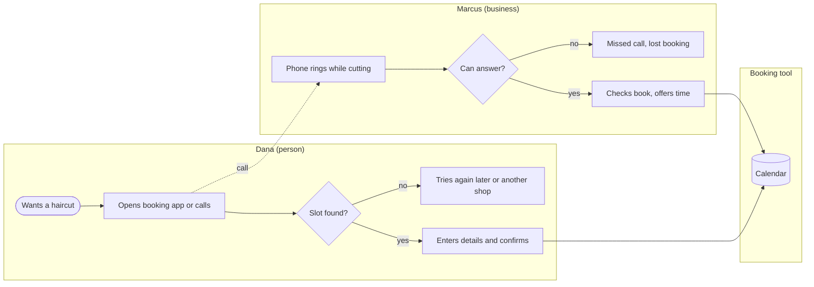
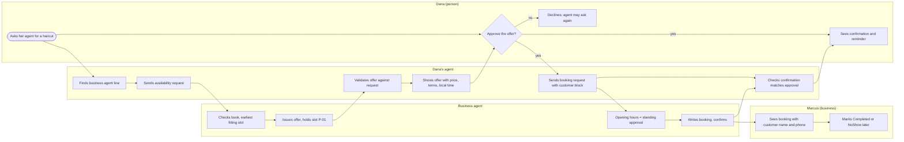
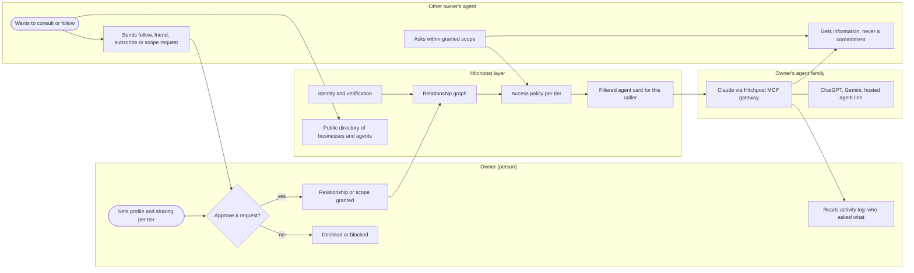
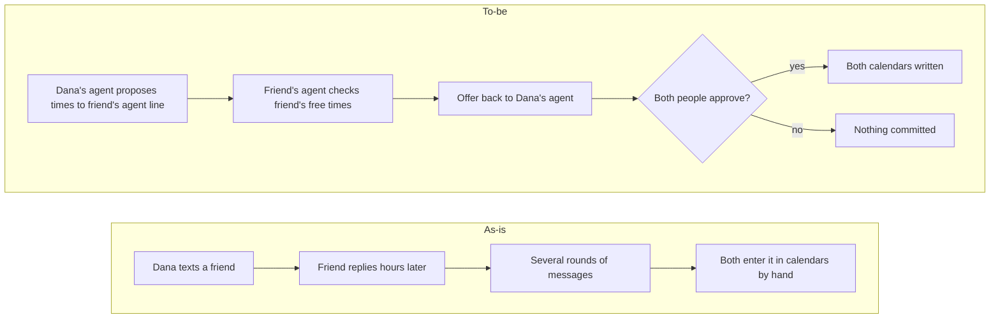

# HP-SAD-23 · Business requirements document

| Field       | Value                                                                                                                                                                          |
| ----------- | ------------------------------------------------------------------------------------------------------------------------------------------------------------------------------ |
| Document ID | HP-SAD-23                                                                                                                                                                      |
| Version     | 1.1                                                                                                                                                                            |
| Status      | Frozen for Phase 2 spike                                                                                                                                                       |
| Date        | 2026-11-09                                                                                                                                                                     |
| Owner       | Sanaullah Jannisar, product and engineering lead                                                                                                                               |
| Conforms to | IIBA BABOK Guide v3 (business analysis planning, elicitation, requirements life cycle management, strategy analysis); business requirements content of ISO/IEC/IEEE 29148:2018 |

## 1. Purpose and scope

This document states what the business needs from Hitchpost, independent of how it is built. It is the top of the requirements chain: business requirements (BR-REQ) here trace down to goals in [01 Vision and scope](01-vision-and-scope.md), functional and non-functional requirements in [05 Requirements](05-requirements.md), and user stories in [24 Product requirements](24-product-requirements-document.md).

For now Hitchpost is an open protocol: the `hitchpost/1` extension on A2A, an MIT-licensed reference implementation and an MCP gateway, so that anyone's agent (Claude, ChatGPT, Gemini, a business's booking agent, a custom agent) can talk to other agents directly ([ADR 0020](../decisions/0020-protocol-first.md)). Nobody pays; monetization is Later and undecided. Hitchpost agents are rule-based software until a language model is added (the language-model stage); we don't call them AI before then.

The direction is an agent-to-agent social network across vendors. Every person or business gets one or more agent lines (an identity plus an A2A agent card), an owner profile, relationships with other owners in tiers ordered owner (the owner's own agent family), friend (mutual), subscriber (Later, unpriced), follower (one-way) and public, with `blocked` as an edge state rather than a tier; sharing preferences per tier; a public directory; verification and reputation; and a human approval gate for every commitment. Booking with businesses, starting with barbers, is the first proven task ([ADR 0008](../decisions/0008-first-vertical-barbers.md)) and the release scope up to v1; the network follows in stages L1 to L4.

The pilot jurisdiction is the United States, in Texas (USD, America/Chicago). Values come from the parameter register in [00 Document control](00-document-control.md#10-normative-parameters-and-phase-map) (P-IDs) and are not restated.

## 2. Business need

### 2.1 Problem statement

People and businesses already have software that can act for them, but those agents can't reach each other. To book a haircut or agree a time with a friend, a person still calls, texts back and forth, or fills in a web form built for humans. Businesses lose bookings while they work because nobody answers the phone. Booking platforms have started to expose their own agents (Fresha's MCP server, Google's agentic booking through Booksy; see [30 Competitive heuristic evaluation](30-competitive-heuristic-evaluation.md)), but each one works only inside its own silo and its own customer base.

A second, larger problem sits behind the first. Everyone's assistant is becoming personalised to how they work: an engineer and a scientist use the same model in very different ways. That knowledge of someone's process, projects and skills is valuable to other people, but there is no safe way for one person's agent to ask another person's agent about it, under the owner's sharing rules. Nobody can learn everyone's process themselves; consulting their agents is the only way that scales.

### 2.2 Opportunity

A neutral, open network where any agent line can reach any other, whatever the vendor, with verified identity, owner profiles, a relationship graph that decides who may ask what, and a record that both sides agreed to any commitment. The transport already exists (A2A, [ADR 0003](../decisions/0003-build-on-a2a-and-mcp.md)), and people's own assistants can connect through MCP. What is missing is the identity, relationship, policy and directory layer across platforms. Hitchpost is that layer plus a relay, not the "brain": the intelligence stays in each owner's own agent. Because it is free and open, the first users are AI power users and agent developers who can adopt it themselves; businesses join because an agent line costs nothing.

### 2.3 Business objectives (SMART)

| ID   | Objective                                               | Measure                                                                     | Target                                                                                      | By                   |
| ---- | ------------------------------------------------------- | --------------------------------------------------------------------------- | ------------------------------------------------------------------------------------------- | -------------------- |
| BO-1 | Prove people will let an agent book for them            | Share of A-01 participants completing two agent bookings                    | Lower 95% confidence bound at or above the "continue" band set in [03](03-business-case.md) | M-01                 |
| BO-2 | Prove businesses will list and keep using an agent line | Pilot businesses active at the end of S2                                    | At least 5 of the P-22 pilot businesses                                                     | M-08                 |
| BO-3 | Prove the approval gate holds                           | Bookings without a logged approval                                          | 0 (G-3)                                                                                     | Every gate from M-03 |
| BO-4 | Prove the network is open                               | Independent implementations (not written by me) passing the conformance kit | At least 2 (G-5)                                                                            | M-08                 |
| BO-5 | Prove people's own assistants are a real channel        | Human-approved bookings in the pilot made through the minimal MCP gateway   | At least 10 of at least 30 pilot bookings                                                   | M-08                 |

### 2.4 Out of business scope

For the booking releases up to v1 (M-08): prices, fees, deposits and payments of any kind, marketplace ranking or advertising, replacing a business's booking tool, and any market outside the United States. The minimal MCP gateway is in v1 (Phase 3). The rest of the social network (agent family L1; profiles, directory of agents, relationships and scopes L2; full MCP gateway and consultation L3) comes after v1, and paid subscriptions (L4, unpriced, only if adoption warrants it) after them; they are in business scope but not in release scope.

## 3. Stakeholders

Full analysis in [04 Stakeholders and personas](04-stakeholders-and-personas.md). The business requirements here serve these groups:

| Group                                                     | Interest in this document                                                       |
| --------------------------------------------------------- | ------------------------------------------------------------------------------- |
| People (Dana), with or without their own AI assistant     | Booking and scheduling without phone tag; nothing committed without a yes       |
| Businesses (Marcus)                                       | Bookings while they work, through the tool they already use; know who is coming |
| Agent developers and platforms (Priya, booking platforms) | An open protocol, a conformance kit and free directory listing for their agents |
| Operator (Sam)                                            | Moderation, support and incident load a solo owner can carry                    |
| Owner                                                     | Bounded cash at risk (no revenue by design), kill criteria before each spend    |
| Regulators (FTC, Texas)                                   | Fair consumer dealing, honest reviews, privacy                                  |

## 4. As-is and to-be business processes

### 4.1 Person books a business: as-is

Pain points: phone tag, missed calls during work, each platform with its own app and account, no record of what was agreed beyond the platform's own.

### 4.2 Person books a business: to-be (pilot, standing approval)

### 4.3 The network: to-be vision (post-v1 releases)

Consultation answers are information only. Anything that commits the owner (money, time, sharing beyond the granted scope) still goes through the approval gate (BR-08).

### 4.4 Two people agree a time: as-is and to-be (UC-11, Phase 4)

In person-to-person scheduling both sides are people, so both approve before anything is written (BR-08 applies on both sides; there is no standing approval for a person).

## 5. Gap analysis

| Capability                                 | As-is                            | To-be                                                       | Gap                                      | Closed by                                              |
| ------------------------------------------ | -------------------------------- | ----------------------------------------------------------- | ---------------------------------------- | ------------------------------------------------------ |
| Reach a business without a call            | Platform app or phone            | Any agent line reaches any business agent line              | Agent-to-agent channel across platforms  | Phase 1 Built (offer exchange only); Phase 2 (booking) |
| My own assistant reaches a business        | Not possible across platforms    | Hitchpost MCP server in Claude, ChatGPT, Gemini             | Minimal MCP gateway                      | Phase 3                                                |
| Know nothing is booked without consent     | Implicit in a form submit        | Logged approval bound to one offer                          | Approval gate and audit log              | Phase 2 (FR-GATE)                                      |
| Business knows who is coming               | Name and phone from the platform | Customer block after approval                               | Customer contact data path               | Phase 2                                                |
| Find a trustworthy business agent          | Platform search, unverified web  | Verified directory with ratings from real interactions      | Directory and verification               | Phases 3 and 5                                         |
| Use one app for many businesses and people | One app per platform             | Contacts are agent lines                                    | Client app with agent contacts           | Phase 4                                                |
| Schedule with another person               | Text back and forth              | Agents propose, both approve                                | Person-to-person flow (UC-11)            | Phase 4                                                |
| Reminders                                  | Platform SMS                     | Reminder from the person's own agent (P-29)                 | Reminder service                         | Phase 4                                                |
| Business cancels                           | Calls the customer               | Business-to-person notice                                   | Operator relay (pilot), notice (Phase 4) | Phases 2 and 4                                         |
| One owner, many agents                     | Each assistant is an island      | Agent family trusted at the owner tier                      | Identity and agent family                | L1                                                     |
| Know whose agent this is                   | Nothing                          | Owner and agent profiles, verified                          | Profiles and public directory of agents  | L2                                                     |
| Decide who may ask my agent what           | Nothing                          | Relationship tiers with per-tier scopes, owner activity log | Relationship graph and access policy     | L2                                                     |
| My own assistant manages contacts          | Copy and paste between chats     | Full MCP gateway with contacts and relationships            | Full MCP gateway                         | L3                                                     |
| Ask an expert's agent how they work        | Cold email, paid call            | Scoped consultation                                         | Consultation                             | L3 (subscriptions L4, unpriced)                        |

## 6. Business rules summary

The full catalogue with decision tables is in [07 Process and behaviour models](07-process-and-behaviour-models.md). The rules that carry business policy, not just mechanics:

| Rule         | Business meaning                                                                       |
| ------------ | -------------------------------------------------------------------------------------- |
| BR-01, BR-02 | A business never double books and never offers the past                                |
| BR-05        | A person's agent rejects an offer that doesn't answer the request                      |
| BR-07, BR-08 | Nothing commits a person without their explicit approval of one specific offer         |
| BR-09        | For a business, opening hours are standing approval (the only pilot mode)              |
| BR-10, BR-11 | Cancel and reschedule need the booking's secret token and respect the cutoff (P-10)    |
| BR-12, BR-13 | A listing is only public after its owner proves control of the agent card              |
| BR-14        | Only verified interactions can be rated                                                |
| BR-17        | No sender may hold more than the open holds cap (P-07), and no business more than P-31 |
| BR-19        | Authority comes from server-minted secrets, never from client-chosen ids               |

Two policies are added by this document and are owned by [05](05-requirements.md) and [07](07-process-and-behaviour-models.md) going forward: nobody pays, so no outcome is ever billed; and an offer is always the earliest slot that fits the request, never one the business prefers.

## 7. SWOT

|              | Helpful                                                                                                                                                                                                                                                                                                                                                                                                        | Harmful                                                                                                                                                                                                                                                                                                                                                                                   |
| ------------ | -------------------------------------------------------------------------------------------------------------------------------------------------------------------------------------------------------------------------------------------------------------------------------------------------------------------------------------------------------------------------------------------------------------- | ----------------------------------------------------------------------------------------------------------------------------------------------------------------------------------------------------------------------------------------------------------------------------------------------------------------------------------------------------------------------------------------- |
| **Internal** | **Strengths:** open protocol (A2A) instead of a private API; vendor-neutral by design; strict validation and origin pinning Built and tested (23 tests, Phase 1 only; the approval gate is designed, not built); Hitchpost is the identity and policy layer, not a model, so it rides every vendor's progress; cash bounded ($12,825, $15,390 with contingency, per [16](16-project-plan.md))                  | **Weaknesses:** one owner at 15 hours a week (R-11); no users yet; nothing beyond the Phase 1 offer exchange is built; no app until Phase 4; no identity or relationships until after v1; no revenue by design; brand not chosen                                                                                                                                                          |
| **External** | **Opportunities:** agents are arriving on phones faster than businesses can answer them; shops on no platform are unserved; no rival keeps a two-sided approval record or exposes A2A; person-to-person scheduling has no neutral player; personalised assistants hold process knowledge others would consult; assistants already accept MCP servers, so a free gateway reaches people where they already work | **Threats:** platforms already ship agents inside their silos (Fresha, Google); assistant vendors could build their own agent-to-agent social layer; cold start on both sides (R-12); A2A could change (R-10); an unpaid protocol may not be adopted or sustained (R-25, R-26); regulation of automated agents and reviews; knowledge leakage or harassment between agents damaging trust |

## 8. PESTLE (United States, Texas pilot)

| Factor        | What matters                                                                                                                                                                                                                                                                      | Effect on requirements                                                                                                                                   |
| ------------- | --------------------------------------------------------------------------------------------------------------------------------------------------------------------------------------------------------------------------------------------------------------------------------- | -------------------------------------------------------------------------------------------------------------------------------------------------------- |
| Political     | Federal and state attention to AI agents and consumer protection                                                                                                                                                                                                                  | Plain disclosure: Hitchpost agents are rule-based software until a language model is added (the language-model stage); we don't call them AI before then |
| Economic      | Small businesses already pay for booking tools; price sensitivity is high                                                                                                                                                                                                         | Nobody pays: the protocol, gateway and agent lines are free; monetization Later and undecided ([ADR 0020](../decisions/0020-protocol-first.md))          |
| Social        | People expect instant booking; trust in automated agents is still forming ([31](31-research-evidence-base.md))                                                                                                                                                                    | Approval gate, clear offer card, reminders (P-29)                                                                                                        |
| Technological | A2A v1.0 and MCP stable enough to build on; platforms exposing agents                                                                                                                                                                                                             | Open extension plus conformance kit; sit in front of existing tools                                                                                      |
| Legal         | FTC Act section 5; FTC rule on reviews (16 CFR Part 465); Texas UETA (Tex. Bus. and Com. Code ch. 322) incl. error correction for electronic agent transactions; Texas Data Privacy and Security Act; CCPA/CPRA for California residents; ADA Title III; COPPA; TCPA and CAN-SPAM | Legal pack in [35](35-legal-compliance-and-governance.md) before S1; accounts 18+; consent for SMS; review and moderation policy                         |
| Environmental | Negligible direct footprint; fewer wasted trips from no-shows and wrong bookings                                                                                                                                                                                                  | None beyond reminders                                                                                                                                    |

These are risk flags for planning, not legal advice.

## 9. Business requirements

| ID        | Business requirement                                                                                                                                                          | Goal     | Traces to                                                                                      | Priority                |
| --------- | ----------------------------------------------------------------------------------------------------------------------------------------------------------------------------- | -------- | ---------------------------------------------------------------------------------------------- | ----------------------- |
| BR-REQ-01 | A person must be able to get a booking from a business through their agent with one approval                                                                                  | G-1      | FR-MSG-02, FR-BOOK-02, FR-GATE-01, FR-APP-02                                                   | Must                    |
| BR-REQ-02 | No commitment of a person's time, money or personal data may happen without that person's explicit approval, and the record must prove it                                     | G-3      | FR-GATE-01 to FR-GATE-04                                                                       | Must                    |
| BR-REQ-03 | A business must be able to answer agents without changing the booking tool it already uses                                                                                    | G-2      | FR-BOOK-06, FR-BOOK-12                                                                         | Must                    |
| BR-REQ-04 | A business must know who is coming to each booking                                                                                                                            | G-2      | FR-BOOK-02 (customer block, Phase 2)                                                           | Must                    |
| BR-REQ-05 | People must be able to tell a verified business agent from a fake one                                                                                                         | G-4      | FR-DIR-01, FR-DIR-03, FR-DIR-05                                                                | Must                    |
| BR-REQ-06 | Any A2A agent, not only Hitchpost's, must be able to take part                                                                                                                | G-5      | FR-MSG-09, NFR-INT-01                                                                          | Must                    |
| BR-REQ-07 | People must be able to keep other people and businesses as agent contacts and schedule with them                                                                              | G-1      | FR-APP-01, FR-APP-03, UC-11                                                                    | Should (Phase 4)        |
| BR-REQ-08 | People must be reminded before their bookings                                                                                                                                 | G-1      | Reminders (P-29, Phase 4; [24](24-product-requirements-document.md))                           | Should                  |
| BR-REQ-09 | A business must be able to cancel a booking and the person must find out                                                                                                      | G-1      | Operator relay (Phase 2), business cancel notice (Phase 4)                                     | Must                    |
| BR-REQ-10 | Ratings must come only from real, verified interactions                                                                                                                       | G-4      | FR-RATE-01 to FR-RATE-05                                                                       | Should (Phase 5)        |
| BR-REQ-11 | Personal data must be minimal, retained for a documented time and deletable on request                                                                                        | G-3      | NFR-PRIV-01, NFR-PRIV-02                                                                       | Must                    |
| BR-REQ-12 | The service must be operable by one owner with a named backup during the pilot                                                                                                | G-2      | P-28, [18](18-deployment-and-operations.md), [36](36-customer-support-and-success-playbook.md) | Must                    |
| BR-REQ-13 | Nobody may be charged in any release up to v1; no requirement may depend on a price or a billable outcome                                                                     | G-1      | [ADR 0020](../decisions/0020-protocol-first.md); P-26 and P-30 retired                         | Must                    |
| BR-REQ-14 | The service must meet US consumer, privacy, review and accessibility rules for the pilot                                                                                      | G-3, G-4 | [35](35-legal-compliance-and-governance.md), NFR-A11Y-01                                       | Must                    |
| BR-REQ-15 | An owner must be able to link all their agent lines, whatever the vendor, into one agent family                                                                               | G-5      | L1: identity and agent family epic in [24](24-product-requirements-document.md)                | Won't this release (L1) |
| BR-REQ-16 | Every agent line must show who owns it and what it is mostly used for, and people must be able to find public businesses and public agents in one directory                   | G-4      | L2: profiles and directory epic                                                                | Won't this release (L2) |
| BR-REQ-17 | An owner must decide, per relationship tier, what other agents may ask their agent, and see who asked what                                                                    | G-3      | L2: relationships and access scopes epic                                                       | Won't this release (L2) |
| BR-REQ-18 | A person's own assistant (Claude, ChatGPT, Gemini) must be able to find a business agent line, ask for availability and approve with explicit confirmation, without a new app | G-5      | FR-DIR-07, FR-MSG-19, FR-GATE-06 (minimal MCP gateway, Phase 3); full gateway L3               | Must (Phase 3)          |
| BR-REQ-19 | One agent must be able to consult another for information within the granted scope, never for a commitment                                                                    | G-3      | L3: consultation epic                                                                          | Won't this release (L3) |
| BR-REQ-20 | An owner might later offer subscriptions to consult their agent, unpriced and only if adoption warrants it, with fair cancellation and refunds                                | G-1      | L4: subscriptions epic                                                                         | Won't this release (L4) |

## 10. Success measures

The north star and counter-metrics are defined once in [01 Vision and scope](01-vision-and-scope.md): weekly agent-to-agent tasks completed with a human's approval (booking is the first task type), with first-offer rejection rate, median time to approve, booking errors, disputes, reports per 100 interactions, repeat use over 8 weeks and the unmarked outcome rate (P-25). The business objectives in section 2.3 map to them: BO-1 to repeat use, BO-2 to active businesses, BO-3 to booking errors, BO-4 to independent implementations (G-5), BO-5 to bookings through the MCP gateway.

## 11. Constraints

- One owner at 15 hours a week ([16 Project plan](16-project-plan.md)); cash budget per 16 section 7.2.
- United States only; pilot in one Texas neighbourhood (P-22).
- Build on A2A v1.0 and the official JavaScript SDK ([ADR 0003](../decisions/0003-build-on-a2a-and-mcp.md)).
- No prices, fees or payments: protocol first ([ADR 0020](../decisions/0020-protocol-first.md)).
- Open source under MIT ([ADR 0004](../decisions/0004-mit-open-source.md)).

## 12. Assumptions

The assumptions with tests and kill criteria are A-01 to A-08 in [03 Business case](03-business-case.md). The ones this document depends on most: A-01 (people will approve agent offers), A-02 (businesses will list), A-03 (booking tools allow programmatic writes; otherwise BR-REQ-03 needs the hosted book) and A-08 (the built-in personal agent covers people without an MCP-capable assistant).

## 13. Business analysis plan

### 13.1 Approach

Iterative and evidence-led. Each phase starts from the business requirements here, confirms them with the cheapest real evidence (interviews, the Wizard-of-Oz study, the pilot) and only then specifies in detail. I hold the analyst, product and approver roles; independent reviews are AI-assisted (separate Claude Code agents under my direction) until a human external reviewer joins at M-05.

### 13.2 Activities and deliverables

| Activity              | Technique                                                                                                             | Deliverable                                                                                                                                                        | When             |
| --------------------- | --------------------------------------------------------------------------------------------------------------------- | ------------------------------------------------------------------------------------------------------------------------------------------------------------------ | ---------------- |
| Strategy analysis     | Problem framing, SWOT, PESTLE, competitive heuristic review                                                           | This document, [02](02-feasibility-study.md), [03](03-business-case.md), [30](30-competitive-heuristic-evaluation.md)                                              | Done for Phase 2 |
| Elicitation           | Interviews (10 businesses), disclosed Wizard-of-Oz (n = 30), trust interviews, document analysis of booking-tool APIs | Interview notes and study report under `docs/research/`                                                                                                            | WP-0.1 to WP-0.4 |
| Requirements analysis | Use cases, process models, decision tables, data models                                                               | [05](05-requirements.md), [06](06-use-cases.md), [07](07-process-and-behaviour-models.md), [08](08-data-design.md), [22](22-enhanced-entity-relationship-model.md) | Per phase        |
| Solution evaluation   | Pilot metrics, usability tests, outcome audit                                                                         | Pilot report, post-implementation review ([17](17-transition-plan.md))                                                                                             | S1, S2, M-08     |

## 14. Requirements management plan

| Aspect              | Rule                                                                                                                                                                                       |
| ------------------- | ------------------------------------------------------------------------------------------------------------------------------------------------------------------------------------------ |
| Elicitation methods | Interviews with open, past-behaviour questions; observation in the Wizard-of-Oz study; document analysis; stakeholder review of the PRD                                                    |
| Prioritisation      | MoSCoW per release in [24](24-product-requirements-document.md); risk-first ordering in [16](16-project-plan.md)                                                                           |
| Baselining          | Each phase gate (M-03 to M-08) baselines the requirements for the next phase; baselines are git tags (`sad-vX.Y`)                                                                          |
| Change control      | Every change goes through the `docs-change` process in [00](00-document-control.md); a change to a P-ID or a phase row updates the register first                                          |
| Traceability        | BR-REQ to G to FR/NFR to UC to design section to TC; the matrix lives in [05](05-requirements.md#7-traceability-matrix) and `pnpm docs:check` verifies IDs, links, values and phases in CI |
| Tools               | Markdown in git as the source of truth; Mermaid for models; the consistency checker; GitHub issues for change requests once the repository is public                                       |
| Acceptance          | A requirement is accepted when its test cases pass ([15](15-test-strategy.md)) and, for business requirements, when its success measure is observed in the pilot                           |

## Revision history

| Version | Date       | Change                                                                                                                                                                                                                                                                                                                                              | Author      |
| ------- | ---------- | --------------------------------------------------------------------------------------------------------------------------------------------------------------------------------------------------------------------------------------------------------------------------------------------------------------------------------------------------- | ----------- |
| 1.0     | 2026-11-09 | First baseline, rounds 3 and 4: agent-to-agent social network framing with booking as the first proven use case, US/Texas, standing approval only, flat business subscription, post-v1 network requirements BR-REQ-15 to BR-REQ-20                                                                                                                  | S. Jannisar |
| 1.1     | 2026-11-09 | Round 5: protocol first (no pricing), minimal MCP gateway in v1, final QA fixes, frozen for the Phase 2 spike. BO-4 and BO-5 measure adoption (independent implementations, gateway bookings) instead of payment; BR-REQ-13 says nobody pays; BR-REQ-18 is a Phase 3 Must; L1 to L4 stages; one tier list; false "Built" and "$5k" claims corrected | S. Jannisar |
