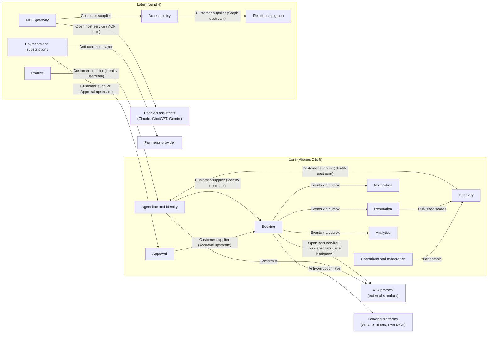
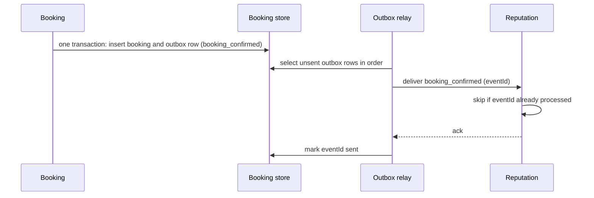

# HP-SAD-26 · Service architecture

| Field       | Value                                                                                                                                                  |
| ----------- | ------------------------------------------------------------------------------------------------------------------------------------------------------ |
| Document ID | HP-SAD-26                                                                                                                                              |
| Version     | 1.0                                                                                                                                                    |
| Status      | Baselined for Phase 2                                                                                                                                  |
| Date        | 2026-11-09                                                                                                                                             |
| Owner       | Sanaullah Jannisar, product and engineering lead                                                                                                       |
| Conforms to | Domain-driven design (Evans, strategic design: bounded contexts and context maps); microservices patterns (decomposition, outbox, idempotent consumer) |

## 1. Purpose and scope

This document decides how Hitchpost is split into parts that own their own data and logic, how those parts talk, and how many deployable services they become. It covers the booking network being built now (Phases 2 to 6) and the agent-to-agent social network that follows it (round 4 direction: identity, relationships, access policy, profiles, an MCP gateway and paid subscriptions).

The decision is recorded in [ADR 0019](../decisions/0019-service-architecture.md). Container and deployment views are in [10 Architecture](10-architecture.md); component and deployment UML in [21 UML models](21-uml-models.md); per-store data in [22 EERD](22-enhanced-entity-relationship-model.md); the backend module design in [28 Software design description](28-software-design-description.md).

Status labels follow [00 Document control](00-document-control.md): **Built**, **Phase N**, **Later**. Contexts introduced by the round 4 direction are labelled **Later (round 4)** until the phase map assigns them a phase.

## 2. Bounded contexts

A bounded context is a part of the system with one consistent model and one owner of its data. The words inside it mean one thing.

| Context                    | What it owns                                                                                                                                                             | Key terms in its language                     | Status                                                                                                      |
| -------------------------- | ------------------------------------------------------------------------------------------------------------------------------------------------------------------------ | --------------------------------------------- | ----------------------------------------------------------------------------------------------------------- |
| Agent line and identity    | Agent lines, agent cards, owners, install keys, signing keys, agent family membership                                                                                    | agent line, owner, card, install key, family  | Built (cards); Phase 2 (install keys); Phase 6 (authentication, signing); earlier when relationships arrive |
| Booking                    | Offers, bookings, the appointment book, holds, slot claims                                                                                                               | offer, hold, booking, slot, reschedule        | Built (offers); Phase 2 (bookings)                                                                          |
| Approval                   | Approval decisions, the approval gate, standing approval rules                                                                                                           | approval, decision, standing approval         | Phase 2                                                                                                     |
| Directory                  | Business listings, verification, search                                                                                                                                  | listing, verified, origin                     | Phase 3                                                                                                     |
| Reputation                 | Interaction records, reviews, behaviour metrics                                                                                                                          | verified interaction, review, outcome         | Phase 5                                                                                                     |
| Notification               | Reminders, push subscriptions, delivery attempts, consent for SMS and email                                                                                              | reminder, subscription, delivery              | Phase 4                                                                                                     |
| Operations and moderation  | Reports, takedowns, pauses, the moderation trail, incident switches                                                                                                      | report, takedown, pause                       | Phase 2 (operator-relayed cancel, pause); Phase 5 (moderation)                                              |
| Analytics                  | Pseudonymous events, metric definitions, weekly snapshots                                                                                                                | event, personKey, snapshot                    | Phase 4                                                                                                     |
| Relationship graph         | Follow, friend and subscriber edges between agent lines and owners; requests and blocks                                                                                  | follower, friend, subscriber, request, block  | Later (round 4)                                                                                             |
| Access policy              | Sharing preferences per tier, scopes, auto-rules, the activity log of who asked what                                                                                     | tier, scope, sharing preference, activity log | Later (round 4)                                                                                             |
| Profiles                   | Owner profiles and agent profiles: purpose, domains, workflows, skills offered                                                                                           | profile, domain, skill                        | Later (round 4)                                                                                             |
| Payments and subscriptions | Paid subscriptions to consult an agent line, payouts, refunds, cancellations                                                                                             | subscription, payout, refund, platform fee    | Later (round 4)                                                                                             |
| MCP gateway                | The MCP server people's own assistants (Claude, ChatGPT, Gemini) connect to: tools to find agents, view profiles, request access, message agents, list contacts, approve | tool, session, connected assistant            | Later (round 4)                                                                                             |

**Why Approval is its own context and not part of Booking.** The approval gate (ADR 0007) is the trust floor for every commitment, not only bookings. Round 4 adds paid subscriptions and sharing personal knowledge beyond scope, which need the same gate. Keeping it separate means one place enforces "no commitment without a yes".

**Why Access policy is separate from Relationship graph.** The graph records who is connected and how; the policy decides what a caller at a given tier may see or ask. They change for different reasons (a friend request versus a privacy setting) and the policy must be checkable on every request without loading the whole graph.

## 3. Context map

Reading notes. Arrows point from the downstream context to the one it depends on. "Conformist" means Hitchpost adopts the A2A model as is, because the value of A2A is that every vendor speaks it. "Open host service" with a "published language" means `hitchpost/1` is a documented, versioned contract anyone can implement ([13 Interfaces](13-interfaces.md)). "Anti-corruption layer" means each booking platform and the payments provider is translated at the edge, so their models never leak into the core.

### 3.1 Relationship patterns, one by one

| Relationship                                   | Pattern                               | Why                                                                                                                                                                    |
| ---------------------------------------------- | ------------------------------------- | ---------------------------------------------------------------------------------------------------------------------------------------------------------------------- |
| Identity to A2A                                | Conformist                            | Interoperability is the product. Cards, tasks and messages follow the A2A specification; Hitchpost adds only an extension.                                             |
| Booking to A2A                                 | Open host service, published language | `hitchpost/1` is published as an open A2A extension with JSON Schemas and a conformance kit (Phase 2), so platforms can implement it natively.                         |
| Booking to booking platforms                   | Anti-corruption layer                 | Each platform has its own notion of services, staff and slots. A connector per platform translates to the Booking model; conditional writes are required (FR-BOOK-06). |
| Approval to Booking                            | Customer-supplier                     | Booking asks Approval for a decision and cannot create an approval itself (ADR 0013, proposed).                                                                        |
| Booking to Reputation, Notification, Analytics | Event publisher, idempotent consumers | Reputation, reminders and metrics react to booking facts; Booking never waits for them.                                                                                |
| MCP gateway to people's assistants             | Open host service                     | The MCP server is a published tool surface so any MCP-capable assistant can use it.                                                                                    |
| Access policy to Relationship graph            | Customer-supplier                     | Policy needs the caller's tier; the graph supplies it.                                                                                                                 |
| Payments to payments provider                  | Anti-corruption layer                 | KYC, payouts, 1099-K reporting and refunds stay inside the provider's model and a thin translator.                                                                     |

## 4. Service catalogue

One row per context. "Owner" is the person accountable; today every row is me, and section 9 says when that has to change.

| Context                    | Responsibility                                                                       | Owned data                                  | APIs offered                                                                               | Events published                                                        | SLO                                                                                                | Owner |
| -------------------------- | ------------------------------------------------------------------------------------ | ------------------------------------------- | ------------------------------------------------------------------------------------------ | ----------------------------------------------------------------------- | -------------------------------------------------------------------------------------------------- | ----- |
| Agent line and identity    | Issue and resolve agent lines, cards, install keys, later authentication and signing | agent_line, owner, install_key, signing_key | A2A agent card endpoint; internal resolve and verify                                       | agent_line_created, key_rotated                                         | Card endpoint availability as directory (NFR-REL-01)                                               | Me    |
| Booking                    | Answer availability, issue and hold offers, confirm, cancel and reschedule bookings  | offer, booking, slot_claims, scheduled_jobs | A2A `SendMessage` and `GetTask` with hitchpost/1 kinds                                     | offer_issued, booking_confirmed, booking_cancelled, booking_rescheduled | Offer round trip p95 under 2 s (NFR-PERF-01)                                                       | Me    |
| Approval                   | Record the person's yes or no; apply standing approval for businesses                | approval, approval_rule                     | In-process `decide()`; App API approve and decline                                         | approval_recorded                                                       | Decision recorded before any commitment (FR-GATE-01)                                               | Me    |
| Directory                  | Register, verify and search business agent lines                                     | listing, verification                       | REST `/v1/listings` ([13](13-interfaces.md))                                               | listing_verified, listing_paused                                        | 99.5% availability (NFR-REL-01)                                                                    | Me    |
| Reputation                 | Attest verified interactions, compute ratings                                        | interaction_record, review, metric          | REST read endpoints                                                                        | rating_updated                                                          | Daily recompute                                                                                    | Me    |
| Notification               | Deliver reminders and push messages with consent                                     | push_subscription, reminder, delivery       | In-process `schedule()`; Web Push                                                          | delivery_failed                                                         | Reminder sent within 5 min of due time                                                             | Me    |
| Operations and moderation  | Reports, takedowns, pause switches, operator-relayed cancel                          | report, moderation_action, pause            | Operator console; one-command pause                                                        | listing_taken_down, pause_engaged                                       | Report acknowledged within the review promise in [36](36-customer-support-and-success-playbook.md) | Me    |
| Analytics                  | Pseudonymous events, metric SQL, weekly snapshots                                    | event, snapshot                             | Read-only SQL views                                                                        | none                                                                    | Weekly snapshot by Monday                                                                          | Me    |
| Relationship graph         | Follow, friend, subscriber edges, requests, blocks                                   | edge, request, block                        | MCP and App API tools                                                                      | relationship_changed                                                    | Later (round 4)                                                                                    | Me    |
| Access policy              | Evaluate tier and scope per call; filter extended agent cards; activity log          | sharing_preference, scope, activity_log     | In-process `authorize(caller, scope)`                                                      | access_denied, access_granted                                           | Policy check under 20 ms p95                                                                       | Me    |
| Profiles                   | Owner and agent profiles                                                             | profile                                     | REST and MCP read                                                                          | profile_updated                                                         | Later (round 4)                                                                                    | Me    |
| Payments and subscriptions | Paid consultation subscriptions, payouts, refunds, cancellation                      | subscription, payout, refund                | Payments provider webhooks; App API                                                        | subscription_started, subscription_cancelled                            | Cancellation effective immediately (FTC negative option rule)                                      | Me    |
| MCP gateway                | MCP server for people's assistants                                                   | mcp_session                                 | MCP tools: find agent, view profile, request access, message agent, list contacts, approve | none                                                                    | Later (round 4)                                                                                    | Me    |

## 5. Decision: microservices or modular monolith

The question is how many deployable services these contexts become now, with one owner at 15 hours a week and pilot traffic under one request per second.

### 5.1 Options

- **A. Microservices per context.** Eight services now, thirteen with round 4.
- **B. One modular monolith.** Every context, including every agent line, in one process.
- **C. Modular monolith with separate agent hosts.** Three deployables: the agent host for business agent lines, the app backend for personal agent lines and the App API, and the platform service for the rest. Each internally split by context.

### 5.2 Weighted comparison

Scores are 1 (poor) to 5 (strong). Weights reflect a solo owner running a pilot.

| Criterion                                | Weight | A        | B        | C        |
| ---------------------------------------- | ------ | -------- | -------- | -------- |
| Operational load for one part-time owner | 0.30   | 1        | 5        | 4        |
| Failure isolation between businesses     | 0.20   | 5        | 2        | 4        |
| Data ownership clarity                   | 0.15   | 5        | 3        | 4        |
| Running cost                             | 0.15   | 2        | 5        | 4        |
| Cost of extracting a context later       | 0.10   | 5        | 3        | 4        |
| Independent deploys                      | 0.10   | 5        | 2        | 3        |
| **Weighted total**                       | 1.00   | **3.35** | **3.60** | **3.90** |

Arithmetic, option C: 0.30 x 4 + 0.20 x 4 + 0.15 x 4 + 0.15 x 4 + 0.10 x 4 + 0.10 x 3 = 1.20 + 0.80 + 0.60 + 0.60 + 0.40 + 0.30 = 3.90.

### 5.3 Choice and why it holds

I chose **C**. It keeps the running cost and on-call load near a monolith, which is what one person can sustain, while the one failure that matters most to businesses, a bad agent deploy or a runaway business line taking everyone down, is contained by keeping agent lines in their own host. B was close on cost but loses on exactly that failure. A buys isolation I can't operate yet.

**What would change my mind:** a second engineer joining (operational load drops in weight), a context with very different scaling needs (the MCP gateway is the likely one), or a regulator or partner requiring a context to run separately (payments).

### 5.4 Extraction triggers

A context becomes its own service when any trigger fires. Until then it stays a module.

| Context                                        | Extraction trigger                                                                                                                         |
| ---------------------------------------------- | ------------------------------------------------------------------------------------------------------------------------------------------ |
| Booking (agent host)                           | Already separate. Split a single business agent line into its own process when it exceeds 10% of host CPU or needs its own deploy cadence. |
| Directory                                      | Read traffic exceeds the platform process budget, or a partner needs a public search SLA above 99.5%.                                      |
| Reputation                                     | Recompute jobs exceed 10 minutes or interfere with directory latency.                                                                      |
| Notification                                   | Delivery volume needs its own queue and retry workers (likely when SMS consent arrives).                                                   |
| Analytics                                      | Moves to its own read store as soon as queries touch more than a week of events.                                                           |
| MCP gateway (round 4)                          | Extracted from the start of round 4: it faces many third-party assistants, has bursty traffic and its own auth model.                      |
| Payments and subscriptions (round 4)           | Extracted from the start: compliance scope (payments provider, KYC, 1099-K reporting) should not include the rest of the platform.         |
| Relationship graph and Access policy (round 4) | Stay together as one module until graph queries exceed the policy latency target.                                                          |

## 6. Communication between contexts

### 6.1 Synchronous or asynchronous

| Interaction                                    | Style                                                                  | Reason                                                                     |
| ---------------------------------------------- | ---------------------------------------------------------------------- | -------------------------------------------------------------------------- |
| Agent to agent (A2A)                           | Synchronous request and reply for questions; Task for commitments      | ADR 0012. A question needs an answer now; a commitment needs a durable id. |
| Booking asks Approval                          | Synchronous, in process                                                | A commitment must not proceed until the decision is recorded.              |
| Booking to Reputation, Notification, Analytics | Asynchronous events through the outbox                                 | Booking must not slow down or fail because a consumer is down.             |
| Access policy check (round 4)                  | Synchronous, in process, cached per caller                             | Every consultation call is checked; latency matters.                       |
| Platform to agent host                         | Synchronous REST for operator actions (pause, operator-relayed cancel) | Operator actions need immediate confirmation.                              |

### 6.2 Transactional outbox

Each producing context writes its event to an `outbox` table in the same database transaction as the state change. A relay loop reads unsent rows in order and delivers them, marking each as sent after the consumer acknowledges. This gives at-least-once delivery without a distributed transaction. If the process crashes after commit and before delivery, the relay sends on restart.

### 6.3 Idempotency

Every event carries an `eventId`. Consumers record processed ids and skip duplicates. On the agent-to-agent edge, the same rule appears as the protocol's de-duplication: `availability_request` on (sender, messageId), `booking_request` on `offerId`, `cancel_request` on `bookingId` ([13 Interfaces](13-interfaces.md), [28 SDD](28-software-design-description.md)).

## 7. Data ownership

| Phase  | Physical layout                                                                                                       | Isolation rule                                                                                    |
| ------ | --------------------------------------------------------------------------------------------------------------------- | ------------------------------------------------------------------------------------------------- |
| 2      | One SQLite file per business agent line; one JSONL audit file per personal agent                                      | A business line can only open its own file.                                                       |
| 3 to 5 | Platform service gets its own SQLite (or Postgres) database with one schema per context                               | Modules call each other's APIs; no cross-schema joins.                                            |
| 6      | One Postgres cluster; one schema and one database role per context; row-level security per business on booking tables | A role can read only its own schema. The analytics role reads only the pseudonymous event schema. |

I chose schema per context over database per service: it gives the ownership boundary that matters (who may read what) without running many databases. Moving a schema to its own database is part of extraction (section 5.4).

## 8. Deployment units and failure isolation

| Unit                  | Contains                                                    | If it fails                                                                                                                            |
| --------------------- | ----------------------------------------------------------- | -------------------------------------------------------------------------------------------------------------------------------------- |
| Agent host            | Business agent lines (one A2A handler and data scope each)  | Bookings for the lines on that host stop; directory, app and other hosts keep working. Agents show the business phone as the fallback. |
| App backend           | Personal agent lines, App API, Notification                 | People can't start new requests or receive reminders; businesses keep their books; confirmed bookings are unaffected.                  |
| Platform service      | Directory, Reputation, Operations and moderation, Analytics | Search and ratings pause; agents already in contacts keep working because agent-to-agent calls don't pass through the platform.        |
| MCP gateway (round 4) | MCP server                                                  | People's assistants can't reach Hitchpost; the app and direct A2A keep working.                                                        |
| Payments (round 4)    | Subscriptions and payouts                                   | New subscriptions pause; existing access continues until the period ends.                                                              |

The one-command pause and the auto-pause on an unacknowledged SEV1 live in Operations and moderation and act on every agent host ([18 Deployment and operations](18-deployment-and-operations.md), [19 Maintenance and evolution](19-maintenance-and-evolution.md)).

## 9. Round 4 implications

The round 4 direction turns Hitchpost into the identity, relationship, policy and directory layer for agents of any vendor, plus a relay. It changes this architecture in four ways.

1. **Identity moves earlier.** Relationship tiers need authenticated callers. Agent authentication and signing, currently Phase 6, must land in the phase that introduces relationships. Agent family membership (all lines owned by one owner trust each other at the owner tier) lives in Agent line and identity.
2. **Cards become caller-specific.** The public agent card stays public; an authenticated caller gets an A2A extended agent card filtered by Access policy for its tier (owner, friend, subscriber, follower, public). The card is computed per call, never cached across callers.
3. **Two contexts start as separate services.** The MCP gateway (third-party assistants, bursty, its own auth) and Payments (compliance scope) are extracted from the start (section 5.4).
4. **Answers are information, commitments still pass the gate.** A consultation reply never commits the owner. Paid subscriptions and sharing beyond scope go through Approval, which is why Approval stays its own context.

## 10. Traceability

| Section | Requirements and decisions                            |
| ------- | ----------------------------------------------------- |
| 2, 3    | ADR 0003, ADR 0012, ADR 0019; FR-MSG-01, FR-BOOK-06   |
| 4       | NFR-PERF-01, NFR-REL-01, FR-GATE-01                   |
| 5       | ADR 0019; risk TO-5 in [11](11-quality-attributes.md) |
| 6       | FR-BOOK-07, NFR-REL-02                                |
| 7       | NFR-PRIV-01, NFR-SEC-01                               |
| 8       | NFR-REL-01, NFR-OBS-01                                |
| 9       | ADR 0007, ADR 0017                                    |

## Revision history

| Version | Date       | Change                                                                                                  | Author      |
| ------- | ---------- | ------------------------------------------------------------------------------------------------------- | ----------- |
| 1.0     | 2026-11-09 | First baseline, including the round 4 contexts (relationships, policy, profiles, payments, MCP gateway) | S. Jannisar |
