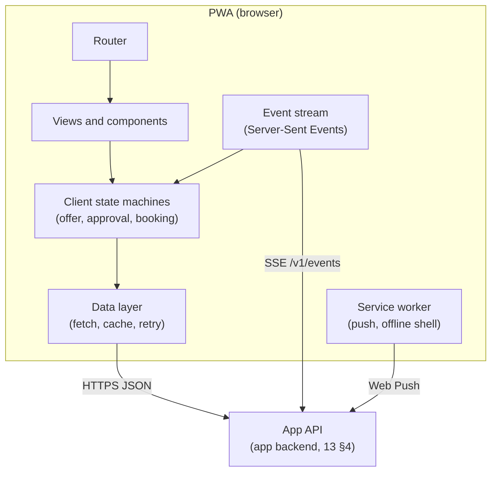
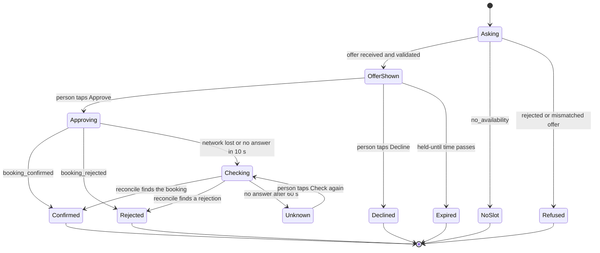

# HP-SAD-27 · Frontend technical specification

| Field       | Value                                                                                                         |
| ----------- | ------------------------------------------------------------------------------------------------------------- |
| Document ID | HP-SAD-27                                                                                                     |
| Version     | 1.1                                                                                                           |
| Status      | Frozen for Phase 2 spike                                                                                      |
| Date        | 2026-11-09                                                                                                    |
| Owner       | Sanaullah Jannisar, product and engineering lead                                                              |
| Conforms to | W3C WCAG 2.2 (AA); W3C Web App Manifest, Service Workers, Push API; WHATWG HTML and Fetch; Server-Sent Events |

## 1. Purpose and scope

This is the technical specification for the client: the people's app (Phase 4) and the business dashboard (Phase 4). It turns the screens in [14 User interface design](14-user-interface-design.md) into an implementable client: platform, architecture, state, the contract with the App API, notifications, the component and token system, CRUD screens per entity, formatting, accessibility, performance, security and testing.

Phase 2 has no graphical client; the command-line personal agent stands in. Everything here is Phase 4 unless marked otherwise.

## 2. Client platform decision

| Option                               | For                                                                                                                                                                                                                           | Against                                                                 |
| ------------------------------------ | ----------------------------------------------------------------------------------------------------------------------------------------------------------------------------------------------------------------------------- | ----------------------------------------------------------------------- |
| **Progressive web app (chosen)**     | One codebase for phones and desktop; installable; Web Push on Android and desktop, and on iOS 16.4+ once installed to the home screen; no app-store review for a pilot; the business dashboard needs a desktop browser anyway | iOS push requires install to the home screen; no background sync on iOS |
| Native iOS and Android               | Best push and background behaviour                                                                                                                                                                                            | Two codebases and store reviews for one part-time owner                 |
| Cross-platform native (React Native) | One codebase, native push                                                                                                                                                                                                     | Still store review; a second toolchain next to the web dashboard        |

I chose a PWA first. The pilot is 5 to 10 businesses and a few dozen people, so the iOS install step is a support script, not a blocker (onboarding asks iOS users to add the app to the home screen before turning on notifications). Native comes Later if push reliability on iOS shows up in the A-01 or pilot results.

Framework: React with Vite and TypeScript. The deciding reason is contributors: it has the largest pool of developers and mature accessibility libraries, which matters for the team-member concern raised in the stakeholder review. This revisits ADR 0002's note that a DOM test environment would need a second test runner (section 13).

## 3. Architecture

- **Routing.** Routes: `/chats`, `/chats/:contactId`, `/bookings`, `/bookings/:bookingId`, `/directory`, `/directory/:listingId`, `/settings`, and for businesses `/dashboard`, `/dashboard/services`, `/dashboard/hours`, `/dashboard/listing`. Every route is a real URL so links and the back button work.
- **State.** Server data lives in the data layer cache (one source per resource). Flow state that must not get confused, an offer being approved, lives in explicit state machines (section 4), not in scattered flags.
- **Data fetching.** Plain `fetch` with a small wrapper: JSON, the error envelope from [13 Interfaces](13-interfaces.md), a request id header for correlation, and retry with backoff only for idempotent requests.
- **Live updates.** One Server-Sent Events connection per signed-in session (`/v1/events`) carries offer, booking and task updates. On reconnect the client sends `Last-Event-ID` and re-fetches anything it may have missed.
- **Offline.** The service worker caches the app shell. Reads show the last known data with a visible "offline" banner. Writes are never queued silently: approve, cancel and reschedule require a connection and say so.

## 4. Client state machine: offer, approval, booking

The approval path is where a confused client does real harm: the person must never believe a booking exists when it doesn't, or the reverse.

Rules:

- **Checking** reconciles by `taskId` (and by `offerId` if the task id was never received) through the App API. It never re-sends an approval on its own: the personal agent's duplicate handling ([28](28-software-design-description.md)) makes a resend safe, but the person has to see what happened.
- **Unknown** shows: "I couldn't confirm this booking yet. Don't book elsewhere. I'll keep checking." with a Check again button and the business phone. The "falsely believed booked = 0" rule from the usability plan applies to Checking and Unknown too.
- **Expired** is driven by a monotonic clock (`performance.now()`), not the wall clock, and is recomputed on `visibilitychange` so a backgrounded tab doesn't drift. The card shows an absolute time ("held until 5:42 pm"), not a ticking countdown.
- Manual shop approval (waiting on the business) is Later; when it arrives it adds a `WaitingOnBusiness` state between Approving and Confirmed, with the button labelled "Request booking".

## 5. App API client contract

The App API is specified in [13 Interfaces](13-interfaces.md) §4. The client depends on these resources and nothing else:

| Method and path                                                    | Use                                          | Idempotent                  |
| ------------------------------------------------------------------ | -------------------------------------------- | --------------------------- |
| `POST /v1/requests`                                                | Ask a contact's agent (availability request) | Yes, with `Idempotency-Key` |
| `GET /v1/offers/:offerId`                                          | Offer detail for the card and approval sheet | Yes                         |
| `POST /v1/offers/:offerId/approve`                                 | Approve (creates the booking request)        | Yes, keyed on offerId       |
| `POST /v1/offers/:offerId/decline`                                 | Decline (sends `offer_declined`)             | Yes                         |
| `GET /v1/bookings`, `GET /v1/bookings/:id`                         | Bookings list and detail                     | Yes                         |
| `POST /v1/bookings/:id/cancel`                                     | Cancel                                       | Yes, keyed on bookingId     |
| `POST /v1/bookings/:id/reschedule`                                 | Ask for a new time                           | Yes, with `Idempotency-Key` |
| `GET /v1/contacts`, `POST /v1/contacts`, `DELETE /v1/contacts/:id` | Contacts                                     | Yes                         |
| `GET /v1/events`                                                   | Server-Sent Events stream                    | Not applicable              |
| `POST /v1/push/subscriptions`, `DELETE /v1/push/subscriptions/:id` | Web Push subscription                        | Yes                         |

The client never sees a `bookingToken`: it stays with the personal agent on the server (FR-MSG-12). Authentication is a session cookie (section 11).

## 6. Push notifications

- Web Push with VAPID keys, subscribed only after the person turns notifications on in Settings (never on first load).
- On iOS the subscribe control is hidden until the app is installed to the home screen; instead it shows the install steps.
- Push carries no personal content in the payload beyond a short title ("Booking confirmed"); the client fetches details after the tap.
- Uses: booking confirmed or rejected, reminders before an appointment, a business cancelling, and Later relationship requests.

## 7. Component inventory and design tokens

### 7.1 Components

App shell, top bar, bottom navigation (people) and side navigation (dashboard), chat list item, chat bubble (person, agent, system), offer card, approval sheet, booking card, booking detail, status banner (offline, checking, error), search field, listing card, rating summary, form field (text, number, time, select, toggle), button (primary, secondary, destructive, text), confirm dialog, toast (non-blocking, also announced), empty state, skeleton loader, report dialog.

### 7.2 Tokens

Colours were chosen to pass WCAG 2.2 contrast. Ratios are computed with the WCAG relative-luminance formula against the background named; I'll re-verify them with an automated checker in the build (section 13).

| Token        | Light   | Ratio (light)                     | Dark    | Ratio (dark)       |
| ------------ | ------- | --------------------------------- | ------- | ------------------ |
| `bg`         | #FFFFFF | n/a                               | #121212 | n/a                |
| `surface`    | #F5F2EE | n/a                               | #1E1E1E | n/a                |
| `text`       | #1B1B1B | 17.2:1 on bg, 15.4:1 on surface   | #EDEAE6 | 15.6:1 on bg       |
| `text-muted` | #5F5A54 | 6.8:1 on bg                       | #A9A39C | 7.5:1 on bg        |
| `primary`    | #8A5A2B | 5.9:1 on bg, 5.3:1 on surface     | #E0A96D | 9.0:1 on bg        |
| `danger`     | #B3261E | 6.5:1 on bg                       | #F2B8B5 | 11.0:1 on bg       |
| `success`    | #2E6B30 | 6.4:1 on bg                       | #8BC48D | to verify in build |
| `focus`      | #1A5FB4 | 6.3:1 on bg (non-text, needs 3:1) | #8AB4F8 | to verify in build |

Typography: the system font stack; sizes 14, 16, 20, 24 and 32 px; body text never below 16 px; line height 1.5. Spacing: a 4 px base (4, 8, 12, 16, 24, 32, 48). Touch targets at least 44 by 44 px (above the 24 px minimum of WCAG 2.5.8). Motion respects `prefers-reduced-motion`.

## 8. CRUD UI specification

One table per user-facing entity. "Who" is the person allowed. Text fields follow P-19 (1 to 200 characters, no control characters); prices and durations follow P-20.

### 8.1 Contacts (people, Phase 4)

| Operation | Screen and behaviour                                                                                                                                                                                                                  |
| --------- | ------------------------------------------------------------------------------------------------------------------------------------------------------------------------------------------------------------------------------------- |
| List      | Chats list: contacts sorted by last activity; empty state "Add a business or a person to start".                                                                                                                                      |
| Detail    | Agent chat with header: name, verified badge if listed, business phone.                                                                                                                                                               |
| Create    | From the directory (Add contact) or by agent line link or QR code. Fields: display name (P-19), agent line address (https URL; origin shown before saving). Validation: the address must serve a valid agent card on the same origin. |
| Edit      | Rename only.                                                                                                                                                                                                                          |
| Delete    | Remove contact. Confirm dialog: "Remove Main Street Barbers? Your bookings stay." Optional "Also block". Block is never pre-ticked.                                                                                                   |
| Who       | The person who owns the contacts.                                                                                                                                                                                                     |

### 8.2 Bookings (people, Phase 4)

| Operation | Screen and behaviour                                                                                                          |
| --------- | ----------------------------------------------------------------------------------------------------------------------------- |
| List      | Upcoming and past tabs; each card shows business-local time first, the person's own time second if different, service, price. |
| Detail    | Business legal name, phone, address, total with tax statement, cancellation terms, status, a "This booking went wrong" entry. |
| Create    | Not directly: a booking is created only by approving an offer (FR-GATE-01).                                                   |
| Edit      | Reschedule: asks the business agent for a new time; the old booking stays until the new one is confirmed (FR-BOOK-11).        |
| Delete    | Cancel. Confirm dialog states the cancellation terms and any cutoff (P-10). Refused cancels show the reason.                  |
| Who       | The person who booked.                                                                                                        |

### 8.3 Business profile and services (businesses, Phase 4)

| Operation | Screen and behaviour                                                                                                                                   |
| --------- | ------------------------------------------------------------------------------------------------------------------------------------------------------ |
| List      | Services list with duration and price.                                                                                                                 |
| Create    | Fields: service name (P-19), duration in minutes (P-20, 1 to 1,440), price in cents shown as currency (P-20), active toggle. Name unique per business. |
| Edit      | Same fields. Changing price or duration affects only new offers; existing bookings keep what was confirmed.                                            |
| Delete    | Archive instead of delete when future bookings use the service; hard delete only when none do. Confirm dialog says which.                              |
| Who       | The business owner.                                                                                                                                    |

### 8.4 Opening hours (businesses, Phase 4)

| Operation     | Screen and behaviour                                                                                                                |
| ------------- | ----------------------------------------------------------------------------------------------------------------------------------- |
| List and edit | One row per weekday with one or more open-close ranges (split shifts allowed). Validation: open before close, ranges don't overlap. |
| Exceptions    | Closed dates (holidays, sick days); adding one warns about existing bookings on that date and links to the operator-relayed cancel. |
| Time zone     | The business's IANA zone, shown read-only until Phase 6 time-zone support; until then times are UTC for demos only.                 |
| Who           | The business owner.                                                                                                                 |

### 8.5 Directory listing (businesses, Phase 3 for the listing, Phase 4 for the dashboard screens)

| Operation        | Screen and behaviour                                                                                  |
| ---------------- | ----------------------------------------------------------------------------------------------------- |
| Create           | Onboarding (UC-05): agent line address, legal name, public name, phone, address, verification method. |
| Detail           | Listing preview as the public sees it, verification status.                                           |
| Edit             | Public fields; changing the agent line origin restarts verification.                                  |
| Pause and resume | Pause hides the listing and stops new offers; existing bookings stay.                                 |
| Delete           | Remove listing. Confirm dialog explains that bookings stay and the listing can't be restored.         |
| Who              | The business owner; the operator can pause or take down (UC-10).                                      |

### 8.6 Reviews (people, Phase 5)

| Operation       | Screen and behaviour                                                                     |
| --------------- | ---------------------------------------------------------------------------------------- |
| Create          | Offered only after a verified interaction (FR-RATE-01): rating and optional text (P-19). |
| Detail and list | On the listing, with "verified booking" shown on each review.                            |
| Edit            | Later.                                                                                   |
| Delete          | The author can delete their own review; confirm dialog.                                  |
| Who             | The person who had the verified interaction.                                             |

### 8.7 Reports (people and businesses, Phase 5)

| Operation       | Screen and behaviour                                                                           |
| --------------- | ---------------------------------------------------------------------------------------------- |
| Create          | Report dialog: reason (enumerated), optional details (P-19), "Also block" unticked by default. |
| Detail          | My reports: status and the outcome when decided, with the reason for the decision.             |
| Edit and delete | Not allowed; a report is a record.                                                             |
| Who             | Any signed-in person or business; the operator reviews (UC-10).                                |

### 8.8 Later screens for the network stages L1 to L3 (inventory only)

The agent-to-agent social network adds these screens; they are listed so the navigation and design system leave room for them, not specified yet:

- **Profile:** owner profile and per-agent profiles (what each agent is used for, domains, skills offered, verification).
- **Contacts with tiers:** contacts grouped and labelled by `RelationshipTier` in this order: owner (the owner's own agent family), friend (mutual), subscriber (Later, unpriced), follower (one-way), public; `blocked` is an edge state, not a tier. Change-tier and block are actions on the contact.
- **Requests inbox:** incoming and outgoing follow, friend and access requests (subscribe requests only at L4, unpriced); approve, decline, auto-rules.
- **Sharing preferences:** per tier, which capabilities and knowledge areas the agent exposes, with a preview of the card a caller at that tier sees.
- **Activity log:** who asked my agent what, when, under which tier and scope, and what it answered.

## 9. Formatting

- **Time.** An in-person appointment is shown in the business's local time first; the person's own zone second, only if different ("10:30 am Central, 11:30 am your time"). Formatting uses `Intl.DateTimeFormat` with the zone from the listing. Spelled-out dates in screen-reader labels ("Thursday, November 12 at 5:30 pm").
- **Money.** `Intl.NumberFormat` with the currency's own minor units (no hard-coded two decimals). Prices are stored in minor units (P-20).
- **Text.** All remote text is rendered as text, never as HTML.

## 10. Accessibility implementation (WCAG 2.2 AA, NFR-A11Y-01)

- Semantic HTML first: real buttons, links, headings, lists, form labels.
- The approval sheet is a dialog with focus moved to its heading, focus trapped while open, Escape closes, and focus returns to the offer card. The Approve button's accessible name includes service, time and price.
- Live regions: polite for new offers and status changes; assertive only for errors. The held-until time is announced once on arrival, not continuously.
- Focus is always visible (the `focus` token, at least 3:1).
- Forms: errors listed at the top and next to each field, linked by `aria-describedby`; no information conveyed by colour alone.
- Language of page set; reduced motion respected; no drag-only interactions in the dashboard (2.5.7).
- Assistive technology matrix: VoiceOver on iOS Safari and macOS Safari, TalkBack on Android Chrome, NVDA on Windows Firefox and Chrome. Every release checks the approval path on all four.

## 11. Security

- **Content Security Policy:** `default-src 'self'; script-src 'self'; style-src 'self'; connect-src 'self'; img-src 'self' data:; frame-ancestors 'none'; base-uri 'none'; object-src 'none'`, plus Trusted Types for DOM sinks.
- **Session:** an HttpOnly, Secure, SameSite=Lax cookie. No tokens in `localStorage` or `sessionStorage`. State-changing requests carry a CSRF token.
- **Secrets:** the client never receives a `bookingToken` or signing material.
- **Untrusted content:** every string from another agent is displayed as text and length-limited by the server's validation (P-19).

## 12. Performance budgets

| Metric                    | Budget                               | How measured                        |
| ------------------------- | ------------------------------------ | ----------------------------------- |
| Largest Contentful Paint  | under 2.5 s on a mid-range phone, 4G | Lighthouse CI on every pull request |
| Interaction to Next Paint | under 200 ms                         | Lighthouse CI and field data        |
| Cumulative Layout Shift   | under 0.1                            | Lighthouse CI                       |
| JavaScript shipped        | under 200 KB gzipped on first load   | Build size check fails the build    |

## 13. Testing

| Level         | Tool                                                               | What                                                                                                       |
| ------------- | ------------------------------------------------------------------ | ---------------------------------------------------------------------------------------------------------- |
| Unit          | Vitest                                                             | Formatters, state machines (every transition in section 4, including Checking and Unknown)                 |
| Component     | Vitest with Testing Library in jsdom                               | Offer card, approval sheet, CRUD forms and their validation                                                |
| End to end    | Playwright against the app backend with test agents                | Ask, approve, confirmed; network drop during approve ends in Confirmed or Unknown, never a false Confirmed |
| Accessibility | axe-core inside Playwright, plus the manual AT matrix (section 10) | Every route; approval path manually                                                                        |
| Performance   | Lighthouse CI                                                      | Budgets in section 12                                                                                      |
| Contrast      | Automated token contrast check                                     | Every token pair in section 7.2                                                                            |

## 14. Build and release

- Vite production build, hashed assets, a service worker versioned with the release.
- The PWA is served by the app backend under the same origin as the App API (no CORS).
- Release: tag, build, deploy to staging (Phase 6) and then production; the service worker prompts "New version ready, refresh" rather than reloading mid-flow.

## Revision history

| Version | Date       | Change                                                                                                        | Author      |
| ------- | ---------- | ------------------------------------------------------------------------------------------------------------- | ----------- |
| 1.0     | 2026-11-09 | First baseline                                                                                                | S. Jannisar |
| 1.1     | 2026-11-09 | Round 5: protocol first (no pricing), minimal MCP gateway in v1, final QA fixes, frozen for the Phase 2 spike | S. Jannisar |
