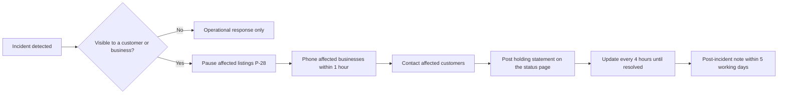

# HP-SAD-29 · Go-to-market plan

| Field       | Value                                                                                                                             |
| ----------- | --------------------------------------------------------------------------------------------------------------------------------- |
| Document ID | HP-SAD-29                                                                                                                         |
| Version     | 1.0                                                                                                                               |
| Status      | Baselined for Phase 2                                                                                                             |
| Date        | 2026-11-09                                                                                                                        |
| Owner       | Sanaullah Jannisar, product and engineering lead                                                                                  |
| Conforms to | April Dunford positioning practice (competitive alternatives, unique attributes, value, best-fit customers); AARRR funnel metrics |

## 1. Purpose and scope

How I get the first people, businesses and developers onto Hitchpost, and how I keep their trust while I do it. Hitchpost is a network of agent lines between users: person to person and person to business, growing into an agent-to-agent social network where people's own assistants (Claude, ChatGPT, Gemini or a custom agent) consult each other within the sharing preferences their owners set. Booking with barbershops in one Texas neighbourhood is the beachhead that proves the protocol works; the network is the expansion. Neither the beachhead nor the vertical is the whole product.

This plan answers the go-to-market panel's finding that the engineering was thorough and the market plan was missing. Every claim about rivals cites [30 Competitive heuristic evaluation](30-competitive-heuristic-evaluation.md); every claim about behaviour cites [31 Research evidence base](31-research-evidence-base.md). Pricing and phases follow the parameter register and phase map in [00 Document control](00-document-control.md#10-normative-parameters-and-phase-map).

Out of scope: paid advertising (not before the pilot proves retention), markets outside the United States (EU is Later, see [35](35-legal-compliance-and-governance.md)).

## 2. Market situation in one paragraph

Rivals already give assistants access to bookings, each inside its own silo: Fresha runs a public MCP server with checkout staying on Fresha, and Google AI Mode books Booksy appointments directly ([30 §3.6, §7.3](30-competitive-heuristic-evaluation.md#73-threats)). So "an AI can book a haircut" is no longer the story. The story is the network: a neutral agent line any person or business can have, reachable from any A2A agent, with contacts that are people as well as businesses, verified identity and a consent record both sides can check. No rival documents a two-sided approval record or exposes A2A ([30 §7.2](30-competitive-heuristic-evaluation.md#72-gaps-hitchpost-can-exploit)).

## 3. Positioning

One statement per audience, built on Dunford's five components. I test each in the pilot interviews before it goes on any public page.

| Component               | People                                                                                             | Businesses                                                                                                                                                                                     | Developers and platforms                                                                       |
| ----------------------- | -------------------------------------------------------------------------------------------------- | ---------------------------------------------------------------------------------------------------------------------------------------------------------------------------------------------- | ---------------------------------------------------------------------------------------------- |
| Competitive alternative | Phoning, a booking app per business, texting a friend back and forth                               | Answering the phone mid-job, a booking app's marketplace that charges 20 to 30% for new clients ([30 §5](30-competitive-heuristic-evaluation.md#5-barber-side-value-and-pricing-as-published)) | Building a separate integration for each platform, or a silo-only MCP server                   |
| Unique attributes       | One agent line reaches any business or person with an agent line; nothing commits without your yes | Your agent line answers every agent, sits in front of the booking tool you already use, flat price                                                                                             | An open A2A extension (`hitchpost/1`), JSON Schemas, a conformance kit and a neutral directory |
| Value                   | Book and arrange things without the back-and-forth                                                 | No missed bookings while you work; new customers from any assistant                                                                                                                            | Reach every listed business through one protocol                                               |
| Best-fit customers      | People who already use an assistant and book recurring services                                    | Small appointment businesses that miss calls while working                                                                                                                                     | Agent builders and booking platforms that want reach without lock-in                           |
| Market category         | Agent-to-agent messaging (like a phone line, for agents)                                           | A business phone line for agents                                                                                                                                                               | Open protocol and directory                                                                    |

Statements:

- **People:** "Your agent talks to theirs. You just say yes."
- **Businesses:** "Never miss a booking while you work. Your agent line answers every agent."
- **Developers and platforms:** "An open A2A extension and a neutral directory for agent lines."

### 3.1 Fourth audience: the agent network (expansion, after booking proves the protocol)

Everyone's assistant is becoming personal to their workflow: an engineer and a scientist use the same model very differently. Nobody can learn everyone's process themselves, so asking someone's agent becomes valuable. This audience has two sides.

| Component               | People who want their agent to consult others                                                    | Experts and creators whose agents get consulted                                                                                |
| ----------------------- | ------------------------------------------------------------------------------------------------ | ------------------------------------------------------------------------------------------------------------------------------ |
| Competitive alternative | Messaging the person and waiting; reading scattered posts; guessing                              | Answering the same questions in DMs; writing content nobody finds at the moment it's needed                                    |
| Unique attributes       | My assistant asks theirs directly, whatever vendor each runs on, within what they chose to share | I decide per tier (family, friend, follower, subscriber, public) what my agent shares; I see an activity log of who asked what |
| Value                   | Answers shaped by how that person actually works                                                 | Reach and, later, income without being online                                                                                  |
| Best-fit customers      | Heavy assistant users in technical and creative work                                             | People with a recognisable workflow others want to learn from                                                                  |
| Market category         | An agent-to-agent social network                                                                 | A profile and a line for your agent                                                                                            |

Statements:

- **People consulting:** "Ask their agent, not just the internet."
- **Experts:** "Your agent answers for you, only what you choose to share."

Sequencing: this audience is not marketed until identity, profiles, relationships and access scopes exist (phases set in the phase map). Until then it is a story for developers and for the A2A community, not a promise to consumers. The creator and paid-subscription angle (section 7) comes after relationships work, not before.

What I don't say: "AI books for you." Phases 1 to 3 are rule-based; calling them AI would be "AI washing" under FTC Act section 5 ([35 §3](35-legal-compliance-and-governance.md#3-applicability-analysis-by-law)). The words are "agent" and "agent line", which are accurate.

## 4. Ideal customer profile (beachhead)

| Attribute     | Ideal                                                                                                  | Why                                                                                                                                                                                                                                         |
| ------------- | ------------------------------------------------------------------------------------------------------ | ------------------------------------------------------------------------------------------------------------------------------------------------------------------------------------------------------------------------------------------- |
| Business type | Barbershop                                                                                             | Short, frequent, standard services; the owner works with their hands and misses calls (ADR 0008)                                                                                                                                            |
| Size          | 1 to 4 chairs, owner-operated                                                                          | The owner decides alone; no procurement                                                                                                                                                                                                     |
| Booking tool  | Square Appointments first, or no tool at all                                                           | Square has a public Bookings API for connector C1; shops with no tool get a hosted agent line ([30 §7.2](30-competitive-heuristic-evaluation.md#72-gaps-hitchpost-can-exploit))                                                             |
| Walk-in share | 20 to 60%                                                                                              | Some appointment flow to improve, and walk-ins mean they already miss calls                                                                                                                                                                 |
| Owner traits  | Uses a smartphone for the business daily; open to trying things; has a regular clientele who text them | Adoption barriers for small businesses are time and perceived usefulness, not price alone ([31 §8](31-research-evidence-base.md#8-small-business-technology-adoption-a-02-sales)), so I target owners who already feel the missed-call pain |
| Location      | One Texas neighbourhood, walkable, 15 to 30 shops in reach                                             | Network density beats breadth ([31 §12](31-research-evidence-base.md#12-two-sided-platform-cold-start-cold-start-plan-a-08-r-12)); in-person setup is possible                                                                              |

Anti-profile: multi-location chains (procurement, existing contracts), shops locked into Booksy's marketplace with no API (R-03), shops whose owner does not handle bookings personally.

The person-side ICP for the pilot: adults (18+) in the same neighbourhood who book a haircut every 3 to 6 weeks and already use a phone assistant or messaging app daily.

## 5. Messaging house

| Layer                              | Content                                                                                                                                    |
| ---------------------------------- | ------------------------------------------------------------------------------------------------------------------------------------------ |
| Umbrella                           | Agent lines: your agent talks to theirs, you just say yes.                                                                                 |
| Pillar 1: you stay in charge       | Nothing books without your yes (FR-GATE-01). Both sides keep a record of what was agreed.                                                  |
| Pillar 2: works with what you have | Businesses keep their booking tool; Hitchpost sits in front of it. People keep their assistant if it speaks A2A, or use the Hitchpost app. |
| Pillar 3: open and neutral         | Open protocol, open source (MIT), a directory that lists businesses whatever platform they use.                                            |
| Proof points                       | Built and tested code in the repository; the approval record; verified listings (Phase 3); pilot results with real numbers (after M-08)    |

Every proof point must be true on the day it is published. Before M-08 the only proof points are the code and the design.

## 6. Naming decision

Hitchpost is a working codename (ADR 0006). The panel is right that printed QR codes and the `hitchpost.dev` extension URI lock a name in.

| Step                                                                           | When                                        | Output                                                       |
| ------------------------------------------------------------------------------ | ------------------------------------------- | ------------------------------------------------------------ |
| Shortlist 5 names                                                              | By M-02                                     | Names that say "line" or "connect", short, easy to say aloud |
| Screen: USPTO TESS search in classes 9, 35, 42; domain and handle availability | By M-03                                     | Two clear candidates                                         |
| Test with 10 pilot-area people and 5 owners                                    | Before S1 materials are printed             | One name                                                     |
| Decide, register domain, run `node scripts/rename.mjs`                         | Before S1, no later than M-07 minus 6 weeks | Name recorded in an ADR                                      |

The extension URI moves to the final domain at the same time; `hitchpost/1` agents in the wild before then are only my own test agents.

## 7. Pricing and packaging

Per round 3 decisions and P-26.

| Package                        | Who                                              | Price                                                                                     | What's included                                                                                                                                                             |
| ------------------------------ | ------------------------------------------------ | ----------------------------------------------------------------------------------------- | --------------------------------------------------------------------------------------------------------------------------------------------------------------------------- |
| Personal agent line            | People                                           | Free                                                                                      | An agent line, contacts, the app (Phase 4), approvals, reminders (P-29)                                                                                                     |
| Business agent line            | Businesses                                       | Free in the pilot; then $15 per verified business agent line per month (P-26, hypothesis) | Verified listing, agent line answering every A2A agent, connector to their booking tool, approval and booking record, dashboard (Phase 4)                                   |
| Open protocol                  | Developers and platforms                         | Free                                                                                      | `hitchpost/1` extension, JSON Schemas, conformance kit, free directory listing of their A2A endpoints                                                                       |
| Platform verification API      | Platforms                                        | Later                                                                                     | Attestation that a listing is verified, for platforms that want to show it                                                                                                  |
| Paid subscriptions to an agent | People and businesses whose agents are consulted | Later: the owner sets the price; Hitchpost keeps a platform fee (hypothesis 10%)          | Subscriber-tier access scopes; payments through a payments provider with KYC for payees, 1099-K reporting and click-to-cancel ([35](35-legal-compliance-and-governance.md)) |

Why flat: every rival bundles bookings into a flat subscription or charges only for new clients; returning clients are free everywhere ([30 §5](30-competitive-heuristic-evaluation.md#5-barber-side-value-and-pricing-as-published)). A flat fee has nothing to game: outcome marking is never billed, so a business has no reason to under-mark. $15 sits below Booksy ($29.99), Fresha ($19.95) and Vagaro ($30), which matters because Hitchpost adds to their tool rather than replacing it.

Willingness to pay is tested with money, not stated preference: at S1 each pilot business signs a letter of intent to pay after the pilot or leaves a refundable $10 deposit. Target: at least 50% of pilot businesses commit. Below 30% the price hypothesis is wrong and I revisit it before M-08.

## 8. Pilot recruitment

### 8.1 Business screener (in person, 5 minutes)

1. Do you take appointments, or walk-ins only? (Walk-ins only: thank and stop.)
2. How do customers book today? (Note the tool. Square or none: high priority.)
3. In a normal week, how many calls or texts do you miss while you're working? (Fewer than 3: low priority.)
4. Who answers booking messages? (Not the owner: stop.)
5. Would you try a free tool for 12 weeks that answers bookings from other people's assistants and puts them in your book? (Record the exact words of the answer.)

### 8.2 In-person outreach script (barbers)

> "Hi, I'm Sanaullah. I'm building something for shops like yours and I'm talking to barbers on this street. Quick question: how many bookings do you think you miss while you've got clippers in your hand? ... What I'm building is a phone line for assistants. When someone's phone assistant wants to book with you, it gets an answer straight away and puts the booking in [your tool]. You don't change anything you do now. It's free for the pilot. Can I show you on my phone? Two minutes."

Rules: never interrupt a cut; come back at a quiet hour; leave a one-page sheet (section 9); never promise customers, only the line.

### 8.3 People recruitment

Recruitment for the A-01 study follows the redesigned protocol in [17 Transition plan](17-transition-plan.md): strangers recruited through a screener, no friends or family, disclosed Wizard-of-Oz, consent per [35 §5.5](35-legal-compliance-and-governance.md#55-research-consent-form-a-01). For the pilot itself, people come from the participating shops' existing customers (QR code at the counter) and from neighbourhood channels (section 11). I track how many are new to each shop, because new customers are what the business is buying.

## 9. Sales playbook

### 9.1 One-page ROI story (handed to owners)

> **You miss bookings while you work.** If you miss 5 booking messages a week and one in three would have booked, that's about 7 lost appointments a month. At $30 a cut that's about $210 a month.
> **Your agent line answers every one.** Any assistant that speaks A2A gets an offer from your real availability in seconds, and the booking lands in the tool you already use.
> **It costs $15 a month after a free pilot.** One recovered appointment pays for it twice. Your regulars cost nothing extra; there are no per-booking fees.
> **You stay in charge.** Your opening hours decide what can be booked. You see every booking and can cancel through Sam during the pilot.

The numbers are an illustration with the owner's own figures plugged in during the conversation, never a promise. "Agent booking reduces no-shows" is not claimed: the evidence is mixed ([31 §7](31-research-evidence-base.md#7-appointment-no-shows-reminders-and-booking-channel-north-star-p-01), EV-5).

### 9.2 Objection handling

| Objection                                            | Answer                                                                                                                                                                                                                                                    | Evidence                                                       |
| ---------------------------------------------------- | --------------------------------------------------------------------------------------------------------------------------------------------------------------------------------------------------------------------------------------------------------- | -------------------------------------------------------------- |
| "My customers already book in 30 seconds on Booksy." | Keep Booksy. Hitchpost answers the people whose assistant isn't Booksy's or Google's, and anyone who'd rather message than open an app. It sits in front of your tool, it doesn't replace it.                                                             | [30 §7.3](30-competitive-heuristic-evaluation.md#73-threats)   |
| "Why would I pay for my own regulars?"               | You don't. It's a flat $15 a month for the line, no per-booking fees, regulars included.                                                                                                                                                                  | Round 3 pricing, P-26                                          |
| "What if it double-books me?"                        | Every booking is checked against your real availability at the moment it's written, inside one transaction. If anything goes wrong in the pilot, I pause your line within minutes and phone you, and the customer sees your phone number as the fallback. | FR-BOOK-04, [18](18-deployment-and-operations.md), P-28        |
| "I don't trust a stranger's robot in my book."       | Only verified people's agents can book, the customer approved it themselves, and you get their name and phone with every booking.                                                                                                                         | Round 3 customer contact block                                 |
| "I'm not technical."                                 | I set it up with you in person, in under 15 minutes, and connect it to your tool.                                                                                                                                                                         | [17](17-transition-plan.md)                                    |
| "What happens if you disappear?"                     | It's open source. Your bookings live in your own tool, not only in Hitchpost.                                                                                                                                                                             | [19 Maintenance](19-maintenance-and-evolution.md), sunset plan |
| "Is this AI?"                                        | It's an agent line: software that answers other software by rules you set. No language model makes decisions about your book.                                                                                                                             | [32](32-automation-boundaries.md)                              |

### 9.3 Commitment

At S1 the owner signs a one-page pilot agreement (outline in [35 §5.3](35-legal-compliance-and-governance.md#53-business-terms-with-service-provider-data-terms)) plus the letter of intent or refundable deposit (section 7).

## 10. Partner strategy (booking platforms)

| Platform            | Why                                                                                                                                   | Value exchange I offer                                                                              | Ask                                                                     | Plan if they say no                                                                         |
| ------------------- | ------------------------------------------------------------------------------------------------------------------------------------- | --------------------------------------------------------------------------------------------------- | ----------------------------------------------------------------------- | ------------------------------------------------------------------------------------------- |
| Square Appointments | Public Bookings API, free tier for solo sellers ([30 §5, §7.2](30-competitive-heuristic-evaluation.md#72-gaps-hitchpost-can-exploit)) | New bookings from any A2A agent land in Square, so sellers stay on Square; a free directory listing | Developer account, app listing in the Square App Marketplace when ready | Build on the public API anyway; nothing requires a partnership                              |
| Fresha              | Already runs an MCP server; closest to agent-native                                                                                   | Implement `hitchpost/1` natively and get every Fresha shop listed in a neutral directory for free   | Native A2A endpoint                                                     | Index their public listings only if their terms allow; otherwise skip                       |
| Booksy              | Largest barber platform; API is partner-gated                                                                                         | Same as Fresha                                                                                      | Partner API access                                                      | Not a pilot dependency; Booksy shops can still get a hosted line (C3) or calendar sync (C2) |
| Vagaro              | API gated and reviewed                                                                                                                | Same                                                                                                | API access                                                              | Same as Booksy                                                                              |
| Google              | Distribution through Search, Maps and AI Mode                                                                                         | Hitchpost listings reachable by any assistant, Google's included                                    | None in v1                                                              | No dependency                                                                               |

Order: Square during WP-0.2, others after M-04 when there is a directory to show. The pitch to every platform is "open extension plus free listing": they become a supply partner, not a target. That turns R-02 from a threat into a channel.

## 11. Launch plan: one Texas neighbourhood

| Stage      | Timing (from [16](16-project-plan.md)) | Channel                                                                                                                            | Goal                                           |
| ---------- | -------------------------------------- | ---------------------------------------------------------------------------------------------------------------------------------- | ---------------------------------------------- |
| Before S0  | Now to WP-0.1 start                    | In-person visits to 15 to 30 shops; barber supply stores; one barber school                                                        | 10 interviews (A-02), 5 to 10 pilot candidates |
| S0 study   | WP-0.1 window                          | Screener posted in neighbourhood community groups and Nextdoor-style channels                                                      | 30 participants (A-01)                         |
| S1         | Phase 6, after staging exists          | Shop counter QR codes and table cards; owners text their regulars a link                                                           | First real bookings; LOIs or deposits          |
| S2         | Pilot window                           | Local press angle: "Neighbourhood barbers take bookings from people's assistants"; a talk at the barber school; supply-store flyer | P-22 pilot size reached                        |
| After M-08 | v1 decision                            | Case study with real numbers, only if RC criteria hold                                                                             | Next neighbourhood or stop                     |

Materials: one-page owner sheet (section 9.1), counter card for customers, a short demo video recorded from the real app, a press note written only after real results exist.

## 12. Developer relations and A2A community

| Asset                                                                        | Phase      | Where published                                                           |
| ---------------------------------------------------------------------------- | ---------- | ------------------------------------------------------------------------- |
| `hitchpost/1` extension spec and JSON Schemas for every message kind         | 2          | The repository and a static docs page on the final domain                 |
| Conformance kit: a test runner pointed at any agent URL                      | 2          | The repository, as a package                                              |
| Example agents (barber agent, personal agent)                                | Built      | The repository                                                            |
| Blog post: "Designing a booking protocol on A2A, and what the SDK taught me" | After M-03 | Personal blog, cross-posted to A2A community channels and relevant forums |
| Directory listing for third-party agents                                     | 3          | The directory                                                             |

Cadence: a short changelog with each release; one technical write-up per phase gate; office-hours issue triage weekly on the repository. Good first issues: 5 scoped issues, each naming a component someone could own (conformance kit, a connector, the directory), published with the first push.

The protocol rules in [13 Interfaces](13-interfaces.md) cite the JS SDK where it shaped a decision; the JSON Schemas are the language-neutral contract so Python or Go agents don't depend on JS SDK behaviour.

## 13. Community and reputation

- Ratings stay private to the business during the pilot (feedback only), and go public only with the business's opt-in after the pilot. Public ratings are reviews under the FTC rule (16 CFR Part 465), so the review and moderation policy in [35 §5.4](35-legal-compliance-and-governance.md#54-review-and-moderation-policy) must be live first.
- The README leads with the product for people and businesses; the portfolio material stays in docs/journey and docs/sad.
- Barber channels, not only developer channels: supply stores, the barber school, local business associations.

## 14. Crisis communications runbook

Applies to any SEV1 or SEV2 in [19 Maintenance and evolution](19-maintenance-and-evolution.md) that a customer or business can see. The operational response comes first; communications run alongside it.

Holding statements (fill the brackets, publish only what is confirmed):

| Scenario              | Holding statement                                                                                                                                                                                                                                                                                      |
| --------------------- | ------------------------------------------------------------------------------------------------------------------------------------------------------------------------------------------------------------------------------------------------------------------------------------------------------ |
| Double booking        | "On [date] a booking made through Hitchpost for [business] clashed with an existing appointment. We paused bookings for that business, contacted both customers and the business directly, and are finding out why. Nothing else is affected. We'll post what happened and what we changed by [date]." |
| Impersonated business | "A listing claiming to be [business] was not theirs. We removed it at [time] and told the real business. If you booked with it, your booking was not with [business]; please contact us at [contact] and we will help you rebook."                                                                     |
| Review dispute        | "[Business] has disputed a review. While we review it under our published policy, the review is [shown / hidden] with a note. Both sides get our reasons in writing, and either can appeal."                                                                                                           |
| Data incident         | "On [date] we found [what happened]. It affected [what data] for [how many] people. We have [contained it how]. We are contacting everyone affected directly and will follow the notification rules that apply in Texas [and other states]."                                                           |

Owner of every statement: me; backup: the named backup operator (P-28). No statement speculates about cause, blames a business or a customer, or minimises.

## 15. Metrics per funnel stage

| Stage               | People                                                                                      | Businesses                                           | Developers                                                            |
| ------------------- | ------------------------------------------------------------------------------------------- | ---------------------------------------------------- | --------------------------------------------------------------------- |
| Acquisition         | Screener completions; app installs (Phase 4)                                                | Shops visited; screener passes                       | Repository stars and clones of the conformance kit (directional only) |
| Activation          | First approved booking within 7 days of joining                                             | Line live and first booking received                 | First agent passing the conformance kit                               |
| Retention           | Repeat booking within one cycle (A-01 and RC 2 definitions in [01](01-vision-and-scope.md)) | Line still live after 8 weeks; switched off is churn | Agent still listed after 8 weeks                                      |
| Revenue             | n/a (free)                                                                                  | LOIs or deposits at S1; paying lines after the pilot | n/a in v1                                                             |
| Referral            | Contacts added who are new to Hitchpost                                                     | Owners who refer another shop                        | Third-party agents listed (RC 6)                                      |
| Network (expansion) | Consultations answered within scope; friend and follow requests accepted                    | n/a                                                  | Assistants connected through the MCP gateway                          |

Counter-metrics: unmarked outcome rate (P-25), first-offer rejection rate, reports per 100 interactions. The north star stays weekly human-approved bookings that were honored ([01](01-vision-and-scope.md)).

## Revision history

| Version | Date       | Change         | Author      |
| ------- | ---------- | -------------- | ----------- |
| 1.0     | 2026-11-09 | First baseline | S. Jannisar |
