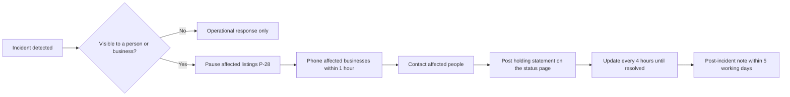

# HP-SAD-29 · Go-to-market plan

| Field       | Value                                                                                                                                                                      |
| ----------- | -------------------------------------------------------------------------------------------------------------------------------------------------------------------------- |
| Document ID | HP-SAD-29                                                                                                                                                                  |
| Version     | 1.1                                                                                                                                                                        |
| Status      | Frozen for Phase 2 spike                                                                                                                                                   |
| Date        | 2026-11-09                                                                                                                                                                 |
| Owner       | Sanaullah Jannisar, product and engineering lead                                                                                                                           |
| Conforms to | April Dunford positioning practice (competitive alternatives, unique attributes, value, best-fit customers); AARRR funnel metrics adapted for adoption of an open protocol |

## 1. Purpose and scope

How I get the first developers, people and businesses onto Hitchpost, and how I keep their trust while I do it. For now Hitchpost is an open protocol: the `hitchpost/1` extension on A2A, an MIT-licensed reference implementation and an MCP gateway, so that anyone's agent can talk to other agents directly ([ADR 0020](../decisions/0020-protocol-first.md)). Nobody pays, so this is an adoption plan, not a sales plan. Monetization is Later and undecided.

The beachhead is AI power users and agent developers: they adopt on their own, already run assistants and understand MCP. Businesses join because an agent line is free; barbershops in one Texas neighbourhood are the first business demonstration that the protocol works for real bookings. The agent-to-agent social network (stages L1 to L4) is the expansion.

Hitchpost agents are rule-based software until a language model is added (the language-model stage); we don't call them AI before then. People's own assistants (Claude, ChatGPT, Gemini) are AI; that is why the gateway matters.

Every claim about rivals cites [30 Competitive heuristic evaluation](30-competitive-heuristic-evaluation.md); every claim about behaviour cites [31 Research evidence base](31-research-evidence-base.md). Phases follow the phase map in [00 Document control](00-document-control.md#10-normative-parameters-and-phase-map).

Out of scope: pricing and sales of any kind, paid advertising, markets outside the United States (EU is Later, see [35](35-legal-compliance-and-governance.md)).

## 2. Market situation in one paragraph

Rivals already give assistants access to bookings, each inside its own silo: Fresha runs a public MCP server with checkout staying on Fresha, and Google AI Mode books Booksy appointments directly ([30 §3.6, §7.3](30-competitive-heuristic-evaluation.md#73-threats)). So "an assistant can book a haircut" is no longer the story. The story is the open network: an agent line any person or business can have, reachable from any A2A agent and from any MCP-capable assistant, with contacts that are people as well as businesses, verified identity and a consent record both sides can check. No rival documents a two-sided approval record or exposes A2A ([30 §7.2](30-competitive-heuristic-evaluation.md#72-gaps-hitchpost-can-exploit)). The risk that assistants simply call platform MCP servers and never need agent lines is R-27 in [33](33-raid-log.md).

## 3. Positioning

One statement per audience, built on Dunford's components. I test each in interviews before it goes on any public page.

| Component               | People with AI assistants (beachhead)                                                                             | Agent developers (beachhead)                                                                   | Businesses (free agent line)                                                                                                                                                                   |
| ----------------------- | ----------------------------------------------------------------------------------------------------------------- | ---------------------------------------------------------------------------------------------- | ---------------------------------------------------------------------------------------------------------------------------------------------------------------------------------------------- |
| Competitive alternative | Phoning, a booking app per business, copying text between chats, texting a friend back and forth                  | Building a separate integration for each platform, or a silo-only MCP server                   | Answering the phone mid-job, a booking app's marketplace that charges 20 to 30% for new clients ([30 §5](30-competitive-heuristic-evaluation.md#5-barber-side-value-and-pricing-as-published)) |
| Unique attributes       | My own assistant reaches any agent line through the Hitchpost MCP server; nothing commits without my explicit yes | An open A2A extension (`hitchpost/1`), JSON Schemas, a conformance kit and a neutral directory | An agent line that answers every agent, sits in front of the booking tool you already use, and costs nothing                                                                                   |
| Value                   | Book and arrange things from the assistant I already use                                                          | Reach every listed agent line through one protocol; prove compliance with the kit              | No missed bookings while you work                                                                                                                                                              |
| Best-fit users          | Heavy Claude, ChatGPT or Gemini users who book recurring services                                                 | People who build A2A or MCP agents and want them to interoperate                               | Small appointment businesses that miss calls while working                                                                                                                                     |
| Market category         | Agent-to-agent messaging (like a phone line, for agents)                                                          | Open protocol and directory                                                                    | A free phone line for agents                                                                                                                                                                   |

Statements:

- **People with assistants:** "Let your agent talk to other agents directly. You just say yes."
- **Agent developers:** "An open A2A extension, JSON Schemas and a conformance kit. Your agent joins in a day."
- **Businesses:** "A free agent line that answers every agent while you work."

### 3.1 The agent network (expansion, after booking proves the protocol)

Everyone's assistant is becoming personal to their workflow: an engineer and a scientist use the same model very differently. Nobody can learn everyone's process themselves, so asking someone's agent becomes valuable. This audience has two sides.

| Component               | People who want their agent to consult others                                                    | Experts whose agents get consulted                                                                                                                        |
| ----------------------- | ------------------------------------------------------------------------------------------------ | --------------------------------------------------------------------------------------------------------------------------------------------------------- |
| Competitive alternative | Messaging the person and waiting; reading scattered posts; guessing                              | Answering the same questions in DMs; writing content nobody finds at the moment it's needed                                                               |
| Unique attributes       | My assistant asks theirs directly, whatever vendor each runs on, within what they chose to share | I decide per tier (owner, friend, subscriber, follower, public; `blocked` is an edge state) what my agent shares; I see an activity log of who asked what |
| Value                   | Answers shaped by how that person actually works                                                 | Reach without being online                                                                                                                                |
| Best-fit users          | Heavy assistant users in technical and creative work                                             | People with a recognisable workflow others want to learn from                                                                                             |
| Market category         | An agent-to-agent social network                                                                 | A profile and a line for your agent                                                                                                                       |

Statements:

- **People consulting:** "Ask their agent, not just the internet."
- **Experts:** "Your agent answers for you, only what you choose to share."

Sequencing: this audience is not marketed until identity (L1), profiles and relationships (L2) exist. Until then it is a story for developers and the A2A and MCP communities, not a promise to consumers. Subscriptions (L4) are unpriced and come only if adoption warrants them.

What I don't say: "Hitchpost's AI books for you." Hitchpost agents are rule-based software until a language model is added (the language-model stage); we don't call them AI before then, which also avoids "AI washing" under FTC Act section 5 ([35 §3](35-legal-compliance-and-governance.md#3-applicability-analysis-by-law)). The words are "agent" and "agent line", which are accurate.

## 4. Who comes first

### 4.1 Beachhead: AI power users and agent developers

| Attribute  | Ideal                                                                                    | Why                                                                                    |
| ---------- | ---------------------------------------------------------------------------------------- | -------------------------------------------------------------------------------------- |
| Tools      | Uses Claude, ChatGPT or Gemini daily, ideally with MCP servers already connected         | The minimal MCP gateway (Phase 3) is one install for them                              |
| Builders   | Has built or is building an A2A or MCP agent                                             | Independent implementations are a release criterion; they can pass the conformance kit |
| Location   | Anywhere in the US for developers; the pilot neighbourhood for people who book in person | Developers don't need density; bookings do                                             |
| Motivation | Wants their agents to work with other people's agents without per-platform glue          | The problem the protocol solves                                                        |

### 4.2 First businesses: barbershops in one Texas neighbourhood

| Attribute     | Ideal                                                                                                  | Why                                                                                                                                                                                                                        |
| ------------- | ------------------------------------------------------------------------------------------------------ | -------------------------------------------------------------------------------------------------------------------------------------------------------------------------------------------------------------------------- |
| Business type | Barbershop                                                                                             | Short, frequent, standard services; the owner works with their hands and misses calls (ADR 0008)                                                                                                                           |
| Size          | 1 to 4 chairs, owner-operated                                                                          | The owner decides alone; no procurement                                                                                                                                                                                    |
| Booking tool  | Square Appointments first, or no tool at all                                                           | Square has a public Bookings API for connector C1; shops with no tool get a hosted agent line ([30 §7.2](30-competitive-heuristic-evaluation.md#72-gaps-hitchpost-can-exploit))                                            |
| Walk-in share | 20 to 60%                                                                                              | Some appointment flow to improve, and walk-ins mean they already miss calls                                                                                                                                                |
| Owner traits  | Uses a smartphone for the business daily; open to trying things; has a regular clientele who text them | Adoption barriers for small businesses are time and perceived usefulness ([31 §8](31-research-evidence-base.md#8-small-business-technology-adoption-a-02-sales)), so I target owners who already feel the missed-call pain |
| Location      | One Texas neighbourhood, walkable, 15 to 30 shops in reach                                             | Network density beats breadth ([31 §12](31-research-evidence-base.md#12-two-sided-platform-cold-start-cold-start-plan-a-08-r-12)); in-person setup is possible                                                             |

Anti-profile: multi-location chains (procurement, existing contracts), shops locked into Booksy's marketplace with no API (R-03), shops whose owner does not handle bookings personally.

The person-side profile for the pilot: adults (18+) in the same neighbourhood who book a haircut every 3 to 6 weeks and already use an AI assistant or a messaging app daily.

## 5. Messaging house

| Layer                              | Content                                                                                                                                                               |
| ---------------------------------- | --------------------------------------------------------------------------------------------------------------------------------------------------------------------- |
| Umbrella                           | Let your agent talk to other agents directly. You just say yes.                                                                                                       |
| Pillar 1: you stay in charge       | Nothing books without your explicit yes (FR-GATE-01, FR-GATE-06). Both sides keep a record of what was agreed.                                                        |
| Pillar 2: works with what you have | People keep their assistant and add the Hitchpost MCP server; businesses keep their booking tool; Hitchpost sits in front of both.                                    |
| Pillar 3: open, neutral and free   | Open protocol, open source (MIT), a directory that lists agent lines whatever platform they use, and nobody pays.                                                     |
| Proof points                       | Built and tested Phase 1 code in the repository (offer exchange, 23 tests); independent implementations passing the kit; pilot results with real numbers (after M-08) |

Every proof point must be true on the day it is published. Before the Phase 2 spike lands, the only proof points are the Phase 1 code and the design.

## 6. Naming decision

Hitchpost is a working codename (ADR 0006). The panel is right that printed QR codes and the `hitchpost.dev` extension URI lock a name in.

| Step                                                                           | When                                        | Output                                                       |
| ------------------------------------------------------------------------------ | ------------------------------------------- | ------------------------------------------------------------ |
| Shortlist 5 names                                                              | By M-02                                     | Names that say "line" or "connect", short, easy to say aloud |
| Screen: USPTO TESS search in classes 9, 35, 42; domain and handle availability | By M-03                                     | Two clear candidates                                         |
| Test with 10 developers, 10 pilot-area people and 5 owners                     | Before S1 materials are printed             | One name                                                     |
| Decide, register domain, run `node scripts/rename.mjs`                         | Before S1, no later than M-07 minus 6 weeks | Name recorded in an ADR                                      |

The extension URI moves to the final domain at the same time; `hitchpost/1` agents in the wild before then are only my own test agents and early implementers, who get notice.

## 7. Packaging (no pricing)

Nothing is priced ([ADR 0020](../decisions/0020-protocol-first.md)). P-26 and P-30 are retired in the parameter register.

| Package                     | Who                      | Cost | What's included                                                                                                              |
| --------------------------- | ------------------------ | ---- | ---------------------------------------------------------------------------------------------------------------------------- |
| Open protocol               | Developers and platforms | Free | `hitchpost/1` extension, JSON Schemas, conformance kit, reference implementation, free directory listing of their agents     |
| Hitchpost MCP server        | People with assistants   | Free | Find an agent line, read its card and profile, ask availability, approve with explicit confirmation (Phase 3)                |
| Personal agent line and app | People                   | Free | An agent line, contacts, the app (Phase 4), approvals, reminders (P-29)                                                      |
| Business agent line         | Businesses               | Free | Verified listing, agent line answering every A2A agent, connector to their booking tool, booking record, dashboard (Phase 4) |

Possible future options, without numbers or dates, only if adoption warrants them: hosted agent lines for people who don't want to run anything; verification services for platforms; subscriptions to consult an agent (L4). None is planned.

## 8. Recruitment

### 8.1 Developers and power users

| Step                                   | When                    | Goal                                                                            |
| -------------------------------------- | ----------------------- | ------------------------------------------------------------------------------- |
| Open-source launch with the first push | Before Phase 2 merges   | Repository public, 5 scoped good first issues, CONTRIBUTING and GOVERNANCE live |
| Spike write-up                         | After the Phase 2 spike | "What the A2A SDK taught me about booking" on A2A and MCP community channels    |
| Conformance kit release                | Phase 2 (M-03)          | First external agent passes the kit                                             |
| MCP gateway release                    | Phase 3 (M-04)          | First bookings from people's own assistants                                     |

### 8.2 Business screener (in person, 5 minutes)

1. Do you take appointments, or walk-ins only? (Walk-ins only: thank and stop.)
2. How do customers book today? (Note the tool. Square or none: high priority.)
3. In a normal week, how many calls or texts do you miss while you're working? (Fewer than 3: low priority.)
4. Who answers booking messages? (Not the owner: stop.)
5. Would you try a free agent line that answers bookings from people's assistants and puts them in your book? (Record the exact words of the answer.)

### 8.3 In-person outreach script (barbers)

> "Hi, I'm Sanaullah. I'm building something for shops like yours and I'm talking to barbers on this street. Quick question: how many bookings do you think you miss while you've got clippers in your hand? ... What I'm building is a phone line for assistants. When someone's phone assistant wants to book with you, it gets an answer straight away and puts the booking in [your tool]. You don't change anything you do now, and it's free. Can I show you on my phone? Two minutes."

Rules: never interrupt a cut; come back at a quiet hour; leave a one-page sheet (section 9); never promise customers, only the line.

### 8.4 People recruitment

Recruitment for the A-01 study follows the redesigned protocol in [17 Transition plan](17-transition-plan.md): strangers recruited through a screener, no friends or family, disclosed Wizard-of-Oz, consent per [35 §5.5](35-legal-compliance-and-governance.md#55-research-consent-form-a-01). For the pilot itself, people come from developer and power-user channels (section 8.1), the participating shops' existing customers (QR code at the counter) and neighbourhood channels (section 11). I track how many book through the MCP gateway, because gateway bookings are a release criterion.

## 9. Adoption playbook for businesses

### 9.1 One-page owner sheet

> **You miss bookings while you work.** If you miss 5 booking messages a week and one in three would have booked, that's about 7 lost appointments a month.
> **Your agent line answers every one.** Any assistant that speaks to Hitchpost gets an offer from your real availability in seconds, and the booking lands in the tool you already use.
> **It's free.** No fees, no per-booking charges, no contract.
> **You stay in charge.** Your opening hours decide what can be booked. You see every booking with the customer's name and phone, and can cancel through Sam during the pilot.

The numbers are an illustration with the owner's own figures plugged in during the conversation, never a promise. "Agent booking reduces no-shows" is not claimed: the evidence is mixed ([31 §7](31-research-evidence-base.md#7-appointment-no-shows-reminders-and-booking-channel-north-star-p-01), EV-5).

### 9.2 Objection handling

| Objection                                            | Answer                                                                                                                                                                                                                                                    | Evidence                                                       |
| ---------------------------------------------------- | --------------------------------------------------------------------------------------------------------------------------------------------------------------------------------------------------------------------------------------------------------- | -------------------------------------------------------------- |
| "My customers already book in 30 seconds on Booksy." | Keep Booksy. Hitchpost answers the people whose assistant isn't Booksy's or Google's, and anyone who'd rather ask their assistant than open an app. It sits in front of your tool, it doesn't replace it.                                                 | [30 §7.3](30-competitive-heuristic-evaluation.md#73-threats)   |
| "What's the catch if it's free?"                     | It's an open-source protocol project. There's no fee now and no plan to charge you for this line. If that ever changes you'd get notice and could leave; your bookings live in your own tool.                                                             | [ADR 0020](../decisions/0020-protocol-first.md)                |
| "What if it double-books me?"                        | Every booking is checked against your real availability at the moment it's written, inside one transaction. If anything goes wrong in the pilot, I pause your line within minutes and phone you, and the customer sees your phone number as the fallback. | FR-BOOK-04, [18](18-deployment-and-operations.md), P-28        |
| "I don't trust a stranger's robot in my book."       | The customer approved it themselves, you get their name and phone with every booking, and no sender can hold more than a few of your slots at once (P-07, P-31).                                                                                          | FR-BOOK-14, FR-BOOK-18                                         |
| "I'm not technical."                                 | I set it up with you in person, in under 15 minutes, and connect it to your tool.                                                                                                                                                                         | [17](17-transition-plan.md)                                    |
| "What happens if you disappear?"                     | It's open source. Your bookings live in your own tool, not only in Hitchpost.                                                                                                                                                                             | [19 Maintenance](19-maintenance-and-evolution.md), sunset plan |
| "Is this AI?"                                        | Hitchpost agents are rule-based software until a language model is added; we don't call them AI before then. The customer's own assistant may be AI, but nothing reaches your book without the customer's explicit yes and your opening hours.            | [32](32-automation-boundaries.md)                              |

### 9.3 Commitment

At S1 the owner signs a one-page pilot agreement (outline in [35 §5.3](35-legal-compliance-and-governance.md#53-business-terms-with-service-provider-data-terms)). There is no payment, letter of intent or deposit.

## 10. Partner strategy (booking platforms)

| Platform            | Why                                                                                                                                   | Value exchange I offer                                                                            | Ask                                                                     | Plan if they say no                                                                         |
| ------------------- | ------------------------------------------------------------------------------------------------------------------------------------- | ------------------------------------------------------------------------------------------------- | ----------------------------------------------------------------------- | ------------------------------------------------------------------------------------------- |
| Square Appointments | Public Bookings API, free tier for solo sellers ([30 §5, §7.2](30-competitive-heuristic-evaluation.md#72-gaps-hitchpost-can-exploit)) | New bookings from any agent land in Square, so sellers stay on Square; a free directory listing   | Developer account, app listing in the Square App Marketplace when ready | Build on the public API anyway; nothing requires a partnership                              |
| Fresha              | Already runs an MCP server; closest to agent-native                                                                                   | Implement `hitchpost/1` natively and get every Fresha shop listed in a neutral directory for free | Native A2A endpoint                                                     | Index their public listings only if their terms allow; otherwise skip                       |
| Booksy              | Largest barber platform; API is partner-gated                                                                                         | Same as Fresha                                                                                    | Partner API access                                                      | Not a pilot dependency; Booksy shops can still get a hosted line (C3) or calendar sync (C2) |
| Vagaro              | API gated and reviewed                                                                                                                | Same                                                                                              | API access                                                              | Same as Booksy                                                                              |
| Google              | Distribution through Search, Maps and AI Mode                                                                                         | Hitchpost listings reachable by any assistant, Google's included                                  | None in v1                                                              | No dependency                                                                               |

Order: Square during WP-0.2, others after M-04 when there is a directory and a gateway to show. The pitch to every platform is "open extension plus free listing": they become a supply partner, not a target.

## 11. Launch plan

| Stage       | Timing (from [16](16-project-plan.md)) | Channel                                                                                                                            | Goal                                                  |
| ----------- | -------------------------------------- | ---------------------------------------------------------------------------------------------------------------------------------- | ----------------------------------------------------- |
| Open source | First push, before Phase 2 merges      | Repository public; A2A and MCP community channels; developer forums                                                                | Watchers and first contributors                       |
| Before S0   | Now to WP-0.1 start                    | In-person visits to 15 to 30 shops; barber supply stores; one barber school                                                        | 10 interviews (A-02), 5 to 10 pilot candidates        |
| S0 study    | WP-0.1 window                          | Screener posted in neighbourhood community groups and Nextdoor-style channels                                                      | 30 participants (A-01)                                |
| M-03, M-04  | Phase 2 and 3 gates                    | Conformance kit release; MCP gateway release; one technical write-up each                                                          | First external implementation; first gateway bookings |
| S1          | Phase 6, after staging exists          | Shop counter QR codes and table cards; owners text their regulars a link; developer and power-user channels for gateway users      | First real bookings, including through the gateway    |
| S2          | Pilot window                           | Local press angle: "Neighbourhood barbers take bookings from people's assistants"; a talk at the barber school; supply-store flyer | P-22 pilot size reached                               |
| After M-08  | v1 decision                            | Case study with real numbers, only if the release criteria hold                                                                    | Next neighbourhood, next task type, or stop           |

Materials: one-page owner sheet (section 9.1), counter card for customers, MCP server install guide for assistant users, a short demo video recorded from the real flow, a press note written only after real results exist.

## 12. Developer relations and the A2A and MCP communities

| Asset                                                                        | Phase           | Where published                                               |
| ---------------------------------------------------------------------------- | --------------- | ------------------------------------------------------------- |
| `hitchpost/1` extension spec and JSON Schemas for every message kind         | 2               | The repository and a static docs page on the final domain     |
| Conformance kit: a test runner pointed at any agent URL                      | 2               | The repository, as a package                                  |
| Example agents (barber agent, personal agent)                                | Built           | The repository                                                |
| Hitchpost MCP server (minimal gateway)                                       | 3               | The repository, as a package; MCP server registries           |
| Blog post: "Designing a booking protocol on A2A, and what the SDK taught me" | After the spike | Personal blog, cross-posted to A2A and MCP community channels |
| Directory listing for third-party agents                                     | 3               | The directory                                                 |

Cadence: a short changelog with each release; one technical write-up per phase gate; office-hours issue triage weekly on the repository. Good first issues: 5 scoped issues, each naming a component someone could own (conformance kit, a connector, the MCP server), published with the first push. Implementers who pass the kit are invited to co-maintain (R-26).

The protocol rules in [13 Interfaces](13-interfaces.md) cite the JS SDK where it shaped a decision; the JSON Schemas are the language-neutral contract so Python or Go agents don't depend on JS SDK behaviour.

## 13. Community and reputation

- Ratings stay private to the business during the pilot (feedback only), and go public only with the business's opt-in after the pilot. Public ratings are reviews under the FTC rule (16 CFR Part 465), so the review and moderation policy in [35 §5.4](35-legal-compliance-and-governance.md#54-review-and-moderation-policy) must be live first.
- The README leads with the protocol and the product for people, developers and businesses; the portfolio material stays in docs/journey and docs/sad.
- Barber channels as well as developer channels: supply stores, the barber school, local business associations.

## 14. Crisis communications runbook

Applies to any SEV1 or SEV2 in [19 Maintenance and evolution](19-maintenance-and-evolution.md) that a person or business can see. The operational response comes first; communications run alongside it.

Holding statements (fill the brackets, publish only what is confirmed):

| Scenario              | Holding statement                                                                                                                                                                                                                                                                                      |
| --------------------- | ------------------------------------------------------------------------------------------------------------------------------------------------------------------------------------------------------------------------------------------------------------------------------------------------------ |
| Double booking        | "On [date] a booking made through Hitchpost for [business] clashed with an existing appointment. We paused bookings for that business, contacted both customers and the business directly, and are finding out why. Nothing else is affected. We'll post what happened and what we changed by [date]." |
| Impersonated business | "A listing claiming to be [business] was not theirs. We removed it at [time] and told the real business. If you booked with it, your booking was not with [business]; please contact us at [contact] and we will help you rebook."                                                                     |
| Gateway misuse        | "On [date] an assistant connected through the Hitchpost MCP server tried to make bookings without the person's confirmation. Our confirmation step stopped them; no booking was made. We have [what we changed]."                                                                                      |
| Review dispute        | "[Business] has disputed a review. While we review it under our published policy, the review is [shown / hidden] with a note. Both sides get our reasons in writing, and either can appeal."                                                                                                           |
| Data incident         | "On [date] we found [what happened]. It affected [what data] for [how many] people. We have [contained it how]. We are contacting everyone affected directly and will follow the notification rules that apply in Texas [and other states]."                                                           |

Owner of every statement: me; backup: the named backup operator (P-28). No statement speculates about cause, blames a business or a person, or minimises.

## 15. Metrics per funnel stage

| Stage               | People                                                                              | Businesses                                           | Developers                                                                  |
| ------------------- | ----------------------------------------------------------------------------------- | ---------------------------------------------------- | --------------------------------------------------------------------------- |
| Acquisition         | MCP server installs (Phase 3); screener completions; app installs (Phase 4)         | Shops visited; screener passes                       | Repository stars and clones of the conformance kit (directional only)       |
| Activation          | First approved booking within 7 days of joining                                     | Line live and first booking received                 | First agent passing the conformance kit                                     |
| Retention           | Repeat use over 8 weeks ([01](01-vision-and-scope.md))                              | Line still live after 8 weeks; switched off is churn | Agent still listed after 8 weeks                                            |
| Adoption            | Bookings through the MCP gateway (release criterion: at least 10)                   | Active agent lines at the end of S2                  | Independent implementations passing the kit (release criterion: at least 2) |
| Referral            | Contacts added who are new to Hitchpost                                             | Owners who refer another shop                        | Third-party agents listed                                                   |
| Network (expansion) | Consultations answered within scope; friend and follow requests accepted (L2 to L3) | n/a                                                  | Assistants connected through the full gateway (L3)                          |

Counter-metrics: unmarked outcome rate (P-25), disputes, first-offer rejection rate, reports per 100 interactions. The north star is weekly agent-to-agent tasks completed with a human's approval ([01](01-vision-and-scope.md)); booking is the first task type.

## Revision history

| Version | Date       | Change                                                                                                                                                                                                                                                                                                                                                                                                                                | Author      |
| ------- | ---------- | ------------------------------------------------------------------------------------------------------------------------------------------------------------------------------------------------------------------------------------------------------------------------------------------------------------------------------------------------------------------------------------------------------------------------------------- | ----------- |
| 1.0     | 2026-11-09 | First baseline                                                                                                                                                                                                                                                                                                                                                                                                                        | S. Jannisar |
| 1.1     | 2026-11-09 | Round 5: protocol first (no pricing), minimal MCP gateway in v1, final QA fixes, frozen for the Phase 2 spike. Sales plan reframed as an adoption plan: beachhead is AI power users and agent developers, businesses join a free agent line; pricing, letters of intent and deposits removed; open-source launch, conformance kit and MCP gateway release added; one tier list; standard AI wording; adoption metrics replace revenue | S. Jannisar |
