# HP-SAD-32 · Automation boundaries

| Field       | Value                                                                                                                                                   |
| ----------- | ------------------------------------------------------------------------------------------------------------------------------------------------------- |
| Document ID | HP-SAD-32                                                                                                                                               |
| Version     | 1.0                                                                                                                                                     |
| Status      | Baselined for Phase 2                                                                                                                                   |
| Date        | 2026-11-09                                                                                                                                              |
| Owner       | Sanaullah Jannisar, product and engineering lead                                                                                                        |
| Conforms to | Parasuraman, Sheridan and Wickens (2000) types and levels of automation; NIST AI Risk Management Framework 1.0 (Govern, Map, Measure, Manage functions) |

## 1. Purpose and scope

Where software acts on its own, where a person must decide, and how either can stop the other. This is the single source for those lines. Every other document that says "the agent does X" must agree with the tables here.

Scope: every function in booking (Phases 2 to 4), ratings and moderation (Phase 5), the agent network (consultation, relationships, profiles, payments, phased per the phase map in [00](00-document-control.md#10-normative-parameters-and-phase-map)) and operations. Out of scope: the internal behaviour of people's own assistants (Claude, ChatGPT, Gemini), which Hitchpost does not control; Hitchpost controls only what reaches it and what it lets through.

## 2. Model and vocabulary

I use the four-stage model of Parasuraman, Sheridan and Wickens ([31 §5](31-research-evidence-base.md#5-levels-of-automation-and-automation-boundaries), S5): information acquisition, information analysis, decision and action selection, action implementation. Automation can sit at a different level in each stage. The evidence base supports keeping decision and implementation of consequential actions at a low level while automating acquisition and analysis freely, because automation bias and complacency grow with reliance on high-level decision automation (S1, S2).

Levels (abridged from Sheridan and Verplank as used in S5):

| Level | Meaning                                                        |
| ----- | -------------------------------------------------------------- |
| 1     | The person does everything                                     |
| 3     | The system narrows the options to a few                        |
| 4     | The system suggests one option                                 |
| 5     | The system executes that option if the person approves         |
| 6     | The system executes unless the person vetoes in a limited time |
| 7     | The system executes, then tells the person                     |
| 10    | The system acts and ignores the person                         |

Loop terms:

- **Human in the loop (HITL):** nothing happens until a person decides (level 5 or below at the decision stage).
- **Human on the loop (HOTL):** the system acts within rules a person set in advance; the person monitors, can override and can stop it (levels 6 to 7).
- **Fully automated:** no person involved per instance (level 8 and above); allowed only for validation, rejection and safety stops, never for commitments.

The governing rule, from ADR 0007 and FR-GATE-01: **a commitment (money, time, or personal data shared beyond the scope already granted) is never above level 5 at the decision stage for the person who is committed.** Standing approval (round 3) is a pre-set rule by the business owner, so for the business it is human on the loop by explicit prior decision; for the person booking it stays human in the loop.

## 3. Boundary map

```mermaid
flowchart LR
  subgraph auto[Fully automated: allowed]
    v[Validate inbound data]
    r[Reject malformed or out of scope]
    s[Safety stops and auto-pause]
    f[Find a fitting slot]
  end
  subgraph hotl[Human on the loop: rules set in advance]
    sa[Business standing approval]
    cs[Consultation within sharing scopes]
    n[Notifications and reminders]
  end
  subgraph hitl[Human in the loop: a person decides each time]
    ap[Person approves a booking]
    rq[Owner accepts a relationship request]
    pay[Subscribe or pay]
    sh[Share beyond the granted scope]
    mod[Moderation takedown]
  end
  auto --> hotl --> hitl
```

## 4. Function by function

Columns: the four stages as levels (Acquire / Analyse / Decide / Implement), the loop, who can override, guardrails, failure modes and fallbacks. Phase follows the phase map.

### 4.1 Booking (person to business)

| Function          | Levels A/An/D/I | Loop                                                              | Override                                           | Guardrails                                                                                                                                                    | Failure mode and fallback                                                                          |
| ----------------- | --------------- | ----------------------------------------------------------------- | -------------------------------------------------- | ------------------------------------------------------------------------------------------------------------------------------------------------------------- | -------------------------------------------------------------------------------------------------- |
| Find slot         | 8 / 8 / 8 / n/a | Fully automated                                                   | Business changes hours or book                     | Earliest fitting slot only, never a business-preferred one (EV-3); window capped (P-06); bounded work per request                                             | No slot: `no_availability`; the person can widen the window                                        |
| Compose request   | 7 / 7 / 4 / 5   | HITL                                                              | Person edits service and window                    | Strict validation before sending (FR-MSG-08); only typed fields                                                                                               | Invalid: refused locally with a clear message (Built)                                              |
| Choose offer      | 8 / 8 / 4 / n/a | HITL                                                              | Person declines (`offer_declined`) or asks again   | One offer at a time (S23 to S27, EV-3); offer must match the request (FR-MSG-04, Built)                                                                       | Mismatch: refused and never shown (Built)                                                          |
| Approve           | 7 / 7 / 5 / 5   | HITL (person)                                                     | Person declines; the hold expires (P-01)           | Time and price are the largest elements; Approve never takes default focus (EV-2); business legal name, total price, cancellation terms shown first (round 3) | Approval fatigue: measured as approvals under 2 seconds; scope the gate to commitments only (EV-4) |
| Book              | 8 / 8 / 6 / 8   | HOTL (business standing approval), HITL (person already approved) | Business cancels through the operator in the pilot | Atomic check and write; idempotent retry (FR-BOOK-07); slot recheck at write                                                                                  | Write fails: `booking_rejected` with reason; nothing half-booked                                   |
| Cancel            | 7 / 7 / 5 / 8   | HITL (whoever cancels)                                            | n/a                                                | `bookingToken` required; cutoff P-10                                                                                                                          | Refused: `cancel_rejected` with reason                                                             |
| Reschedule        | 7 / 7 / 5 / 8   | HITL                                                              | Person declines the new offer                      | Atomic swap: the old booking ends only when the new one is confirmed (FR-BOOK-11)                                                                             | Swap fails: the original booking stands                                                            |
| Mark outcome      | 1 / 1 / 1 / 7   | HITL (business), HITL (customer answer)                           | Disagreement goes to Disputed, operator reviews    | Never billed (round 3), so nothing rewards mis-marking; unmarked after 7 days becomes Unresolved (P-25)                                                       | Unresolved excluded from the north star                                                            |
| Notify and remind | 8 / 8 / 7 / 8   | HOTL                                                              | Person turns reminders off                         | Reminders at P-29 only; SMS only with TCPA consent ([35](35-legal-compliance-and-governance.md))                                                              | Delivery fails: in-app only, logged                                                                |

### 4.2 Ratings, moderation, listings

| Function                      | Levels A/An/D/I | Loop                                     | Override                 | Guardrails                                                                        | Failure mode and fallback                                            |
| ----------------------------- | --------------- | ---------------------------------------- | ------------------------ | --------------------------------------------------------------------------------- | -------------------------------------------------------------------- |
| Rate                          | 1 / 1 / 1 / 7   | HITL                                     | Rater edits or withdraws | Only verified interactions (FR-RATE-01, supported by S20 to S22); FTC review rule | Disputed review: published policy, statement of reasons, appeal      |
| Moderate (report to takedown) | 7 / 4 / 1 / 5   | HITL                                     | Appeal                   | Basic moderation in Phase 5 is manual; auto-suspend is Later                      | Backlog: listing stays live unless a safety rule triggers auto-pause |
| Verify listing                | 7 / 7 / 5 / 8   | HITL (operator signs off the first time) | Operator revokes         | Domain or DNS proof (FR-DIR-01); confusables check on the name (round 3)          | Fails: listing stays unverified and unlisted                         |

### 4.3 The agent network (expansion phases)

| Function                                                            | Levels A/An/D/I | Loop                                                                       | Override                                                                  | Guardrails                                                                                                                                                                           | Failure mode and fallback                                                              |
| ------------------------------------------------------------------- | --------------- | -------------------------------------------------------------------------- | ------------------------------------------------------------------------- | ------------------------------------------------------------------------------------------------------------------------------------------------------------------------------------ | -------------------------------------------------------------------------------------- |
| Discover agents and view profiles                                   | 8 / 8 / 8 / n/a | Fully automated                                                            | Owner hides profile or agent                                              | Public directory shows only what the owner made public                                                                                                                               | n/a                                                                                    |
| Relationship request (friend, follow, subscribe, access to a scope) | 8 / 8 / 1 / 7   | HITL for the owner, unless the owner set an auto-rule (HOTL)               | Owner removes or blocks at any time                                       | Rate limit per requester; blocked callers see nothing                                                                                                                                | Spam: requests throttled and reportable                                                |
| Consultation (one agent asks another for information)               | 8 / 8 / 7 / 8   | HOTL: the owner set the sharing scopes in advance; no per-message approval | Owner narrows scopes, blocks a caller, or pauses the agent                | Scope enforced by Hitchpost policy outside any model (section 5); the caller's tier comes from authenticated identity, not from what the caller claims; per-relationship rate limits | Out-of-scope question: refused with "not shared"; never answered partially from memory |
| Share beyond granted scope                                          | 1 / 1 / 1 / 5   | HITL every time                                                            | n/a                                                                       | An explicit owner approval, logged, bound to that caller and that item                                                                                                               | Default deny                                                                           |
| Subscribe or pay                                                    | 1 / 1 / 1 / 5   | HITL every time (the payer)                                                | Click-to-cancel at any time ([35](35-legal-compliance-and-governance.md)) | Payments provider handles card data; Hitchpost never stores card numbers                                                                                                             | Payment fails: no access granted                                                       |
| Owner activity log                                                  | 8 / 8 / n/a / 8 | Fully automated record, owner reviews                                      | Owner exports or deletes per privacy rights                               | Every consultation: who asked, which scope, what category was answered                                                                                                               | Log write fails: the consultation fails closed                                         |

Consultation answers are information, never commitments. If a consultation leads to a commitment (a booking, a payment, sharing more), that step goes through the gate at level 5.

## 5. Scope enforcement is policy, not a model

The access decision "may this caller get this information" is made by deterministic Hitchpost policy code: caller identity (authenticated), relationship tier, the owner's scope settings, and the item's classification. It returns allow or deny before any content is produced. A language model, if one composes the answer, only ever receives content already allowed for that caller; it never sees out-of-scope material, so it cannot leak it, even under prompt injection. This follows the evidence that prompt-injection defences inside the model are broken by adaptive attacks (S28 to S30, EV-6).

## 6. What a language model may and may never do

There is no language model in Phases 1 to 3. When one is added (as a front end for composing requests, or inside a hosted agent line for consultation answers):

| May                                                                               | Must never                                                                                 |
| --------------------------------------------------------------------------------- | ------------------------------------------------------------------------------------------ |
| Turn a person's words into a typed request that the person then sees and confirms | Sit in the commit path: approve, book, cancel, pay, accept a relationship or widen a scope |
| Summarise allowed content into an answer for an authorised caller                 | Receive content outside the caller's allowed scope                                         |
| Suggest a reply the owner can edit                                                | Treat text from another agent as instructions; inbound text is data (NFR-SEC-01)           |
| Explain an offer in plain language next to the typed fields                       | Replace the typed fields as the thing the person approves                                  |

Testing: red-team with adaptive attacks, not a fixed list (EV-6), before any model reaches a pilot.

## 7. Kill switches

| Switch            | Who                        | Effect                                                                             | Trigger                                                                      |
| ----------------- | -------------------------- | ---------------------------------------------------------------------------------- | ---------------------------------------------------------------------------- |
| Auto-pause        | Automatic                  | All listings stop taking new bookings; the business phone is shown as the fallback | Any SEV1 alert unacknowledged for 30 minutes (P-28)                          |
| One-command pause | Operator                   | Same as auto-pause, for all or one business                                        | Any operator judgement                                                       |
| Business pause    | Business owner             | Their line stops taking bookings                                                   | Any time, from the dashboard (Phase 4) or by contacting the operator (pilot) |
| Agent pause       | Any owner (network phases) | Their agent stops answering consultations and requests                             | Any time                                                                     |
| Block             | Any owner                  | A caller sees nothing and cannot request again                                     | Any time                                                                     |

Every switch is reversible, logged and tested before the pilot (TC references in [15](15-test-strategy.md) and [34](34-functional-test-specification.md)).

## 8. AI transparency

- **No "AI washing."** Phases 1 to 3 are rule-based software. Public copy says "agent" and "agent line", never "AI" for those phases (FTC Act section 5; see [35](35-legal-compliance-and-governance.md)).
- **When a model is added**, any answer composed by a model is labelled as automated to the person reading it, and a business's customers are told an automated agent answered. In the EU, AI Act Article 50 transparency applies (Later, EU expansion).
- **Profiles say what an agent is:** owner, vendor (Claude, ChatGPT, Gemini, custom), what it is used for, and what it can do for each tier.

## 9. Audit evidence per decision

| Decision                                | Evidence kept                                    | Where                                     | Retention      |
| --------------------------------------- | ------------------------------------------------ | ----------------------------------------- | -------------- |
| Person approves or declines an offer    | Offer hash, decision, time, correlation ids      | Both sides' audit logs                    | P-12           |
| Business standing approval              | The rule in force at booking time (hours, mode)  | Business audit log                        | P-12           |
| Booking written, cancelled, rescheduled | Event with correlation ids                       | Both sides                                | P-12           |
| Outcome marked or disputed              | Who marked, when, any dispute and its resolution | Business log and ratings service          | P-12           |
| Moderation action                       | Report, reasons, decision, appeal                | Moderation trail                          | P-14           |
| Consultation answered or refused        | Caller, tier, scope, category, allow or deny     | Owner activity log                        | P-12           |
| Scope widened or relationship changed   | Owner decision and time                          | Owner activity log                        | P-12           |
| Payment or subscription change          | Provider reference only                          | Payments provider and an event in the log | Provider rules |

## 10. RACI: human vs agent per function

R responsible, A accountable, C consulted, I informed.

| Function                                  | Person      | Person's agent | Business owner        | Business agent | Operator        |
| ----------------------------------------- | ----------- | -------------- | --------------------- | -------------- | --------------- |
| Find slot                                 | I           | C              | A (sets hours)        | R              | I               |
| Compose request                           | A           | R              | I                     | I              | I               |
| Approve booking                           | A, R        | C              | I                     | I              | I               |
| Book                                      | I           | C              | A (standing approval) | R              | I               |
| Cancel or reschedule                      | A, R        | C              | I                     | R (executes)   | C (pilot relay) |
| Mark outcome                              | R (answers) | C              | A, R                  | I              | C (disputes)    |
| Rate                                      | A, R        | I              | I                     | I              | C               |
| Moderate                                  | C (reports) | I              | C                     | I              | A, R            |
| Verify listing                            | I           | I              | R (proves)            | I              | A               |
| Consultation within scope                 | I           | R (asks)       | A (sets scopes)       | R (answers)    | I               |
| Share beyond scope or accept relationship | I           | C              | A, R                  | I              | I               |
| Pause and kill switches                   | n/a         | n/a            | R (own line)          | I              | A, R            |

In the network phases, "Business owner" reads as "the owner of the agent being consulted", person or business.

## Revision history

| Version | Date       | Change         | Author      |
| ------- | ---------- | -------------- | ----------- |
| 1.0     | 2026-11-09 | First baseline | S. Jannisar |
