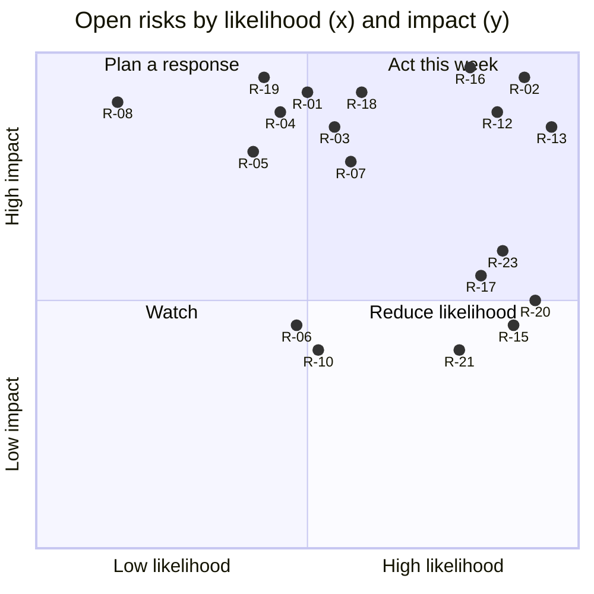

# HP-SAD-33 · RAID log

| Field       | Value                                                                                        |
| ----------- | -------------------------------------------------------------------------------------------- |
| Document ID | HP-SAD-33                                                                                    |
| Version     | 1.0                                                                                          |
| Status      | Baselined for Phase 2                                                                        |
| Date        | 2026-11-09                                                                                   |
| Owner       | Sanaullah Jannisar, product and engineering lead                                             |
| Conforms to | ISO 31000:2018 risk management principles; PMI risk register and RAID practice (informative) |

## 1. Purpose and scope

This is the one register of Risks, Assumptions, Issues and Dependencies for Hitchpost. It replaces the risk table in [03 Business case](03-business-case.md) as the live source: 03 keeps the original reasoning, this log keeps the current state. It takes in the round 3 decisions (Hitchpost is a network of agent lines between users, pilot in Texas, standing approval only, flat pricing per business agent line), the six-panel expert audit, the [competitive heuristic evaluation](30-competitive-heuristic-evaluation.md), the [research evidence base](31-research-evidence-base.md) and the open findings in the [SA&D review record](../audits/2026-11-09-sad-review.md).

IDs are permanent. A closed item stays listed with its closing date. Values cite the parameter register in [00 §10](00-document-control.md#10-normative-parameters-and-phase-map).

## 2. Scales

| Score | Likelihood (L)                   | Impact (I)                                                   |
| ----- | -------------------------------- | ------------------------------------------------------------ |
| 1     | Unlikely before v1               | Inconvenience; no person or business harmed                  |
| 2     | Possible; has happened elsewhere | A wrong booking, a lost week of schedule, or a pilot setback |
| 3     | Likely, or already showing signs | Ends the pilot, harms a person, or breaks the core promise   |

Exposure = L x I. 6 to 9 is red (owner action this week), 3 to 4 amber (planned response with a date), 1 to 2 green (watch). Trend compares to the 03 rating: up, down, flat or new.

Every item is owned by me (S. Jannisar) unless a named backup is given. That single point of ownership is itself R-13.

## 3. Risks

### 3.1 Original risks, re-rated after round 3

| ID   | Risk                                                                           | L   | I   | Exp. | Trend | Response                                                                                                                                    | Due   | Status |
| ---- | ------------------------------------------------------------------------------ | --- | --- | ---- | ----- | ------------------------------------------------------------------------------------------------------------------------------------------- | ----- | ------ |
| R-01 | People don't adopt agent booking (A-01 fails)                                  | 2   | 3   | 6    | flat  | Redesigned A-01 (disclosed Wizard-of-Oz, n = 30, 10 weeks, pre-registered bands); person-to-person use (UC-11) widens the reason to install | M-01  | Open   |
| R-02 | Booking platforms ship their own agent endpoints and keep it inside their silo | 3   | 3   | 9    | up    | Materialized: see I-01. Kept as a risk for further platforms. Open extension and free directory listing for platform endpoints              | M-02  | Issue  |
| R-03 | Booking tools block API access or forbid automation in their terms             | 2   | 3   | 6    | flat  | A-03 desk audit; Square public Bookings API as first connector (30); hosted book only as a capped fallback                                  | M-02  | Open   |
| R-04 | Prompt injection or hostile agents trick an agent into acting                  | 2   | 3   | 6    | down  | Typed messages, strict validation, approval gate, interface-origin pinning now Built; injection corpus test (TC-50)                         | M-03  | Open   |
| R-05 | Fake or impersonated business agents                                           | 2   | 3   | 6    | flat  | Origin-verified listings (Phase 3), confusables check on names, signed cards (Phase 6), reporting (UC-09)                                   | M-04  | Open   |
| R-06 | Spam and hold exhaustion                                                       | 2   | 2   | 4    | down  | Hold cap (P-07) and rate limit (P-08) keyed per install key from Phase 2, IP fallback; per identity in Phase 6                              | M-03  | Open   |
| R-07 | Liability for wrong bookings                                                   | 2   | 3   | 6    | up    | Approval and audit log on both sides; terms of service and business terms before S1 (I-05); offer shows terms and legal name                | M-07  | Open   |
| R-08 | Privacy breach of calendar or contact data                                     | 1   | 3   | 3    | up    | Customer contact block is Sensitive and shared with one business only; minimisation; retention P-11 to P-13; US-first privacy work          | M-07  | Open   |
| R-09 | Regulation once deposits or payments appear                                    | 1   | 2   | 2    | down  | No payments in v1; flat subscription billed outside the booking path                                                                        | Later | Watch  |
| R-10 | A2A changes in breaking ways                                                   | 2   | 2   | 4    | flat  | Track the spec; contract tests; SDK upgrade regression suite (34 §7)                                                                        | M-03  | Open   |
| R-11 | Solo maintainer bandwidth (moderation, support, ops)                           | 3   | 3   | 9    | up    | Merged into R-13 for continuity; scope cut (standing approval only); auto-pause (P-28)                                                      | M-07  | Open   |
| R-12 | Cold start: empty directory and no consumer agents speaking A2A                | 3   | 3   | 9    | flat  | Built-in personal agent; person-to-person agent lines give people a reason to join before many businesses list; seeded neighbourhood        | M-05  | Open   |

### 3.2 New risks from the panels and round 3

| ID   | Risk                                                                                                                  | L   | I   | Exp. | Source                       | Response                                                                                                                                         | Due  | Status            |
| ---- | --------------------------------------------------------------------------------------------------------------------- | --- | --- | ---- | ---------------------------- | ------------------------------------------------------------------------------------------------------------------------------------------------ | ---- | ----------------- |
| R-13 | Key person: I am owner, approver, operator, moderator and on call, at 15 h a week                                     | 3   | 3   | 9    | Governance, SRE, contributor | Named backup operator as a go/no-go condition (DP-04); SEV1 cover limited to opening hours with auto-pause (P-28); GOVERNANCE.md with succession | M-07 | Open              |
| R-14 | Billing integrity: the payer marked the billable outcome                                                              | 1   | 2   | 2    | Sales, finance, data, Marcus | Closed by round 3: flat price per business agent line (P-26), outcomes never billed                                                              | -    | Closed 2026-11-09 |
| R-15 | Rival agent access keeps spreading (Fresha MCP server, Google AI Mode booking), shrinking the "agents can book" story | 3   | 2   | 6    | Doc 30                       | Position on the neutral network of agent lines, person to person, two-sided approval record; sit in front of existing tools                      | M-02 | Open              |
| R-16 | Legal readiness: no terms, privacy notice, business terms or review policy before real people use it                  | 3   | 3   | 9    | Compliance panel             | Legal pack in [35](35-legal-compliance-and-governance.md); counsel review budgeted; research consent pulled into WP-0.1                          | M-07 | Open              |
| R-17 | A-01 measures trust in a known human, not in an agent, and is too small to decide                                     | 3   | 2   | 6    | UX research, data            | Redesign per round 3; confidence intervals reported; decisions labelled qualitative where the interval spans the bands                           | M-01 | Open              |
| R-18 | The business can't reach the customer (no contact data) when it must cancel                                           | 2   | 3   | 6    | Support, psychology          | Customer contact block from Phase 2; operator-relayed cancel in the pilot; business cancel notice in Phase 4                                     | M-03 | Open              |
| R-19 | Dual write between the SDK task store and the bookings table leaves inconsistent state after a crash                  | 2   | 3   | 6    | Backend panel                | Bookings table is the source of truth; Task state rebuilt at startup; restart test TC-46                                                         | M-03 | Open              |
| R-20 | Ops promises exceed one person (1 h SEV1 at any hour)                                                                 | 3   | 2   | 6    | SRE, support, governance     | P-17 and P-28 restated: SEV1 cover in opening hours only; auto-pause after 30 min unacknowledged                                                 | M-07 | Open              |
| R-21 | Willingness to pay never tested with money                                                                            | 3   | 2   | 6    | Sales, finance               | Letters of intent or a refundable $10 deposit from pilot businesses at S1                                                                        | M-07 | Open              |
| R-22 | Portfolio framing undermines trust with businesses and platforms ("will this exist next year?")                       | 2   | 2   | 4    | Community, contributor       | README leads with the product; portfolio material lower and in docs/journey                                                                      | M-04 | Open              |
| R-23 | No external human review: every review so far is AI-assisted                                                          | 3   | 2   | 6    | Governance                   | One human external reviewer at M-05 and M-07 (DP-05)                                                                                             | M-05 | Open              |
| R-24 | Approval fatigue erodes the gate once people book often                                                               | 1   | 2   | 2    | Doc 31 (indirect evidence)   | Low frequency per person (every few weeks); absolute "held until" time; measure time-to-approve and recheck rate                                 | M-05 | Watch             |

## 4. Assumptions

| ID   | Assumption                                                                                    | Test (current design)                                                                                                  | Status (2026-11-09)     | Decides at     |
| ---- | --------------------------------------------------------------------------------------------- | ---------------------------------------------------------------------------------------------------------------------- | ----------------------- | -------------- |
| A-01 | People will book through an agent and approve offers                                          | Disclosed Wizard-of-Oz, n = 30 strangers by screener, 10 weeks, pre-registered continue / iterate / kill bands, 95% CI | Not started; redesigned | M-01           |
| A-02 | Businesses will list and act on bookings that arrive this way                                 | 10 interviews about past behaviour, not hypotheticals; behaviour confirmed in S1                                       | Not started             | M-02           |
| A-03 | Booking tools allow programmatic reads and writes                                             | Desk audit; Square Bookings API is the most likely first connector (30)                                                | Partly answered by 30   | M-02           |
| A-04 | Agent booking is faster for the person than today                                             | Baseline excludes me; compared against the incumbent app (about 30 s on Booksy per 30), not only against a phone call  | Not started             | M-01           |
| A-05 | A neutral network of agent lines is defensible and someone pays for it                        | Dated competitor scan (done in 30) plus price question and letters of intent                                           | Partly answered by 30   | M-02           |
| A-06 | People trust reviews from verified interactions more than ordinary reviews                    | 5 short interviews with mockups; supported in principle by verified-purchase research (31)                             | Not started             | Before Phase 5 |
| A-07 | Nobody offers directory, verified reputation and a two-sided approval record across platforms | Doc 30 confirms no rival combines them; agent access itself is no longer unique                                        | Holds, narrowed         | M-02           |
| A-08 | The built-in personal agent is enough on the consumer side at launch                          | Measured inside A-01                                                                                                   | Not started             | M-01           |
| A-09 | People will use agent lines person to person (UC-11), not only to book businesses             | Add a person-to-person scheduling task to the A-01 study                                                               | New                     | M-01           |
| A-10 | Businesses will pay a flat monthly fee per verified agent line (P-26)                         | Letters of intent or refundable deposit at S1                                                                          | New                     | M-07           |
| A-11 | Businesses will share outcomes honestly when outcomes aren't billed                           | Unmarked rate and shop/customer disagreement rate in S1 and S2                                                         | New                     | M-08           |

## 5. Issues

Issues are things that are true now and need action.

| ID   | Issue                                                                                                           | Priority | Source                      | Action                                                                                         | Due  | Status            |
| ---- | --------------------------------------------------------------------------------------------------------------- | -------- | --------------------------- | ---------------------------------------------------------------------------------------------- | ---- | ----------------- |
| I-01 | R-02 has materialized: Fresha and Google already offer agent booking                                            | High     | Doc 30                      | Reposition (round 3 framing); update 03 and 29; partner brief per platform                     | M-02 | Open              |
| I-02 | O-1: standard A2A task methods expose tasks and tokens to any caller                                            | High     | SA&D review                 | Phase 2 protocol spike: method policy, bearer task ids, HMAC booking token                     | M-03 | Open              |
| I-03 | O-2: no design for finishing a waiting task later                                                               | Medium   | SA&D review                 | Lower now that manual approval is Later; resolver design still needed for retries and restarts | M-03 | Open              |
| I-04 | O-3 to O-11: remaining SA&D model and consistency findings                                                      | Medium   | SA&D review                 | Fixed in the round 3 document pass; re-check with `pnpm docs:check`                            | M-03 | Open              |
| I-05 | No legal pack (terms, privacy notice, business terms, review policy, research consent)                          | High     | Compliance panel            | Draft outlines in 35; counsel review before S1; consent form before WP-0.1 starts              | M-01 | Open              |
| I-06 | Repository not pushed: no branch protection, CI never run on GitHub, nothing for contributors or Priya to reach | High     | Governance, stakeholders    | First push checklist; branch protection with 2FA before any Phase 2 merge                      | M-03 | Open              |
| I-07 | Revenue model assumed 25 honored bookings per shop per month; v1 volume is about 10                             | Medium   | Sales, finance              | Rebuild 02 and 03 at realistic volume with flat pricing                                        | M-02 | Open              |
| I-08 | Analytics can't compute repeat use or time to approve: no event store                                           | Medium   | Data panel                  | Pseudonymous event store with salted personKey and SQL metric definitions                      | M-05 | Open              |
| I-09 | No go-to-market artefacts (positioning, ICP, sales playbook, crisis comms)                                      | High     | GTM panel                   | Go-to-market plan in [29](29-go-to-market-plan.md)                                             | M-02 | Open              |
| I-10 | Production readiness basics missing (health endpoint, graceful shutdown, JSON logs)                             | Medium   | SRE panel                   | Phase 2 work, with persistence                                                                 | M-03 | Open              |
| I-11 | Interface-origin pinning gap in my agent                                                                        | High     | Security and backend panels | Fixed in commit 047edef with test TC-23                                                        | -    | Closed 2026-11-09 |
| I-12 | Accessibility requirement covered only the client app                                                           | Medium   | Accessibility panel         | NFR-A11Y-01 widened to every human-facing surface                                              | M-05 | Open              |

## 6. Dependencies

| ID    | Dependency                                                           | Type     | Needed for                                                         | Risk if late                                    | Status (2026-11-09)                |
| ----- | -------------------------------------------------------------------- | -------- | ------------------------------------------------------------------ | ----------------------------------------------- | ---------------------------------- |
| DP-01 | `@a2a-js/sdk` 1.x and the A2A specification                          | External | Every phase                                                        | Breaking change re-opens protocol design (R-10) | In use, version pinned by lockfile |
| DP-02 | A booking platform's public write API (Square first)                 | External | Real bookings in the pilot (FR-BOOK-06)                            | Fallback to a capped hosted book (R-03)         | Not started                        |
| DP-03 | Legal counsel for the Texas pilot pack                               | External | S1 go/no-go                                                        | Pilot cannot start (R-16)                       | Not engaged                        |
| DP-04 | A named backup operator                                              | People   | Pilot go/no-go (M-07)                                              | Pilot cannot start (R-13)                       | Not named                          |
| DP-05 | A human external reviewer                                            | People   | M-05 and M-07 reviews                                              | Claims stay AI-reviewed only (R-23)             | Not named                          |
| DP-06 | GitHub repository, Actions and the Claude GitHub App with its secret | Platform | CI, review bot, contributors (I-06)                                | No enforced gates                               | Repo not created                   |
| DP-07 | SMS or phone verification provider                                   | External | Verified phone in the customer contact block; listing verification | Contact block unverified                        | Not chosen                         |
| DP-08 | Study participants (30 strangers) and a recruiting channel           | People   | A-01, A-09                                                         | M-01 slips                                      | Not started                        |
| DP-09 | Hosting provider for Phase 6 (ADR 0014)                              | External | Staging, pilot                                                     | Pilot slips                                     | Proposed                           |

## 7. Heat map

Open risks by likelihood and impact. Points are spread inside their cell so labels don't overlap; the cell is what matters.

R-09 and R-24 sit in the green cell and are omitted; R-11 is merged into R-13; R-14 is closed.

## 8. Review procedure

- **When:** every Monday, 20 minutes, plus at every milestone gate (M-01 to M-08).
- **Inputs:** this log, `pnpm docs:check` output, open GitHub issues, support tickets ([36](36-customer-support-and-success-playbook.md)), study data.
- **Steps:**
  1. Re-score every open risk; record the trend.
  2. Move any risk that has happened to Issues with a new I- ID; keep the risk if it can recur.
  3. Check each assumption whose decision milestone is within 4 weeks; confirm the test is on track.
  4. Check each dependency's status; escalate any that blocks a gate within 4 weeks.
  5. Close items with a date and a one-line reason; never delete.
  6. Add a revision-history row when anything changes rating, owner or status.
- **Escalation:** any red item without a response dated within 2 weeks goes into the weekly status update and blocks the next gate until it has one.

## Revision history

| Version | Date       | Change                                                                                             | Author      |
| ------- | ---------- | -------------------------------------------------------------------------------------------------- | ----------- |
| 1.0     | 2026-11-09 | First baseline: consolidates 03 risks, assumptions, the SA&D open findings and the six-panel audit | S. Jannisar |
