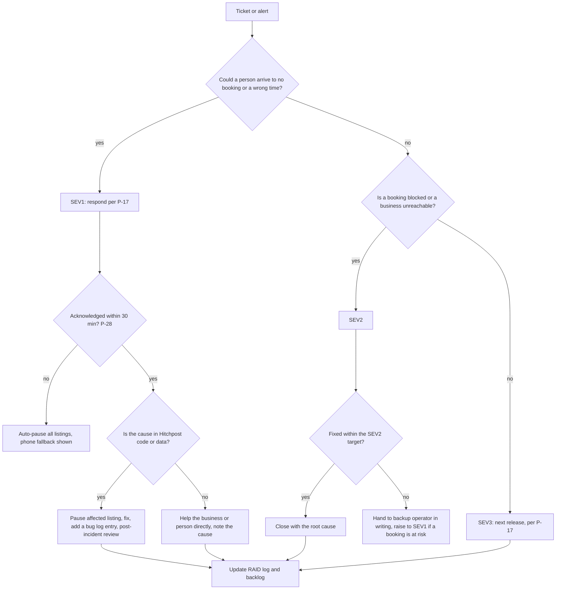

# HP-SAD-36 · Customer support and success playbook

| Field       | Value                                                                                             |
| ----------- | ------------------------------------------------------------------------------------------------- |
| Document ID | HP-SAD-36                                                                                         |
| Version     | 1.1                                                                                               |
| Status      | Frozen for Phase 2 spike                                                                          |
| Date        | 2026-11-09                                                                                        |
| Owner       | Sanaullah Jannisar, product and engineering lead                                                  |
| Conforms to | ITIL 4 practices: service desk, incident management, problem management, service level management |

## 1. Purpose and scope

How people and businesses get help when using Hitchpost, from the A-01 study through the pilot to v1: who answers, through which channel, how fast, with what words, and when it escalates. It also covers keeping pilot businesses successful and spotting the ones about to leave.

It applies the round 3 decisions: a network of agent lines between users (people and businesses), a Texas pilot, standing approval only, a customer contact block on every booking, outcomes that are never billed, and an operator-relayed cancel tool for the pilot. Response targets come from P-17 and P-28 in [00 §10](00-document-control.md#10-normative-parameters-and-phase-map); the one severity table lives in [19](19-maintenance-and-evolution.md) and this playbook cites it rather than restating it.

## 2. Support model and coverage

| Period                    | Who answers                                              | Coverage                                                                                                    |
| ------------------------- | -------------------------------------------------------- | ----------------------------------------------------------------------------------------------------------- |
| A-01 study (Wizard-of-Oz) | Me, as study facilitator                                 | The study hours published in the consent form                                                               |
| Pilot S1 and S2           | Me, with the named backup operator (DP-04)               | SEV1 response per P-17 during listed businesses' opening hours; outside them the auto-pause in P-28 applies |
| v1                        | Me plus the backup; contributors for developer questions | Same as the pilot, reviewed at M-08                                                                         |

Rules that hold in every period:

- **The business phone is always the fallback.** Every booking confirmation and reminder shows it, so a person can always reach the business without us.
- **Booking-path failures come first.** Anything that could leave a person at a locked door or a business with a surprise customer is handled before anything else.
- **One owner per ticket.** Whoever picks it up owns it until it's closed or handed over in writing.
- **No raw remote text.** Replies never paste content another agent sent; they describe it.

## 3. Channels

| Audience               | Before the app (A-01, S1)                                                           | With the app (Phase 4 on)                                      |
| ---------------------- | ----------------------------------------------------------------------------------- | -------------------------------------------------------------- |
| People                 | WhatsApp or SMS to the study or pilot support number; email                         | "This booking went wrong" on every booking; in-app help; email |
| Businesses             | A phone line answered in opening hours; WhatsApp; a printed card left at onboarding | Dashboard help button; phone line                              |
| Developers (Priya)     | GitHub issues and discussions once the repo is public                               | Same                                                           |
| Security reports       | GitHub private vulnerability reporting ([SECURITY.md](../../SECURITY.md))           | Same                                                           |
| Accessibility problems | Any channel above; tagged `a11y` and treated as at least SEV3                       | Plus an accessibility feedback link on every screen            |

SMS and WhatsApp messages from us go only to people who opted in, with the consent recorded (TCPA).

## 4. Failure taxonomy

Each journey failure has an owner, a target, a reply template and an escalation path. Severity labels are the ones defined in [19](19-maintenance-and-evolution.md).

| Code  | Failure                                                        | Severity                                  | Owner        | First response | Fix or workaround target                                               | Escalation                                                                  |
| ----- | -------------------------------------------------------------- | ----------------------------------------- | ------------ | -------------- | ---------------------------------------------------------------------- | --------------------------------------------------------------------------- |
| SF-01 | Person showed up and the business had no record                | SEV1 if Hitchpost confirmed it; else SEV2 | Me           | Per P-17       | Same day: apology, rebook, root cause in the bug log                   | Check both audit logs; pause that listing if the cause is ours              |
| SF-02 | Booked for the wrong time                                      | SEV1                                      | Me           | Per P-17       | Same day: correct or cancel; contact both sides                        | Time handling incident; check ADR 0018 rules                                |
| SF-03 | Business had to cancel                                         | SEV2                                      | Backup or me | Per P-17       | Person told before the appointment time                                | Operator-relayed cancel tool (pilot); business cancel notice (Phase 4)      |
| SF-04 | Booking confirmed but missing from the person's calendar       | SEV3                                      | Me           | Per P-17       | Next working day                                                       | If repeated, file against FR-APP-06                                         |
| SF-05 | Outcome dispute (business says no-show, person says they came) | SEV3                                      | Me           | Per P-17       | Decision within 5 working days, both sides told the reason             | Booking goes to Disputed; review both audit logs                            |
| SF-06 | Review dispute (Phase 5)                                       | SEV3                                      | Me           | Per P-17       | Decision within 5 working days with a statement of reasons; one appeal | Review and moderation policy in [35](35-legal-compliance-and-governance.md) |
| SF-07 | Impersonation: a listing or agent pretends to be someone else  | SEV1                                      | Me           | Per P-17       | Listing paused immediately; owner verified again                       | Moderation; security report if it involved a code path                      |
| SF-08 | Accessibility barrier                                          | SEV2 if it blocks booking; else SEV3      | Me           | Per P-17       | Workaround at once (book by phone for them); fix in the next release   | Add to the accessibility conformance report                                 |
| SF-09 | Person can't tell whether they're booked                       | SEV2                                      | Me           | Per P-17       | Answer from the audit log within the response time                     | UX bug against the confirmation screens                                     |
| SF-10 | Business setup or connection broken                            | SEV2 in opening hours                     | Me           | Per P-17       | Listing paused until fixed; business told                              | Connector issue against FR-BOOK-06                                          |

### 4.1 Reply templates

Short, plain, no blame, and never pasting what another agent said.

- **SF-01:** "I'm sorry, that's on us to sort out. I can see your booking at {time} with {business}. I'm calling them now to fit you in or rebook. I'll message you within {minutes} minutes."
- **SF-02:** "Your booking was saved at the wrong time, and I'm sorry. The correct time you asked for was {time}. I've {fixed it / cancelled it and asked {business} for the nearest slot}. Nothing else changes."
- **SF-03:** "{Business} has had to cancel your {service} at {time} today. Nothing is charged. Would you like me to find the next free slot with them, or somewhere else nearby?"
- **SF-04:** "Your booking is confirmed for {time} at {business}. It didn't reach your calendar, so here it is again with an 'add to calendar' link. I'm looking into why."
- **SF-05 (to both sides):** "There's a difference between your two records for the {time} booking. I'm reviewing both logs and will tell you both the outcome and the reason by {date}."
- **SF-07:** "Thanks for reporting this. I've paused the listing while I check who runs it. You won't receive anything from it in the meantime."
- **SF-08:** "Thank you for telling me. I can book this for you by phone right now while I fix the problem. Which time works for you?"

## 5. Escalation tree

## 6. Business onboarding success plan

Goal: a business is "live and healthy" within 14 days of signing up.

| Day | Step                                                                                | Done when                                                              |
| --- | ----------------------------------------------------------------------------------- | ---------------------------------------------------------------------- |
| 0   | In-person visit: services, hours, booking tool, verification, business terms signed | Listing verified; book configuration loads without errors (FR-BOOK-12) |
| 0   | Test booking from my agent line, seen in their own tool, then cancelled             | The business saw the booking and the cancel with the customer's name   |
| 1   | Leave the printed help card and QR code                                             | Card on the counter                                                    |
| 3   | Check-in call: any bookings, anything confusing                                     | One real booking, or a note on why not                                 |
| 7   | Review the first week's outcomes together                                           | Outcomes marked; unmarked rate under 20%                               |
| 14  | Health review (section 7)                                                           | Green, or a recovery plan agreed                                       |

## 7. Health score and churn signals

A business's health is reviewed weekly from the event store and the audit logs.

| Signal                                         | Healthy   | Watch           | At risk                               |
| ---------------------------------------------- | --------- | --------------- | ------------------------------------- |
| Bookings through Hitchpost in the last 2 weeks | 2 or more | 1               | 0                                     |
| Unmarked outcome rate (P-25)                   | Under 20% | 20% to 50%      | Over 50%                              |
| Requests to approve each booking manually      | None      | Asked once      | Asked repeatedly (Later feature)      |
| Pause requests                                 | None      | One short pause | Paused over a week, or more than once |
| Support tickets caused by Hitchpost            | None      | One SEV3        | Any SEV1 or two or more SEV2          |
| Shop and customer outcome disagreements        | None      | One             | Two or more in a month                |

For people, the one strong churn signal is **one-and-done**: a person who booked once and has not asked any agent line for anything in 60 days. Watch also for people who decline or let three offers in a row expire.

At-risk businesses get a call within a week; at-risk people get one short message asking what got in the way, and nothing more.

### 7.1 Dashboard specification

| Panel                             | Measure                                                            | Source                     | Refresh |
| --------------------------------- | ------------------------------------------------------------------ | -------------------------- | ------- |
| Business health                   | One row per business, signals above, overall colour                | Event store, audit logs    | Daily   |
| Open tickets by severity and age  | Count and oldest age per severity                                  | Ticket tracker             | Live    |
| Response and resolution vs target | Share of tickets inside the P-17 targets, by severity              | Ticket tracker             | Weekly  |
| Failure taxonomy                  | Tickets per SF code per week                                       | Ticket tracker             | Weekly  |
| One-and-done people               | Count and share of people with one booking and nothing for 60 days | Event store (pseudonymous) | Weekly  |
| Disputes                          | Open disputes and their age                                        | Booking store              | Daily   |

## 8. Predicted top 15 questions

| #   | Question                                     | Answer                                                                                                                      |
| --- | -------------------------------------------- | --------------------------------------------------------------------------------------------------------------------------- |
| 1   | Is my booking confirmed?                     | If you see "Booked" with a time and the business's address, yes. If you see anything else, nothing is booked yet.           |
| 2   | Why do I have to approve every booking?      | Your agent never commits your time or money without your yes. That's the point of Hitchpost.                                |
| 3   | How do I cancel?                             | Open the booking and tap Cancel, or tell your agent. If the business has a cancellation window, it's shown before you book. |
| 4   | The time looks wrong.                        | Times show in the business's local time first. If it still looks wrong, contact us straight away (SF-02).                   |
| 5   | What does the business see about me?         | Your display name, your phone number and any note you add, and only for that booking.                                       |
| 6   | Is this AI?                                  | Agents follow fixed rules today; no language model makes booking decisions. We'll say clearly if that changes.              |
| 7   | What does it cost me?                        | Nothing. People are free.                                                                                                   |
| 8   | What does it cost my business?               | Nothing. Hitchpost is an open protocol with a free reference implementation; nobody pays, now or for the pilot.             |
| 9   | Do I have to change my booking app?          | No. Hitchpost sits in front of the tool you already use.                                                                    |
| 10  | What if Hitchpost goes down?                 | Your existing bookings stay in your own tool, and people see your phone number as the fallback.                             |
| 11  | Why was my offer gone when I tapped Approve? | Offers are held for a short time so others can book too. Ask again and your agent will find the next free time.             |
| 12  | Can I book for my child?                     | Accounts are for adults. A parent or guardian books from their own agent line.                                              |
| 13  | How do I stop getting messages?              | Reply STOP to any SMS, or turn notifications off in settings.                                                               |
| 14  | How do I delete my data?                     | Ask in the app or by email; we erase it within the period in P-13.                                                          |
| 15  | How do I connect my own agent?               | Read the `hitchpost/1` specification and run the conformance kit against your agent's URL.                                  |

## 9. Feedback loop into the backlog

- Every closed ticket gets an SF code and, if the cause is ours, a link to a bug log entry or a GitHub issue.
- Every Monday, during the RAID review in [33](33-raid-log.md), I read the week's tickets by SF code. Any code with two or more tickets in a week becomes a backlog item with a "support" label.
- A repeated question (three times in a month) gets an FAQ entry or a microcopy change in [14](14-user-interface-design.md).

## 10. Support metrics

| Metric                                    | Target                     |
| ----------------------------------------- | -------------------------- |
| First response inside P-17, by severity   | 95% of tickets             |
| SEV1 incidents per month during the pilot | 0 caused by Hitchpost code |
| Disputes decided within 5 working days    | 100%                       |
| Tickets per 100 bookings                  | Under 5 by the end of S2   |
| Repeat contact on the same ticket         | Under 10%                  |

## 11. Backup operator handover

The backup operator (DP-04) covers when I'm unavailable. Before the pilot starts:

1. **Access:** support phone line, ticket tracker, the operator console with the one-command listing pause and the cancel tool, read access to audit logs. No production write access beyond those tools.
2. **Training:** one paired shift running sections 4 and 5, plus a dry run of SF-01, SF-03 and SF-07.
3. **Handover note** at the start of each cover period: open tickets, at-risk businesses, anything unusual.
4. **Hand-back note** at the end: what happened, what's still open.
5. **Authority:** the backup may pause any listing and relay any cancellation without asking me; anything else waits for me unless a person's appointment is at risk.

## Revision history

| Version | Date       | Change                                                                                                        | Author      |
| ------- | ---------- | ------------------------------------------------------------------------------------------------------------- | ----------- |
| 1.0     | 2026-11-09 | First baseline: support model, failure taxonomy with templates, escalation, onboarding, health, FAQ           | S. Jannisar |
| 1.1     | 2026-11-09 | Round 5: protocol first (no pricing), minimal MCP gateway in v1, final QA fixes, frozen for the Phase 2 spike | S. Jannisar |
